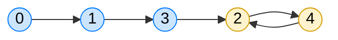

## LeetCode 217: Contains Duplicate
**Difficulty:** Easy | **Pattern:** HashSet for O(1) lookup | **Language:** Java

### 1. Problem
- Return `true` if any value appears at least twice in `nums`, else `false`. Example: `[1,2,3,1]` -> `true`.
- Constraints: `n <= 10^5`, values fit in `int`. O(n^2) pair checking is too slow; target O(n) time.
- **Key insight:** "Have I seen this before?" is a membership question. A hash set answers it in O(1), and `Set.add` returns `false` when the element was already present, so the check and the insert are one call.

### 2. Solution
- **Step 1 (brute force):** compare every pair, O(n^2) time, O(1) space. Wasteful because it re-scans values we already looked at.
- **Step 2 (sort):** sort, then compare neighbours. O(n log n), O(1) extra space if sorting in place. Better, but it mutates the input and is slower than needed.
- **Step 3 (hash set):** remember what we have seen. One pass, O(n) time, O(n) space. Stop at the first duplicate.

```java
import java.util.HashSet;
import java.util.Set;

class Solution {
    public boolean containsDuplicate(int[] nums) {
        Set<Integer> seen = new HashSet<>(nums.length * 2); // presize: avoids rehashing
        for (int x : nums) {
            if (!seen.add(x)) return true; // add() == false means x was already present
        }
        return false;
    }
}
```
Implementation note: presizing the set avoids repeated resizes; boxing to `Integer` is unavoidable with `HashSet`.

### 3. Dry Run
Input `[1,2,3,1]`.

| Step | x | seen before | `seen.add(x)` | Action |
|---|---|---|---|---|
| 0 | 1 | {} | true | continue |
| 1 | 2 | {1} | true | continue |
| 2 | 3 | {1,2} | true | continue |
| 3 | 1 | {1,2,3} | false | return true |

Final answer: `true`.

**Complexity:** Time O(n), one pass with O(1) average set operations. Space O(n), the set may hold every element.

### 4. Takeaway
- **Pattern:** any "have I seen X" / "is there a repeat" question -> hash set; if you need counts or indices, upgrade to a hash map. Sorting is the O(1)-space alternative.

| Input | Result | Note |
|---|---|---|
| `[1]` | false | single element cannot repeat |
| `[1,1]` | true | smallest duplicate case |
| `[1,2,3,4]` | false | full pass, no early exit |
| `[-1,-1]` | true | negatives are fine for a set |

- **Mistakes to avoid:**
  - Calling `contains` then `add` separately (two lookups instead of one).
  - Using `==` on `Integer` objects anywhere in the logic; the set handles equality for you.
  - Forgetting the sort variant when the interviewer asks for O(1) space.
- **Related problems:** 219 Contains Duplicate II (duplicate within distance k: map value -> last index), 220 Contains Duplicate III (needs bucketing or TreeSet), 1 Two Sum (needs the index, so a map).

---

## LeetCode 283: Move Zeroes
**Difficulty:** Easy | **Pattern:** Read/write two pointers (in-place partition) | **Language:** Java

### 1. Problem
- Move all `0`s to the end in place, keeping the relative order of non-zero values. Example: `[0,1,0,3,12]` -> `[1,3,12,0,0]`.
- Constraints: `n <= 10^4`; must be in place, so O(1) extra space, ideally O(n) time and minimal writes.
- **Key insight:** treat it as a stable partition. A read pointer scans everything; a write pointer marks where the next non-zero belongs. Everything left of `write` is already the finished non-zero prefix.

### 2. Solution
- **Step 1 (brute force):** copy non-zeros into a new array, pad with zeros, copy back. O(n) time but O(n) space, which violates "in place".
- **Step 2 (bubble zeros right):** repeatedly swap a zero with the next non-zero. O(n^2) in the worst case because each zero may travel far.
- **Step 3 (two pointers):** one pass. When `nums[read] != 0`, swap it with `nums[write]` and advance `write`. The swap pushes the zero that sat at `write` to the right automatically, so no second pass to fill zeros is needed.

```java
class Solution {
    public void moveZeroes(int[] nums) {
        int write = 0;
        for (int read = 0; read < nums.length; read++) {
            if (nums[read] != 0) {
                if (read != write) { // skip no-op swap when there is no zero before us yet
                    int tmp = nums[write];
                    nums[write] = nums[read];
                    nums[read] = tmp;
                }
                write++;
            }
        }
    }
}
```
Implementation note: invariant is `nums[0..write)` holds the non-zeros seen so far in order, and `nums[write..read)` is all zeros.

### 3. Dry Run
Input `[0,1,0,3,12]`.

| read | nums[read] | write (before) | Action | Array after | write (after) |
|---|---|---|---|---|---|
| 0 | 0 | 0 | zero, skip | [0,1,0,3,12] | 0 |
| 1 | 1 | 0 | swap idx 0,1 | [1,0,0,3,12] | 1 |
| 2 | 0 | 1 | zero, skip | [1,0,0,3,12] | 1 |
| 3 | 3 | 1 | swap idx 1,3 | [1,3,0,0,12] | 2 |
| 4 | 12 | 2 | swap idx 2,4 | [1,3,12,0,0] | 3 |

Final answer: `[1,3,12,0,0]`.

**Complexity:** Time O(n), single pass. Space O(1), only two indices.

### 4. Takeaway
- **Pattern:** "keep elements satisfying a predicate, stably, in place" -> read/write pointers. Same skeleton drives Remove Element, Remove Duplicates, and partition steps in QuickSort.

| Input | Result | Note |
|---|---|---|
| `[0]` | `[0]` | nothing to move |
| `[1,2,3]` | unchanged | `read == write` always, swap guard avoids writes |
| `[0,0,1]` | `[1,0,0]` | zeros before the only non-zero |
| `[0,0,0]` | unchanged | write never advances |

- **Mistakes to avoid:**
  - Swapping when `read == write` is harmless but wastes writes; the guard fixes that.
  - Filling zeros in a second loop but forgetting to zero the tail correctly.
  - Breaking stability by swapping from both ends.
- **Related problems:** 27 Remove Element (same write pointer, return count), 26 Remove Duplicates from Sorted Array (compare with last written), 75 Sort Colors (three-way partition).

---

## LeetCode 448: Find All Numbers Disappeared in an Array
**Difficulty:** Easy | **Pattern:** Index-as-hash (negation marking), O(1) space | **Language:** Java

### 1. Problem
- Given `nums` of length `n` with every value in `[1, n]`, return all numbers in `[1, n]` that do not appear. Example: `[4,3,2,7,8,2,3,1]` -> `[5,6]`.
- Constraints: `n <= 10^5`. O(n) time; the follow-up demands O(1) extra space (the output list does not count).
- **Key insight:** values are bounded by `[1, n]`, so each value `v` can address slot `v-1`. Flip the sign at that slot to say "v was seen". Slots still positive at the end are the missing numbers' indices.

### 2. Solution
- **Step 1 (brute force):** for each `v` in `1..n`, scan the array. O(n^2).
- **Step 2 (boolean array/set):** mark seen values, then list unmarked. O(n) time, O(n) space. The array already has `n` slots, so reuse it as the marker store.
- **Step 3 (negation marking):** for each element, take `idx = |nums[i]| - 1` (absolute value because it may already be negated) and make `nums[idx]` negative if it is positive. Never negate twice (that would erase the mark). Finally collect `i + 1` for each positive `nums[i]`.

```java
import java.util.ArrayList;
import java.util.List;

class Solution {
    public List<Integer> findDisappearedNumbers(int[] nums) {
        for (int i = 0; i < nums.length; i++) {
            int idx = Math.abs(nums[i]) - 1;   // abs: nums[i] may already be marked
            if (nums[idx] > 0) nums[idx] = -nums[idx]; // guard keeps the mark idempotent
        }
        List<Integer> missing = new ArrayList<>();
        for (int i = 0; i < nums.length; i++) {
            if (nums[i] > 0) missing.add(i + 1);
        }
        return missing;
    }
}
```
Implementation note: this modifies the input. If that is disallowed, say so and fall back to a `boolean[]`.

### 3. Dry Run
Input `[4,3,2,7,8,2,3,1]` (n = 8).

| i | nums[i] | idx | Action | Array after |
|---|---|---|---|---|
| 0 | 4 | 3 | 7 -> -7 | [4,3,2,-7,8,2,3,1] |
| 1 | 3 | 2 | 2 -> -2 | [4,3,-2,-7,8,2,3,1] |
| 2 | -2 (abs 2) | 1 | 3 -> -3 | [4,-3,-2,-7,8,2,3,1] |
| 3 | -7 (abs 7) | 6 | 3 -> -3 | [4,-3,-2,-7,8,2,-3,1] |
| 4 | 8 | 7 | 1 -> -1 | [4,-3,-2,-7,8,2,-3,-1] |
| 5 | 2 | 1 | already negative, skip | unchanged |
| 6 | -3 (abs 3) | 2 | already negative, skip | unchanged |
| 7 | -1 (abs 1) | 0 | 4 -> -4 | [-4,-3,-2,-7,8,2,-3,-1] |

Scan for positives: index 4 (value 8) and index 5 (value 2) -> missing `5` and `6`.

Final answer: `[5,6]`.

**Complexity:** Time O(n), two passes. Space O(1) extra (output excluded), marks live inside the input.

### 4. Takeaway
- **Pattern:** values bounded by the array length -> the array is its own hash map (negation or cyclic placement). Reappears in #287 and #41.

| Input | Result | Note |
|---|---|---|
| `[1,1]` | `[2]` | duplicate hides the 2 |
| `[1]` | `[]` | nothing missing |
| `[2,2]` | `[1]` | 1 never addressed |
| `[1,2,3]` | `[]` | permutation, all negative |

- **Mistakes to avoid:**
  - Forgetting `Math.abs` when reading a value that may already be negated.
  - Negating unconditionally, which flips a mark back to positive on a duplicate.
  - Using `value` instead of `value - 1` as the index.
- **Related problems:** 442 Find All Duplicates in an Array (same marking, collect when already negative), 287 Find the Duplicate Number (cannot modify the array), 41 First Missing Positive (values unbounded, needs placement).

---

## LeetCode 121: Best Time to Buy and Sell Stock
**Difficulty:** Easy | **Pattern:** Running minimum + greedy single pass | **Language:** Java

### 1. Problem
- `prices[i]` is the price on day `i`. Choose one day to buy and a later day to sell for maximum profit; return 0 if no profit is possible. Example: `[7,1,5,3,6,4]` -> `5` (buy at 1, sell at 6).
- Constraints: `n <= 10^5`. O(n^2) pairs is too slow; O(n) needed.
- **Key insight:** if you sell on day `i`, the best buy is the cheapest price seen before `i`. Keep that running minimum and evaluate the profit for every day as you go.

### 2. Solution
- **Step 1 (brute force):** try every buy/sell pair, O(n^2). Wasteful because for each sell day only the lowest earlier price matters.
- **Step 2 (precompute):** build a prefix-min array, then scan. O(n) time, O(n) space. The prefix min is just one number carried forward.
- **Step 3 (single pass):** maintain `minPrice` and `best`. For each price: if it is below `minPrice`, it becomes the new best buy; otherwise compute `price - minPrice` and update `best`.

```java
class Solution {
    public int maxProfit(int[] prices) {
        int minPrice = Integer.MAX_VALUE;
        int best = 0;
        for (int p : prices) {
            if (p < minPrice) minPrice = p;          // better day to buy
            else best = Math.max(best, p - minPrice); // else try selling today
        }
        return best;
    }
}
```
Implementation note: `best` starts at 0 so "no profitable trade" returns 0. `p - minPrice` never overflows since prices are small and non-negative.

### 3. Dry Run
Input `[7,1,5,3,6,4]`.

| Day | price | minPrice | Action | best |
|---|---|---|---|---|
| 0 | 7 | 7 | new min | 0 |
| 1 | 1 | 1 | new min | 0 |
| 2 | 5 | 1 | profit 4 | 4 |
| 3 | 3 | 1 | profit 2 | 4 |
| 4 | 6 | 1 | profit 5 | 5 |
| 5 | 4 | 1 | profit 3 | 5 |

Final answer: `5`.

**Complexity:** Time O(n), one pass. Space O(1), two variables.

### 4. Takeaway
- **Pattern:** "best pair with order constraint" -> carry the best-so-far of one side while evaluating the other. This is the entry point to the stock series (state-machine DP in 122, 123, 188, 309, 714).

| Input | Result | Note |
|---|---|---|
| `[7,6,4,3,1]` | 0 | strictly decreasing, no profit |
| `[5]` | 0 | single day |
| `[1,2]` | 1 | smallest profitable case |
| `[2,4,1]` | 2 | the later low cannot be used to sell earlier |

- **Mistakes to avoid:**
  - Taking global max minus global min (ignores that buy must precede sell).
  - Initialising `best` to a negative number or `minPrice` to 0.
  - Updating `best` before `minPrice` in a way that sells on the same day you bought (harmless here: profit 0).
- **Related problems:** 122 Best Time II (unlimited trades: sum positive differences), 123/188 (at most k trades, DP), 309 (cooldown), 714 (fee).

---

## LeetCode 53: Maximum Subarray
**Difficulty:** Medium | **Pattern:** Kadane's algorithm | **Language:** Java

### 1. Problem
- Find the contiguous non-empty subarray with the largest sum and return that sum. Example: `[-2,1,-3,4,-1,2,1,-5,4]` -> `6` (subarray `[4,-1,2,1]`).
- Constraints: `n <= 10^5`, values in `[-10^4, 10^4]`, so sums fit in `int`. Need O(n).
- **Key insight:** at each index the best subarray ending here either extends the best one ending at `i-1` or starts fresh at `i`. A negative running sum can only hurt, so drop it: `cur = max(nums[i], cur + nums[i])`.

### 2. Solution
- **Step 1 (brute force):** try all `(i, j)` ranges, O(n^2) with a running sum (O(n^3) naive). Wasteful because ranges share most of their elements.
- **Step 2 (DP):** let `dp[i]` be the best sum of a subarray ending at `i`. `dp[i] = max(nums[i], dp[i-1] + nums[i])`; answer is `max dp[i]`.
- **Step 3 (Kadane, O(1) space):** `dp[i]` depends only on `dp[i-1]`, so keep a single variable `cur`.

```java
class Solution {
    public int maxSubArray(int[] nums) {
        int cur = nums[0];   // best sum of a subarray ending at the current index
        int best = nums[0];  // non-empty requirement: start from nums[0], not 0
        for (int i = 1; i < nums.length; i++) {
            cur = Math.max(nums[i], cur + nums[i]); // extend or restart
            best = Math.max(best, cur);
        }
        return best;
    }
}
```
Implementation note: seeding with `nums[0]` (not 0) is what makes all-negative arrays correct. To return the subarray itself, record a `start` whenever you restart and the `[start, i]` when `best` improves.

### 3. Dry Run
Input `[-2,1,-3,4,-1,2,1,-5,4]`. The row `cur` is the filled DP table (`dp[i]`).

| i | nums[i] | cur + nums[i] | cur = max(nums[i], cur+nums[i]) | best |
|---|---|---|---|---|
| 0 | -2 | - | -2 | -2 |
| 1 | 1 | -1 | 1 (restart) | 1 |
| 2 | -3 | -2 | -2 (extend) | 1 |
| 3 | 4 | 2 | 4 (restart) | 4 |
| 4 | -1 | 3 | 3 | 4 |
| 5 | 2 | 5 | 5 | 5 |
| 6 | 1 | 6 | 6 | 6 |
| 7 | -5 | 1 | 1 | 6 |
| 8 | 4 | 5 | 5 | 6 |

Final answer: `6`.

**Complexity:** Time O(n), single pass. Space O(1), two variables.

### 4. Takeaway
- **Pattern:** "best contiguous segment" with additive score -> extend-or-restart DP (Kadane). Alternatives: divide and conquer O(n log n), or prefix sums (`prefix[i] - min prefix before i`).

| Input | Result | Note |
|---|---|---|
| `[-3]` | -3 | single element |
| `[-3,-1,-2]` | -1 | all negative, pick the largest element |
| `[5,4,-1,7,8]` | 23 | whole array |
| `[0,0]` | 0 | zeros fine |

- **Mistakes to avoid:**
  - Initialising `best = 0`, which wrongly returns 0 for all-negative input.
  - Resetting `cur = 0` when negative and then taking `max(cur, ...)` before adding the element (breaks all-negative case).
  - Not seeing the circular variant needs `total - minSubarray` with an all-negative guard.
- **Related problems:** 918 Maximum Sum Circular Subarray (also min-Kadane), 152 Maximum Product Subarray (track min too), 1749 Maximum Absolute Sum of Any Subarray, 121 (Kadane on differences).

---

## LeetCode 238: Product of Array Except Self
**Difficulty:** Medium | **Pattern:** Prefix product + suffix product, no division | **Language:** Java

### 1. Problem
- Return `answer` where `answer[i]` is the product of all elements except `nums[i]`, without using division. Example: `[1,2,3,4]` -> `[24,12,8,6]`.
- Constraints: `n` up to `10^5`, products fit in 32-bit int, zeros possible. Must be O(n); follow-up asks for O(1) extra space (output excluded).
- **Key insight:** `answer[i] = (product of everything left of i) * (product of everything right of i)`. Each side is a running product built in one pass.

### 2. Solution
- **Step 1 (brute force):** for each `i`, multiply all others, O(n^2).
- **Step 2 (total / nums[i]):** O(n) but forbidden, and breaks with zeros.
- **Step 3 (prefix and suffix arrays):** `left[i]` = product of `nums[0..i-1]`, `right[i]` = product of `nums[i+1..]`; multiply. O(n) time, O(n) extra space.
- **Step 4 (optimal):** store the left products directly in the output array, then sweep from the right with a single running `suffix` variable, multiplying it into the output in place.

```java
class Solution {
    public int[] productExceptSelf(int[] nums) {
        int n = nums.length;
        int[] res = new int[n];
        res[0] = 1;
        for (int i = 1; i < n; i++) {
            res[i] = res[i - 1] * nums[i - 1]; // product of everything left of i
        }
        int suffix = 1; // product of everything right of i
        for (int i = n - 1; i >= 0; i--) {
            res[i] *= suffix;
            suffix *= nums[i];
        }
        return res;
    }
}
```
Implementation note: the output array is reused as the prefix store, which is why extra space is O(1). Zeros need no special case because no division occurs.

### 3. Dry Run
Input `[1,2,3,4]`.

Forward pass (prefix products into `res`):

| i | formula | res after |
|---|---|---|
| 0 | res[0] = 1 | [1,_,_,_] |
| 1 | 1 * nums[0] = 1 | [1,1,_,_] |
| 2 | 1 * nums[1] = 2 | [1,1,2,_] |
| 3 | 2 * nums[2] = 6 | [1,1,2,6] |

Backward pass (suffix):

| i | suffix before | res[i] *= suffix | suffix after (suffix * nums[i]) |
|---|---|---|---|
| 3 | 1 | 6 * 1 = 6 | 4 |
| 2 | 4 | 2 * 4 = 8 | 12 |
| 1 | 12 | 1 * 12 = 12 | 24 |
| 0 | 24 | 1 * 24 = 24 | 24 |

Final answer: `[24,12,8,6]`.

**Complexity:** Time O(n), two passes. Space O(1) extra (output array excluded).

### 4. Takeaway
- **Pattern:** "combine everything except me" -> left aggregate x right aggregate. Same shape in Trapping Rain Water (max left/right) and Largest Rectangle (nearest smaller left/right).

| Input | Result | Note |
|---|---|---|
| `[0,1,2]` | `[2,0,0]` | one zero: only its slot is non-zero |
| `[0,0,3]` | `[0,0,0]` | two zeros: everything zero |
| `[-1,1]` | `[1,-1]` | negatives ok |
| `[5,2]` | `[2,5]` | n = 2 |

- **Mistakes to avoid:**
  - Using division (banned and fails on zeros).
  - Updating `suffix` before multiplying into `res[i]`, which would include `nums[i]` itself.
  - Allocating two extra arrays when one pass variable suffices.
- **Related problems:** 42 Trapping Rain Water (prefix/suffix max), 84 Largest Rectangle in Histogram, 2602 style prefix/suffix cost problems.

---

## LeetCode 287: Find the Duplicate Number
**Difficulty:** Medium | **Pattern:** Floyd's cycle detection (array as implicit graph) | **Language:** Java

### 1. Problem
- `nums` has `n + 1` integers, each in `[1, n]`, with exactly one value repeated (possibly many times). Return it without modifying the array and with O(1) extra space. Example: `[1,3,4,2,2]` -> `2`.
- Constraints: `n <= 10^5`. O(n log n) or better; no sorting (mutates), no set (O(n) space).
- **Key insight:** treat `i -> nums[i]` as a linked list. Values lie in `[1, n]` and indices in `[0, n]`, so every step is valid and index 0 is never pointed to (it is the entry). Two indices pointing to the same value means two nodes share a successor, so the structure has a cycle, and the cycle's entry node is the duplicate.

### 2. Solution
- **Step 1 (brute force):** compare all pairs, O(n^2).
- **Step 2 (sort or set):** O(n log n) with mutation, or O(n) with O(n) space. Both violate the constraints.
- **Step 3 (binary search on value range):** count elements `<= mid`; O(n log n) time, O(1) space. Valid, but slower.
- **Step 4 (Floyd):** Phase 1: move `slow` by 1 and `fast` by 2 until they meet inside the cycle. Phase 2: restart one pointer from index 0; moving both by 1 they meet at the cycle entry. Reason: if the tail has length `a` and they meet `b` steps into the cycle of length `c`, then `2(a+b) = a+b+mc`, so `a = mc - b`; walking `a` steps from the meeting point lands on the entry.

```java
class Solution {
    public int findDuplicate(int[] nums) {
        int slow = 0, fast = 0;
        do {
            slow = nums[slow];
            fast = nums[nums[fast]];
        } while (slow != fast);          // phase 1: meet inside the cycle

        slow = 0;                        // phase 2: find the cycle entry
        while (slow != fast) {
            slow = nums[slow];
            fast = nums[fast];
        }
        return slow;
    }
}
```
Implementation note: start at index 0 (not a value); a do-while is needed because both pointers begin equal.

### 3. Dry Run
Input `[1,3,4,2,2]`. Graph edges `i -> nums[i]`: 0->1, 1->3, 3->2, 2->4, 4->2.


Legend: blue = tail, yellow = cycle; node 2 is the entry and the answer.

| Node | Next (`nums[node]`) | Role |
|---|---|---|
| 0 | 1 | start |
| 1 | 3 | tail |
| 3 | 2 | tail |
| 2 | 4 | cycle entry (two parents: 3 and 4) |
| 4 | 2 | cycle |

Phase 1:

| Iter | slow | fast |
|---|---|---|
| start | 0 | 0 |
| 1 | nums[0] = 1 | nums[nums[0]] = nums[1] = 3 |
| 2 | nums[1] = 3 | nums[nums[3]] = nums[2] = 4 |
| 3 | nums[3] = 2 | nums[nums[4]] = nums[2] = 4 |
| 4 | nums[2] = 4 | nums[nums[4]] = nums[2] = 4 |

They meet at 4. Phase 2:

| Step | slow | fast |
|---|---|---|
| start | 0 | 4 |
| 1 | 1 | nums[4] = 2 |
| 2 | 3 | nums[2] = 4 |
| 3 | nums[3] = 2 | nums[4] = 2 |

They meet at 2.

Final answer: `2`.

**Complexity:** Time O(n), each pointer walks a bounded number of steps. Space O(1), two indices.

### 4. Takeaway
- **Pattern:** "values index back into the array" + a pigeonhole duplicate -> cycle detection. Modelling the array as a functional graph is the meta-skill.

| Input | Result | Note |
|---|---|---|
| `[1,1]` | 1 | n = 1 |
| `[3,1,3,4,2]` | 3 | duplicate, cycle entry via index 0 -> 3 |
| `[2,2,2,2,2]` | 2 | many repeats still fine |
| `[1,4,4,2,4]` | 4 | repeated three times |

- **Mistakes to avoid:**
  - Returning the meeting point of phase 1 (it is inside the cycle, not necessarily the entry).
  - Starting `slow`/`fast` at `nums[0]` inconsistently between phases.
  - Using a while loop that exits immediately because pointers start equal.
- **Related problems:** 142 Linked List Cycle II (same algorithm on real nodes), 141 Linked List Cycle, 442 Find All Duplicates (multiple duplicates, negation marking), 448 (negation marking).

---

## LeetCode 152: Maximum Product Subarray
**Difficulty:** Medium | **Pattern:** DP tracking both max and min simultaneously | **Language:** Java

### 1. Problem
- Find the contiguous non-empty subarray with the largest product. Example: `[2,3,-2,4]` -> `6` (subarray `[2,3]`).
- Constraints: `n <= 2*10^4`; any prefix/suffix product fits in a 32-bit int; zeros and negatives are possible. Need O(n).
- **Key insight:** a very negative running product becomes the largest after one more negative multiplier. So at each index keep both the maximum and the minimum product of subarrays ending there.

### 2. Solution
- **Step 1 (brute force):** every subarray, O(n^2) with a running product.
- **Step 2 (Kadane copy):** `cur = max(x, cur * x)` fails, because it forgets that a large-magnitude negative can flip into a winner.
- **Step 3 (max and min):** for each `x`, the candidates ending here are `x` (restart), `curMax * x`, `curMin * x`. New max is the max of the three, new min the min of the three. A zero automatically resets both to 0 via the restart candidate `x`.

```java
class Solution {
    public int maxProduct(int[] nums) {
        int curMax = nums[0], curMin = nums[0], best = nums[0];
        for (int i = 1; i < nums.length; i++) {
            int x = nums[i];
            int a = curMax * x; // compute both before overwriting either
            int b = curMin * x;
            curMax = Math.max(x, Math.max(a, b));
            curMin = Math.min(x, Math.min(a, b));
            best = Math.max(best, curMax);
        }
        return best;
    }
}
```
Implementation note: `a` and `b` are computed first so updating `curMax` does not corrupt the `curMin` update. The problem guarantees products fit in `int`.

### 3. Dry Run
Input `[2,3,-2,4]`. The table is the DP state per index.

| i | x | a = curMax*x | b = curMin*x | curMax | curMin | best |
|---|---|---|---|---|---|---|
| 0 | 2 | - | - | 2 | 2 | 2 |
| 1 | 3 | 6 | 6 | max(3,6,6) = 6 | min(3,6,6) = 3 | 6 |
| 2 | -2 | -12 | -6 | max(-2,-12,-6) = -2 | min(-2,-12,-6) = -12 | 6 |
| 3 | 4 | -8 | -48 | max(4,-8,-48) = 4 | min(4,-8,-48) = -48 | 6 |

Final answer: `6`.

**Complexity:** Time O(n), one pass. Space O(1), three variables.

### 4. Takeaway
- **Pattern:** when an operation can flip ordering (negation, multiplying by a negative), track both extremes. Alternative: prefix products from the left and from the right, resetting after zero.

| Input | Result | Note |
|---|---|---|
| `[-2]` | -2 | single negative |
| `[-2,0,-1]` | 0 | zero beats negatives |
| `[-2,3,-4]` | 24 | two negatives cancel |
| `[0,2]` | 2 | zero resets, then restart |

- **Mistakes to avoid:**
  - Updating `curMax` and then using the new value for `curMin`.
  - Initialising `best` to 0 (wrong for all-negative single element).
  - Forgetting the restart candidate `x`, which breaks after zeros.
- **Related problems:** 53 Maximum Subarray (sum, only one extreme), 628 Maximum Product of Three Numbers, 713 Subarray Product Less Than K.

---

## LeetCode 189: Rotate Array
**Difficulty:** Medium | **Pattern:** Triple reverse trick (in-place rotation) | **Language:** Java

### 1. Problem
- Rotate `nums` to the right by `k` steps in place. Example: `[1,2,3,4,5,6,7]`, `k = 3` -> `[5,6,7,1,2,3,4]`.
- Constraints: `n <= 10^5`, `k` up to `10^9` (may exceed `n`). Aim for O(n) time and O(1) space.
- **Key insight:** a right rotation by `k` moves the last `k` elements to the front, preserving each block's order. Reversing the whole array puts those blocks in the right places but backwards; reversing each block fixes the order.

### 2. Solution
- **Step 1 (brute force):** rotate by one, `k` times: O(n*k).
- **Step 2 (extra array):** `res[(i + k) % n] = nums[i]`, then copy back. O(n) time, O(n) space.
- **Step 3 (cyclic replacement):** juggle elements around cycles of `gcd(n,k)`. O(1) space but fiddly.
- **Step 4 (triple reverse):** `k %= n`; reverse all; reverse `[0, k-1]`; reverse `[k, n-1]`. Simple and O(1) space.

```java
class Solution {
    public void rotate(int[] nums, int k) {
        int n = nums.length;
        k %= n; // k can exceed n; rotating by n is the identity
        reverse(nums, 0, n - 1);
        reverse(nums, 0, k - 1);
        reverse(nums, k, n - 1);
    }

    private static void reverse(int[] a, int lo, int hi) {
        while (lo < hi) {
            int tmp = a[lo];
            a[lo++] = a[hi];
            a[hi--] = tmp;
        }
    }
}
```
Implementation note: when `k == 0`, `reverse(nums, 0, -1)` is a no-op because `lo < hi` is false, so no special case is needed.

### 3. Dry Run
Input `[1,2,3,4,5,6,7]`, `k = 3` (3 % 7 = 3).

| Step | Operation | Array after |
|---|---|---|
| 0 | start | [1,2,3,4,5,6,7] |
| 1 | reverse whole [0,6] | [7,6,5,4,3,2,1] |
| 2 | reverse [0,2] | [5,6,7,4,3,2,1] |
| 3 | reverse [3,6] | [5,6,7,1,2,3,4] |

Final answer: `[5,6,7,1,2,3,4]`.

**Complexity:** Time O(n), each element is swapped at most twice. Space O(1), only temp variables.

### 4. Takeaway
- **Pattern:** block rearrangement in place -> compose reversals. Also solves "rotate string" and left rotation (reverse the two blocks first, then everything).

| Input | Result | Note |
|---|---|---|
| `[1]`, k = 5 | `[1]` | n = 1, k % n = 0 |
| `[1,2]`, k = 2 | `[1,2]` | k % n = 0, identity |
| `[1,2,3]`, k = 4 | `[3,1,2]` | k reduced to 1 |
| `[-1,-100,3,99]`, k = 2 | `[3,99,-1,-100]` | negatives fine |

- **Mistakes to avoid:**
  - Forgetting `k %= n` (index out of range or wasted work).
  - Using `(i + k) % n` with `int` overflow ideas; `k` is already reduced so it is safe.
  - Reversing the wrong ranges (`[0,k-1]` and `[k,n-1]` after the full reverse).
- **Related problems:** 61 Rotate List (linked list version), 796 Rotate String, 48 Rotate Image (matrix rotation via transpose + reverse).

---

## LeetCode 169: Majority Element
**Difficulty:** Easy | **Pattern:** Boyer-Moore voting algorithm | **Language:** Java

### 1. Problem
- Return the element that appears more than `n/2` times (guaranteed to exist). Example: `[2,2,1,1,1,2,2]` -> `2`.
- Constraints: `n <= 5*10^4`. O(n) time and O(1) space is the interview target.
- **Key insight:** pair off each occurrence of the majority with a different element. Because the majority outnumbers everything else combined, it survives all cancellations. Track a candidate and a count; cancel on mismatch.

### 2. Solution
- **Step 1 (hash map counts):** O(n) time, O(n) space.
- **Step 2 (sort):** the middle element is the majority; O(n log n).
- **Step 3 (Boyer-Moore):** keep `candidate` and `count`. If `count == 0`, adopt the current element. Then `count++` if it matches, else `count--`. Because a true majority exists, the final candidate is it (no verification pass needed for this problem).

```java
class Solution {
    public int majorityElement(int[] nums) {
        int candidate = 0, count = 0;
        for (int x : nums) {
            if (count == 0) candidate = x;
            count += (x == candidate) ? 1 : -1;
        }
        return candidate;
    }
}
```
Implementation note: if existence were not guaranteed, add a second pass to verify `candidate` appears more than `n/2` times.

### 3. Dry Run
Input `[2,2,1,1,1,2,2]`.

| i | x | count before | candidate | count after |
|---|---|---|---|---|
| 0 | 2 | 0 | 2 (adopt) | 1 |
| 1 | 2 | 1 | 2 | 2 |
| 2 | 1 | 2 | 2 | 1 |
| 3 | 1 | 1 | 2 | 0 |
| 4 | 1 | 0 | 1 (adopt) | 1 |
| 5 | 2 | 1 | 1 | 0 |
| 6 | 2 | 0 | 2 (adopt) | 1 |

Final answer: `2`.

**Complexity:** Time O(n), one pass. Space O(1), two variables.

### 4. Takeaway
- **Pattern:** "element with frequency above a threshold" with O(1) space -> voting with cancellation; generalises to n/k with k-1 candidates (see #229).

| Input | Result | Note |
|---|---|---|
| `[3]` | 3 | single element |
| `[3,3,4]` | 3 | smallest nontrivial |
| `[1,2,1,2,1]` | 1 | candidate flips but ends right |
| `[-1,-1,2]` | -1 | negatives fine |

- **Mistakes to avoid:**
  - Thinking the count at the end means the frequency (it does not).
  - Skipping verification when the majority is not guaranteed.
  - Comparing `Integer` objects with `==` if you box.
- **Related problems:** 229 Majority Element II (two candidates), 1150 Check If a Number Is Majority Element in a Sorted Array, 2404 Most Frequent Even Element (counting variant).

---

## LeetCode 229: Majority Element II
**Difficulty:** Medium | **Pattern:** Generalized Boyer-Moore (two candidates for > n/3) | **Language:** Java

### 1. Problem
- Return all elements that appear more than `floor(n/3)` times. Example: `[3,2,3]` -> `[3]`.
- Constraints: `n <= 5*10^4`, values in 32-bit range. Follow-up: O(n) time, O(1) space.
- **Key insight:** at most two values can exceed `n/3` (three would need more than `n` elements). Run voting with two candidates: a mismatch with both cancels one vote from each (three distinct values cancel as a trio). A verification pass is mandatory because survivors are only possible answers.

### 2. Solution
- **Step 1 (hash map):** count and filter, O(n) time, O(n) space.
- **Step 2 (two-candidate voting):** keep `(c1, n1)` and `(c2, n2)`. For each `x`: matches `c1` -> `n1++`; else matches `c2` -> `n2++`; else if `n1 == 0` adopt as `c1`; else if `n2 == 0` adopt as `c2`; else decrement both.
- **Step 3 (verify):** count real occurrences of the two survivors and keep those above `n/3`.

```java
import java.util.ArrayList;
import java.util.List;

class Solution {
    public List<Integer> majorityElement(int[] nums) {
        int c1 = 0, c2 = 1, n1 = 0, n2 = 0; // c1 != c2 so one value is never tracked twice
        for (int x : nums) {
            if (x == c1) n1++;
            else if (x == c2) n2++;
            else if (n1 == 0) { c1 = x; n1 = 1; }
            else if (n2 == 0) { c2 = x; n2 = 1; }
            else { n1--; n2--; }
        }
        int cnt1 = 0, cnt2 = 0;
        for (int x : nums) {
            if (x == c1) cnt1++;
            else if (x == c2) cnt2++;
        }
        List<Integer> res = new ArrayList<>(2);
        int limit = nums.length / 3;
        if (cnt1 > limit) res.add(c1);
        if (cnt2 > limit) res.add(c2);
        return res;
    }
}
```
Implementation note: the dummy candidates have count 0, so any real value displaces them; the verification pass filters out dummies that never got replaced.

### 3. Dry Run
Input `[1,1,1,3,3,2,2,2]`, `n = 8`, `limit = 2`.

| i | x | Action | c1,n1 | c2,n2 |
|---|---|---|---|---|
| init | - | - | 0,0 | 1,0 |
| 0 | 1 | matches c2 | 0,0 | 1,1 |
| 1 | 1 | matches c2 | 0,0 | 1,2 |
| 2 | 1 | matches c2 | 0,0 | 1,3 |
| 3 | 3 | n1 == 0, adopt | 3,1 | 1,3 |
| 4 | 3 | matches c1 | 3,2 | 1,3 |
| 5 | 2 | both non-zero, decrement | 3,1 | 1,2 |
| 6 | 2 | decrement both | 3,0 | 1,1 |
| 7 | 2 | n1 == 0, adopt | 2,1 | 1,1 |

Candidates: 2 and 1. Verification: count of 2 is 3 > 2, count of 1 is 3 > 2. Both pass.

Final answer: `[2,1]` (any order).

**Complexity:** Time O(n), two passes. Space O(1), four scalars plus output.

### 4. Takeaway
- **Pattern:** frequency > n/k with O(1) space -> k-1 candidates and a verification pass.

| Input | Result | Note |
|---|---|---|
| `[1]` | `[1]` | limit 0, one element qualifies |
| `[1,2]` | `[1,2]` | limit 0, both qualify |
| `[1,2,3]` | `[]` | each count 1, limit 1 |
| `[0,0,0]` | `[0]` | dummy c1 = 0 matches real value, still correct |

- **Mistakes to avoid:**
  - Skipping the verification pass.
  - Initialising both candidates to the same value.
  - Checking `n1 == 0` before the equality checks (counts the same value as two candidates).
  - Using `n / 3.0` or `>=` instead of integer `> n/3`.
- **Related problems:** 169 (one candidate), 2404, 532 K-diff Pairs (counting).

---

## LeetCode 41: First Missing Positive
**Difficulty:** Hard | **Pattern:** Index-as-hash (cyclic sort / placement) | **Language:** Java

### 1. Problem
- Find the smallest positive integer missing from an unsorted array. Example: `[3,4,-1,1]` -> `2`.
- Constraints: `n <= 10^5`, values in the full `int` range. Required: O(n) time, O(1) extra space.
- **Key insight:** the answer is always in `[1, n+1]` (n slots can hold at most `1..n`). So only values in `[1, n]` matter. Place each such value `v` at index `v-1`; the first index whose value is wrong reveals the answer.

### 2. Solution
- **Step 1 (brute force):** test 1, 2, 3, ... each with a scan, O(n^2).
- **Step 2 (hash set):** insert all, probe 1..n+1; O(n) time, O(n) space.
- **Step 3 (sort):** O(n log n).
- **Step 4 (cyclic placement):** for each `i`, while `nums[i]` is in `[1, n]` and not already at its home (`nums[nums[i]-1] != nums[i]`), swap it home. The duplicate check prevents infinite loops. Each swap puts one value permanently home, so total swaps are at most `n`. Finally the first `i` with `nums[i] != i+1` gives `i+1`; otherwise `n+1`.

```java
class Solution {
    public int firstMissingPositive(int[] nums) {
        int n = nums.length;
        for (int i = 0; i < n; i++) {
            while (nums[i] > 0 && nums[i] <= n && nums[nums[i] - 1] != nums[i]) {
                int home = nums[i] - 1;
                int tmp = nums[home];
                nums[home] = nums[i];
                nums[i] = tmp;
            }
        }
        for (int i = 0; i < n; i++) {
            if (nums[i] != i + 1) return i + 1;
        }
        return n + 1;
    }
}
```
Implementation note: comparing `nums[nums[i]-1] != nums[i]` (not `home != i`) handles duplicates safely. No overflow: no arithmetic on large values.

### 3. Dry Run
Input `[3,4,-1,1]`, `n = 4`.

| i | Check on nums[i] | Action | Array after |
|---|---|---|---|
| 0 | 3: home 2 holds -1 != 3 | swap 0,2 | [-1,4,3,1] |
| 0 | -1 out of range | stop while | [-1,4,3,1] |
| 1 | 4: home 3 holds 1 != 4 | swap 1,3 | [-1,1,3,4] |
| 1 | 1: home 0 holds -1 != 1 | swap 1,0 | [1,-1,3,4] |
| 1 | -1 out of range | stop while | [1,-1,3,4] |
| 2 | 3: home 2 holds 3 (equal) | no swap | [1,-1,3,4] |
| 3 | 4: home 3 holds 4 (equal) | no swap | [1,-1,3,4] |

Scan: index 0 has 1 (ok); index 1 has -1, expected 2 -> return 2.

Final answer: `2`.

**Complexity:** Time O(n), each swap fixes one value for good, so at most `n` swaps in total. Space O(1), in-place.

### 4. Takeaway
- **Pattern:** "smallest missing / duplicate in a bounded range" -> use the array as its own table by placing values at their home index.

| Input | Result | Note |
|---|---|---|
| `[1,2,0]` | 3 | all of 1..n present, answer n+1 |
| `[7,8,9]` | 1 | nothing in range |
| `[1,1]` | 2 | duplicates must not loop |
| `[2,1]` | 3 | full permutation |

- **Mistakes to avoid:**
  - Omitting the duplicate check, causing an infinite swap loop.
  - Using `if` instead of `while` for the swap.
  - Evaluating `nums[nums[i]-1]` before the range check.
  - Forgetting the answer can be `n + 1`.
- **Related problems:** 268 Missing Number, 448 Find All Numbers Disappeared (negation), 287 Find the Duplicate Number, 442 Find All Duplicates.

---

## LeetCode 1480: Running Sum of 1d Array
**Difficulty:** Easy | **Pattern:** Prefix sum in place | **Language:** Java

### 1. Problem
- Return an array where `out[i]` is the sum of `nums[0..i]`. Example: `[1,2,3,4]` -> `[1,3,6,10]`.
- Constraints: `n <= 1000`, values in `[-10^6, 10^6]`; max magnitude about `10^9`, which fits in `int`. O(n) is natural.
- **Key insight:** each answer is the previous answer plus the current element: `prefix[i] = prefix[i-1] + nums[i]`.

### 2. Solution
- **Step 1 (brute force):** re-sum `nums[0..i]` for every `i`, O(n^2). Wasteful: the sum for `i` already contains the sum for `i-1`.
- **Step 2 (running total):** carry the previous result forward. O(n) time. Writing into `nums` itself makes extra space O(1).

```java
class Solution {
    public int[] runningSum(int[] nums) {
        for (int i = 1; i < nums.length; i++) {
            nums[i] += nums[i - 1]; // nums[i-1] already holds the prefix sum
        }
        return nums;
    }
}
```
Implementation note: in place is fine because each index only reads the one before it. If the caller must keep the input, clone first. Worst case sum is 10^9 < 2^31 - 1, so `int` is safe.

### 3. Dry Run
Input `[1,2,3,4]`.

| i | nums[i] before | nums[i-1] | nums[i] after | Array |
|---|---|---|---|---|
| 1 | 2 | 1 | 3 | [1,3,3,4] |
| 2 | 3 | 3 | 6 | [1,3,6,4] |
| 3 | 4 | 6 | 10 | [1,3,6,10] |

Final answer: `[1,3,6,10]`.

**Complexity:** Time O(n), one pass. Space O(1) extra, modifies the input.

### 4. Takeaway
- **Pattern:** any "sum of the first i elements" request -> prefix sums. Range sum = `prefix[r] - prefix[l-1]`.

| Input | Result | Note |
|---|---|---|
| `[5]` | `[5]` | loop does not run |
| `[1,1,1,1,1]` | `[1,2,3,4,5]` | uniform |
| `[3,1,2,10,1]` | `[3,4,6,16,17]` | general |
| `[-1,1]` | `[-1,0]` | negatives |

- **Mistakes to avoid:**
  - Starting the loop at 0 (reads `nums[-1]`).
  - Mutating input when the caller needs it.
  - Using `int` for sums that can exceed range in other variants (use `long` then).
- **Related problems:** 303 Range Sum Query (answer many range queries), 724 Find Pivot Index (left vs right prefix), 560 Subarray Sum Equals K (prefix + map).

---

## LeetCode 303: Range Sum Query - Immutable
**Difficulty:** Easy | **Pattern:** Precomputed prefix array -> O(1) range query | **Language:** Java

### 1. Problem
- Design `NumArray(int[] nums)` and `sumRange(left, right)` returning the sum of `nums[left..right]`. Example: `nums = [-2,0,3,-5,2,-1]`, `sumRange(0,2) = 1`, `sumRange(2,5) = -1`, `sumRange(0,5) = -3`.
- Constraints: up to `10^4` elements and `10^4` queries. Scanning per query is O(n) each, 10^8 total in the worst case; we want O(1) per query.
- **Key insight:** build once, answer many. With `prefix[i]` = sum of the first `i` elements, `sum(l..r) = prefix[r+1] - prefix[l]`.

### 2. Solution
- **Step 1 (brute force):** loop from `left` to `right` per query: O(n) per query.
- **Step 2 (prefix array):** store `prefix` of length `n+1` with `prefix[0] = 0`. The leading zero removes the `l == 0` special case. Constructor O(n), each query O(1).

```java
class NumArray {
    private final int[] prefix; // prefix[i] = sum of nums[0..i-1]

    public NumArray(int[] nums) {
        prefix = new int[nums.length + 1];
        for (int i = 0; i < nums.length; i++) {
            prefix[i + 1] = prefix[i] + nums[i];
        }
    }

    public int sumRange(int left, int right) {
        return prefix[right + 1] - prefix[left];
    }
}
```
Implementation note: the extra leading 0 is the sentinel that makes the formula uniform. Max sum magnitude about 10^9, safe in `int`.

### 3. Dry Run
`nums = [-2,0,3,-5,2,-1]`.

Build:

| i | nums[i] | prefix[i+1] = prefix[i] + nums[i] |
|---|---|---|
| 0 | -2 | -2 |
| 1 | 0 | -2 |
| 2 | 3 | 1 |
| 3 | -5 | -4 |
| 4 | 2 | -2 |
| 5 | -1 | -3 |

`prefix = [0,-2,-2,1,-4,-2,-3]`.

| Query | Formula | Result |
|---|---|---|
| sumRange(0,2) | prefix[3] - prefix[0] = 1 - 0 | 1 |
| sumRange(2,5) | prefix[6] - prefix[2] = -3 - (-2) | -1 |
| sumRange(0,5) | prefix[6] - prefix[0] = -3 - 0 | -3 |

Final answers: `1, -1, -3`.

**Complexity:** Time O(n) to build, O(1) per query. Space O(n) for the prefix array.

### 4. Takeaway
- **Pattern:** many queries over immutable data -> precompute once. This is the 1D version of the 2D prefix sum in #304.

| Input | Result | Note |
|---|---|---|
| single element, query (0,0) | that element | prefix length 2 |
| query (i,i) | nums[i] | one-element range |
| all zeros | 0 | trivial |
| full range | total | `prefix[n] - prefix[0]` |

- **Mistakes to avoid:**
  - Off-by-one: using `prefix[right] - prefix[left]` with a length-`n+1` array.
  - Rebuilding the prefix in each query.
  - Dropping the leading zero and then special-casing `left == 0`.
- **Related problems:** 304 (2D version), 307 Range Sum Query - Mutable (needs a Fenwick or segment tree), 1480.

---

## LeetCode 560: Subarray Sum Equals K
**Difficulty:** Medium | **Pattern:** Prefix sum + HashMap (sum -> count) | **Language:** Java

### 1. Problem
- Count the contiguous subarrays whose sum equals `k`. Example: `nums = [1,2,3]`, `k = 3` -> `2` (`[1,2]` and `[3]`).
- Constraints: `n <= 2*10^4`, values and `k` can be negative or zero. Negatives rule out a sliding window; need O(n) via hashing.
- **Key insight:** subarray `(j, i]` has sum `prefix[i] - prefix[j]`. It equals `k` exactly when `prefix[j] = prefix[i] - k`. So at each `i`, count how many earlier prefixes equal `prefix[i] - k`.

### 2. Solution
- **Step 1 (brute force):** all `(i, j)` with a running sum, O(n^2). Wasteful: for a fixed end we only need the number of starts with a specific prefix.
- **Step 2 (prefix + map):** keep `Map<prefixSum, occurrences>`. Seed `{0: 1}` so subarrays starting at index 0 are counted. For each element: update running sum, add `map[sum - k]` to the answer, then record `sum`. Query before insert, so `k = 0` does not count an empty subarray.

```java
import java.util.HashMap;
import java.util.Map;

class Solution {
    public int subarraySum(int[] nums, int k) {
        Map<Integer, Integer> seen = new HashMap<>();
        seen.put(0, 1);           // empty prefix
        int sum = 0, count = 0;
        for (int x : nums) {
            sum += x;             // |sum| <= 2*10^4 * 1000, fits int
            count += seen.getOrDefault(sum - k, 0);
            seen.merge(sum, 1, Integer::sum);
        }
        return count;
    }
}
```
Implementation note: `merge` avoids a get-then-put. For constraints of values up to 1000 and n up to 2*10^4, the sum fits in `int`.

### 3. Dry Run
Input `nums = [1,2,3]`, `k = 3`.

| i | x | sum | sum - k | seen[sum-k] | count | seen after |
|---|---|---|---|---|---|---|
| init | - | 0 | - | - | 0 | {0:1} |
| 0 | 1 | 1 | -2 | 0 | 0 | {0:1, 1:1} |
| 1 | 2 | 3 | 0 | 1 | 1 | {0:1, 1:1, 3:1} |
| 2 | 3 | 6 | 3 | 1 | 2 | {0:1, 1:1, 3:1, 6:1} |

Final answer: `2`.

**Complexity:** Time O(n), one pass with O(1) average map ops. Space O(n) for the map.

### 4. Takeaway
- **Pattern:** "count subarrays with a given aggregate" and negatives allowed -> prefix sums in a hash map. Window techniques only work for non-negative data.

| Input | Result | Note |
|---|---|---|
| `[1], k=0` | 0 | no empty subarray counted |
| `[0,0,0], k=0` | 6 | all subarrays |
| `[1,-1,0], k=0` | 3 | `[1,-1]`, `[0]`, `[1,-1,0]` |
| `[1,1,1], k=2` | 2 | overlaps counted |

- **Mistakes to avoid:**
  - Forgetting `seen.put(0,1)`.
  - Inserting the current sum before querying (miscounts when `k = 0`).
  - Trying a sliding window with negative numbers.
- **Related problems:** 974 (modulo version), 525 (+1/-1 encoding), 930 (binary array), 437 Path Sum III (same idea on a tree), 1074 (2D).

---

## LeetCode 974: Subarray Sums Divisible by K
**Difficulty:** Medium | **Pattern:** Prefix sum modulo + HashMap (remainder -> count) | **Language:** Java

### 1. Problem
- Count the non-empty contiguous subarrays whose sum is divisible by `k`. Example: `[4,5,0,-2,-3,1]`, `k = 5` -> `7`.
- Constraints: `n <= 3*10^4`, values in `[-10^4, 10^4]`, `2 <= k <= 10^4`. Need O(n).
- **Key insight:** subarray `(j, i]` is divisible by `k` iff `prefix[i] % k == prefix[j] % k`. So bucket prefixes by remainder; each pair in a bucket is one answer.

### 2. Solution
- **Step 1 (brute force):** every subarray, O(n^2).
- **Step 2 (remainder counts):** same-remainder prefixes pair up. Since remainders lie in `[0, k-1]`, a plain `int[k]` array replaces the HashMap. Seed `freq[0] = 1` for the empty prefix. For each element, normalise the remainder, add `freq[r]` to the answer, then increment `freq[r]`.
- **Negative remainders:** Java's `%` can return a negative value; use `((sum % k) + k) % k`. Keeping the running remainder (not the raw sum) avoids overflow too.

```java
class Solution {
    public int subarraysDivByK(int[] nums, int k) {
        int[] freq = new int[k];
        freq[0] = 1;
        int rem = 0, count = 0;
        for (int x : nums) {
            rem = ((rem + x) % k + k) % k; // keep in [0, k-1]
            count += freq[rem];
            freq[rem]++;
        }
        return count;
    }
}
```
Implementation note: `rem + x` stays tiny (below 2*10^4), so no overflow. The final count is at most about n^2/2 = 4.5*10^8 which fits in `int`.

### 3. Dry Run
Input `[4,5,0,-2,-3,1]`, `k = 5`. `freq` starts as `[1,0,0,0,0]`.

| i | x | rem = ((rem+x)%5+5)%5 | freq[rem] before | count | freq after |
|---|---|---|---|---|---|
| 0 | 4 | 4 | 0 | 0 | [1,0,0,0,1] |
| 1 | 5 | (4+5)=9 -> 4 | 1 | 1 | [1,0,0,0,2] |
| 2 | 0 | 4 | 2 | 3 | [1,0,0,0,3] |
| 3 | -2 | (4-2)=2 -> 2 | 0 | 3 | [1,0,1,0,3] |
| 4 | -3 | (2-3)=-1 -> 4 | 3 | 6 | [1,0,1,0,4] |
| 5 | 1 | (4+1)=5 -> 0 | 1 | 7 | [2,0,1,0,4] |

Final answer: `7`.

**Complexity:** Time O(n), one pass. Space O(k) for the frequency array.

### 4. Takeaway
- **Pattern:** divisibility of a range sum -> equal prefix remainders. Same family as #560 with `k` replaced by remainder equality.

| Input | Result | Note |
|---|---|---|
| `[5], k=5` | 1 | the single element |
| `[-1], k=2` | 0 | remainder normalised to 1 |
| `[0,0], k=3` | 3 | all subarrays have sum 0 |
| `[-5,5], k=5` | 3 | negatives normalised |

- **Mistakes to avoid:**
  - Using `%` result directly when it is negative (index out of range).
  - Forgetting `freq[0] = 1`.
  - Incrementing `freq` before adding to the count.
- **Related problems:** 560 (exact sum), 523 Continuous Subarray Sum (same remainder map, length >= 2), 1590 Make Sum Divisible by P.

---

## LeetCode 525: Contiguous Array
**Difficulty:** Medium | **Pattern:** Prefix sum with +1/-1 encoding + HashMap | **Language:** Java

### 1. Problem
- Given a binary array, return the maximum length of a contiguous subarray with equal numbers of 0s and 1s. Example: `[0,1,0]` -> `2`.
- Constraints: `n <= 10^5`; need O(n).
- **Key insight:** map `0 -> -1` and `1 -> +1`. A balanced subarray has sum 0, so two equal prefix sums bracket it. Store the first index where each prefix sum appears; the longest span is `i - firstIndex[sum]`.

### 2. Solution
- **Step 1 (brute force):** every subarray, tracking counts, O(n^2).
- **Step 2 (encoding + first occurrence):** maintain `bal` (running +1/-1 sum). If `bal` was seen at index `j`, subarray `(j, i]` has net zero. Keep the *earliest* index to maximise length. Seed `bal = 0` at index `-1`. Since `bal` lies in `[-n, n]`, an array of size `2n+1` with offset `n` beats a HashMap.

```java
import java.util.Arrays;

class Solution {
    public int findMaxLength(int[] nums) {
        int n = nums.length;
        int[] first = new int[2 * n + 1];
        Arrays.fill(first, -2);       // -2 = unseen (-1 is a valid index)
        first[n] = -1;                // balance 0 before the array starts
        int bal = 0, best = 0;
        for (int i = 0; i < n; i++) {
            bal += nums[i] == 1 ? 1 : -1;
            int slot = bal + n;
            if (first[slot] == -2) first[slot] = i;
            else best = Math.max(best, i - first[slot]);
        }
        return best;
    }
}
```
Implementation note: sentinel `-2` for unseen because index `-1` is legitimately stored for the empty prefix.

### 3. Dry Run
Input `[0,1,0]`, `n = 3`, offset 3. `first[3] = -1`.

| i | nums[i] | bal | slot | first[slot] before | Action | best |
|---|---|---|---|---|---|---|
| 0 | 0 | -1 | 2 | -2 | record 0 | 0 |
| 1 | 1 | 0 | 3 | -1 | len = 1 - (-1) = 2 | 2 |
| 2 | 0 | -1 | 2 | 0 | len = 2 - 0 = 2 | 2 |

Final answer: `2`.

**Complexity:** Time O(n), one pass plus array init. Space O(n) for the first-index table.

### 4. Takeaway
- **Pattern:** "equal counts of two kinds" -> transform to +1/-1 and find the longest zero-sum subarray via first occurrence of each prefix sum. Store first occurrence for longest, count occurrences for number of subarrays.

| Input | Result | Note |
|---|---|---|
| `[0]` | 0 | no balance possible |
| `[0,1]` | 2 | whole array |
| `[0,0,1,0,0,0,1,1]` | 6 | indices 2..7, `[1,0,0,0,1,1]`, balance -2 first seen at index 1 |
| `[1,1,1]` | 0 | never returns to 0 |

- **Mistakes to avoid:**
  - Storing the latest index instead of the earliest.
  - Not seeding balance 0 at index -1 (misses prefixes that begin at 0).
  - Using 0 as the unseen sentinel when 0 is a valid index.
- **Related problems:** 560 (count version), 1124 Longest Well-Performing Interval, 325 Maximum Size Subarray Sum Equals k (premium, same first-occurrence idea).

---

## LeetCode 1310: XOR Queries of a Subarray
**Difficulty:** Medium | **Pattern:** Prefix XOR for O(1) range XOR queries | **Language:** Java

### 1. Problem
- Given `arr` and queries `[l, r]`, return for each query the XOR of `arr[l..r]`. Example: `arr = [1,3,4,8]`, `queries = [[0,1],[1,2],[0,3],[3,3]]` -> `[2,7,14,8]`.
- Constraints: `n, q <= 3*10^4`, values up to `10^9`. Per-query scanning is O(n*q) ~ 9*10^8, too slow; need O(1) per query.
- **Key insight:** XOR is its own inverse, so prefix XOR behaves like prefix sum: `xor(l..r) = prefix[r+1] ^ prefix[l]` (the common head cancels).

### 2. Solution
- **Step 1 (brute force):** XOR the range per query, O(n) each.
- **Step 2 (prefix XOR):** build `prefix[i+1] = prefix[i] ^ arr[i]` with `prefix[0] = 0`. Answer each query in O(1).

```java
class Solution {
    public int[] xorQueries(int[] arr, int[][] queries) {
        int n = arr.length;
        int[] prefix = new int[n + 1];
        for (int i = 0; i < n; i++) prefix[i + 1] = prefix[i] ^ arr[i];

        int[] ans = new int[queries.length];
        for (int i = 0; i < queries.length; i++) {
            ans[i] = prefix[queries[i][1] + 1] ^ prefix[queries[i][0]];
        }
        return ans;
    }
}
```
Implementation note: XOR of two ints never overflows. `10^9 < 2^30`, so everything stays within 30 bits.

### 3. Dry Run
`arr = [1,3,4,8]`.

Build prefix:

| i | arr[i] | prefix[i+1] = prefix[i] ^ arr[i] |
|---|---|---|
| 0 | 1 | 0 ^ 1 = 1 |
| 1 | 3 | 1 ^ 3 = 2 |
| 2 | 4 | 2 ^ 4 = 6 |
| 3 | 8 | 6 ^ 8 = 14 |

`prefix = [0,1,2,6,14]`.

| Query | prefix[r+1] ^ prefix[l] | Result |
|---|---|---|
| [0,1] | prefix[2] ^ prefix[0] = 2 ^ 0 | 2 |
| [1,2] | prefix[3] ^ prefix[1] = 6 ^ 1 | 7 |
| [0,3] | prefix[4] ^ prefix[0] = 14 ^ 0 | 14 |
| [3,3] | prefix[4] ^ prefix[3] = 14 ^ 6 | 8 |

Final answer: `[2,7,14,8]`.

**Complexity:** Time O(n + q). Space O(n) for the prefix array (plus O(q) output).

### 4. Takeaway
- **Pattern:** any invertible associative operation (sum, XOR, product with no zeros) supports prefix-based range queries.

| Input | Result | Note |
|---|---|---|
| single element, query (0,0) | that element | prefix[1] ^ prefix[0] |
| query over equal pair `[5,5]` | 0 | XOR cancels |
| no queries | empty array | loop skipped |
| full range | XOR of all | `prefix[n]` |

- **Mistakes to avoid:**
  - Using `prefix[r] ^ prefix[l]` without the shift (off by one).
  - Treating XOR like sum with subtraction (`-` is wrong here).
  - Forgetting that non-invertible ops (min, max, gcd) cannot use this trick.
- **Related problems:** 303 (sum version), 1442 Count Triplets That Can Form Two Arrays of Equal XOR, 136 Single Number (XOR properties).

---

## LeetCode 304: Range Sum Query 2D - Immutable
**Difficulty:** Medium | **Pattern:** 2D prefix sum (integral image) + inclusion-exclusion | **Language:** Java

### 1. Problem
- Design `NumMatrix(int[][] matrix)` and `sumRegion(row1, col1, row2, col2)` returning the sum of the rectangle with those inclusive corners. Example on `[[1,2,3],[4,5,6],[7,8,9]]`: `sumRegion(1,1,2,2) = 28`.
- Constraints: matrix up to `200 x 200`, up to `10^4` queries. Scanning the rectangle per query is O(m*n) each; we want O(1) per query.
- **Key insight:** let `P[i][j]` be the sum of the rectangle from `(0,0)` to `(i-1,j-1)`. A query is the big rectangle minus the strip above, minus the strip to the left, plus the doubly-subtracted corner (inclusion-exclusion).

### 2. Solution
- **Step 1 (brute force):** loop over the rectangle per query, O(m*n) per query.
- **Step 2 (row prefix sums):** prefix per row gives O(rows) per query. Better, still not constant.
- **Step 3 (2D prefix):** `P[i+1][j+1] = M[i][j] + P[i][j+1] + P[i+1][j] - P[i][j]` (add top and left, remove the overlap counted twice). Query: `P[r2+1][c2+1] - P[r1][c2+1] - P[r2+1][c1] + P[r1][c1]`. A zero row/column of padding removes edge cases.

```java
class NumMatrix {
    private final int[][] p; // p[i][j] = sum of matrix[0..i-1][0..j-1]

    public NumMatrix(int[][] matrix) {
        int m = matrix.length, n = matrix[0].length;
        p = new int[m + 1][n + 1];
        for (int i = 0; i < m; i++) {
            for (int j = 0; j < n; j++) {
                p[i + 1][j + 1] = matrix[i][j] + p[i][j + 1] + p[i + 1][j] - p[i][j];
            }
        }
    }

    public int sumRegion(int row1, int col1, int row2, int col2) {
        return p[row2 + 1][col2 + 1] - p[row1][col2 + 1] - p[row2 + 1][col1] + p[row1][col1];
    }
}
```
Implementation note: the padded zero row and column mean `row1 = 0` or `col1 = 0` need no branches. Max sum 200*200*10^5 = 4*10^9 would overflow, but the constraint is values in `[-10^4, 10^4]`, giving at most 4*10^8, safe in `int`.

### 3. Dry Run
Matrix `[[1,2,3],[4,5,6],[7,8,9]]`.

Prefix table `P` (4 x 4):

| | j=0 | j=1 | j=2 | j=3 |
|---|---|---|---|---|
| i=0 | 0 | 0 | 0 | 0 |
| i=1 | 0 | 1 | 3 | 6 |
| i=2 | 0 | 5 | 12 | 21 |
| i=3 | 0 | 12 | 27 | 45 |

Sample fill: `P[2][2] = 5 + P[1][2] + P[2][1] - P[1][1] = 5 + 3 + 5 - 1 = 12`.

Query `sumRegion(1,1,2,2)`:

| Term | Value |
|---|---|
| P[3][3] (everything to bottom-right) | 45 |
| - P[1][3] (rows above) | -6 |
| - P[3][1] (columns left) | -12 |
| + P[1][1] (overlap) | +1 |
| Total | 28 (check: 5+6+8+9 = 28) |

Final answer: `28`.

**Complexity:** Time O(m*n) to build, O(1) per query. Space O(m*n) for `P`.

### 4. Takeaway
- **Pattern:** repeated rectangle sums on a static grid -> 2D prefix sums; also the engine behind #1314 and #1074.

| Input | Result | Note |
|---|---|---|
| 1x1 matrix, query (0,0,0,0) | the value | padded P of 2x2 |
| query spanning whole matrix | `P[m][n]` | other terms are 0 |
| query on row 0 | no top strip | `P[0][*] = 0` handles it |
| negative values | fine | linear arithmetic |

- **Mistakes to avoid:**
  - Forgetting to add back `P[r1][c1]`.
  - Off-by-one between matrix indices and padded `P` indices.
  - Computing P without subtracting the overlap `P[i][j]`.
- **Related problems:** 303 (1D), 1314 Matrix Block Sum (every cell is a query), 1074 (rectangles with target sum), 308 Range Sum Query 2D Mutable (premium, Fenwick tree).

---

## LeetCode 1314: Matrix Block Sum
**Difficulty:** Medium | **Pattern:** 2D prefix sum with clamped boundaries | **Language:** Java

### 1. Problem
- For each cell `(i, j)`, output the sum of all cells `(r, c)` with `i-k <= r <= i+k` and `j-k <= c <= j+k` that lie inside the matrix. Example: `[[1,2,3],[4,5,6],[7,8,9]]`, `k = 1` -> `[[12,21,16],[27,45,33],[24,39,28]]`.
- Constraints: `m, n <= 100`, `k <= 100`. Brute force is O(m*n*k^2) = up to 10^8 here; 2D prefix gives O(m*n).
- **Key insight:** each output cell is one rectangle query. Clamp the rectangle to the matrix bounds with `max(0, ...)` and `min(m-1, ...)`, then use #304's inclusion-exclusion.

### 2. Solution
- **Step 1 (brute force):** sum the window for every cell, O(m*n*k^2).
- **Step 2 (prefix + clamp):** build padded `P` once. For each cell compute `r1 = max(0, i-k)`, `r2 = min(m-1, i+k)`, `c1 = max(0, j-k)`, `c2 = min(n-1, j+k)` and apply the query formula.

```java
class Solution {
    public int[][] matrixBlockSum(int[][] mat, int k) {
        int m = mat.length, n = mat[0].length;
        int[][] p = new int[m + 1][n + 1];
        for (int i = 0; i < m; i++) {
            for (int j = 0; j < n; j++) {
                p[i + 1][j + 1] = mat[i][j] + p[i][j + 1] + p[i + 1][j] - p[i][j];
            }
        }
        int[][] ans = new int[m][n];
        for (int i = 0; i < m; i++) {
            int r1 = Math.max(0, i - k), r2 = Math.min(m - 1, i + k);
            for (int j = 0; j < n; j++) {
                int c1 = Math.max(0, j - k), c2 = Math.min(n - 1, j + k);
                ans[i][j] = p[r2 + 1][c2 + 1] - p[r1][c2 + 1] - p[r2 + 1][c1] + p[r1][c1];
            }
        }
        return ans;
    }
}
```
Implementation note: `i - k` and `i + k` are tiny (< 300), no overflow. Row bounds are hoisted out of the inner loop.

### 3. Dry Run
`mat = [[1,2,3],[4,5,6],[7,8,9]]`, `k = 1`. Prefix `P` is the same as in #304:
rows `[0,0,0,0]`, `[0,1,3,6]`, `[0,5,12,21]`, `[0,12,27,45]`.

| (i,j) | r1,c1,r2,c2 | P[r2+1][c2+1] - P[r1][c2+1] - P[r2+1][c1] + P[r1][c1] | Result |
|---|---|---|---|
| (0,0) | 0,0,1,1 | 12 - 0 - 0 + 0 | 12 |
| (0,1) | 0,0,1,2 | 21 - 0 - 0 + 0 | 21 |
| (0,2) | 0,1,1,2 | 21 - 0 - 5 + 0 | 16 |
| (1,0) | 0,0,2,1 | 27 - 0 - 0 + 0 | 27 |
| (1,1) | 0,0,2,2 | 45 - 0 - 0 + 0 | 45 |
| (1,2) | 0,1,2,2 | 45 - 0 - 12 + 0 | 33 |
| (2,0) | 1,0,2,1 | 27 - 3 - 0 + 0 | 24 |
| (2,1) | 1,0,2,2 | 45 - 6 - 0 + 0 | 39 |
| (2,2) | 1,1,2,2 | 45 - 6 - 12 + 1 | 28 |

Final answer: `[[12,21,16],[27,45,33],[24,39,28]]`.

**Complexity:** Time O(m*n), build plus one query per cell. Space O(m*n) for `P` (plus the output).

### 4. Takeaway
- **Pattern:** "sum of a window around every cell" -> prefix sums with boundary clamping.

| Input | Result | Note |
|---|---|---|
| `k = 0` | same matrix | window is the cell itself |
| `k >= max(m,n)` | total sum everywhere | clamps to the full matrix |
| 1x1 matrix | same value | clamps keep indices 0 |
| single row | row-window sums | rows clamp to 0 |

- **Mistakes to avoid:**
  - Clamping `r2` to `m` instead of `m-1` (or forgetting the `+1` shift into `P`).
  - Forgetting to clamp the lower bounds (negative index).
  - Mixing clamped inclusive bounds with padded indices.
- **Related problems:** 304 (single query form), 1074 (target-sum rectangles), 2132 Stamping the Grid (2D difference array).

---

## LeetCode 209: Minimum Size Subarray Sum
**Difficulty:** Medium | **Pattern:** Variable sliding window (shrink when valid) | **Language:** Java

### 1. Problem
- Given positive integers `nums` and `target`, return the minimal length of a contiguous subarray whose sum is `>= target`, or `0` if none. Example: `target = 7`, `[2,3,1,2,4,3]` -> `2` (`[4,3]`).
- Constraints: `n <= 10^5`, all elements positive, `target <= 10^9`. Need O(n) (or O(n log n)).
- **Key insight:** all values are positive, so extending a window increases its sum and shrinking decreases it. Expand `right` until the sum is valid, then shrink `left` as long as it stays valid, recording the shortest length each time.

### 2. Solution
- **Step 1 (brute force):** try all subarrays, O(n^2).
- **Step 2 (prefix + binary search):** for each start, binary search the smallest end with prefix `>= target + prefix[start]`; O(n log n). Works because prefixes are increasing.
- **Step 3 (sliding window):** two pointers, O(n). Each element enters and leaves the window once. This is the "shrink when valid" variant: we want the minimum, so we tighten while the condition holds.

```java
class Solution {
    public int minSubArrayLen(int target, int[] nums) {
        int left = 0, best = Integer.MAX_VALUE;
        long sum = 0; // sum up to 10^5 * 10^4 = 10^9 fits int, long is cheap insurance
        for (int right = 0; right < nums.length; right++) {
            sum += nums[right];
            while (sum >= target) {
                best = Math.min(best, right - left + 1);
                sum -= nums[left++];
            }
        }
        return best == Integer.MAX_VALUE ? 0 : best;
    }
}
```
Implementation note: `Integer.MAX_VALUE` is the "not found" sentinel; return 0 in that case.

### 3. Dry Run
`target = 7`, `nums = [2,3,1,2,4,3]`.

| right | nums[right] | sum after add | Shrink steps (left, sum, len) | best |
|---|---|---|---|---|
| 0 | 2 | 2 | none | inf |
| 1 | 3 | 5 | none | inf |
| 2 | 1 | 6 | none | inf |
| 3 | 2 | 8 | len 4 (l=0), sum 6, l=1 | 4 |
| 4 | 4 | 10 | len 4 (l=1), sum 7, l=2; len 3 (l=2), sum 6, l=3 | 3 |
| 5 | 3 | 9 | len 3 (l=3), sum 7, l=4; len 2 (l=4), sum 3, l=5 | 2 |

Final answer: `2`.

**Complexity:** Time O(n), each pointer moves at most n times. Space O(1).

### 4. Takeaway
- **Pattern:** positive numbers + "shortest window meeting a threshold" -> shrink while valid. For "longest window while valid" shrink while invalid instead. Negatives break monotonicity (use prefix sums + monotonic deque, see 862).

| Input | Result | Note |
|---|---|---|
| `target=4`, `[1,4,4]` | 1 | single element suffices |
| `target=11`, `[1,1,1,1,1,1,1,1]` | 0 | impossible |
| `target=1`, `[5]` | 1 | single element |
| `target=15`, `[1,2,3,4,5]` | 5 | needs everything |

- **Mistakes to avoid:**
  - Using `if` instead of `while` to shrink (misses smaller windows).
  - Forgetting to return 0 when nothing is found.
  - Applying the window to arrays with negatives.
- **Related problems:** 862 Shortest Subarray with Sum at Least K (negatives, deque), 3 (longest valid), 713 (count windows), 1423 (fixed window complement).

---

## LeetCode 1074: Number of Submatrices That Sum to Target
**Difficulty:** Hard | **Pattern:** 2D prefix sum + the #560 prefix-sum HashMap, applied per row pair | **Language:** Java

### 1. Problem
- Count the submatrices (non-empty contiguous rectangles) whose sum equals `target`. Example: `[[1,-1],[-1,1]]`, `target = 0` -> `5`.
- Constraints: `m, n <= 100`, values in `[-1000, 1000]`. O(m^2 * n) = 10^6 is fine; O(m^2 n^2) = 10^8 is risky.
- **Key insight:** fix a pair of rows (top, bottom). The columns between them collapse to a 1D array of column sums, and a rectangle is just a subarray of that array. Counting subarrays with sum `target` is exactly #560.

### 2. Solution
- **Step 1 (brute force):** every rectangle with a 2D prefix sum: O(m^2 n^2) rectangles evaluated in O(1).
- **Step 2 (reduce dimension):** loop `top` from 0, and extend `bottom` downward, adding row `bottom` into a running `colSum[]`. That keeps the band's column sums incrementally in O(n) per `bottom`, no separate prefix matrix needed.
- **Step 3 (apply #560):** for each band, walk the columns with a running sum and a map of prefix sums seeded with `{0: 1}`; at each column add `map[sum - target]`.

```java
import java.util.HashMap;
import java.util.Map;

class Solution {
    public int numSubmatrixSumTarget(int[][] matrix, int target) {
        int m = matrix.length, n = matrix[0].length;
        int count = 0;
        int[] colSum = new int[n];
        Map<Integer, Integer> seen = new HashMap<>();
        for (int top = 0; top < m; top++) {
            java.util.Arrays.fill(colSum, 0);
            for (int bottom = top; bottom < m; bottom++) {
                for (int c = 0; c < n; c++) colSum[c] += matrix[bottom][c];

                seen.clear();
                seen.put(0, 1);
                int sum = 0;
                for (int c = 0; c < n; c++) {
                    sum += colSum[c];
                    count += seen.getOrDefault(sum - target, 0);
                    seen.merge(sum, 1, Integer::sum);
                }
            }
        }
        return count;
    }
}
```
Implementation note: sums are bounded by 100*100*1000 = 10^7, safe in `int`. If `m > n`, transposing first gives O(min^2 * max), a minor optimisation.

### 3. Dry Run
`matrix = [[1,-1],[-1,1]]`, `target = 0`.

| top | bottom | colSum | Column walk (c: sum, need, seen[need] -> count) | count after band |
|---|---|---|---|---|
| 0 | 0 | [1,-1] | c0: sum 1, need 1, 0; c1: sum 0, need 0, 1 -> +1 | 1 |
| 0 | 1 | [0,0] | c0: sum 0, need 0, 1 -> +1; c1: sum 0, need 0, 2 -> +2 | 4 |
| 1 | 1 | [-1,1] | c0: sum -1, need -1, 0; c1: sum 0, need 0, 1 -> +1 | 5 |

The `seen` map before each column step: band 1 starts `{0:1}`, becomes `{0:1,1:1}` after c0, `{0:2,1:1}` after c1. Band 2: `{0:1}` -> `{0:2}` -> `{0:3}`. Band 3: `{0:1}` -> `{0:1,-1:1}` -> `{0:2,-1:1}`.

Final answer: `5`.

**Complexity:** Time O(m^2 * n), each row pair costs O(n). Space O(n) for `colSum` and the map.

### 4. Takeaway
- **Pattern:** "rectangles with property X in a grid" -> fix two rows, collapse to 1D, reuse the 1D subarray technique (also Max Sum of Rectangle No Larger Than K, 363). Compose known building blocks.

| Input | Result | Note |
|---|---|---|
| `[[904]]`, target 0 | 0 | no match |
| `[[0]]`, target 0 | 1 | single cell |
| `[[0,0],[0,0]]`, target 0 | 9 | every rectangle qualifies: 3 row-bands x 3 column-ranges |
| all positive, target large | 0 | none |

- **Mistakes to avoid:**
  - Not clearing the map or reseeding `{0:1}` per row pair.
  - Resetting `colSum` per `bottom` instead of per `top`.
  - Counting a prefix before inserting it (order matters for `target = 0`).
- **Related problems:** 560 (1D version), 304 (2D prefix), 363 Max Sum of Rectangle No Larger Than K, 85 Maximal Rectangle.

---

## LeetCode 167: Two Sum II - Input Array Is Sorted
**Difficulty:** Medium | **Pattern:** Opposite-end two pointers on sorted array | **Language:** Java

### 1. Problem
- Given a 1-indexed array sorted non-decreasing and a `target`, return the 1-indexed positions of the two numbers adding to `target` (exactly one solution exists). Example: `[2,7,11,15]`, `target = 9` -> `[1,2]`.
- Constraints: `n <= 3*10^4`, O(1) extra space required. Hash map is disallowed by spirit; O(n) with two pointers.
- **Key insight:** sortedness lets you reason about direction. If `a[l] + a[r]` is too small, only moving `l` right can increase it; if too large, only moving `r` left can decrease it. Each move safely discards one element.

### 2. Solution
- **Step 1 (brute force):** all pairs, O(n^2).
- **Step 2 (binary search per element):** O(n log n).
- **Step 3 (two pointers):** `l = 0`, `r = n-1`. Compare the sum with the target and move the pointer that fixes the discrepancy. Discarding `l` when sum is too small is safe: even paired with the largest remaining value `a[r]` it was too small, so with anything smaller it is too.

```java
class Solution {
    public int[] twoSum(int[] numbers, int target) {
        int l = 0, r = numbers.length - 1;
        while (l < r) {
            int sum = numbers[l] + numbers[r]; // |values| <= 1000, no overflow
            if (sum == target) return new int[] {l + 1, r + 1};
            if (sum < target) l++;
            else r--;
        }
        return new int[] {-1, -1}; // unreachable: a solution is guaranteed
    }
}
```
Implementation note: add `long` if the values could reach the `int` limit; here the range is `[-1000, 1000]`.

### 3. Dry Run
`numbers = [2,7,11,15]`, `target = 9`.

| Step | l | r | numbers[l] + numbers[r] | Compare | Action |
|---|---|---|---|---|---|
| 1 | 0 | 3 | 2 + 15 = 17 | > 9 | r-- |
| 2 | 0 | 2 | 2 + 11 = 13 | > 9 | r-- |
| 3 | 0 | 1 | 2 + 7 = 9 | == 9 | return [1, 2] |

Final answer: `[1,2]`.

**Complexity:** Time O(n), pointers only move inward. Space O(1).

### 4. Takeaway
- **Pattern:** sorted array + pair condition monotone in each end -> converge from both ends. Basis of 3Sum, 4Sum, Container With Most Water.

| Input | Result | Note |
|---|---|---|
| `[2,3,4]`, 6 | `[1,3]` | pointers skip the middle |
| `[-1,0]`, -1 | `[1,2]` | two elements |
| `[1,1]`, 2 | `[1,2]` | duplicates |
| `[-3,-1,0,2]`, -1 | `[1,4]` | negatives |

- **Mistakes to avoid:**
  - Returning 0-indexed positions.
  - Using `l <= r` (would reuse the same element).
  - Reaching for a HashMap and losing the O(1) space requirement.
- **Related problems:** 1 Two Sum (unsorted: map), 15 3Sum, 653 Two Sum IV (BST), 11 Container With Most Water.

---

## LeetCode 15: 3Sum
**Difficulty:** Medium | **Pattern:** Sort + two pointers + deduplication | **Language:** Java

### 1. Problem
- Return all unique triplets `[a,b,c]` (distinct indices) with `a + b + c = 0`. Example: `[-1,0,1,2,-1,-4]` -> `[[-1,-1,2],[-1,0,1]]`.
- Constraints: `n <= 3000`, so O(n^3) (2.7*10^10) is out; O(n^2) is the target. The triplets must be unique as value sets.
- **Key insight:** sort, fix the first element `a`, and the rest becomes Two Sum II on the suffix with target `-a`. Sorting also lets us skip duplicate values cheaply.

### 2. Solution
- **Step 1 (brute force):** triple loop plus a set to dedupe, O(n^3).
- **Step 2 (fix one, hash the rest):** O(n^2) but deduping is awkward and uses extra space.
- **Step 3 (sort + two pointers):** after sorting, for each `i` run `l = i+1`, `r = n-1`.
  - If `nums[i] > 0`, stop: all later values are positive, so no zero sum.
  - Skip `i` when `nums[i] == nums[i-1]` (same first value was already fully explored).
  - On a hit, record it, move both pointers, and skip duplicate values on `l` and `r`.

```java
import java.util.ArrayList;
import java.util.Arrays;
import java.util.List;

class Solution {
    public List<List<Integer>> threeSum(int[] nums) {
        Arrays.sort(nums);
        List<List<Integer>> res = new ArrayList<>();
        int n = nums.length;
        for (int i = 0; i < n - 2 && nums[i] <= 0; i++) {
            if (i > 0 && nums[i] == nums[i - 1]) continue; // duplicate first element
            int l = i + 1, r = n - 1;
            while (l < r) {
                int sum = nums[i] + nums[l] + nums[r]; // values <= 10^5, no overflow
                if (sum < 0) l++;
                else if (sum > 0) r--;
                else {
                    res.add(List.of(nums[i], nums[l], nums[r]));
                    l++;
                    r--;
                    while (l < r && nums[l] == nums[l - 1]) l++; // skip duplicate second
                    while (l < r && nums[r] == nums[r + 1]) r--; // skip duplicate third
                }
            }
        }
        return res;
    }
}
```
Implementation note: dedup is applied only after a hit (and on `i`), which is enough because duplicates can only yield duplicate triplets when a match is found.

### 3. Dry Run
Sorted input: `[-4,-1,-1,0,1,2]`.

| i | nums[i] | l | r | sum | Action | res |
|---|---|---|---|---|---|---|
| 0 | -4 | 1 | 5 | -4-1+2 = -3 | l++ | [] |
| 0 | -4 | 2 | 5 | -4-1+2 = -3 | l++ | [] |
| 0 | -4 | 3 | 5 | -4+0+2 = -2 | l++ | [] |
| 0 | -4 | 4 | 5 | -4+1+2 = -1 | l++, l == r, stop | [] |
| 1 | -1 | 2 | 5 | -1-1+2 = 0 | hit, l=3, r=4; skips: nums[3]=0 != -1, nums[4]=1 != 2 | [[-1,-1,2]] |
| 1 | -1 | 3 | 4 | -1+0+1 = 0 | hit, l=4, r=3 | [[-1,-1,2],[-1,0,1]] |
| 2 | -1 | - | - | - | same as nums[1], skip | same |
| 3 | 0 | 4 | 5 | 0+1+2 = 3 | r-- | same |
| 3 | 0 | 4 | 4 | - | l == r, stop | same |
| 4 | loop ends (`i < n-2` fails) | | | | | |

Final answer: `[[-1,-1,2],[-1,0,1]]`.

**Complexity:** Time O(n^2), sort O(n log n) plus n two-pointer sweeps of O(n). Space O(1) extra (ignoring sort internals and output).

### 4. Takeaway
- **Pattern:** k-Sum -> sort, fix k-2 elements, two pointers for the last two. Dedup by skipping equal neighbours at every level.

| Input | Result | Note |
|---|---|---|
| `[0,0,0]` | `[[0,0,0]]` | duplicates form one triple |
| `[0,0,0,0]` | `[[0,0,0]]` | dedup prevents repeats |
| `[1,2,3]` | `[]` | first element positive, early exit |
| `[-2,0,0,2,2]` | `[[-2,0,2]]` | duplicates on both sides |

- **Mistakes to avoid:**
  - Deduping `l`/`r` before processing the first hit (skips valid triples).
  - Comparing `nums[i] == nums[i+1]` for the skip (drops `[-1,-1,2]`).
  - Using a Set of lists (slow and memory heavy).
- **Related problems:** 167 (two-sum core), 16 3Sum Closest, 18 4Sum (one more outer loop), 259 3Sum Smaller (count version).

---

## LeetCode 16: 3Sum Closest
**Difficulty:** Medium | **Pattern:** Sort + two pointers, track closest sum | **Language:** Java

### 1. Problem
- Return the sum of three integers in `nums` closest to `target` (exactly one answer exists). Example: `[-1,2,1,-4]`, `target = 1` -> `2` (`-1 + 2 + 1`).
- Constraints: `3 <= n <= 500`, values to `+-1000`, target to `+-10^4`. O(n^2) is expected.
- **Key insight:** same skeleton as 3Sum. For each fixed `i`, the two-pointer sweep still tells us which direction improves the sum, while we record the sum whose distance to `target` is smallest.

### 2. Solution
- **Step 1 (brute force):** all triples, O(n^3).
- **Step 2 (sort + two pointers):** for each `i`, sweep `l`, `r`. Compare `|sum - target|` to the best seen. If `sum == target`, return immediately (distance 0 cannot be beaten). Otherwise move `l` when `sum < target`, `r` when `sum > target`.

```java
import java.util.Arrays;

class Solution {
    public int threeSumClosest(int[] nums, int target) {
        Arrays.sort(nums);
        int n = nums.length;
        int closest = nums[0] + nums[1] + nums[2];
        for (int i = 0; i < n - 2; i++) {
            int l = i + 1, r = n - 1;
            while (l < r) {
                int sum = nums[i] + nums[l] + nums[r];
                if (Math.abs(sum - target) < Math.abs(closest - target)) closest = sum;
                if (sum == target) return sum;
                if (sum < target) l++;
                else r--;
            }
        }
        return closest;
    }
}
```
Implementation note: initialise `closest` with a real triple (not `Integer.MAX_VALUE`, which would overflow in `closest - target`). Magnitudes here are tiny, so no overflow.

### 3. Dry Run
Sorted `[-4,-1,1,2]`, `target = 1`. Initial `closest = -4-1+1 = -4`.

| i | l | r | sum | |sum-1| | closest after | Action |
|---|---|---|---|---|---|---|
| 0 | 1 | 3 | -4-1+2 = -3 | 4 | -3 (4 < 5) | sum < 1, l++ |
| 0 | 2 | 3 | -4+1+2 = -1 | 2 | -1 | sum < 1, l++ |
| 0 | 3 | 3 | - | - | -1 | stop |
| 1 | 2 | 3 | -1+1+2 = 2 | 1 | 2 | sum > 1, r-- |
| 1 | 2 | 2 | - | - | 2 | stop |
| 2 | loop ends (`i < n-2` = 2 fails) | | | | 2 | |

Final answer: `2`.

**Complexity:** Time O(n^2), sort plus n sweeps. Space O(1) extra.

### 4. Takeaway
- **Pattern:** "closest to target" with sorted order -> same pointer logic as exact match, but track minimum distance.

| Input | Result | Note |
|---|---|---|
| `[0,0,0]`, 1 | 0 | only one triple |
| `[1,1,1,0]`, 100 | 3 | picks the largest triple |
| `[-1,2,1,-4]`, 1 | 2 | exact sample |
| sum equals target | immediate return | distance 0 |

- **Mistakes to avoid:**
  - Initialising `closest` to `Integer.MAX_VALUE` and overflowing on subtraction.
  - Comparing signed differences instead of absolute values.
  - Skipping the early return, which is just an optimisation but a nice one.
- **Related problems:** 15 3Sum, 259 3Sum Smaller, 18 4Sum, 611 Valid Triangle Number (sort + pointers).

---

## LeetCode 11: Container With Most Water
**Difficulty:** Medium | **Pattern:** Two pointers - always move the bottleneck | **Language:** Java

### 1. Problem
- `height[i]` is a vertical line at `x = i`. Choose two lines that, with the x-axis, hold the most water; return that area. Example: `[1,8,6,2,5,4,8,3,7]` -> `49` (lines at index 1 and 8).
- Constraints: `n <= 10^5`; O(n^2) pairs is too slow. Target O(n).
- **Key insight:** area = `min(h[l], h[r]) * (r - l)`. Start with the widest pair. Width only shrinks from here, so the only way to improve is a taller limiting wall. Moving the taller wall can never help (the min stays at most the shorter wall while width shrinks), so move the shorter one.

### 2. Solution
- **Step 1 (brute force):** every pair, O(n^2).
- **Step 2 (greedy two pointers):** `l = 0`, `r = n-1`. Compute area, update best, then move the pointer at the shorter line inward. Every discarded pair is provably no better than one already evaluated.

```java
class Solution {
    public int maxArea(int[] height) {
        int l = 0, r = height.length - 1, best = 0;
        while (l < r) {
            int h = Math.min(height[l], height[r]);
            best = Math.max(best, h * (r - l)); // max 10^4 * 10^5 = 10^9 fits int
            if (height[l] < height[r]) l++;
            else r--;
        }
        return best;
    }
}
```
Implementation note: heights up to `10^4` and width up to `10^5` give at most `10^9 < 2^31`, so `int` is safe.

### 3. Dry Run
`height = [1,8,6,2,5,4,8,3,7]`.

| l | r | h[l] | h[r] | min | width | area | best | Move |
|---|---|---|---|---|---|---|---|---|
| 0 | 8 | 1 | 7 | 1 | 8 | 8 | 8 | l++ (1 < 7) |
| 1 | 8 | 8 | 7 | 7 | 7 | 49 | 49 | r-- (8 >= 7) |
| 1 | 7 | 8 | 3 | 3 | 6 | 18 | 49 | r-- |
| 1 | 6 | 8 | 8 | 8 | 5 | 40 | 49 | r-- (equal, move r) |
| 1 | 5 | 8 | 4 | 4 | 4 | 16 | 49 | r-- |
| 1 | 4 | 8 | 5 | 5 | 3 | 15 | 49 | r-- |
| 1 | 3 | 8 | 2 | 2 | 2 | 4 | 49 | r-- |
| 1 | 2 | 8 | 6 | 6 | 1 | 6 | 49 | r-- |

Pointers meet (`l = 1, r = 1`), stop.

Final answer: `49`.

**Complexity:** Time O(n), each step moves a pointer inward. Space O(1).

### 4. Takeaway
- **Pattern:** maximise a function of a pair where narrowing hurts one factor -> start at the extremes and drop the limiting side. Appears in interval and capacity problems.

| Input | Result | Note |
|---|---|---|
| `[1,1]` | 1 | minimum size |
| `[4,3,2,1,4]` | 16 | both ends tall |
| `[1,2,1]` | 2 | middle line is useless as a wall here |
| `[0,0]` | 0 | zero heights |

- **Mistakes to avoid:**
  - Moving the taller pointer.
  - Computing width as `r - l + 1` (it is the distance, not the count).
  - Overthinking equal heights: moving either side is valid.
- **Related problems:** 42 Trapping Rain Water (sum of water, not a pair), 84 Largest Rectangle in Histogram, 167 Two Sum II.

---

## LeetCode 42: Trapping Rain Water
**Difficulty:** Hard | **Pattern:** Two pointers with running max from both ends | **Language:** Java

### 1. Problem
- Given elevation heights (bar width 1), compute how much rain water is trapped. Example: `[0,1,0,2,1,0,1,3,2,1,2,1]` -> `6`.
- Constraints: `n <= 2*10^4`; O(n) time. O(1) space is the best solution.
- **Key insight:** the water above bar `i` is `min(maxLeft(i), maxRight(i)) - height[i]`. Only the smaller of the two maxima matters. With two pointers, whichever side has the smaller current max is fully determined, so process that side.

### 2. Solution
- **Step 1 (brute force):** for each `i`, scan both directions for the maxima, O(n^2).
- **Step 2 (prefix/suffix arrays):** precompute `leftMax[]` and `rightMax[]`, O(n) time, O(n) space.
- **Step 3 (two pointers):** keep `l`, `r`, `leftMax`, `rightMax`. If `height[l] < height[r]` then the right side has a wall at least `height[r] > height[l]`, so water at `l` depends only on `leftMax`. Update `leftMax`, add `leftMax - height[l]`, and move `l`. Otherwise do the symmetric step on `r`.
- A monotonic stack (layer-by-layer) is the other O(n) approach.

```java
class Solution {
    public int trap(int[] height) {
        int l = 0, r = height.length - 1;
        int leftMax = 0, rightMax = 0, water = 0;
        while (l < r) {
            if (height[l] < height[r]) {
                leftMax = Math.max(leftMax, height[l]);
                water += leftMax - height[l];
                l++;
            } else {
                rightMax = Math.max(rightMax, height[r]);
                water += rightMax - height[r];
                r--;
            }
        }
        return water;
    }
}
```
Implementation note: with `n <= 2*10^4` and heights `<= 10^5`, the total is at most 2*10^9, just under the `int` limit; use `long water` if the limits are looser.

### 3. Dry Run
`height = [0,1,0,2,1,0,1,3,2,1,2,1]`.

| l | r | h[l] | h[r] | Side | leftMax | rightMax | Added | water |
|---|---|---|---|---|---|---|---|---|
| 0 | 11 | 0 | 1 | left | 0 | 0 | 0 | 0 |
| 1 | 11 | 1 | 1 | right (not <) | 0 | 1 | 0 | 0 |
| 1 | 10 | 1 | 2 | left | 1 | 1 | 0 | 0 |
| 2 | 10 | 0 | 2 | left | 1 | 1 | 1 | 1 |
| 3 | 10 | 2 | 2 | right | 1 | 2 | 0 | 1 |
| 3 | 9 | 2 | 1 | right | 1 | 2 | 1 | 2 |
| 3 | 8 | 2 | 2 | right | 1 | 2 | 0 | 2 |
| 3 | 7 | 2 | 3 | left | 2 | 2 | 0 | 2 |
| 4 | 7 | 1 | 3 | left | 2 | 2 | 1 | 3 |
| 5 | 7 | 0 | 3 | left | 2 | 2 | 2 | 5 |
| 6 | 7 | 1 | 3 | left | 2 | 2 | 1 | 6 |
| 7 | 7 | stop (`l == r`) | | | | | | |

Final answer: `6`.

**Complexity:** Time O(n), one pass. Space O(1).

### 4. Takeaway
- **Pattern:** value at `i` depends on prefix max and suffix max -> two pointers can replace the arrays by processing the side with the smaller bound.

| Input | Result | Note |
|---|---|---|
| `[]` or `[5]` | 0 | no basin |
| `[1,2,3]` | 0 | monotonic, no trap |
| `[3,0,3]` | 3 | single basin |
| `[4,2,0,3,2,5]` | 9 | classic |

- **Mistakes to avoid:**
  - Using the wrong comparison to choose the side (use heights, not maxima, as shown).
  - Forgetting that bars equal to the max add 0, not a negative.
  - Mixing prefix-array and pointer logic.
- **Related problems:** 407 Trapping Rain Water II (heap, 2D), 11 Container With Most Water, 84 Largest Rectangle in Histogram (monotonic stack), 238 (prefix/suffix thinking).

---

## LeetCode 75: Sort Colors
**Difficulty:** Medium | **Pattern:** Dutch National Flag - 3-way partition | **Language:** Java

### 1. Problem
- Sort an array of 0s, 1s and 2s in place, with no library sort. Example: `[2,0,2,1,1,0]` -> `[0,0,1,1,2,2]`.
- Constraints: `n <= 300`. Best: one pass, O(1) space.
- **Key insight:** three regions: `[0, low)` are 0s, `[low, mid)` are 1s, `(high, n-1]` are 2s, and `[mid, high]` is unknown. Examine `nums[mid]` and send it to the right region by swapping.

### 2. Solution
- **Step 1 (library sort):** O(n log n); not allowed.
- **Step 2 (counting sort):** count, then rewrite; two passes, O(1) space.
- **Step 3 (Dutch flag, one pass):**
  - `0`: swap with `low`, advance both `low` and `mid` (what comes from `low` is a known 1, or `mid == low`).
  - `1`: just `mid++`.
  - `2`: swap with `high`, `high--`, and do NOT advance `mid` (the swapped-in value is unexamined).

```java
class Solution {
    public void sortColors(int[] nums) {
        int low = 0, mid = 0, high = nums.length - 1;
        while (mid <= high) {
            if (nums[mid] == 0) {
                swap(nums, low++, mid++);
            } else if (nums[mid] == 1) {
                mid++;
            } else {
                swap(nums, mid, high--);
            }
        }
    }

    private static void swap(int[] a, int i, int j) {
        int t = a[i];
        a[i] = a[j];
        a[j] = t;
    }
}
```
Implementation note: loop condition is `mid <= high` (inclusive) because the element at `high` is still unexamined.

### 3. Dry Run
`[2,0,2,1,1,0]`, start `low=0, mid=0, high=5`.

| Step | low | mid | high | nums[mid] | Action | Array after |
|---|---|---|---|---|---|---|
| 1 | 0 | 0 | 5 | 2 | swap(0,5), high-- | [0,0,2,1,1,2] |
| 2 | 0 | 0 | 4 | 0 | swap(0,0), low++, mid++ | [0,0,2,1,1,2] |
| 3 | 1 | 1 | 4 | 0 | swap(1,1), low++, mid++ | [0,0,2,1,1,2] |
| 4 | 2 | 2 | 4 | 2 | swap(2,4), high-- | [0,0,1,1,2,2] |
| 5 | 2 | 2 | 3 | 1 | mid++ | [0,0,1,1,2,2] |
| 6 | 2 | 3 | 3 | 1 | mid++ | [0,0,1,1,2,2] |
| 7 | 2 | 4 | 3 | stop (`mid > high`) | | |

Final answer: `[0,0,1,1,2,2]`.

**Complexity:** Time O(n), each step advances `mid` or shrinks `high`. Space O(1).

### 4. Takeaway
- **Pattern:** in-place classification into a fixed number of ordered groups -> multi-way partition (also the 3-way QuickSort partition).

| Input | Result | Note |
|---|---|---|
| `[0]` | `[0]` | single |
| `[2,2,2]` | `[2,2,2]` | all swaps with self |
| `[1,2,0]` | `[0,1,2]` | full reorder |
| `[1,1,0]` | `[0,1,1]` | zero from the end |

- **Mistakes to avoid:**
  - Advancing `mid` after swapping with `high` (skips an unexamined value).
  - Using `mid < high` (leaves the last element unchecked).
  - Advancing `mid` in the `0` case is correct, but not in the `2` case.
- **Related problems:** 283 Move Zeroes (2-way partition), 215 Kth Largest (quickselect), 324 Wiggle Sort II, 280 Wiggle Sort.

---

## LeetCode 643: Maximum Average Subarray I
**Difficulty:** Easy | **Pattern:** Fixed-size sliding window | **Language:** Java

### 1. Problem
- Find the contiguous subarray of length exactly `k` with the largest average and return that average. Example: `[1,12,-5,-6,50,3]`, `k = 4` -> `12.75` (subarray `[12,-5,-6,50]`).
- Constraints: `n <= 10^5`, values in `[-10^4, 10^4]`. Window sum is at most `10^9`, fits in `int`. Need O(n).
- **Key insight:** maximising the average of fixed-length windows equals maximising the sum. Consecutive windows share `k-1` elements, so update the sum by adding the entering element and subtracting the leaving one.

### 2. Solution
- **Step 1 (brute force):** re-sum each window, O(n*k).
- **Step 2 (slide):** compute the first window once; for each next index, `sum += nums[i] - nums[i-k]`. Track the max sum and divide by `k` only at the end.

```java
class Solution {
    public double findMaxAverage(int[] nums, int k) {
        int sum = 0;
        for (int i = 0; i < k; i++) sum += nums[i];
        int best = sum;
        for (int i = k; i < nums.length; i++) {
            sum += nums[i] - nums[i - k]; // add entering, drop leaving
            if (sum > best) best = sum;
        }
        return (double) best / k;
    }
}
```
Implementation note: compare integer sums and divide once at the end (no repeated floating-point division). Initialise `best` from the first window, not 0, because all sums can be negative.

### 3. Dry Run
`nums = [1,12,-5,-6,50,3]`, `k = 4`.

| Step | Window (indices) | Update | sum | best |
|---|---|---|---|---|
| init | 0..3 | 1+12-5-6 | 2 | 2 |
| i=4 | 1..4 | 2 + 50 - 1 | 51 | 51 |
| i=5 | 2..5 | 51 + 3 - 12 | 42 | 51 |

Final answer: `51 / 4 = 12.75`.

**Complexity:** Time O(n), one pass. Space O(1).

### 4. Takeaway
- **Pattern:** fixed length `k` -> build the first window, then add one/drop one. Master this before variable windows.

| Input | Result | Note |
|---|---|---|
| `[5]`, k=1 | 5.0 | single element |
| `[-1]`, k=1 | -1.0 | negative, so do not start `best` at 0 |
| `[0,4,0,3,2]`, k=1 | 4.0 | k = 1 is the max element |
| `[4,2,1,3,3]`, k=5 | 2.6 | window is the whole array |

- **Mistakes to avoid:**
  - Integer division (`best / k` without the cast).
  - Initialising `best` to `Integer.MIN_VALUE` and then adding to it, or to 0.
  - Off-by-one on the leaving index (`i - k`, not `i - k - 1`).
- **Related problems:** 1456 Max Vowels in a Substring of Given Length, 1343 Subarrays of Size K with Average >= Threshold, 3 (variable window).

---

## LeetCode 3: Longest Substring Without Repeating Characters
**Difficulty:** Medium | **Pattern:** Variable sliding window + HashSet | **Language:** Java

### 1. Problem
- Return the length of the longest substring without repeated characters. Example: `"abcabcbb"` -> `3` (`"abc"`).
- Constraints: `n <= 5*10^4`, ASCII characters. Need O(n).
- **Key insight:** expand `right`; when the new character is already inside the window, move `left` past its previous occurrence. The window always stays duplicate-free, and each character is handled O(1) times.

### 2. Solution
- **Step 1 (brute force):** every substring with a set, O(n^2) or O(n^3).
- **Step 2 (HashSet window):** add `s[right]`; while it is already in the set, remove `s[left++]`. O(n) since each index enters and leaves once.
- **Step 3 (last-seen index, jump):** store each character's last index + 1. If the character was last seen inside the window (`last[c] > left`), jump `left` straight to `last[c]` instead of removing one at a time. Same O(n) but a single pass for both pointers.

```java
class Solution {
    public int lengthOfLongestSubstring(String s) {
        int[] lastEnd = new int[128]; // lastEnd[c] = (last index of c) + 1, 0 means unseen
        int left = 0, best = 0;
        for (int right = 0; right < s.length(); right++) {
            char c = s.charAt(right);
            if (lastEnd[c] > left) left = lastEnd[c]; // duplicate inside window: jump past it
            lastEnd[c] = right + 1;
            best = Math.max(best, right - left + 1);
        }
        return best;
    }
}
```
Implementation note: the `+1` encoding lets 0 mean "never seen" without a separate sentinel; `max` is implicit because `left` only moves forward (the `>` test).

### 3. Dry Run
`s = "abcabcbb"`.

| right | char | lastEnd[c] before | left after | lastEnd[c] after | window length | best |
|---|---|---|---|---|---|---|
| 0 | a | 0 | 0 | 1 | 1 | 1 |
| 1 | b | 0 | 0 | 2 | 2 | 2 |
| 2 | c | 0 | 0 | 3 | 3 | 3 |
| 3 | a | 1 (> 0) | 1 | 4 | 3 | 3 |
| 4 | b | 2 (> 1) | 2 | 5 | 3 | 3 |
| 5 | c | 3 (> 2) | 3 | 6 | 3 | 3 |
| 6 | b | 5 (> 3) | 5 | 7 | 2 | 3 |
| 7 | b | 7 (> 5) | 7 | 8 | 1 | 3 |

Final answer: `3`.

**Complexity:** Time O(n), one pass. Space O(1), fixed 128-entry table (O(min(n, alphabet)) in general).

### 4. Takeaway
- **Pattern:** "longest substring/subarray satisfying a constraint" -> expand right, shrink left on violation. This skeleton underlies #424, #1004, #340/#904, #76.

| Input | Result | Note |
|---|---|---|
| `""` | 0 | loop skipped |
| `"bbbbb"` | 1 | window collapses each step |
| `"pwwkew"` | 3 | `"wke"`; left jumps past the first w |
| `"abba"` | 2 | stale `lastEnd[a]` must not move left backwards |

- **Mistakes to avoid:**
  - Setting `left = lastEnd[c]` unconditionally (moves left backwards in `"abba"`); the `> left` guard prevents it.
  - Forgetting to update `lastEnd[c]` on every character.
  - Returning the final window length instead of the max seen.
- **Related problems:** 340/904 (at most K distinct), 424 (replacement budget), 76 (needs all characters), 159 Two Distinct Characters.

---

## LeetCode 567: Permutation in String
**Difficulty:** Medium | **Pattern:** Fixed window + frequency match counter | **Language:** Java

### 1. Problem
- Return `true` if some substring of `s2` is a permutation of `s1`. Example: `s1 = "ab"`, `s2 = "eidbaooo"` -> `true` (`"ba"`).
- Constraints: lengths up to `10^4`, lowercase letters. Need O(n) rather than sorting every window.
- **Key insight:** a permutation has the same letter counts. Keep `diff[c] = windowCount[c] - need[c]` and a counter `matches` of letters with `diff == 0`. When `matches == 26` the window is a permutation. Sliding changes two entries, so validity stays O(1) per step.

### 2. Solution
- **Step 1 (brute force):** sort every window of length `|s1|` and compare, O(n * k log k).
- **Step 2 (compare count arrays):** O(26) per window, O(26 n). Fine, but we can do better.
- **Step 3 (matches counter):** initialise `diff[c] = -need[c]`, so `matches = 26 - (distinct letters of s1)`. Adding or removing a letter flips at most one letter in or out of `diff == 0`; update `matches` around each change.

```java
class Solution {
    public boolean checkInclusion(String s1, String s2) {
        int k = s1.length();
        if (k > s2.length()) return false;
        int[] diff = new int[26]; // window count minus required count
        for (int i = 0; i < k; i++) diff[s1.charAt(i) - 'a']--;
        int matches = 0;
        for (int d : diff) if (d == 0) matches++;

        for (int i = 0; i < s2.length(); i++) {
            int in = s2.charAt(i) - 'a';
            if (diff[in] == 0) matches--; // about to leave the matched state
            diff[in]++;
            if (diff[in] == 0) matches++; // just entered the matched state

            if (i >= k) {
                int out = s2.charAt(i - k) - 'a';
                if (diff[out] == 0) matches--;
                diff[out]--;
                if (diff[out] == 0) matches++;
            }
            if (matches == 26) return true;
        }
        return false;
    }
}
```
Implementation note: the check happens after every step; while the window is still filling (`i < k-1`) `matches` cannot reach 26 unless `s1` is empty, which the constraints exclude.

### 3. Dry Run
`s1 = "ab"` (`k = 2`), `s2 = "eidbaooo"`. Initially `diff[a] = diff[b] = -1`, `matches = 24`.

| i | in | out | Window | Mismatched letters | matches | Result |
|---|---|---|---|---|---|---|
| 0 | e | - | "e" | e, a, b | 23 | no |
| 1 | i | - | "ei" | e, i, a, b | 22 | no |
| 2 | d | e | "id" | i, d, a, b | 22 | no |
| 3 | b | i | "db" | d, a | 24 | no |
| 4 | a | d | "ba" | none | 26 | true |

Final answer: `true`.

**Complexity:** Time O(n), O(1) per step. Space O(1), fixed 26-entry array.

### 4. Takeaway
- **Pattern:** "window is an anagram/permutation of pattern" -> fixed window + counts, with a matches counter for O(1) validity. Direct ancestor of #438 and #76.

| Input | Result | Note |
|---|---|---|
| `s1` longer than `s2` | false | early exit |
| `"a"`, `"a"` | true | window equals string |
| `"ab"`, `"eidboaoo"` | false | letters not adjacent |
| `"abc"`, `"cbaebabacd"` | true | first window matches |

- **Mistakes to avoid:**
  - Updating `matches` after the change only (must check both before and after).
  - Removing the outgoing letter at the wrong index (`i - k`).
  - Comparing 26-entry arrays each step and thinking it is O(n) overall without noting the constant 26.
- **Related problems:** 438 (collect all start indices), 76 (superset window), 242 Valid Anagram, 1456.

---

## LeetCode 438: Find All Anagrams in a String
**Difficulty:** Medium | **Pattern:** Fixed window + frequency matching, collect all results | **Language:** Java

### 1. Problem
- Return the start indices of all substrings of `s` that are anagrams of `p`. Example: `s = "cbaebabacd"`, `p = "abc"` -> `[0,6]`.
- Constraints: lengths up to `3*10^4`, lowercase letters. Need O(n).
- **Key insight:** identical to #567, except that instead of returning on the first valid window we record `i - k + 1` for every window where `matches == 26`.

### 2. Solution
- **Step 1 (brute force):** sort or count every window, O(n * k).
- **Step 2 (matches counter):** keep `diff[c] = window - need`, `matches` = number of zero entries. Slide the window one character per step and update `matches` on the two changed letters. Append the start index whenever all 26 match.

```java
import java.util.ArrayList;
import java.util.List;

class Solution {
    public List<Integer> findAnagrams(String s, String p) {
        List<Integer> res = new ArrayList<>();
        int k = p.length();
        if (k > s.length()) return res;
        int[] diff = new int[26];
        for (int i = 0; i < k; i++) diff[p.charAt(i) - 'a']--;
        int matches = 0;
        for (int d : diff) if (d == 0) matches++;

        for (int i = 0; i < s.length(); i++) {
            int in = s.charAt(i) - 'a';
            if (diff[in] == 0) matches--;
            diff[in]++;
            if (diff[in] == 0) matches++;

            if (i >= k) {
                int out = s.charAt(i - k) - 'a';
                if (diff[out] == 0) matches--;
                diff[out]--;
                if (diff[out] == 0) matches++;
            }
            if (matches == 26) res.add(i - k + 1);
        }
        return res;
    }
}
```
Implementation note: same update pattern as #567; the start index of the window ending at `i` is `i - k + 1`.

### 3. Dry Run
`s = "cbaebabacd"`, `p = "abc"` (`k = 3`). Initially `diff[a]=diff[b]=diff[c]=-1`, `matches = 23`.

| i | in | out | Window | Mismatched letters | matches | Record |
|---|---|---|---|---|---|---|
| 0 | c | - | "c" | a, b | 24 | - |
| 1 | b | - | "cb" | a | 25 | - |
| 2 | a | - | "cba" | none | 26 | 0 |
| 3 | e | c | "bae" | e, c | 24 | - |
| 4 | b | b | "aeb" | e, c | 24 | - |
| 5 | a | a | "eba" | e, c | 24 | - |
| 6 | b | e | "bab" | b, c | 24 | - |
| 7 | a | b | "aba" | a, c | 24 | - |
| 8 | c | a | "bac" | none | 26 | 6 |
| 9 | d | b | "acd" | d, b | 24 | - |

Window rows use s indexes (i-2..i); for example i=6 is s[4..6] = "bab". Final answer: `[0,6]`.

**Complexity:** Time O(n). Space O(1) besides the output list.

### 4. Takeaway
- **Pattern:** "every window that matches a multiset" -> fixed window + `matches` counter and collect on success.

| Input | Result | Note |
|---|---|---|
| `p` longer than `s` | `[]` | early exit |
| `"abab"`, `"ab"` | `[0,1,2]` | overlapping anagrams |
| `"aaaa"`, `"aa"` | `[0,1,2]` | repeated letters |
| `"a"`, `"b"` | `[]` | no match |

- **Mistakes to avoid:**
  - Recording `i` instead of `i - k + 1`.
  - Rebuilding frequency arrays for each window.
  - Forgetting to check windows before `i >= k` (the first window ends at `k - 1`).
- **Related problems:** 567 (boolean), 76 (minimum covering window), 242, 49 Group Anagrams.

---

## LeetCode 424: Longest Repeating Character Replacement
**Difficulty:** Medium | **Pattern:** Variable window + lazy maxFreq tracking | **Language:** Java

### 1. Problem
- You may change at most `k` characters of `s` to any uppercase letter. Return the length of the longest substring of one repeated letter you can obtain. Example: `"AABABBA"`, `k = 1` -> `4`.
- Constraints: `n <= 10^5`, uppercase letters. Need O(n).
- **Key insight:** a window can be made uniform iff `windowSize - maxFreq <= k` (replace everything except the most frequent letter). Since we only care about a *larger* answer, we never need to lower `maxFreq` when the window shrinks: a stale high value can only make us accept a window that is no bigger than one we have already counted.

### 2. Solution
- **Step 1 (brute force):** for each substring count frequencies, O(n^2) or worse.
- **Step 2 (window + exact maxFreq):** shrink while `size - maxFreq > k`. Exact `maxFreq` after removals costs O(26) per step.
- **Step 3 (lazy maxFreq):** `maxFreq` only ever grows. Slide the window one step at a time: add `s[right]`; if the window is invalid, remove `s[left]` once (window size stays the same, it just slides). The answer is the largest window ever reached.

```java
class Solution {
    public int characterReplacement(String s, int k) {
        int[] count = new int[26];
        int left = 0, maxFreq = 0, best = 0;
        for (int right = 0; right < s.length(); right++) {
            int c = s.charAt(right) - 'A';
            maxFreq = Math.max(maxFreq, ++count[c]); // historic max, never lowered
            if (right - left + 1 - maxFreq > k) {
                count[s.charAt(left) - 'A']--;
                left++;
            }
            best = Math.max(best, right - left + 1);
        }
        return best;
    }
}
```
Implementation note: a single `if` is enough because adding one character raises the deficit by at most 1.

### 3. Dry Run
`s = "AABABBA"`, `k = 1`.

| right | char | counts after add | maxFreq | size - maxFreq | Action | left | window len | best |
|---|---|---|---|---|---|---|---|---|
| 0 | A | A1 | 1 | 0 | ok | 0 | 1 | 1 |
| 1 | A | A2 | 2 | 0 | ok | 0 | 2 | 2 |
| 2 | B | A2 B1 | 2 | 1 | ok | 0 | 3 | 3 |
| 3 | A | A3 B1 | 3 | 1 | ok | 0 | 4 | 4 |
| 4 | B | A3 B2 | 3 | 5-3 = 2 > 1 | drop s[0]=A | 1 | 4 | 4 |
| 5 | B | A2 B3 | 3 | 5-3 = 2 > 1 | drop s[1]=A | 2 | 4 | 4 |
| 6 | A | A2 B2 | 3 | 5-3 = 2 > 1 | drop s[2]=B | 3 | 4 | 4 |

Counts after drops: step 4: A2 B2; step 5: A1 B3 (before adding A at step 6); step 6: add A -> A2, drop B -> A2 B2. Note `maxFreq` stays 3 even though the window `s[3..6]` holds A2 B2. That staleness is harmless: the window never grows without a truly higher frequency.

Final answer: `4`.

**Complexity:** Time O(n), one pass. Space O(1), 26 counters.

### 4. Takeaway
- **Pattern:** "longest window with at most k fixes" -> `size - dominant <= k`; the lazy `maxFreq` trick avoids rescanning counts.

| Input | Result | Note |
|---|---|---|
| `"ABAB"`, k=2 | 4 | replace two letters |
| `"AAAA"`, k=0 | 4 | already uniform |
| `"A"`, k=0 | 1 | single |
| `"ABC"`, k=0 | 1 | cannot change anything |

- **Mistakes to avoid:**
  - Decrementing `maxFreq` on shrink (unnecessary and costly).
  - Using `while` with a stale `maxFreq` (still correct, but obscures the invariant).
  - Returning `maxFreq` instead of the window length.
- **Related problems:** 1004 (cleaner version of the same budget idea), 3 (no replacements), 340/904 (distinct-count constraint).

---

## LeetCode 1004: Max Consecutive Ones III
**Difficulty:** Medium | **Pattern:** Variable window - "at most k zeros" reframing | **Language:** Java

### 1. Problem
- Given a binary array and `k`, return the longest run of 1s after flipping at most `k` zeros. Example: `[1,1,1,0,0,0,1,1,1,1,0]`, `k = 2` -> `6`.
- Constraints: `n <= 10^5`. Need O(n).
- **Key insight:** "flip at most k zeros" is the same as "longest window containing at most k zeros". The operation budget becomes a content constraint on the window.

### 2. Solution
- **Step 1 (brute force):** every subarray, count zeros, O(n^2).
- **Step 2 (window):** expand `right`, counting zeros. If zeros exceed `k`, advance `left` (decrementing the zero count when leaving a zero) until valid again. Record the length each step.

```java
class Solution {
    public int longestOnes(int[] nums, int k) {
        int left = 0, zeros = 0, best = 0;
        for (int right = 0; right < nums.length; right++) {
            if (nums[right] == 0) zeros++;
            while (zeros > k) {
                if (nums[left] == 0) zeros--;
                left++;
            }
            best = Math.max(best, right - left + 1);
        }
        return best;
    }
}
```
Implementation note: `while` is used because moving `left` past a one does not reduce `zeros`, so several steps may be needed.

### 3. Dry Run
`nums = [1,1,1,0,0,0,1,1,1,1,0]`, `k = 2`.

| right | nums[right] | zeros after add | Shrink | left | zeros | len | best |
|---|---|---|---|---|---|---|---|
| 0 | 1 | 0 | - | 0 | 0 | 1 | 1 |
| 1 | 1 | 0 | - | 0 | 0 | 2 | 2 |
| 2 | 1 | 0 | - | 0 | 0 | 3 | 3 |
| 3 | 0 | 1 | - | 0 | 1 | 4 | 4 |
| 4 | 0 | 2 | - | 0 | 2 | 5 | 5 |
| 5 | 0 | 3 | pass idx 0,1,2 (ones), then idx 3 (zero) | 4 | 2 | 2 | 5 |
| 6 | 1 | 2 | - | 4 | 2 | 3 | 5 |
| 7 | 1 | 2 | - | 4 | 2 | 4 | 5 |
| 8 | 1 | 2 | - | 4 | 2 | 5 | 5 |
| 9 | 1 | 2 | - | 4 | 2 | 6 | 6 |
| 10 | 0 | 3 | pass idx 4 (zero) | 5 | 2 | 6 | 6 |

Final answer: `6`.

**Complexity:** Time O(n), each pointer advances at most n times. Space O(1).

### 4. Takeaway
- **Pattern:** "at most k of something bad" -> longest window with a bad-count <= k. Same engine as #424 and the "at most K distinct" family.

| Input | Result | Note |
|---|---|---|
| `[0,0,0]`, k=0 | 0 | no ones possible |
| `[1,1,1]`, k=0 | 3 | already all ones |
| `[0,0,0]`, k=3 | 3 | flip everything |
| `[1,0,1]`, k=1 | 3 | single flip |

- **Mistakes to avoid:**
  - Decrementing `zeros` when leaving a one.
  - Using `if` instead of `while` for the shrink.
  - Forgetting `k = 0` is legal (window of consecutive ones).
- **Related problems:** 424, 487 Max Consecutive Ones II (k = 1), 485 Max Consecutive Ones, 2024 Maximize the Confusion of an Exam.

---

## LeetCode 904: Fruit Into Baskets (free substitute for #340)
**Difficulty:** Medium | **Pattern:** Variable sliding window + HashMap (at most K distinct, here K = 2) | **Language:** Java

### 1. Problem
- Sheet #340 (Longest Substring with At Most K Distinct Characters) is premium. Its free k = 2 twin is #904: `fruits[i]` is the fruit type on tree `i`; you pick from consecutive trees with two baskets, each holding one type. Return the most fruit you can pick. Example: `[1,2,3,2,2]` -> `4` (`[2,3,2,2]`).
- Constraints: `n <= 10^5`; need O(n).
- **Key insight:** longest contiguous subarray containing at most 2 distinct values. Shrink from the left whenever a third type appears. The same code with `2` replaced by `k` solves #340.

### 2. Solution
- **Step 1 (brute force):** each start, extend until a third type appears, O(n^2).
- **Step 2 (window + counts):** keep type counts in the window and the number of distinct types. Add `fruits[right]`; while distinct > 2, remove `fruits[left]`, and when its count hits 0 reduce distinct.
- Types lie in `[0, n)`, so an `int[]` of size `n+1` is the map (no boxing).

```java
class Solution {
    public int totalFruit(int[] fruits) {
        int[] count = new int[fruits.length + 1]; // types are in [0, n)
        int left = 0, distinct = 0, best = 0;
        for (int right = 0; right < fruits.length; right++) {
            if (count[fruits[right]]++ == 0) distinct++;
            while (distinct > 2) {
                if (--count[fruits[left]] == 0) distinct--;
                left++;
            }
            best = Math.max(best, right - left + 1);
        }
        return best;
    }
}
```
Implementation note: for a general `K` or arbitrary keys (characters, large values) use a `HashMap<Integer,Integer>` and `distinct = map.size()`, removing entries at zero.

### 3. Dry Run
`fruits = [1,2,3,2,2]`.

| right | type | count after add | distinct | Shrink | left | window | best |
|---|---|---|---|---|---|---|---|
| 0 | 1 | {1:1} | 1 | - | 0 | [1] | 1 |
| 1 | 2 | {1:1,2:1} | 2 | - | 0 | [1,2] | 2 |
| 2 | 3 | {1:1,2:1,3:1} | 3 | drop 1 -> {2:1,3:1}, distinct 2 | 1 | [2,3] | 2 |
| 3 | 2 | {2:2,3:1} | 2 | - | 1 | [2,3,2] | 3 |
| 4 | 2 | {2:3,3:1} | 2 | - | 1 | [2,3,2,2] | 4 |

Final answer: `4`.

**Complexity:** Time O(n), each pointer moves forward only. Space O(n) for the count array (O(K) with a map of distinct keys).

### 4. Takeaway
- **Pattern:** "at most K distinct" -> window + count map, shrink while distinct > K. Frequent at Google/Amazon.

| Input | Result | Note |
|---|---|---|
| `[1]` | 1 | single tree |
| `[1,2,1]` | 3 | two types fit |
| `[0,1,2,2]` | 3 | `[1,2,2]` |
| `[1,2,3,2,2]` | 4 | sample |

- **Mistakes to avoid:**
  - Checking `distinct` only when the new type arrives, not removing zero-count entries.
  - Using `if` rather than `while` when shrinking.
  - Counting "at most" as "exactly" (for exactly K see #992).
- **Related problems:** 340 (generalised, premium), 159 Longest Substring with At Most Two Distinct Characters (premium), 992 (exactly K), 3.

---

## LeetCode 992: Subarrays with K Different Integers
**Difficulty:** Hard | **Pattern:** "Exactly K" = atMost(K) - atMost(K-1) | **Language:** Java

### 1. Problem
- Count the contiguous subarrays with exactly `k` distinct integers. Example: `[1,2,1,2,3]`, `k = 2` -> `7`.
- Constraints: `n <= 2*10^4`, `1 <= nums[i], k <= n`. Need O(n).
- **Key insight:** a window cannot directly track "exactly K" (shrinking can break and restore validity non-monotonically). But "at most K" is monotone and slides cleanly, and `exactly(K) = atMost(K) - atMost(K-1)`.

### 2. Solution
- **Step 1 (brute force):** all subarrays with a set, O(n^2).
- **Step 2 (atMost):** `atMost(k)` counts subarrays with at most `k` distinct. For each `right`, after shrinking until distinct <= k, every start in `[left, right]` yields a valid subarray ending at `right`, contributing `right - left + 1`.
- **Step 3:** the answer is `atMost(k) - atMost(k - 1)`. Subarrays with at most K-1 distinct are exactly those removed from the "at most K" set.

```java
class Solution {
    public int subarraysWithKDistinct(int[] nums, int k) {
        return atMost(nums, k) - atMost(nums, k - 1);
    }

    private static int atMost(int[] nums, int k) {
        if (k == 0) return 0;
        int[] count = new int[nums.length + 1]; // values are in [1, n]
        int left = 0, distinct = 0, total = 0;
        for (int right = 0; right < nums.length; right++) {
            if (count[nums[right]]++ == 0) distinct++;
            while (distinct > k) {
                if (--count[nums[left]] == 0) distinct--;
                left++;
            }
            total += right - left + 1; // all subarrays ending at right
        }
        return total;
    }
}
```
Implementation note: the totals are at most `n(n+1)/2 = 2*10^8`, safe in `int`. `k == 0` short-circuit handles `atMost(k-1)` when `k = 1`.

### 3. Dry Run
`nums = [1,2,1,2,3]`, `k = 2`.

`atMost(2)`:

| right | value | distinct after shrink | left | add (right-left+1) | total |
|---|---|---|---|---|---|
| 0 | 1 | 1 | 0 | 1 | 1 |
| 1 | 2 | 2 | 0 | 2 | 3 |
| 2 | 1 | 2 | 0 | 3 | 6 |
| 3 | 2 | 2 | 0 | 4 | 10 |
| 4 | 3 | 3, shrink to 2 by dropping indices 0..2 | 3 | 2 | 12 |

Check the shrink: after adding 3 the counts are {1:2,2:2,3:1}; drop idx0 (1:1), idx1 (2:1), idx2 (1:0, distinct 2). `left = 3`.

`atMost(1)`:

| right | value | distinct after shrink | left | add | total |
|---|---|---|---|---|---|
| 0 | 1 | 1 | 0 | 1 | 1 |
| 1 | 2 | 1 (drop idx0) | 1 | 1 | 2 |
| 2 | 1 | 1 (drop idx1) | 2 | 1 | 3 |
| 3 | 2 | 1 (drop idx2) | 3 | 1 | 4 |
| 4 | 3 | 1 (drop idx3) | 4 | 1 | 5 |

Answer: `12 - 5 = 7`.

Final answer: `7`.

**Complexity:** Time O(n), two linear passes. Space O(n) for the count array.

### 4. Takeaway
- **Pattern:** "exactly K" over a monotone property -> `atMost(K) - atMost(K-1)`. Works for exactly K odd numbers (#1248), binary sum (#930), and so on.

| Input | Result | Note |
|---|---|---|
| `[1,1,1]`, k=1 | 6 | all subarrays |
| `[1,2,1,3,4]`, k=3 | 3 | sample |
| `[1]`, k=2 | 0 | not enough distinct |
| `[1,2]`, k=2 | 1 | only the whole array |

- **Mistakes to avoid:**
  - Trying to maintain a single window for exactly K.
  - Adding 1 instead of `right - left + 1` per step (that counts windows, not subarrays).
  - Forgetting the `k == 0` guard.
- **Related problems:** 930, 1248 Count Number of Nice Subarrays, 904 (longest, at most 2), 713 (count windows with product limit).

---

## LeetCode 930: Binary Subarrays With Sum
**Difficulty:** Medium | **Pattern:** "Exactly K" decomposition (atMost) or prefix-sum HashMap | **Language:** Java

### 1. Problem
- Count non-empty subarrays of a binary array whose sum equals `goal`. Example: `[1,0,1,0,1]`, `goal = 2` -> `4`.
- Constraints: `n <= 3*10^4`, `0 <= goal <= n`. Need O(n).
- **Key insight:** elements are non-negative, so "sum at most S" is monotone and slides; `exactly(S) = atMost(S) - atMost(S-1)`. (A prefix-sum count array, as in #560, works equally and avoids two passes.)

### 2. Solution
- **Step 1 (brute force):** all subarrays, O(n^2).
- **Step 2 (prefix counts, #560 style):** `count[s]` = number of prefixes with sum `s`; since prefix sums lie in `[0, n]`, an array replaces the map. For each element add `count[sum - goal]` (if non-negative).
- **Step 3 (atMost alternative):** `atMost(g)` slides with a running sum; the prefix version is the code below and the atMost variant is described after it.

```java
class Solution {
    public int numSubarraysWithSum(int[] nums, int goal) {
        int[] prefixCount = new int[nums.length + 1];
        prefixCount[0] = 1; // empty prefix
        int sum = 0, ans = 0;
        for (int x : nums) {
            sum += x;
            if (sum >= goal) ans += prefixCount[sum - goal];
            prefixCount[sum]++;
        }
        return ans;
    }
}
```
Implementation note: `sum - goal` is guarded for negative indices. `ans` is at most about 4.5*10^8, safe in `int`.

Alternative (atMost): `atMost(g)` = for each `right` add `nums[right]` to the window sum, shrink `left` while `sum > g` (return 0 if `g < 0`), then add `right - left + 1`. Answer `atMost(goal) - atMost(goal - 1)`.

### 3. Dry Run
`nums = [1,0,1,0,1]`, `goal = 2`. `prefixCount = [1,0,0,0,0,0]` initially.

| i | x | sum | sum - goal | prefixCount[sum-goal] | ans | prefixCount after (index: count) |
|---|---|---|---|---|---|---|
| 0 | 1 | 1 | -1 | skip | 0 | 0:1, 1:1 |
| 1 | 0 | 1 | -1 | skip | 0 | 0:1, 1:2 |
| 2 | 1 | 2 | 0 | 1 | 1 | 0:1, 1:2, 2:1 |
| 3 | 0 | 2 | 0 | 1 | 2 | 0:1, 1:2, 2:2 |
| 4 | 1 | 3 | 1 | 2 | 4 | 0:1, 1:2, 2:2, 3:1 |

Final answer: `4`.

**Complexity:** Time O(n), one pass. Space O(n) for the prefix count array.

### 4. Takeaway
- **Pattern:** counting subarrays with a target sum over non-negative values: prefix counts or atMost differencing. Prefix counts also handle negatives (see #560); atMost does not.

| Input | Result | Note |
|---|---|---|
| `[0,0,0,0,0]`, goal=0 | 15 | all subarrays |
| `[1]`, goal=1 | 1 | single |
| `[1]`, goal=0 | 0 | none |
| `[1,0,1,0,1]`, goal=2 | 4 | sample |

- **Mistakes to avoid:**
  - Forgetting `prefixCount[0] = 1`.
  - Indexing with `sum - goal` when it is negative.
  - In the atMost version, not returning 0 for `goal - 1 < 0`.
- **Related problems:** 560 (any integers), 992 (exactly K distinct), 1248 Count Number of Nice Subarrays, 713.

---

## LeetCode 713: Subarray Product Less Than K
**Difficulty:** Medium | **Pattern:** Sliding window with product tracking, count subarrays | **Language:** Java

### 1. Problem
- Count contiguous subarrays whose product is strictly less than `k` (all elements are positive). Example: `[10,5,2,6]`, `k = 100` -> `8`.
- Constraints: `n <= 3*10^4`, `nums[i] <= 1000`, `k <= 10^6`. Need O(n).
- **Key insight:** all values are `>= 1`, so a window's product grows when you extend it and shrinks when you cut it: monotone. For a fixed `right`, the valid starts form a contiguous range `[left, right]`, contributing `right - left + 1` subarrays that end at `right`.

### 2. Solution
- **Step 1 (brute force):** every subarray, O(n^2).
- **Step 2 (window):** multiply `product` by `nums[right]`; while `product >= k`, divide by `nums[left++]`. Add `right - left + 1`.
- If `k <= 1`, no positive-integer product can be below `k`; return 0 (this also protects the `left > right` case).

```java
class Solution {
    public int numSubarrayProductLessThanK(int[] nums, int k) {
        if (k <= 1) return 0;
        int left = 0, count = 0;
        long product = 1; // < k <= 10^6 before multiply, times <= 1000 stays small; long is cheap insurance
        for (int right = 0; right < nums.length; right++) {
            product *= nums[right];
            while (product >= k) {
                product /= nums[left++];
            }
            count += right - left + 1;
        }
        return count;
    }
}
```
Implementation note: division is exact because `product` is the product of exactly `nums[left..right]`.

### 3. Dry Run
`nums = [10,5,2,6]`, `k = 100`.

| right | nums[right] | product after multiply | Shrink | left | product | add | count |
|---|---|---|---|---|---|---|---|
| 0 | 10 | 10 | - | 0 | 10 | 1 | 1 |
| 1 | 5 | 50 | - | 0 | 50 | 2 | 3 |
| 2 | 2 | 100 | 100 >= 100: divide by 10 -> 10, left 1 | 1 | 10 | 2 | 5 |
| 3 | 6 | 60 | - | 1 | 60 | 3 | 8 |

Row 2 detail: after shrinking, the product is `5 * 2 = 10`, window `[5,2]`, giving 2 subarrays (`[2]`, `[5,2]`). Row 3: product `5*2*6 = 60`, window `[5,2,6]`, 3 subarrays.

Final answer: `8`.

**Complexity:** Time O(n), pointers only move forward. Space O(1).

### 4. Takeaway
- **Pattern:** "count subarrays satisfying a monotone condition" -> add `right - left + 1` per step. This is distinct from "longest/shortest window" problems because every valid length counts.

| Input | Result | Note |
|---|---|---|
| `[1,2,3]`, k=0 | 0 | k <= 1 guard |
| `[1,1,1]`, k=2 | 6 | all subarrays |
| `[100]`, k=100 | 0 | strict inequality |
| `[1,2,3]`, k=1 | 0 | positive ints are >= 1 |

- **Mistakes to avoid:**
  - Missing the `k <= 1` guard (infinite shrink or `left > right`).
  - Using `<=` instead of `<`.
  - Counting only one subarray per step instead of `right - left + 1`.
- **Related problems:** 209 (shortest with sum >= target), 930, 992, 1358 Number of Substrings Containing All Three Characters.

---

## LeetCode 76: Minimum Window Substring
**Difficulty:** Hard | **Pattern:** Variable window - shrink aggressively once valid | **Language:** Java

### 1. Problem
- Return the smallest substring of `s` containing every character of `t` (with multiplicity), or `""` if none exists. Example: `s = "ADOBECODEBANC"`, `t = "ABC"` -> `"BANC"`.
- Constraints: lengths up to `10^5`, upper and lowercase letters. Need O(m + n).
- **Key insight:** keep a `need` table and a counter `missing` of how many required characters are still not covered. Expand `right` until `missing == 0`; then shrink `left` as far as validity holds, recording the best window. Each character enters and leaves once.

### 2. Solution
- **Step 1 (brute force):** check every substring, O(n^2 * 128).
- **Step 2 (window + have/need):** `need[c]` counts required characters (decremented as characters enter). A character is "useful" when `need[c] > 0` before the decrement; only then does `missing--`. After the window is valid, drop `s[left]`: increment `need[c]`; if it becomes positive again, `missing++`.
- Using one table with negative counts for surplus keeps the logic to one array.

```java
class Solution {
    public String minWindow(String s, String t) {
        int[] need = new int[128];
        for (int i = 0; i < t.length(); i++) need[t.charAt(i)]++;
        int missing = t.length();
        int bestStart = 0, bestLen = Integer.MAX_VALUE;
        int left = 0;
        for (int right = 0; right < s.length(); right++) {
            if (need[s.charAt(right)]-- > 0) missing--; // needed character found
            while (missing == 0) {
                if (right - left + 1 < bestLen) {
                    bestLen = right - left + 1;
                    bestStart = left;
                }
                if (++need[s.charAt(left++)] > 0) missing++; // lost a required character
            }
        }
        return bestLen == Integer.MAX_VALUE ? "" : s.substring(bestStart, bestStart + bestLen);
    }
}
```
Implementation note: `need[c]` goes negative for surplus characters, so "> 0 before decrement" means "still required". Record the window before shrinking past it.

### 3. Dry Run
`s = "ADOBECODEBANC"` (indices 0..12), `t = "ABC"`. `need[A]=need[B]=need[C]=1`, `missing = 3`.

| right | char | Effect | missing | Shrink loop | bestLen / bestStart |
|---|---|---|---|---|---|
| 0 | A | need[A] 1->0, useful | 2 | - | - |
| 1 | D | need[D] 0->-1 | 2 | - | - |
| 2 | O | -> -1 | 2 | - | - |
| 3 | B | useful | 1 | - | - |
| 4 | E | -> -1 | 1 | - | - |
| 5 | C | useful | 0 | window [0,5] len 6, record (6, 0); drop A -> need[A]=1, missing 1, left 1 | 6 / 0 |
| 6 | O | need -> -2 | 1 | - | 6 / 0 |
| 7 | D | -> -2 | 1 | - | 6 / 0 |
| 8 | E | -> -2 | 1 | - | 6 / 0 |
| 9 | B | need[B] 0->-1, not useful | 1 | - | 6 / 0 |
| 10 | A | need[A] 1->0, useful | 0 | window [1,10] len 10, 9, 8, 7 are not better; at left 5 the window [5,10] has len 6, ties (not strictly smaller); drop C (need[C] 0->1) -> missing 1, left 6 | 6 / 0 |
| 11 | N | -> -1, not useful | 1 | - | 6 / 0 |
| 12 | C | need[C] 1->0, useful | 0 | lens 7, 6, 5 at left 6, 7, 8 not better; left 9 gives "BANC" len 4, record (4, 9); drop B (need[B] 0->1) -> missing 1, left 10 | 4 / 9 |

Between rows 10 and 12 the shrink loop only dropped non-required characters (D, O, B-surplus, E, O, D, E) until a required one (C at index 5, then B at index 9) left the window and made `missing` positive again.

Final answer: `"BANC"`.

**Complexity:** Time O(m + n), each index enters and leaves the window once. Space O(1), 128-entry table.

### 4. Takeaway
- **Pattern:** "smallest window covering a multiset" -> expand until valid, shrink while valid. The `missing` counter makes validity an O(1) check.

| Input | Result | Note |
|---|---|---|
| `"a"`, `"a"` | `"a"` | single match |
| `"a"`, `"aa"` | `""` | multiplicity not satisfiable |
| `"ab"`, `"b"` | `"b"` | shrinks past a |
| `t` longer than `s` | `""` | never reaches missing 0 |

- **Mistakes to avoid:**
  - Treating `t` as a set (ignoring duplicate letters).
  - Decrementing `missing` for surplus characters (check `need[c] > 0` before decrement).
  - Recording the best window after shrinking instead of before.
  - Creating `substring` inside the loop.
- **Related problems:** 567/438 (fixed-size matches), 209 (numeric analogue), 3, 727 Minimum Window Subsequence.

---

## LeetCode 239: Sliding Window Maximum
**Difficulty:** Hard | **Pattern:** Monotonic deque (decreasing) | **Language:** Java

### 1. Problem
- For every window of size `k`, output its maximum. Example: `[1,3,-1,-3,5,3,6,7]`, `k = 3` -> `[3,3,5,5,6,7]`.
- Constraints: `n <= 10^5`; O(n*k) is too slow, aim for O(n). (Anchor for the monotonic deque section.)
- **Key insight:** an element that is older and not larger than a newer element can never be a window maximum again, so discard it. Keep a deque of indices with decreasing values; the front is the current maximum.

### 2. Solution
- **Step 1 (brute force):** scan each window, O(n*k).
- **Step 2 (max-heap with lazy deletion):** O(n log n).
- **Step 3 (monotonic deque):** for each index `i`:
  - Pop from the back while `nums[back] <= nums[i]` (they are dominated).
  - Push `i`.
  - Pop from the front if `front <= i - k` (expired).
  - Once `i >= k - 1`, record `nums[front]`.
- A primitive `int[]` used as a deque avoids `Integer` boxing.

```java
class Solution {
    public int[] maxSlidingWindow(int[] nums, int k) {
        int n = nums.length;
        int[] result = new int[n - k + 1];
        int[] dq = new int[n]; // stores indices; values decreasing front to back
        int head = 0, tail = 0; // [head, tail) is the deque
        for (int i = 0; i < n; i++) {
            while (tail > head && nums[dq[tail - 1]] <= nums[i]) tail--; // dominated
            dq[tail++] = i;
            if (dq[head] <= i - k) head++; // front fell out of the window
            if (i >= k - 1) result[i - k + 1] = nums[dq[head]];
        }
        return result;
    }
}
```
Implementation note: each index is pushed once, so a plain array of size `n` suffices, and `head`/`tail` never wrap. At most one element expires per step.

### 3. Dry Run
`nums = [1,3,-1,-3,5,3,6,7]`, `k = 3`. Deque shown as indices (values).

| i | nums[i] | Pop back | Deque after push | Expire front | Deque | Output |
|---|---|---|---|---|---|---|
| 0 | 1 | - | [0(1)] | no | [0(1)] | - |
| 1 | 3 | 0(1) | [1(3)] | no | [1(3)] | - |
| 2 | -1 | - | [1(3), 2(-1)] | no | [1(3), 2(-1)] | 3 |
| 3 | -3 | - | [1(3), 2(-1), 3(-3)] | 1 <= 0? no | [1(3), 2(-1), 3(-3)] | 3 |
| 4 | 5 | 3, 2, 1 | [4(5)] | no | [4(5)] | 5 |
| 5 | 3 | - | [4(5), 5(3)] | no | [4(5), 5(3)] | 5 |
| 6 | 6 | 5, 4 | [6(6)] | no | [6(6)] | 6 |
| 7 | 7 | 6 | [7(7)] | no | [7(7)] | 7 |

Check for i = 3: expiry test is `dq[head] <= i - k = 0`; the front is index 1, so it stays. The window is indices 1..3, max 3. Correct.

Final answer: `[3,3,5,5,6,7]`.

**Complexity:** Time O(n), each index is pushed and popped at most once. Space O(n) for the deque array plus the output.

### 4. Takeaway
- **Pattern:** "min/max over every sliding window" -> monotonic deque of candidate indices. Also speeds up DP transitions with a window (e.g. 1425, 862).

| Input | Result | Note |
|---|---|---|
| `[1]`, k=1 | `[1]` | single window |
| `[1,-1]`, k=1 | `[1,-1]` | k = 1 returns the array |
| `[9,11]`, k=2 | `[11]` | pop dominated 9 |
| `[4,3,2,1]`, k=2 | `[4,3,2]` | strictly decreasing, expiry matters |

- **Mistakes to avoid:**
  - Storing values instead of indices (cannot detect expiry).
  - Popping with `<` instead of `<=` (still correct, but keeps useless equal elements).
  - Emitting output before the first window is full.
  - Using `LinkedList<Integer>` boxing in the hot loop.
- **Related problems:** 862 Shortest Subarray with Sum at Least K, 1438 Longest Continuous Subarray with Abs Diff <= Limit, 1425 Constrained Subsequence Sum, 84 (monotonic stack).
