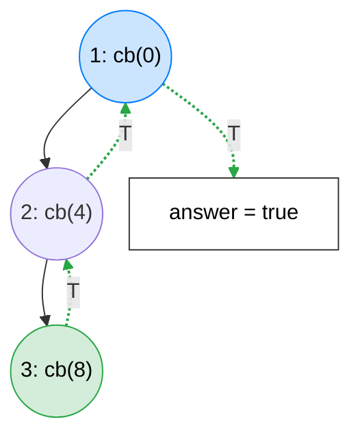
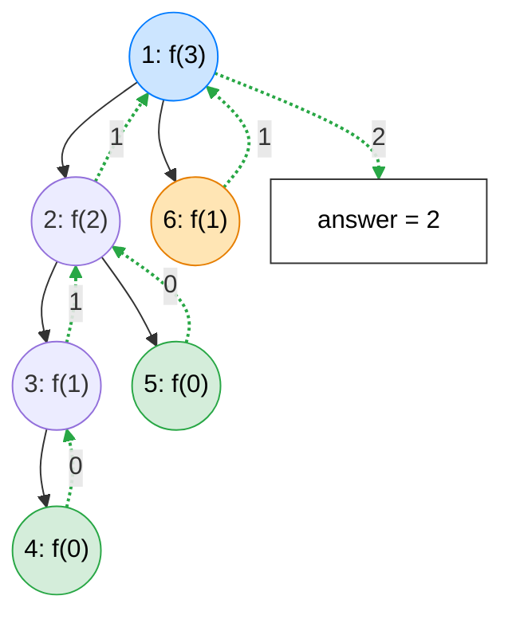
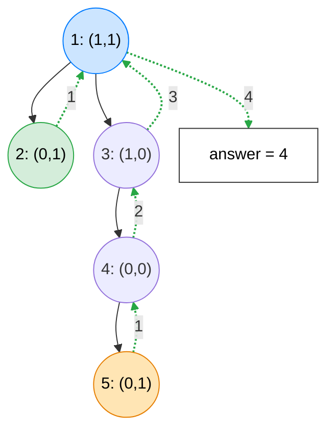

## LeetCode 70: Climbing Stairs
**Difficulty:** Easy | **Pattern:** Fibonacci DP | **Language:** Java

### 1. Problem
- You climb a staircase of `n` steps taking 1 or 2 steps at a time. Count the distinct ways to reach the top. Example: `n = 4` -> `5` (1111, 112, 121, 211, 22).
- Constraints: `1 <= n <= 45`. Even an exponential solution is "small" here, but the intent is O(n) time; the answer fits in `int`.
- **Key insight:** the last move into step `i` came from step `i-1` (a 1-step) or `i-2` (a 2-step), and those two groups of paths never overlap. So `ways(i) = ways(i-1) + ways(i-2)`.

### 2. Solution
- **Step 1, brute force:** recurse `f(n) = f(n-1) + f(n-2)`. O(2^n) time because `f(2)`, `f(1)` are recomputed on every branch.
- **Step 2, memoise:** the same `n` values repeat, so cache them. O(n) time, O(n) space (stack plus cache).
- **Step 3, tabulate (bottom-up):**
  - **State:** `dp[i]` = number of ways to stand on step `i`.
  - **Recurrence:** `dp[i] = dp[i-1] + dp[i-2]`.
  - **Base case:** `dp[0] = 1` (one way to stay on the ground: do nothing), `dp[1] = 1`.
  - **Iteration order:** `i` ascending, because `dp[i]` needs only smaller indices.
  - **Space optimisation:** only the last two values are ever read, so keep two variables: O(1) space.

```java
class Solution {
    public int climbStairs(int n) {
        if (n <= 2) return n;
        int twoBack = 1;   // dp[i-2], starts as dp[1]
        int oneBack = 2;   // dp[i-1], starts as dp[2]
        for (int i = 3; i <= n; i++) {
            int cur = oneBack + twoBack;
            twoBack = oneBack;
            oneBack = cur;
        }
        return oneBack;
    }
}
```

---

## #198 House Robber
**Difficulty:** Medium | **Pattern:** Take-or-skip decision DP | **Language:** Java

### 1. Problem
- Houses in a row hold `nums[i]` cash; robbing two adjacent houses triggers an alarm. Maximise the loot. Example: `[2,7,9,3,1]` -> `12` (2 + 9 + 1).
- Constraints: `n <= 100`, `0 <= nums[i] <= 400`. Any O(n) approach is fine.
- **Key insight:** at house `i` you either skip it (best of the first `i-1` houses) or rob it (its value plus the best of the first `i-2` houses). Take the larger.

### 2. Solution
- **Step 1, brute force:** try every subset with no two adjacent, O(2^n). Recursion `rob(i) = max(rob(i-1), nums[i] + rob(i-2))` has overlapping calls, so memoise.
- **Step 2, tabulate:**
  - **State:** `dp[i]` = max loot using houses `0..i`.
  - **Recurrence:** `dp[i] = max(dp[i-1], dp[i-2] + nums[i])`.
  - **Base case:** `dp[-1] = dp[-2] = 0` (no houses), so `dp[0] = nums[0]`.
  - **Iteration order:** ascending `i`.
  - **Space optimisation:** only `dp[i-1]` and `dp[i-2]` are read -> two variables, O(1).

```java
class Solution {
    public int rob(int[] nums) {
		final int n = nums.length;
		int[] dp = new int[n+1]; // dp[i] --> represents max money can be made for i houses
		
		// base cases
		dp[0] = nums[0]; // 1 house
		dp[1] = Math.max(nums[0], nums[1]); // only 1 house
        for (int i=2; i<=n-1; i++) {
			//                skip.      loot
			dp[i] = Math.max(dp[i-1], nums[i] + dp[i-2]);
        }
        return dp[n];
    }
}
```
Implementation note: starting both at 0 absorbs the `n = 1` base case without a special branch.

### 3. Dry Run
Input `[2,7,9,3,1]`.

| i   | nums[i] | skip = dp[i-1] | rob = dp[i-2]+nums[i] | dp[i] |
| --- | ------- | -------------- | --------------------- | ----- |
| 0   | 2       | 0              | 0+2 = 2               | 2     |
| 1   | 7       | 2              | 0+7 = 7               | 7     |
| 2   | 9       | 7              | 2+9 = 11              | 11    |
| 3   | 3       | 11             | 7+3 = 10              | 11    |
| 4   | 1       | 11             | 11+1 = 12             | 12    |

Rolling variables (twoBack, oneBack) after each step: (0,2), (2,7), (7,11), (11,11), (11,12). Answer: **12**.

**Complexity:** time O(n), one pass; space O(1), two variables.

### 4. Takeaway
- **Pattern:** a linear sequence where choosing an element forbids its neighbour(s): "take it plus the best before the blocked neighbour, or skip it".
- **Edge cases:**

| Input | Result | Note |
|-------|--------|------|
| [5] | 5 | single house |
| [1,2] | 2 | pick the larger |
| [2,1,1,2] | 4 | skip the middle two |
| [0,0] | 0 | zeros fine |

- **Mistakes to avoid:**
  - Greedy "take every other house" (fails on `[2,1,1,2]`).
  - Overwriting `twoBack` before computing `cur`.
- **Related problems:** 213 House Robber II (circular); 337 House Robber III (tree); 740 Delete and Earn (reduces to this); 746 Min Cost Climbing Stairs.

---

## LeetCode 213: House Robber II
**Difficulty:** Medium | **Pattern:** Circular DP, solve twice | **Language:** Java

### 1. Problem
- Same as House Robber but the houses form a circle, so the first and last are adjacent. Example: `[1,2,3,1]` -> `4` (1 + 3).
- Constraints: `1 <= n <= 100`. O(n) expected.
- **Key insight:** first and last can never both be robbed. So the answer is the better of two linear problems: houses `0..n-2` (last excluded) and houses `1..n-1` (first excluded). Every valid circular choice lives inside one of them.

### 2. Solution
- **Step 1, brute force:** try every non-adjacent circular subset, O(2^n).
- **Step 2, break the circle:** case A "skip the last house" and case B "skip the first house" are each a House Robber instance. Their union covers all valid choices (any valid set omits at least one of the two ends).
- **DP spec (per linear run):** state `dp[i]` = best loot in the range up to `i`; recurrence `dp[i] = max(dp[i-1], dp[i-2] + nums[i])`; base `dp` before the range = 0; iterate ascending; space reduced to two variables.
- Special case `n == 1`: the ranges would be empty, so return `nums[0]`.

```java
class Solution {
    public int rob(int[] nums) {
        int n = nums.length;
        if (n == 1) return nums[0];
        return Math.max(robRange(nums, 0, n - 2), robRange(nums, 1, n - 1));
    }

    private int robRange(int[] nums, int lo, int hi) {
        int twoBack = 0, oneBack = 0;
        for (int i = lo; i <= hi; i++) {
            int cur = Math.max(oneBack, twoBack + nums[i]);
            twoBack = oneBack;
            oneBack = cur;
        }
        return oneBack;
    }
}
```

### 3. Dry Run
Input `[1,2,3,1]`, `n = 4`.

Range A = indices 0..2 = `[1,2,3]`:

| i | nums[i] | skip | rob | dp |
|---|---------|------|-----|----|
| 0 | 1 | 0 | 0+1 = 1 | 1 |
| 1 | 2 | 1 | 0+2 = 2 | 2 |
| 2 | 3 | 2 | 1+3 = 4 | 4 |

Range B = indices 1..3 = `[2,3,1]`:

| i | nums[i] | skip | rob | dp |
|---|---------|------|-----|----|
| 1 | 2 | 0 | 2 | 2 |
| 2 | 3 | 2 | 0+3 = 3 | 3 |
| 3 | 1 | 3 | 2+1 = 3 | 3 |

Answer = max(4, 3) = **4**.

**Complexity:** time O(n), two linear passes; space O(1).

### 4. Takeaway
- **Pattern:** a circular adjacency constraint -> "break the circle" by solving two linear subproblems that each exclude one end.
- **Edge cases:**

---

## LeetCode 55: Jump Game
**Difficulty:** Medium | **Pattern:** Greedy, track max reachable index | **Language:** Java

### 1. Problem
- `nums[i]` is the max jump length from index `i`. Starting at index 0, can you reach the last index? Example: `[3,2,1,0,4]` -> `false`; `[2,3,1,1,4]` -> `true`.
- Constraints: `n <= 10^4`, `0 <= nums[i] <= 10^5`. Target O(n); O(n^2) is borderline.
- **Key insight:** reachable indices always form a contiguous prefix `[0..maxReach]`. If you ever stand at `i > maxReach`, you are stuck.

### 2. Solution
- **Step 1, DP:** `dp[i]` = can index `i` be reached. Base `dp[0] = true`; `dp[i] = true` if some `j < i` has `dp[j]` and `j + nums[j] >= i`. Ascending order. O(n^2) time, O(n) space.
- **Step 2, observation:** if `j` is reachable, so is everything between `j` and `j + nums[j]`, so the set of reachable indices is a prefix. One number, `maxReach`, replaces the whole table.
- **Step 3, greedy:** scan left to right; if `i > maxReach` return false; else `maxReach = max(maxReach, i + nums[i])`; return true as soon as `maxReach >= n-1`. This is the space optimisation of the DP to O(1).

```java
class Solution {
    public boolean canJump(int[] nums) {
        final int n = nums.length;
        int maxReach = 0;
        for (int i = 0; i < n; i++) {
            if (i > maxReach) return false;      // gap we cannot cross
            maxReach = Math.max(maxReach, i + nums[i]);
            if (maxReach >= n - 1) return true;  // early exit
        }
        return true;
    }
}
```
Implementation note: `i + nums[i]` is at most about 10^4 + 10^5, no overflow.

### 3. Dry Run
Input `[3,2,1,0,4]` (`n = 5`, target index 4):

| i | nums[i] | i > maxReach? | i + nums[i] | maxReach after |
|---|---------|---------------|-------------|----------------|
| 0 | 3 | 0 > 0 no | 3 | 3 |
| 1 | 2 | no | 3 | 3 |
| 2 | 1 | no | 3 | 3 |
| 3 | 0 | 3 > 3 no | 3 | 3 |
| 4 | 4 | 4 > 3 yes | - | return false |

Contrast `[2,3,1,1,4]`: i=0 -> maxReach 2; i=1 -> 1+3 = 4 >= 4 -> return true.

Final answer: **false** for the first input. **Complexity:** time O(n), single pass; space O(1).

### 4. Takeaway
- **Pattern:** when the set of feasible states is an interval/prefix, track its boundary greedily instead of filling a DP table.
- **Edge cases:**

| Input | Result | Note |
|-------|--------|------|
| [0] | true | already at last index |
| [0,1] | false | stuck at 0 |
| [1,0,1] | false | zero blocks |
| [2,0,0] | true | jump over zeros |

- **Mistakes to avoid:**
  - Checking `nums[i] == 0` only; zeros are harmless if `maxReach` passes them.
  - Updating `maxReach` before checking `i > maxReach`.
- **Related problems:** 45 Jump Game II (minimum jumps); 1306 Jump Game III (graph search); 1871 Jump Game VII.

---

## LeetCode 45: Jump Game II
**Difficulty:** Medium | **Pattern:** Greedy, BFS-like level jumps | **Language:** Java

### 1. Problem
- Same array; the last index is guaranteed reachable. Return the minimum number of jumps. Example: `[2,3,1,1,4]` -> `2` (0 -> 1 -> 4).
- Constraints: `n <= 10^4`. O(n) is the target; O(n^2) DP passes but is not optimal.
- **Key insight:** treat positions reachable with `k` jumps as BFS level `k`. Level `k` is a contiguous range ending at `currentEnd`; the farthest index seen while scanning that range defines level `k+1`.

### 2. Solution
- **Step 1, DP:** `dp[i]` = min jumps to reach `i`; `dp[0] = 0`; `dp[i] = min over j<i with j+nums[j]>=i of dp[j]+1`. Ascending. O(n^2) time, O(n) space.
- **Step 2, observation:** total number of jumps is same as total number of segment ( a contiguous block of indices ) - exactly BFS levels minus 1. [2], [3,1], [1,4], From 2 we can go till 1, and then from 2nd segment we can go till 4. hence, total 2nd 
- **Step 3, greedy:** scan; keep `farthest`. When `i == currentEnd`, the current level is exhausted: commit a jump and set `currentEnd = farthest`. Loop only to `n-2`, because standing on the last index needs no extra jump hence `i != n-1` check. O(1) space.

```java
class Solution {
    public int jump(int[] nums) {
        int jumps = 0, currentEnd = 0, farthest = 0;
        for (int i = 0; i < nums.length; i++) {
            farthest = Math.max(farthest, i + nums[i]);
			// must jump to go beyond this level, but do not jump if already at the end
            if (i == currentEnd && i != n-1) {   
                jumps++;
                currentEnd = farthest; // jump to next segment
            }
        }
        return jumps;
    }
}
```
Implementation note: stopping at `n-2` avoids counting a spurious jump when `currentEnd` lands exactly on the last index.

### 3. Dry Run
Input `[2,3,1,1,4]`, loop `i = 0..3`.

| i   | nums[i] | farthest | i == currentEnd? | jumps | currentEnd |
| --- | ------- | -------- | ---------------- | ----- | ---------- |
| 0   | 2       | 2        | yes (0)          | 1     | 2          |
| 1   | 3       | 4        | no               | 1     | 2          |
| 2   | 1       | 4        | yes (2)          | 2     | 4          |
| 3   | 1       | 4        | no               | 2     | 4          |

Final answer: **2**. **Complexity:** time O(n); space O(1).

### 4. Takeaway
- **Pattern:** minimum steps on an implicit graph whose levels are contiguous ranges -> BFS collapsed into two integers.
- **Edge cases:**

| Input | Result | Note |
|-------|--------|------|
| [0] | 0 | loop body never runs |
| [1,2] | 1 | |
| [2,1] | 1 | |
| [1,1,1,1] | 3 | one per step |

- **Mistakes to avoid:**
  - Looping to `n-1`: adds an extra jump when `currentEnd == n-1`.
  - Updating `farthest` after the `i == currentEnd` check.
- **Related problems:** 55 Jump Game (feasibility only); 1696 Jump Game VI (DP + deque); 1306 Jump Game III.

---

## LeetCode 139: Word Break
**Difficulty:** Medium | **Pattern:** 1D DP on a string (prefix segmentable) | **Language:** Java

### 1. Problem
- Given string `s` and a dictionary `wordDict`, can `s` be split into a space-separated sequence of dictionary words (words reusable)? Example: `s = "leetcode"`, dict `[leet, code]` -> `true`.
- Constraints: `s.length <= 300`, `wordDict.length <= 1000`, each word `<= 20` chars. O(n * maxWordLen) substring checks is comfortable.
- **Key insight:** `s[0..i)` is segmentable iff for some split `j`, `s[0..j)` is segmentable AND `s[j..i)` is a word. The smaller question "is this prefix breakable?" repeats, so cache it.

### 2. Solution
- **Step 1, brute force:** recursively try every prefix word; on failure backtrack. Exponential (e.g. `"aaaa...ab"` with `[a, aa, aaa...]`) because the same suffix is re-explored.
- **Step 2, memoise suffixes** (top-down): `canBreak(start)` is the same function for each `start`, so at most `n` distinct states.
- **Step 3, bottom-up:**
  - **State:** `dp[i]` = true if the first `i` characters can be segmented.
  - **Recurrence:** `dp[i] = OR over j in [i-maxLen, i-1] of (dp[j] && set.contains(s.substring(j, i)))`.
  - **Base case:** `dp[0] = true` (empty prefix).
  - **Iteration order:** `i` ascending; `j < i` is already final.
  - **Space optimisation:** the full boolean table is needed because any earlier `j` (within `maxLen`) may be read; only a window of `maxLen + 1` entries is truly required, but O(n) boolean is already tiny. Bounding `j` by `maxLen` is the main speedup.

```java
import java.util.HashSet;
import java.util.List;
import java.util.Set;

class Solution {
    public boolean wordBreak(String s, List<String> wordDict) {
        Set<String> words = new HashSet<>(wordDict);
        int maxLen = 0;
        for (String w : wordDict) maxLen = Math.max(maxLen, w.length());

        int n = s.length();
        boolean[] dp = new boolean[n + 1];
        dp[0] = true;
        for (int i = 1; i <= n; i++) {
            // no word is longer than maxLen, so earlier splits are useless
            for (int j = i - 1; j >= Math.max(0, i - maxLen); j--) {
                if (dp[j] && words.contains(s.substring(j, i))) {
                    dp[i] = true;
                    break;
                }
            }
        }
        return dp[n];
    }
}
```
Implementation note: `HashSet` gives O(1) average membership; the `break` stops at the first valid split.

### 3. Dry Run
Input `s = "leetcode"`, dict `{leet, code}`, `maxLen = 4`.

| i | prefix | j tried (substring, dp[j]) | dp[i] |
|---|--------|-----------------------------|-------|
| 0 | "" | base | T |
| 1 | l | j=0 "l" no | F |
| 2 | le | j=1 "e" dp[1]=F; j=0 "le" no | F |
| 3 | lee | j=2,1 dp F; j=0 "lee" no | F |
| 4 | leet | j=3,2,1 dp F; j=0 "leet" yes, dp[0]=T | T |
| 5 | leetc | j=4 "c" no; j=3,2,1 dp F | F |
| 6 | leetco | j=5 dp F; j=4 "co" no; j=3,2 dp F | F |
| 7 | leetcod | j=6,5 dp F; j=4 "cod" no; j=3 dp F | F |
| 8 | leetcode | j=7,6,5 dp F; j=4 "code" yes, dp[4]=T | T |

Top-down view `canBreak(start)` (a single chain here, so no memo hits; on failing inputs repeated starts would be memo hits):


Legend: green = base case (start == n), blue = root; green dotted = returned boolean.

| Order | Call | Depth | Action | Returns |
|-------|------|-------|--------|---------|
| 1 | cb(0) | 0 | "leet" is a word, recurse at 4 | T |
| 2 | cb(4) | 1 | "code" is a word, recurse at 8 | T |
| 3 | cb(8) | 2 | start == n, base | T |

Final answer: **true**. **Complexity:** time O(n * maxLen * maxLen) (each substring costs up to maxLen to hash); space O(n + total dictionary size).

### 4. Takeaway
- **Pattern:** "can this prefix/suffix be built from pieces" -> boolean prefix DP with a set lookup for the last piece.
- **Edge cases:**

| Input | Result | Note |
|-------|--------|------|
| s="a", dict=[b] | false | nothing matches |
| s="aaaaaaa", dict=[aaaa, aaa] | true | 4 + 3 |
| s="catsandog", dict=[cats,dog,sand,and,cat] | false | tempting greedy fails |
| dict has repeated words | fine | set deduplicates |

- **Mistakes to avoid:**
  - Greedy longest-match (fails on `cats|and|og`-style inputs).
  - Forgetting `dp[0] = true`.
  - Recomputing `maxLen` per iteration or scanning all `j` (still correct, just slower).
- **Related problems:** 140 Word Break II (return all sentences, backtracking + memo); 472 Concatenated Words; 91 Decode Ways (same prefix-split shape, counting).

---

## LeetCode 91: Decode Ways
**Difficulty:** Medium | **Pattern:** 1D DP with conditional transitions | **Language:** Java

### 1. Problem
- Letters map `A=1 ... Z=26`. Given a digit string, count the ways to decode it. Example: `"226"` -> `3` (BZ, VF, BBF).
- Constraints: `1 <= n <= 100`; the string may contain `'0'`, which cannot stand alone. O(n) expected. Answer fits in `int`.
- **Key insight:** the last character is decoded either alone (valid if `'1'..'9'`) or as the second digit of a pair (valid if the pair is `10..26`). The two groups are disjoint, so counts add - each only when its validity test passes.

### 2. Solution
- **Step 1, brute force:** recursion that consumes 1 or 2 characters, O(2^n) with repeated suffixes.
- **Step 2, tabulate:**
  - **State:** `dp[i]` = number of ways to decode the first `i` characters.
  - **Recurrence:** `dp[i] = (s[i-1] != '0' ? dp[i-1] : 0) + (pair s[i-2..i-1] in 10..26 ? dp[i-2] : 0)`.
  - **Base case:** `dp[0] = 1` (empty string has one decoding), `dp[1] = (s[0] != '0') ? 1 : 0`.
  - **Iteration order:** `i` ascending.
  - **Space optimisation:** only `dp[i-1]` and `dp[i-2]` are read -> two variables.

```java
class Solution {
    public int numDecodings(String s) {
        int n = s.length();
        if (s.charAt(0) == '0') return 0;
        int twoBack = 1;  // dp[0]
        int oneBack = 1;  // dp[1]
        for (int i = 2; i <= n; i++) {
            int cur = 0;
            if (s.charAt(i - 1) != '0') cur += oneBack;               // single digit 1..9
            int pair = (s.charAt(i - 2) - '0') * 10 + (s.charAt(i - 1) - '0');
            if (pair >= 10 && pair <= 26) cur += twoBack;             // pair 10..26 (excludes 05 etc.)
            twoBack = oneBack;
            oneBack = cur;
        }
        return oneBack;
    }
}
```
Implementation note: the `pair >= 10` check is what rejects leading-zero pairs like `"06"`. If both branches fail, `cur = 0` and the zero propagates correctly.

### 3. Dry Run
Input `"226"`:

| i | char s[i-1] | single valid? | pair | pair valid? | dp[i] |
|---|-------------|---------------|------|-------------|-------|
| 0 | - | - | - | - | 1 (base) |
| 1 | 2 | yes | - | - | 1 |
| 2 | 2 | yes: +dp[1]=1 | 22 | yes: +dp[0]=1 | 2 |
| 3 | 6 | yes: +dp[2]=2 | 26 | yes: +dp[1]=1 | 3 |

Contrast `"06"`: first char `'0'` -> return 0. Contrast `"100"`: dp[2]: single '0' invalid, pair 10 valid -> +dp[0]=1 -> 1; dp[3]: single '0' invalid, pair "00"=0 invalid -> 0.

Final answer: **3**. **Complexity:** time O(n); space O(1).

### 4. Takeaway
- **Pattern:** counting decompositions with piece-length 1 or 2 and per-piece validity conditions.
- **Edge cases:**

| Input | Result | Note |
|-------|--------|------|
| "0" | 0 | cannot start with 0 |
| "10" | 1 | only J |
| "27" | 1 | 27 invalid pair |
| "100" | 0 | trailing 00 impossible |
| "2101" | 1 | BJA |

- **Mistakes to avoid:**
  - Allowing pairs `01..09` (must be `>= 10`).
  - Letting a lone `'0'` add `dp[i-1]`.
  - Setting `dp[0] = 0`.
- **Related problems:** 639 Decode Ways II (with `*` wildcard); 70 Climbing Stairs (no validity conditions); 139 Word Break.

---

## LeetCode 322: Coin Change
**Difficulty:** Medium | **Pattern:** Unbounded knapsack, minimise count | **Language:** Java

### 1. Problem
- Given coin denominations and an `amount`, return the fewest coins that make it up, or `-1`. Example: `coins=[1,2,5]`, `amount=11` -> `3` (5+5+1).
- Constraints: `coins.length <= 12`, `amount <= 10^4`. O(amount * coins) is about 1.2e5, trivial.
- **Key insight:** the best way to make `a` ends with some coin `c`, leaving the best way to make `a - c`. Take the minimum over all coins. Greedy (largest coin first) is wrong for arbitrary denominations (e.g. `[1,3,4]`, 6 -> 3+3, not 4+1+1).

### 2. Solution
- **Step 1, brute force:** try every coin at every step, O(coins^amount).
- **Step 2, memoise on remaining amount:** only `amount + 1` distinct values -> top-down O(amount * coins).
- **Step 3, tabulate:**
  - **State:** `dp[a]` = minimum coins to form amount `a` (INF if impossible).
  - **Recurrence:** `dp[a] = min over coins c <= a of dp[a-c] + 1`.
  - **Base case:** `dp[0] = 0`.
  - **Iteration order:** `a` ascending (`a-c` is smaller); coins can be in any order.
  - **Space optimisation:** the table is itself the 1D rolled form of the 2D `dp[coinIndex][amount]`; no further reduction is possible because any smaller amount may be read.

```java
import java.util.Arrays;

class Solution {
    public int coinChange(int[] coins, int amount) {
        int[] dp = new int[amount + 1];
        Arrays.fill(dp, amount + 1);   // amount+1 acts as INF: no answer can use more than `amount` coins
        dp[0] = 0;
        for (int a = 1; a <= amount; a++) {
            for (int c : coins) {
                if (c <= a && dp[a - c] + 1 < dp[a]) {
                    dp[a] = dp[a - c] + 1;
                }
            }
        }
        return dp[amount] > amount ? -1 : dp[amount];
    }
}
```
Implementation note: using `amount + 1` as INF avoids the `Integer.MAX_VALUE + 1` overflow trap.

### 3. Dry Run
Input `coins=[1,2,5]`, `amount=11`. Filled table (INF unused since coin 1 exists):

| a | candidates (dp[a-c]+1) | dp[a] |
|---|------------------------|-------|
| 0 | base | 0 |
| 1 | c1: 1 | 1 |
| 2 | c1: 2, c2: 1 | 1 |
| 3 | c1: 2, c2: 2 | 2 |
| 4 | c1: 3, c2: 2 | 2 |
| 5 | c1: 3, c2: 3, c5: 1 | 1 |
| 6 | c1: 2, c2: 3, c5: 2 | 2 |
| 7 | c1: 3, c2: 2, c5: 2 | 2 |
| 8 | c1: 3, c2: 3, c5: 3 | 3 |
| 9 | c1: 4, c2: 3, c5: 3 | 3 |
| 10 | c1: 4, c2: 4, c5: 2 | 2 |
| 11 | c1: 3, c2: 4, c5: 3 | 3 |

Top-down memo view on a smaller case `coins=[1,2]`, `amount=3` (`f(r)` = min coins for remaining r):


Legend: green = base f(0)=0, orange = memo hit, blue = root; green dotted = returned value.

| Order | Call | Depth | Action | Returns |
|-------|------|-------|--------|---------|
| 1 | f(3) | 0 | try coin 1 -> f(2), coin 2 -> f(1) | 2 |
| 2 | f(2) | 1 | coin 1 -> f(1), coin 2 -> f(0) | 1 |
| 3 | f(1) | 2 | coin 1 -> f(0); coin 2 too big | 1 |
| 4 | f(0) | 3 | base | 0 |
| 5 | f(0) | 2 | base | 0 |
| 6 | f(1) | 1 | memo hit (from call 3) | 1 |

Final answer: **3** for the main example. **Complexity:** time O(amount * coins); space O(amount).

### 4. Takeaway
- **Pattern:** "minimum items with unlimited reuse to hit a target" -> unbounded knapsack with `dp[a] = min(dp[a-c]) + 1`.
- **Edge cases:**

| Input | Result | Note |
|-------|--------|------|
| amount=0 | 0 | base case |
| coins=[2], amount=3 | -1 | unreachable |
| coins=[1,3,4], amount=6 | 2 | greedy gives 3 |
| coins=[186,419,83,408], 6249 | 20 | large coins |

- **Mistakes to avoid:**
  - Greedy largest-first.
  - INF = `Integer.MAX_VALUE` then `+ 1` overflows to negative.
  - Not skipping `c > a` (index out of bounds).
- **Related problems:** 518 Coin Change II (count ways); 377 Combination Sum IV (count orderings); 279 Perfect Squares (same with squares); 983 Minimum Cost For Tickets.

---

## LeetCode 518: Coin Change II
**Difficulty:** Medium | **Pattern:** Unbounded knapsack, count combinations | **Language:** Java

### 1. Problem
- Count the number of combinations (order does not matter) of coins that sum to `amount`; each coin is unlimited. Example: `amount=5, coins=[1,2,5]` -> `4`.
- Constraints: `amount <= 5000`, `coins.length <= 300`; answer fits in a 32-bit int. O(amount * coins) is 1.5e6.
- **Key insight:** to count combinations, decide coin by coin ("how many of coin 1, then coin 2, ..."). That means **coins in the outer loop, amounts in the inner loop**: each multiset is generated in exactly one order (non-decreasing coin index), so `1+2` and `2+1` are not double counted.

### 2. Solution
- **Step 1, brute force:** backtracking over coins with a start index, O(exponential).
- **Step 2, 2D DP:** `dp[i][a]` = ways using the first `i` coin types: `dp[i][a] = dp[i-1][a] + dp[i][a-coin_i]` (skip the coin, or use one more of it).
- **Step 3, collapse to 1D:**
  - **State:** `dp[a]` = number of combinations summing to `a` using the coin types processed so far.
  - **Recurrence:** `dp[a] += dp[a - c]` for the current coin `c`.
  - **Base case:** `dp[0] = 1` (the empty combination).
  - **Iteration order:** outer = coins, inner = `a` ascending from `c` (ascending lets the same coin be reused: unbounded).
  - **Space optimisation:** this 1D array is the optimisation from 2D.

```java
class Solution {
    public int change(int amount, int[] coins) {
        int[] dp = new int[amount + 1];
        dp[0] = 1;
        for (int c : coins) {                       // coins OUTER -> combinations
            for (int a = c; a <= amount; a++) {
                dp[a] += dp[a - c];
            }
        }
        return dp[amount];
    }
}
```
Implementation note: int additions may wrap for intermediate non-target sums on some tests; since only `+` is used and the true answer fits in int, wraparound arithmetic still yields the right final value.

### 3. Dry Run (mirror pair with 377)
To compare with #377 we use the same input: `coins=[1,2,3]`, `amount=4`. Table after each coin (columns are amounts 0..4):

| after coin | dp[0] | dp[1] | dp[2] | dp[3] | dp[4] | action |
|-----------|-------|-------|-------|-------|-------|--------|
| init | 1 | 0 | 0 | 0 | 0 | dp[0]=1 |
| coin 1 | 1 | 1 | 1 | 1 | 1 | each dp[a] += dp[a-1] |
| coin 2 | 1 | 1 | 2 | 2 | 3 | dp[2]+=dp[0]; dp[3]+=dp[1]; dp[4]+=dp[2] (=1+2) |
| coin 3 | 1 | 1 | 2 | 3 | 4 | dp[3]+=dp[0]; dp[4]+=dp[1] |

The 4 combinations: `1111`, `112`, `22`, `13`.

Side by side with #377 (same recurrence line `dp[a] += dp[a - c]`, only the loops swap):

| | #518 Coin Change II (combinations) | #377 Combination Sum IV (permutations) |
|---|-----------------------------------|----------------------------------------|
| outer loop | `for c in coins` | `for a in 1..target` |
| inner loop | `for a in c..amount` | `for c in nums` |
| meaning of `dp[a]` | multisets of the coins seen so far | ordered sequences of any coin |
| `[1,2,3]`, 4 | **4** | **7** |
| why | each coin type "closed" before the next opens | every amount may be last-extended by any coin |

Final answer: **4**. **Complexity:** time O(amount * coins); space O(amount).

### 4. Takeaway
- **Pattern:** unbounded counting of unordered selections -> coins outer, amounts inner.
- **Edge cases:**

| Input | Result | Note |
|-------|--------|------|
| amount=0, coins=[7] | 1 | empty combination |
| amount=3, coins=[2] | 0 | unreachable |
| amount=10, coins=[10] | 1 | |
| coins=[1,2,5], 5 | 4 | |

- **Mistakes to avoid:**
  - Swapping the loops (silently computes permutations).
  - Starting the inner loop at 1 and indexing `a - c < 0`.
  - `dp[0] = 0`.
- **Related problems:** 377 Combination Sum IV (permutations, mirror); 322 Coin Change (minimise); 494 Target Sum; 416 Partition Equal Subset Sum (0/1 variant, inner loop descending).

---

## LeetCode 377: Combination Sum IV
**Difficulty:** Medium | **Pattern:** Counting permutations, amount outer, items inner | **Language:** Java

### 1. Problem
- Given distinct positive integers `nums` and a `target`, count the ordered sequences that sum to `target` (so `1,2` and `2,1` differ). Example: `nums=[1,2,3]`, `target=4` -> `7`.
- Constraints: `n <= 200`, `target <= 1000`, answer fits in 32-bit int. O(target * n).
- **Key insight:** treat the **last** element of the sequence as the decision: `ways(t) = sum over x of ways(t - x)`. Since any number can be last at any amount, the amount loop must be outer so `dp[t - x]` already counts every ordering.

### 2. Solution
- **Step 1, brute force:** recurse over every possible next number, exponential.
- **Step 2, memoise on remaining target**: `target + 1` states, each trying `n` numbers.
- **Step 3, tabulate:**
  - **State:** `dp[t]` = number of ordered sequences summing to `t`.
  - **Recurrence:** `dp[t] = sum over x in nums with x <= t of dp[t - x]`.
  - **Base case:** `dp[0] = 1` (empty sequence).
  - **Iteration order:** outer `t` ascending, inner over `nums`.
  - **Space optimisation:** the 1D table is already minimal (any smaller `t` may be read).

```java
class Solution {
    public int combinationSum4(int[] nums, int target) {
        int[] dp = new int[target + 1];
        dp[0] = 1;
        for (int t = 1; t <= target; t++) {     // amount OUTER -> permutations
            for (int x : nums) {
                if (x <= t) dp[t] += dp[t - x];
            }
        }
        return dp[target];
    }
}
```
Implementation note: intermediate `dp[t]` values for `t < target` can exceed `int` on adversarial inputs; Java wraps silently and, because only additions are used and the final answer is guaranteed to fit, the result is still correct (do not "fix" this with a min/cap).

### 3. Dry Run (mirror of #518)
Same input: `nums=[1,2,3]`, `target=4`.

| t | terms dp[t-x] for x = 1, 2, 3 | dp[t] |
|---|------------------------------|-------|
| 0 | base | 1 |
| 1 | dp[0] = 1 | 1 |
| 2 | dp[1] + dp[0] = 1 + 1 | 2 |
| 3 | dp[2] + dp[1] + dp[0] = 2 + 1 + 1 | 4 |
| 4 | dp[3] + dp[2] + dp[1] = 4 + 2 + 1 | 7 |

The 7 sequences: `1111, 112, 121, 211, 22, 13, 31`. The combination view (#518) collapses `112/121/211` into one and `13/31` into one -> 4.

Loop-order comparison (recurrence identical, loops swapped):

```java
// #518 combinations                 // #377 permutations
for (int c : coins)                  for (int t = 1; t <= target; t++)
  for (int a = c; a <= amount; a++)    for (int x : nums)
    dp[a] += dp[a - c];                  if (x <= t) dp[t] += dp[t - x];
```

Final answer: **7**. **Complexity:** time O(target * n); space O(target).

### 4. Takeaway
- **Pattern:** "count ordered ways" -> target outer, choices inner; "count unordered" -> choices outer, target inner.
- **Edge cases:**

| Input | Result | Note |
|-------|--------|------|
| nums=[9], target=3 | 0 | no number fits |
| nums=[1], target=5 | 1 | only 11111 |
| nums=[4,2,1], 32 | 39882198 | large values; int wrap safe |
| target small, nums large | check `x <= t` | avoids negative index |

- **Mistakes to avoid:**
  - Using the #518 loop order (gives combinations).
  - Skipping `x <= t`.
  - Switching to `long` and then returning a truncated cast incorrectly; plain `int` is fine.
- **Related problems:** 518 Coin Change II (mirror, combinations); 70 Climbing Stairs (nums = [1,2]); 39 Combination Sum (enumerate instead of count); 322 Coin Change.

---

## LeetCode 96: Unique Binary Search Trees
**Difficulty:** Medium | **Pattern:** Catalan number DP, sum over root choices | **Language:** Java

### 1. Problem
- Given `n`, count the structurally distinct BSTs that store the values `1..n`. Example: `n = 3` -> `5`.
- Constraints: `1 <= n <= 19`. O(n^2) is trivial; the answer (Catalan(19) = 1,767,263,190) fits in `int`.
- **Key insight:** pick value `i` as the root. Values `1..i-1` must form the left subtree and `i+1..n` the right. Only the **count** of nodes matters, not the actual values, so the shapes multiply: `left(i-1) * right(n-i)`.

### 2. Solution
- **Step 1, brute force:** actually build every tree, exponential (the count is Catalan, about 4^n / n^1.5).
- **Step 2, observation:** a set of `m` consecutive values has the same number of BST shapes regardless of which values they are, so define the answer by size only. Subproblems repeat heavily.
- **Step 3, tabulate:**
  - **State:** `dp[m]` = number of BSTs with `m` nodes.
  - **Recurrence:** `dp[m] = sum for root = 1..m of dp[root-1] * dp[m-root]`.
  - **Base case:** `dp[0] = 1` (empty tree), `dp[1] = 1`.
  - **Iteration order:** `m` ascending (needs strictly smaller sizes).
  - **Space optimisation:** the recurrence reads every smaller entry, so O(n) is the floor; halve the work by symmetry (`dp[a]*dp[b]` appears twice) if desired. The closed form `C(n+1) = C(n) * 2(2n+1) / (n+2)` gives O(n) time, O(1) space with `long`.

```java
class Solution {
    public int numTrees(int n) {
        int[] dp = new int[n + 1];
        dp[0] = 1;
        for (int size = 1; size <= n; size++) {
            for (int root = 1; root <= size; root++) {
                dp[size] += dp[root - 1] * dp[size - root];
            }
        }
        return dp[n];
    }
}
```
Implementation note: each product is at most Catalan(18)*1 scale and the sum is the final Catalan value, so `int` never overflows for `n <= 19`.

### 3. Dry Run
Input `n = 3`. Filled table:

| size m | root choices (left size * right size) | dp[m] |
|--------|----------------------------------------|-------|
| 0 | base | 1 |
| 1 | root1: dp0*dp0 = 1 | 1 |
| 2 | root1: dp0*dp1 = 1; root2: dp1*dp0 = 1 | 2 |
| 3 | root1: dp0*dp2 = 2; root2: dp1*dp1 = 1; root3: dp2*dp0 = 2 | 5 |

Final answer: **5**. **Complexity:** time O(n^2), nested loops; space O(n), the dp array.

### 4. Takeaway
- **Pattern:** "split at every pivot and multiply the counts of the two sides" -> Catalan recurrence (also valid parentheses, polygon triangulation).
- **Edge cases:**

| Input | Result | Note |
|-------|--------|------|
| n=1 | 1 | single node |
| n=2 | 2 | root 1 or root 2 |
| n=19 | 1767263190 | max, fits int |

- **Mistakes to avoid:**
  - `dp[0] = 0` (every product becomes 0).
  - Using `size - root + 1` instead of `size - root` for the right side.
- **Related problems:** 95 Unique Binary Search Trees II (generate the trees); 22 Generate Parentheses; 312 Burst Balloons (interval DP, same pivot idea).

---

## LeetCode 338: Counting Bits
**Difficulty:** Easy | **Pattern:** DP from bit structure | **Language:** Java

### 1. Problem
- For every `i` in `0..n`, return the number of set bits in `i`. Example: `n = 5` -> `[0,1,1,2,1,2]`.
- Constraints: `0 <= n <= 10^5`. A single O(n) pass is the goal (not `n * log n` with popcount per number).
- **Key insight:** `i >> 1` is `i` without its last bit, and it is smaller than `i`. So `bits(i) = bits(i >> 1) + (i & 1)`.

### 2. Solution
- **Step 1, brute force:** for each `i` count bits by looping 32 times (or `Integer.bitCount`): O(n log n).
- **Step 2, reuse:** the answer for `i >> 1` is already known, and the removed bit is just `i & 1`.
- **Step 3, tabulate:**
  - **State:** `dp[i]` = popcount of `i`.
  - **Recurrence:** `dp[i] = dp[i >> 1] + (i & 1)`.
  - **Base case:** `dp[0] = 0`.
  - **Iteration order:** `i` ascending (`i >> 1 < i`).
  - **Space optimisation:** the output array is the table; no extra space. (Equivalent: `dp[i] = dp[i & (i-1)] + 1`, dropping the lowest set bit.)

```java
class Solution {
    public int[] countBits(int n) {
        int[] dp = new int[n + 1];
        for (int i = 1; i <= n; i++) {
            dp[i] = dp[i >> 1] + (i & 1);
        }
        return dp;
    }
}
```
Implementation note: `dp[0]` is already 0 from array initialisation.

### 3. Dry Run
Input `n = 5`:

| i | binary | i >> 1 | i & 1 | dp[i] = dp[i>>1] + (i&1) |
|---|--------|--------|-------|---------------------------|
| 0 | 000 | - | - | 0 |
| 1 | 001 | 0 | 1 | 0 + 1 = 1 |
| 2 | 010 | 1 | 0 | 1 + 0 = 1 |
| 3 | 011 | 1 | 1 | 1 + 1 = 2 |
| 4 | 100 | 2 | 0 | 1 + 0 = 1 |
| 5 | 101 | 2 | 1 | 1 + 1 = 2 |

Final answer: **[0,1,1,2,1,2]**. **Complexity:** time O(n), O(1) work per number; space O(1) extra (output excluded).

### 4. Takeaway
- **Pattern:** a property of `i` determined by a smaller number reachable through a bit operation (shift, clear lowest set bit) -> DP over integers.
- **Edge cases:**

| Input | Result | Note |
|-------|--------|------|
| n=0 | [0] | loop skipped |
| n=1 | [0,1] | |
| n=8 | [0,1,1,2,1,2,2,3,1] | powers of two give 1 |

- **Mistakes to avoid:**
  - Using `>>>`/`>>` interchangeably is fine here (non-negative), but forgetting `& 1` loses the dropped bit.
  - Allocating `n` instead of `n + 1` elements.
- **Related problems:** 191 Number of 1 Bits (single number); 231 Power of Two; 477 Total Hamming Distance.

---

## LeetCode 300: Longest Increasing Subsequence
**Difficulty:** Medium | **Pattern:** O(n^2) DP, then O(n log n) tails array | **Language:** Java

### 1. Problem
- Return the length of the longest strictly increasing subsequence (elements need not be adjacent). Example: `[10,9,2,5,3,7,101,18]` -> `4` (e.g. 2,3,7,101).
- Constraints: `n <= 2500`, values in `[-10^4, 10^4]`. O(n^2) passes (6.25e6); O(n log n) is the known follow-up.
- **Key insight:** (a) the best subsequence ending at `i` extends the best one ending at some earlier smaller value; (b) for fixed length `L`, only the **smallest possible tail** matters, and those tails are always sorted, so binary search applies.

### 2. Solution
- **Step 1, brute force:** enumerate all 2^n subsequences, check each.
- **Step 2, O(n^2) DP:**
  - **State:** `dp[i]` = length of the LIS that ends exactly at index `i`.
  - **Recurrence:** `dp[i] = 1 + max(dp[j])` over `j < i` with `nums[j] < nums[i]` (or `1` if none).
  - **Base case:** every `dp[i]` starts at 1.
  - **Iteration order:** `i` ascending, inner `j` from 0 to `i-1`. Answer = `max(dp)` (not `dp[n-1]`).
  - **Space:** O(n), cannot shrink (arbitrary earlier `j` read).
- **Step 3, flaw:** the inner scan is linear. Maintain `tails[len-1]` = smallest tail of any increasing subsequence of length `len`. `tails` is strictly increasing, so for each `x`: find the first slot with `tails[slot] >= x` (lower bound) and overwrite it with `x`; if none, append (LIS grows). The array is **not** an actual subsequence, only its length is meaningful. Time O(n log n), space O(n).

O(n^2) version:
```java
class SolutionQuadratic {
    public int lengthOfLIS(int[] nums) {
        int n = nums.length, best = 1;
        int[] dp = new int[n];
        java.util.Arrays.fill(dp, 1);
        for (int i = 1; i < n; i++) {
            for (int j = 0; j < i; j++) {
                if (nums[j] < nums[i]) dp[i] = Math.max(dp[i], dp[j] + 1);
            }
            best = Math.max(best, dp[i]);
        }
        return best;
    }
}
```

Optimal O(n log n) version:
```java
class Solution {
    public int lengthOfLIS(int[] nums) {
        int[] tails = new int[nums.length];
        int size = 0;
        for (int x : nums) {
            int lo = 0, hi = size;               // lower bound in tails[0..size)
            while (lo < hi) {
                int mid = (lo + hi) >>> 1;
                if (tails[mid] < x) lo = mid + 1;
                else hi = mid;
            }
            tails[lo] = x;
            if (lo == size) size++;
        }
        return size;
    }
}
```
Implementation note: lower bound (`>=`) enforces **strictly** increasing; use upper bound for non-decreasing. Overwriting `tails[lo]` with an equal `x` is harmless.

### 3. Dry Run
Input `[10,9,2,5,3,7,101,18]`.

O(n^2) DP table:

| i | nums[i] | best j (nums[j] < nums[i]) | dp[i] |
|---|---------|-----------------------------|-------|
| 0 | 10 | none | 1 |
| 1 | 9 | none | 1 |
| 2 | 2 | none | 1 |
| 3 | 5 | j=2 (dp 1) | 2 |
| 4 | 3 | j=2 (dp 1) | 2 |
| 5 | 7 | j=3 or j=4 (dp 2) | 3 |
| 6 | 101 | j=5 (dp 3) | 4 |
| 7 | 18 | j=5 (dp 3) | 4 |

Answer = max = 4.

Tails array per step (O(n log n)):

| step | x | lower-bound slot | action | tails after | size |
|------|---|------------------|--------|-------------|------|
| 1 | 10 | 0 | append | [10] | 1 |
| 2 | 9 | 0 | replace 10 | [9] | 1 |
| 3 | 2 | 0 | replace 9 | [2] | 1 |
| 4 | 5 | 1 | append | [2,5] | 2 |
| 5 | 3 | 1 | replace 5 | [2,3] | 2 |
| 6 | 7 | 2 | append | [2,3,7] | 3 |
| 7 | 101 | 3 | append | [2,3,7,101] | 4 |
| 8 | 18 | 3 | replace 101 | [2,3,7,18] | 4 |

Final answer: **4**. **Complexity:** quadratic version O(n^2) time / O(n) space; tails version O(n log n) time (binary search per element) / O(n) space.

### 4. Takeaway
- **Pattern:** "longest chain under a pairwise order" -> `dp[i]` ending at `i`; speed up with patience sorting when only the length is needed.
- **Edge cases:**

| Input | Result | Note |
|-------|--------|------|
| [7] | 1 | single |
| [7,7,7] | 1 | strict, equals do not extend |
| [1,2,3,4] | 4 | append each time |
| [4,3,2,1] | 1 | always replace slot 0 |

- **Mistakes to avoid:**
  - Returning `dp[n-1]` instead of the max.
  - Using upper bound (allows equal elements).
  - Printing `tails` as the actual subsequence.
- **Related problems:** 673 Number of LIS (count too); 354 Russian Doll Envelopes (sort then LIS); 1671 Minimum Removals to Make Mountain Array; 646 Maximum Length of Pair Chain.

---

## LeetCode 673: Number of Longest Increasing Subsequence
**Difficulty:** Medium | **Pattern:** DP tracking LIS length and count | **Language:** Java

### 1. Problem
- Return how many longest strictly increasing subsequences exist. Example: `[1,3,5,4,7]` -> `2` (1,3,5,7 and 1,3,4,7).
- Constraints: `n <= 2000`. O(n^2) is intended.
- **Key insight:** alongside `len[i]` (LIS ending at `i`) keep `cnt[i]` (how many such LIS end at `i`). For each smaller `nums[j]`: if `len[j] + 1 > len[i]` we found a **longer** length, so **reset** `cnt[i] = cnt[j]`; if `len[j] + 1 == len[i]` it is another way to reach the same length, so **accumulate** `cnt[i] += cnt[j]`.

### 2. Solution
- **Step 1, brute force:** enumerate all subsequences, O(2^n).
- **Step 2, reuse #300's DP:** the length part is unchanged.
- **Step 3, add counting:**
  - **State:** `len[i]`, `cnt[i]` for subsequences ending at `i`.
  - **Recurrence:** for `j < i` with `nums[j] < nums[i]`: `len[j]+1 > len[i]` -> `len[i] = len[j]+1, cnt[i] = cnt[j]`; `== len[i]` -> `cnt[i] += cnt[j]`.
  - **Base case:** `len[i] = 1, cnt[i] = 1` (the element alone).
  - **Iteration order:** `i` ascending, `j` from 0 to `i-1`.
  - **Result:** `maxLen = max(len)`; answer = sum of `cnt[i]` where `len[i] == maxLen` (different end points are different subsequences).
  - **Space:** O(n); the O(n log n) variant uses a Fenwick/segment tree and is rarely expected.

```java
class Solution {
    public int findNumberOfLIS(int[] nums) {
        int n = nums.length;
        int[] len = new int[n];
        int[] cnt = new int[n];
        int maxLen = 0, result = 0;
        for (int i = 0; i < n; i++) {
            len[i] = 1;
            cnt[i] = 1;
            for (int j = 0; j < i; j++) {
                if (nums[j] < nums[i]) {
                    if (len[j] + 1 > len[i]) {        // strictly longer: reset
                        len[i] = len[j] + 1;
                        cnt[i] = cnt[j];
                    } else if (len[j] + 1 == len[i]) { // tie: accumulate
                        cnt[i] += cnt[j];
                    }
                }
            }
            if (len[i] > maxLen) {
                maxLen = len[i];
                result = cnt[i];
            } else if (len[i] == maxLen) {
                result += cnt[i];
            }
        }
        return result;
    }
}
```
Implementation note: the answer is accumulated on the fly, so no second pass; counts fit in `int` per the problem guarantee.

### 3. Dry Run
Input `[1,3,5,4,7]`:

| i | nums[i] | j steps (smaller nums[j]: effect) | len[i] | cnt[i] |
|---|---------|------------------------------------|--------|--------|
| 0 | 1 | none | 1 | 1 |
| 1 | 3 | j0: 2>1 reset -> (2, cnt0=1) | 2 | 1 |
| 2 | 5 | j0: reset (2,1); j1: 3>2 reset (3, cnt1=1) | 3 | 1 |
| 3 | 4 | j0: reset (2,1); j1: 3>2 reset (3,1); j2 (5) not smaller | 3 | 1 |
| 4 | 7 | j0: (2,1); j1: (3,1); j2: 4>3 reset (4, cnt2=1); j3: 3+1=4 tie, cnt += cnt3=1 -> 2 | 4 | 2 |

Running result: after i=0..3 maxLen/result = (1,1), (2,1), (3,1), (3,1+1=2); at i=3 len ties maxLen 3 so result = 2; at i=4 len 4 > 3 so maxLen = 4, result = cnt[4] = 2.

Final answer: **2**. **Complexity:** time O(n^2), nested loops; space O(n), two arrays.

### 4. Takeaway
- **Pattern:** "count the optimal solutions" -> carry a count beside each optimum; reset on strict improvement, accumulate on ties.
- **Edge cases:**

| Input | Result | Note |
|-------|--------|------|
| [2,2,2,2,2] | 5 | each single element is an LIS |
| [1,2,4,3,5,4,7,2] | 3 | classic |
| [5] | 1 | |
| [3,2,1] | 3 | all length 1 |

- **Mistakes to avoid:**
  - Accumulating when the length is strictly better (stale count).
  - Returning `cnt[maxIndex]` rather than summing all end points with max length.
  - Forgetting to initialise `cnt[i] = 1`.
- **Related problems:** 300 Longest Increasing Subsequence (length only); 1143 LCS; 128 Longest Consecutive Sequence (different technique).

---

## LeetCode 309: Best Time to Buy and Sell Stock with Cooldown
**Difficulty:** Medium | **Pattern:** State-machine DP (hold / sold / rest) | **Language:** Java

### 1. Problem
- Unlimited buy/sell transactions, one share at a time, but after selling you must wait one day (cooldown) before buying. Maximise profit. Example: `[1,2,3,0,2]` -> `3` (buy 1, sell 2, cooldown, buy 0, sell 2).
- Constraints: `n <= 5000`, prices `<= 1000`. O(n) time expected.
- **Key insight:** model each day as being in one of three states and write the legal transitions: `hold` (own a share), `sold` (just sold today), `rest` (own nothing and free to buy). A buy is only allowed from `rest`, which encodes the cooldown.

### 2. Solution
- **Step 1, brute force:** DFS over (day, holding, cooldown) choices, exponential.
- **Step 2, states:** best profit at the end of day `i` in each state:
  - **State:** `hold[i]`, `sold[i]`, `rest[i]`.
  - **Recurrence:**
    - `hold[i] = max(hold[i-1], rest[i-1] - price[i])` (keep, or buy from rest)
    - `sold[i] = hold[i-1] + price[i]` (sell what we held)
    - `rest[i] = max(rest[i-1], sold[i-1])` (idle, or cooldown after a sale)
  - **Base case (day 0):** `hold = -price[0]`, `sold = 0` (nothing to have sold; harmless because it only feeds `rest`), `rest = 0`.
  - **Iteration order:** days ascending.
  - **Space optimisation:** day `i` reads only day `i-1`, so three variables; copy old values first.
  - **Answer:** `max(sold, rest)` on the last day (never end holding).

```java
class Solution {
    public int maxProfit(int[] prices) {
        int hold = -prices[0];
        int sold = 0;
        int rest = 0;
        for (int i = 1; i < prices.length; i++) {
            int prevHold = hold, prevSold = sold, prevRest = rest;
            hold = Math.max(prevHold, prevRest - prices[i]);
            sold = prevHold + prices[i];
            rest = Math.max(prevRest, prevSold);
        }
        return Math.max(sold, rest);
    }
}
```
Implementation note: no `-infinity` is needed because day 0 can legally be "bought" directly.

### 3. Dry Run
Input `[1,2,3,0,2]`:

| day | price | hold | sold | rest | computation |
|-----|-------|------|------|------|-------------|
| 0 | 1 | -1 | 0 | 0 | base |
| 1 | 2 | max(-1, 0-2) = -1 | -1+2 = 1 | max(0,0) = 0 | |
| 2 | 3 | max(-1, 0-3) = -1 | -1+3 = 2 | max(0,1) = 1 | |
| 3 | 0 | max(-1, 1-0) = 1 | -1+0 = -1 | max(1,2) = 2 | buy at 0 from rest=1 |
| 4 | 2 | max(1, 2-2) = 1 | 1+2 = 3 | max(2,-1) = 2 | sell the 0-share |

Final answer = max(sold=3, rest=2) = **3**. **Complexity:** time O(n); space O(1).

### 4. Takeaway
- **Pattern:** actions constrained by history (cooldown, fee, limited transactions) -> small explicit states and transitions.
- **Edge cases:**

| Input | Result | Note |
|-------|--------|------|
| [1] | 0 | loop skipped, max(0,0) |
| [2,1] | 0 | never profitable |
| [1,2,4] | 3 | buy 1, sell 4 |
| [6,1,3,2,4,7] | 6 | cooldown shapes the plan |

- **Mistakes to avoid:**
  - Updating `hold` first and then using the new value in `sold`/`rest`.
  - Returning `hold`.
  - Allowing buy from `sold` (ignores cooldown).
- **Related problems:** 121 (one transaction); 122 (unlimited, no cooldown); 123 (two transactions); 188 (k transactions); 714 (transaction fee).

---

## LeetCode 188: Best Time to Buy and Sell Stock IV
**Difficulty:** Hard | **Pattern:** State-machine DP with k transactions | **Language:** Java

### 1. Problem
- At most `k` transactions (buy then sell counts as one), holding at most one share. Maximise profit. Example: `k=2, [3,2,6,5,0,3]` -> `7` (buy 2 sell 6 = 4; buy 0 sell 3 = 3).
- Constraints: `k <= 100`, `n <= 1000`. O(n*k) is fine, but `k` can exceed what is useful.
- **Key insight:** each transaction needs at least two days, so if `k >= n/2` the limit never binds and the answer is the unlimited-transactions greedy (sum of all positive day-to-day gains). Otherwise run a DP with states `(transactions, holding)`.

### 2. Solution
- **Step 1, brute force:** DFS on (day, transactions left, holding), exponential.
- **Step 2, DP:**
  - **State:** `buy[j]` = best profit while holding a share during the `j`-th transaction; `sell[j]` = best profit after completing `j` transactions (not holding).
  - **Recurrence (per price p):** `buy[j] = max(buy[j], sell[j-1] - p)`; `sell[j] = max(sell[j], buy[j] + p)`.
  - **Base case:** `sell[0] = 0`, `sell[j] = 0` (zero transactions made = zero profit), `buy[j] = -infinity` (cannot hold before the first price).
  - **Iteration order:** outer over days, inner `j = 1..k` ascending; both arrays updated in place (a same-day buy+sell just adds 0, harmless).
  - **Space optimisation:** the day dimension is rolled away, leaving O(k) arrays instead of an n x k table.
- **Step 3, shortcut:** if `k >= n/2`, return the sum of `max(0, p[i]-p[i-1])`, O(n) time, O(1) space, and also avoids huge `k` allocations.

```java
class Solution {
    public int maxProfit(int k, int[] prices) {
        int n = prices.length;
        if (n < 2 || k == 0) return 0;

        if (k >= n / 2) {                       // limit never binds: unlimited transactions
            int profit = 0;
            for (int i = 1; i < n; i++) {
                if (prices[i] > prices[i - 1]) profit += prices[i] - prices[i - 1];
            }
            return profit;
        }

        int[] buy = new int[k + 1];
        int[] sell = new int[k + 1];
        java.util.Arrays.fill(buy, Integer.MIN_VALUE);
        for (int p : prices) {
            for (int j = 1; j <= k; j++) {
                buy[j] = Math.max(buy[j], sell[j - 1] - p);
                sell[j] = Math.max(sell[j], buy[j] + p);
            }
        }
        return sell[k];
    }
}
```
Implementation note: `buy[j] + p` with `buy = MIN_VALUE` cannot happen before `buy[j]` is set on the same iteration (it is set from `sell[j-1] - p >= -p` first), so no overflow. `sell` is non-decreasing in `j`, so `sell[k]` is the answer.

### 3. Dry Run
Input `k=2`, `[3,2,6,5,0,3]` (`n=6`, `n/2=3`, `k < 3` so the DP runs). Initial: `buy1=buy2=-inf`, `sell1=sell2=0`.

| day | p | buy1 | sell1 | buy2 | sell2 |
|-----|---|------|-------|------|-------|
| 0 | 3 | max(-inf, 0-3) = -3 | max(0, -3+3) = 0 | max(-inf, 0-3) = -3 | max(0, 0) = 0 |
| 1 | 2 | max(-3, -2) = -2 | max(0, 0) = 0 | max(-3, 0-2) = -2 | max(0, 0) = 0 |
| 2 | 6 | max(-2, -6) = -2 | max(0, 4) = 4 | max(-2, 4-6) = -2 | max(0, 4) = 4 |
| 3 | 5 | -2 | max(4, 3) = 4 | max(-2, 4-5) = -1 | max(4, 4) = 4 |
| 4 | 0 | max(-2, 0) = 0 | max(4, 0) = 4 | max(-1, 4-0) = 4 | max(4, 4+0) = 4 |
| 5 | 3 | max(0, -3) = 0 | max(4, 3) = 4 | max(4, 4-3) = 4 | max(4, 4+3) = 7 |

Final answer: **7**.

Shortcut check: `k=100`, same prices, `100 >= 3` -> sum of positive gains: diffs `-1, +4, -1, -5, +3` -> 4 + 3 = **7** (matches because two transactions already capture all gains).

**Complexity:** time O(n*k) (O(n) with the shortcut); space O(k) (O(1) with the shortcut).

### 4. Takeaway
- **Pattern:** bounded number of buy/sell operations -> per-transaction `(buy, sell)` states; "generalise, then special-case the unbounded limit".
- **Edge cases:**

| Input | Result | Note |
|-------|--------|------|
| k=0 | 0 | early return |
| prices length 1 | 0 | no pair |
| k=2, [2,4,1] | 2 | one transaction suffices |
| k=1000, long array | O(n) | shortcut avoids a huge table |
| k=2, [3,3,5,0,0,3,1,4] | 6 | #123 case |

- **Mistakes to avoid:**
  - Skipping the `k >= n/2` shortcut (TLE or OOM for large k).
  - Initialising `buy` to `Integer.MIN_VALUE` and then doing `buy - p` (overflow).
  - Using the shortcut threshold `k >= n` (correct but weaker than needed).
- **Related problems:** 121 (k=1); 122 (k=infinity); 123 (k=2); 309 (cooldown); 714 (fee).

---

## LeetCode 329: Longest Increasing Path in a Matrix
**Difficulty:** Hard | **Pattern:** DFS + memoisation on a grid (implicit DAG) | **Language:** Java

### 1. Problem
- Find the length of the longest strictly increasing path in an `m x n` matrix, moving up/down/left/right (no diagonals, no wrap). Example: `[[9,9,4],[6,6,8],[2,1,1]]` -> `4` (1 -> 2 -> 6 -> 9).
- Constraints: `m, n <= 200` (40,000 cells). Each cell must be solved once: O(m*n).
- **Key insight:** edges point only from a smaller to a larger value, so the grid is a DAG - no cycles, hence no `visited` set. The longest path starting at a cell depends only on its larger neighbours, so memoise it per cell.

### 2. Solution
- **Step 1, brute force:** DFS from every cell exploring all increasing paths; exponential in the worst case (long staircases with many branches).
- **Step 2, memoise:** `memo[r][c]` = longest increasing path **starting** at `(r,c)`; each cell is computed once.
  - **State:** `dp(r,c)` = longest increasing path starting at `(r,c)`.
  - **Recurrence:** `dp(r,c) = 1 + max(dp(nr,nc))` over neighbours with `matrix[nr][nc] > matrix[r][c]` (or 1 if none).
  - **Base case:** a cell with no larger neighbour has value 1.
  - **Iteration order:** top-down recursion visits dependencies first (larger values); equivalently bottom-up in descending value order (sort cells, or Kahn topological BFS).
  - **Space optimisation:** the memo is the table; recursion depth is at most the answer (<= m*n, though about 40,000 deep in a snake worst case; if stack depth worries you, use the topological-sort variant).

```java
class Solution {
    private static final int[][] DIRS = {{1, 0}, {-1, 0}, {0, 1}, {0, -1}};
    private int rows, cols;
    private int[][] grid, memo;

    public int longestIncreasingPath(int[][] matrix) {
        grid = matrix;
        rows = matrix.length;
        cols = matrix[0].length;
        memo = new int[rows][cols];     // 0 = not computed yet
        int best = 0;
        for (int r = 0; r < rows; r++) {
            for (int c = 0; c < cols; c++) {
                best = Math.max(best, dfs(r, c));
            }
        }
        return best;
    }

    private int dfs(int r, int c) {
        if (memo[r][c] != 0) return memo[r][c];
        int best = 1;
        for (int[] d : DIRS) {
            int nr = r + d[0], nc = c + d[1];
            if (nr >= 0 && nr < rows && nc >= 0 && nc < cols && grid[nr][nc] > grid[r][c]) {
                best = Math.max(best, 1 + dfs(nr, nc));
            }
        }
        return memo[r][c] = best;
    }
}
```
Implementation note: `0` doubles as the "uncomputed" sentinel because real values are >= 1. A `DIRS` constant avoids re-allocating per call.

### 3. Dry Run
The recursion tree is drawn on a small grid `[[3,4],[2,1]]` (answer 4: 1 -> 2 -> 3 -> 4), for a single fresh call from cell `(1,1)` (value 1). Directions are tried in the order down, up, right, left.

Cells: `(0,0)=3, (0,1)=4, (1,0)=2, (1,1)=1`.


Legend: green = no larger neighbour (value 1), orange = memo hit, blue = root; green dotted = returned path length.

| Order | Call | Depth | Action | Returns |
|-------|------|-------|--------|---------|
| 1 | dfs(1,1) val 1 | 0 | larger neighbours: (0,1)=4, (1,0)=2 | 4 |
| 2 | dfs(0,1) val 4 | 1 | no larger neighbour | 1 |
| 3 | dfs(1,0) val 2 | 1 | larger neighbour (0,0)=3 | 3 |
| 4 | dfs(0,0) val 3 | 2 | larger neighbour (0,1)=4 | 2 |
| 5 | dfs(0,1) val 4 | 3 | memo hit (stored at call 2) | 1 |

Combine: dfs(0,0) = 1 + 1 = 2; dfs(1,0) = 1 + 2 = 3; dfs(1,1) = max(1 + 1, 1 + 3) = 4.

Filled memo table (final, `memo[r][c]` = longest path starting here):

| | c=0 | c=1 |
|---|-----|-----|
| r=0 | 2 | 1 |
| r=1 | 3 | 4 |

Final answer = max over all cells = **4**. **Complexity:** time O(m*n), each cell computed once with 4 neighbour checks; space O(m*n) for memo plus recursion depth up to O(m*n).

### 4. Takeaway
- **Pattern:** a grid with a strict ordering on moves is a DAG -> DFS + memo per cell with no visited set.
- **Edge cases:**

| Input | Result | Note |
|-------|--------|------|
| [[1]] | 1 | single cell |
| [[1,1],[1,1]] | 1 | equal values never chain |
| single row [1,2,3] | 3 | straight line |
| big snake | deep recursion | consider topological-order version |

- **Mistakes to avoid:**
  - Adding a `visited` array (unnecessary; strictness already prevents cycles) or using `>=` (creates cycles and breaks the memo).
  - Memoising only from one start cell and forgetting to maximise over all cells.
  - Using `-1`/`0` sentinel inconsistently.
- **Related problems:** 200 Number of Islands (plain grid DFS); 300 LIS (1D analogue); 1631 Path With Minimum Effort; 62/63 Unique Paths (grid DP with fixed direction); alternative approach: peel off cells by in-degree (topological BFS) and count levels.

---
