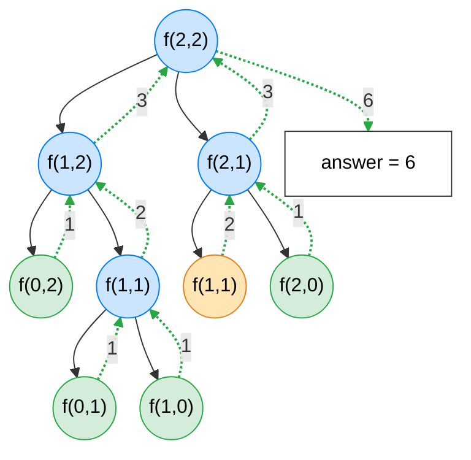
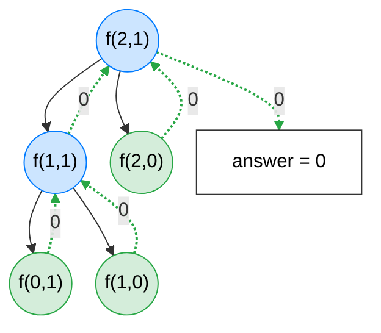
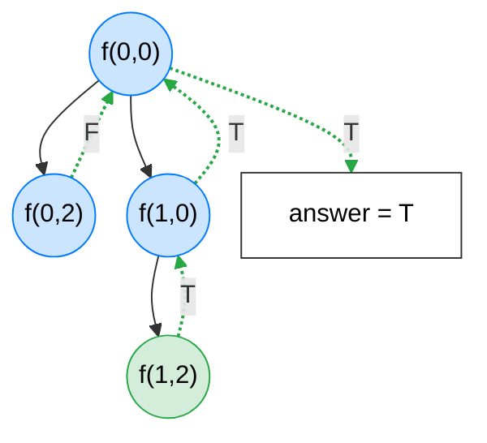

## LeetCode 62: Unique Paths
**Difficulty:** Medium | **Pattern:** 2D DP grid, count paths | **Language:** Java

### 1. Problem
- A robot starts at the top-left of an `m x n` grid and may only move right or down. Count the paths to the bottom-right. Example: `m = 3, n = 7` gives `28`; `m = 3, n = 4` gives `10`.
- Constraints: `1 <= m, n <= 100`, answer fits in 32-bit (at most 2 * 10^9). `O(m*n)` is trivially fine; brute-force recursion `O(2^(m+n))` is not.
- **Key insight:** the last move into any cell came either from above or from the left, and those two sets of paths are disjoint. So `paths(cell) = paths(above) + paths(left)`.

### 2. Solution
- **State:** `dp[i][j]` = number of distinct paths from `(0,0)` to `(i,j)`.
- **Recurrence:** `dp[i][j] = dp[i-1][j] + dp[i][j-1]`.
- **Base cases:** first row and first column are all `1` (only one straight line reaches them).
- **Iteration order:** row by row, left to right, so both neighbours are ready.
- **Step 1, brute force:** recurse `f(i,j) = f(i-1,j) + f(i,j-1)`. Exponential, because the same cell is recomputed through many routes.
- **Step 2, memoise / tabulate:** only `m*n` distinct states exist, each `O(1)`: `O(m*n)` time and space.
- **Step 3, space optimisation:** row `i` needs only row `i-1` (above) and the current row's left cell. A single array `dp[j]` already holds "above" before the update, and `dp[j-1]` already holds "left" after it. So `dp[j] += dp[j-1]` and space becomes `O(n)`.
- Also exists: closed form `C(m+n-2, m-1)`, but computing it safely needs care with overflow; the DP is the interview-expected answer.

```java
class Solution {
    public int uniquePaths(int m, int n) {
        if (n > m) { int t = m; m = n; n = t; }   // keep the rolling array short
        int[] dp = new int[n];
        java.util.Arrays.fill(dp, 1);              // first row: one path each
        for (int i = 1; i < m; i++) {
            for (int j = 1; j < n; j++) {
                dp[j] += dp[j - 1];                // dp[j] is "above", dp[j-1] is "left"
            }
        }
        return dp[n - 1];
    }
}
```
Implementation notes: swapping is safe because the grid is symmetric in paths. `int` is enough: every cell value is at most the final answer, which the problem bounds by 2 * 10^9.

### 3. Dry Run
Example `m = 3, n = 4`. Full table (row and column are 0-indexed):

| | c0 | c1 | c2 | c3 |
|---|---|---|---|---|
| **r0** | 1 | 1 | 1 | 1 |
| **r1** | 1 | 2 | 3 | 4 |
| **r2** | 1 | 3 | 6 | **10** |

Cell dependencies: `dp[2][3] = dp[1][3] (above, 4) + dp[2][2] (left, 6) = 10`. Likewise `dp[1][2] = dp[0][2] (1) + dp[1][1] (2) = 3`, `dp[2][2] = dp[1][2] (3) + dp[2][1] (3) = 6`.

Rolling array trace (`dp` after each row):

| Row | j=1 | j=2 | j=3 | dp after row |
|---|---|---|---|---|
| init | | | | [1,1,1,1] |
| i=1 | 1+1=2 | 1+2=3 | 1+3=4 | [1,2,3,4] |
| i=2 | 2+1=3 | 3+3=6 | 4+6=10 | [1,3,6,10] |

Top-down view on a 3x3 grid (`f(i,j)` = paths to `(i,j)`; `f(0,*)` and `f(*,0)` are base cases returning 1). Note the memo hit on `f(1,1)`:


Legend: green = base case, blue = computed call, orange = memo hit, dotted green = return value.

| Order | Call | Depth | Action | Returns |
|---|---|---|---|---|
| 1 | f(2,2) | 0 | recurse up and left | 6 |
| 2 | f(1,2) | 1 | recurse | 3 |
| 3 | f(0,2) | 2 | base (row 0) | 1 |
| 4 | f(1,1) | 2 | recurse, store memo | 2 |
| 5 | f(0,1) | 3 | base | 1 |
| 6 | f(1,0) | 3 | base | 1 |
| 7 | f(2,1) | 1 | recurse | 3 |
| 8 | f(1,1) | 2 | memo hit | 2 |
| 9 | f(2,0) | 2 | base (col 0) | 1 |

Answer for `3 x 4`: **10**.

**Complexity:** Time `O(m*n)` since each cell is computed once. Space `O(min(m,n))` for the rolling array.

### 4. Takeaway
- **Pattern:** counting routes in a grid with restricted moves: sum of predecessor counts. Any "number of ways to reach" with disjoint last steps.
- **Edge cases:**

| Input | Result | Note |
|---|---|---|
| m=1, n=1 | 1 | start equals end |
| m=1, n=5 | 1 | single straight line |
| m=3, n=7 | 28 | standard example |
| m=100, n=100 | fits int? use the problem bound | cells never exceed the answer |

- **Mistakes to avoid:**
  - Forgetting to initialise the first row/column to 1 (zero-filled arrays give 0 everywhere).
  - Starting the inner loop at `j = 0` in the rolling array, which would read `dp[-1]`.
  - Off-by-one: the answer is `dp[m-1][n-1]`, not `dp[m][n]`.
- **Related problems:** 63 Unique Paths II (obstacles zero cells), 64 Minimum Path Sum (min instead of sum), 70 Climbing Stairs (1D version), 120 Triangle.

---

## LeetCode 63: Unique Paths II
**Difficulty:** Medium | **Pattern:** 2D DP with obstacles | **Language:** Java

### 1. Problem
- Same as #62 but some cells are blocked (`1`). Count right/down paths from top-left to bottom-right avoiding obstacles. Example: `[[0,0,0],[0,1,0],[0,0,0]]` gives `2`.
- Constraints: `m, n <= 100`, answer at most 2 * 10^9. Target `O(m*n)`.
- **Key insight:** an obstacle simply has zero paths through it, so `dp = 0` there. That automatically kills everything that could only be reached via it, including the rest of the first row or column after an obstacle.

### 2. Solution
- **State:** `dp[i][j]` = paths from `(0,0)` to `(i,j)`; `0` if the cell is an obstacle.
- **Recurrence:** if `grid[i][j] == 1` then `0`, else `dp[i-1][j] + dp[i][j-1]`.
- **Base cases:** `dp[0][0] = 1` unless the start is blocked (then answer `0`). First row: `dp[0][j] = dp[0][j-1]` if open else `0`; first column similarly. An obstacle there zeroes everything after it.
- **Iteration order:** row by row, left to right.
- **Step 1, brute force:** recursion with the obstacle check, exponential.
- **Step 2, table:** `O(m*n)` time and space.
- **Step 3, space optimisation:** one array. Start `dp[0] = 1` as the virtual "above" of row 0. For each cell: obstacle gives `dp[j] = 0`; otherwise `dp[j] += dp[j-1]` (for `j > 0`). Column 0 keeps its previous value (the "above") unless it is blocked, which is exactly the first-column rule.

```java
class Solution {
    public int uniquePathsWithObstacles(int[][] grid) {
        int n = grid[0].length;
        long[] dp = new long[n];
        dp[0] = 1;                                  // virtual cell above (0,0)
        for (int[] row : grid) {
            for (int j = 0; j < n; j++) {
                if (row[j] == 1) {
                    dp[j] = 0;                      // blocked: no path ends here
                } else if (j > 0) {
                    dp[j] += dp[j - 1];             // above (old dp[j]) + left
                }
            }
        }
        return (int) dp[n - 1];
    }
}
```
Implementation notes: `long` guards intermediate cells that may exceed the final answer when later obstacles cut them off. If `grid[0][0] == 1`, `dp[0]` becomes `0` in the first iteration and the whole answer is `0`.

### 3. Dry Run
Grid (`1` = obstacle):

| | c0 | c1 | c2 |
|---|---|---|---|
| r0 | 0 | 0 | 0 |
| r1 | 0 | **1** | 0 |
| r2 | 0 | 0 | 0 |

Full DP table:

| | c0 | c1 | c2 |
|---|---|---|---|
| **r0** | 1 | 1 | 1 |
| **r1** | 1 | 0 | 1 |
| **r2** | 1 | 1 | **2** |

Dependencies: `dp[1][2] = dp[0][2] (1) + dp[1][1] (0) = 1`; `dp[2][1] = dp[1][1] (0) + dp[2][0] (1) = 1`; `dp[2][2] = dp[1][2] (1) + dp[2][1] (1) = 2`.

Rolling array trace:

| Row | Per-cell action | dp after row |
|---|---|---|
| init | dp[0]=1 | [1,0,0] |
| r0 | j0 keep 1; j1 0+1=1; j2 0+1=1 | [1,1,1] |
| r1 | j0 keep 1; j1 obstacle -> 0; j2 1+0=1 | [1,0,1] |
| r2 | j0 keep 1; j1 0+1=1; j2 1+1=2 | [1,1,2] |

Answer: **2**.

**Complexity:** Time `O(m*n)`, each cell once. Space `O(n)`, one rolling array.

### 4. Takeaway
- **Pattern:** DP where some states are invalid: set them to the identity of the combine operation (0 for sums) and let the recurrence propagate.
- **Edge cases:**

| Input | Result | Note |
|---|---|---|
| start blocked | 0 | dp[0] zeroed immediately |
| end blocked | 0 | final cell forced to 0 |
| `[[0]]` | 1 | single open cell |
| obstacle in row 0 at col k | cells right of k in row 0 are 0 | handled by `dp[j] += dp[j-1]` chain |
| `[[1]]` | 0 | start is obstacle |

- **Mistakes to avoid:**
  - Initialising the whole first row/column to `1` regardless of obstacles.
  - Forgetting to zero `dp[j]` on an obstacle in the rolling version (stale "above" value leaks through).
  - Using `int` and overflowing on intermediate cells.
- **Related problems:** 62 Unique Paths (no obstacles), 64 Minimum Path Sum, 980 Unique Paths III (must visit every cell, needs backtracking).

---

## LeetCode 64: Minimum Path Sum
**Difficulty:** Medium | **Pattern:** 2D DP grid, minimise cost | **Language:** Java

### 1. Problem
- Given an `m x n` grid of non-negative numbers, find the right/down path from top-left to bottom-right with the smallest sum. Example: `[[1,3,1],[1,5,1],[4,2,1]]` gives `7` (path 1,3,1,1,1).
- Constraints: `m, n <= 200`, values `<= 200`, so sums stay far below `int` overflow. `O(m*n)` is the target.
- **Key insight:** the best path to a cell must end with the better of two predecessors, so `best(cell) = cost(cell) + min(best(above), best(left))`. Optimal substructure holds because costs are non-negative and independent of how you arrived.

### 2. Solution
- **State:** `dp[i][j]` = minimum cost of any path from `(0,0)` to `(i,j)`, including both endpoints.
- **Recurrence:** `dp[i][j] = grid[i][j] + min(dp[i-1][j], dp[i][j-1])`.
- **Base cases:** `dp[0][0] = grid[0][0]`; first row is a running prefix sum; first column likewise (only one way in).
- **Iteration order:** row by row, left to right.
- **Step 1, brute force:** try all paths, `O(2^(m+n))`.
- **Step 2, DP:** `O(m*n)` time and space.
- **Step 3, space optimisation:** keep one row. `dp[j]` before update is "above", `dp[j-1]` after update is "left". We can even reuse a single `int[n]`, leaving the input untouched.

```java
class Solution {
    public int minPathSum(int[][] grid) {
        int n = grid[0].length;
        int[] dp = new int[n];
        dp[0] = grid[0][0];
        for (int j = 1; j < n; j++) dp[j] = dp[j - 1] + grid[0][j];   // first row
        for (int i = 1; i < grid.length; i++) {
            dp[0] += grid[i][0];                                      // first column
            for (int j = 1; j < n; j++) {
                dp[j] = grid[i][j] + Math.min(dp[j], dp[j - 1]);      // above vs left
            }
        }
        return dp[n - 1];
    }
}
```

### 3. Dry Run
Grid:

| | c0 | c1 | c2 |
|---|---|---|---|
| r0 | 1 | 3 | 1 |
| r1 | 1 | 5 | 1 |
| r2 | 4 | 2 | 1 |

Full DP table:

| | c0 | c1 | c2 |
|---|---|---|---|
| **r0** | 1 | 4 | 5 |
| **r1** | 2 | 7 | 6 |
| **r2** | 6 | 8 | **7** |

Dependencies: `dp[1][1] = 5 + min(dp[0][1]=4, dp[1][0]=2) = 7`; `dp[1][2] = 1 + min(5, 7) = 6`; `dp[2][1] = 2 + min(7, 6) = 8`; `dp[2][2] = 1 + min(dp[1][2]=6, dp[2][1]=8) = 7`.

Rolling array trace:

| Row | Updates | dp after |
|---|---|---|
| r0 | prefix sums 1, 4, 5 | [1,4,5] |
| r1 | dp0=1+1=2; dp1=5+min(4,2)=7; dp2=1+min(5,7)=6 | [2,7,6] |
| r2 | dp0=2+4=6; dp1=2+min(7,6)=8; dp2=1+min(6,8)=7 | [6,8,7] |

Traceback of the path: from `(2,2)` pick the smaller predecessor `(1,2)=6`, then `(0,2)=5`, `(0,1)=4`, `(0,0)=1`: the path 1 -> 3 -> 1 -> 1 -> 1.

Answer: **7**.

**Complexity:** Time `O(m*n)`. Space `O(n)`.

### 4. Takeaway
- **Pattern:** grid shortest path with only forward moves: DP in topological order (cheaper than Dijkstra). If moves can go in all four directions, DP is invalid; use Dijkstra.
- **Edge cases:**

| Input | Result | Note |
|---|---|---|
| `[[5]]` | 5 | single cell |
| one row | sum of row | only one path |
| one column | sum of column | only one path |
| all zeros | 0 | any path |

- **Mistakes to avoid:**
  - Taking `min` in the first row/column using out-of-range neighbours (use prefix sums instead, or a large sentinel).
  - Forgetting to include `grid[i][j]` itself.
  - Using greedy "go to the smaller neighbour": it is wrong.
- **Related problems:** 62/63 (counting instead of minimising), 120 Triangle, 174 Dungeon Game (needs a backward DP), 931 Minimum Falling Path Sum.

---

## LeetCode 1143: Longest Common Subsequence
**Difficulty:** Medium | **Pattern:** 2D DP on two sequences | **Language:** Java

### 1. Problem
- Return the length of the longest subsequence (order kept, not necessarily contiguous) common to two strings. Example: `"abcde"`, `"ace"` gives `3` (`"ace"`).
- Constraints: lengths up to 1000, so `O(n*m)` = 10^6 steps is fine; exponential subsets are not.
- **Key insight:** compare the last characters. If equal, they belong in some optimal LCS, so shrink both. If not, at least one of them is unused: drop one from either string and take the better.

### 2. Solution
- **State:** `dp[i][j]` = LCS length of `a[0..i-1]` and `b[0..j-1]`.
- **Recurrence:** if `a[i-1] == b[j-1]`, `dp[i][j] = dp[i-1][j-1] + 1`; else `max(dp[i-1][j], dp[i][j-1])`.
- **Base cases:** `dp[0][j] = dp[i][0] = 0` (an empty string shares nothing).
- **Iteration order:** `i` ascending, `j` ascending; each cell needs up, left and up-left.
- **Step 1, brute force:** enumerate all `2^n` subsequences of one string and test each: far too slow.
- **Step 2, recursion on suffixes/prefixes:** `lcs(i,j)` branches into two calls when characters differ, `O(2^(n+m))`, but only `n*m` distinct pairs: memoise.
- **Step 3, table:** `O(n*m)` time and space.
- **Step 4, space optimisation:** row `i` needs row `i-1` only. Keep two rows (or one row plus a saved `prev` for the diagonal): `O(min(n,m))`. The one-row trick loses the table, so reconstruct from the full table when the actual subsequence is required (or use Hirschberg's divide and conquer for linear space).
- The code below gives the length with a rolling row, and a second method that rebuilds the subsequence from the full table.

```java
class Solution {
    public int longestCommonSubsequence(String text1, String text2) {
        if (text1.length() < text2.length()) { String t = text1; text1 = text2; text2 = t; }
        int m = text2.length();
        int[] dp = new int[m + 1];
        for (int i = 1; i <= text1.length(); i++) {
            int diag = 0;                                // dp[i-1][j-1]
            char c = text1.charAt(i - 1);
            for (int j = 1; j <= m; j++) {
                int up = dp[j];                          // dp[i-1][j]
                dp[j] = (c == text2.charAt(j - 1)) ? diag + 1 : Math.max(up, dp[j - 1]);
                diag = up;
            }
        }
        return dp[m];
    }

    // Reconstruct one actual LCS using the full table.
    static String lcsString(String a, String b) {
        int n = a.length(), m = b.length();
        int[][] dp = new int[n + 1][m + 1];
        for (int i = 1; i <= n; i++)
            for (int j = 1; j <= m; j++)
                dp[i][j] = a.charAt(i - 1) == b.charAt(j - 1)
                        ? dp[i - 1][j - 1] + 1
                        : Math.max(dp[i - 1][j], dp[i][j - 1]);
        StringBuilder sb = new StringBuilder();
        int i = n, j = m;
        while (i > 0 && j > 0) {
            if (a.charAt(i - 1) == b.charAt(j - 1)) { sb.append(a.charAt(i - 1)); i--; j--; }
            else if (dp[i - 1][j] >= dp[i][j - 1]) i--;
            else j--;
        }
        return sb.reverse().toString();
    }
}
```
Implementation notes: the `diag` variable preserves the old `dp[i-1][j-1]` that the in-place update would otherwise overwrite. Swapping makes the row the shorter string.

### 3. Dry Run
`a = "abcde"` (rows), `b = "ace"` (columns).

| | "" | a | c | e |
|---|---|---|---|---|
| **""** | 0 | 0 | 0 | 0 |
| **a** | 0 | 1 | 1 | 1 |
| **b** | 0 | 1 | 1 | 1 |
| **c** | 0 | 1 | 2 | 2 |
| **d** | 0 | 1 | 2 | 2 |
| **e** | 0 | 1 | 2 | **3** |

Key cells: `dp[3][2]` (c, c) match, so `dp[2][1] + 1 = 1 + 1 = 2`. `dp[2][2]` (b vs c) mismatch: `max(dp[1][2]=1, dp[2][1]=1) = 1`. `dp[5][3]` (e, e) match: `dp[4][2] + 1 = 3`.

Traceback (start at `(5,3)`):

| Cell | Chars | Action | Collected (reverse order) |
|---|---|---|---|
| (5,3) | e = e | take, go diagonal to (4,2) | e |
| (4,2) | d vs c | up (2) >= left (1), go to (3,2) | e |
| (3,2) | c = c | take, go diagonal to (2,1) | e c |
| (2,1) | b vs a | up (1) >= left (0), go to (1,1) | e c |
| (1,1) | a = a | take, go diagonal to (0,0) | e c a |

Reversed: **"ace"**, length **3**.

Top-down view for the tiny mismatching pair `"ab"` / `"c"` (`f(i,j)` = LCS of the first `i` and `j` characters):


Legend: green = base case (an empty prefix), blue = computed call, dotted green = return value. Both characters differ (`b` vs `c`, then `a` vs `c`), so each call branches into "drop last of a" and "drop last of b" and takes the max; no memo hit occurs at this size (hits appear once strings are longer and subproblems overlap).

| Order | Call | Depth | Action | Returns |
|---|---|---|---|---|
| 1 | f(2,1) | 0 | `b` != `c`: max of f(1,1), f(2,0) | 0 |
| 2 | f(1,1) | 1 | `a` != `c`: max of f(0,1), f(1,0) | 0 |
| 3 | f(0,1) | 2 | base (empty a) | 0 |
| 4 | f(1,0) | 2 | base (empty b) | 0 |
| 5 | f(2,0) | 1 | base (empty b) | 0 |

Answer for the main example: **3**, subsequence `"ace"`.

**Complexity:** Time `O(n*m)`. Space `O(min(n,m))` for length only; `O(n*m)` when reconstructing.

### 4. Takeaway
- **Pattern:** "longest/best alignment preserving order of two sequences". The table is the template for diff, edit distance and many counting variants.
- **Edge cases:**

| Input | Result | Note |
|---|---|---|
| one empty string | 0 | base row/column |
| identical strings | length | full diagonal |
| no common chars | 0 | all `max` of zeros |
| `"abc"`, `"cba"` | 1 | order matters |

- **Mistakes to avoid:**
  - Confusing subsequence with substring (substring resets to 0 on mismatch).
  - Losing the diagonal when updating in place.
  - On traceback, mismatching tie-breaks give a different but equally valid LCS; that is fine.
- **Related problems:** 72 Edit Distance, 583 Delete Operation for Two Strings (`n+m-2*LCS`), 1035 Uncrossed Lines (same recurrence), 516 Longest Palindromic Subsequence (LCS of s and reverse), 718 Longest Common Substring variant, 1092 Shortest Common Supersequence.

---

## LeetCode 72: Edit Distance
**Difficulty:** Medium | **Pattern:** Levenshtein distance DP (insert/delete/replace) | **Language:** Java

### 1. Problem
- Minimum number of single-character insert, delete or replace operations to turn `word1` into `word2`. Example: `"horse"` -> `"ros"` gives `3`.
- Constraints: lengths up to 500, so `O(n*m)` = 250,000 states is easy.
- **Key insight:** look at the last characters. If equal, no operation is needed for them. If not, the last step was one of three operations, each reducing to a smaller prefix pair; take the cheapest.

### 2. Solution
- **State:** `dp[i][j]` = minimum operations to convert `word1[0..i-1]` into `word2[0..j-1]`.
- **Recurrence:** if `w1[i-1] == w2[j-1]`: `dp[i][j] = dp[i-1][j-1]`. Else `1 + min(dp[i-1][j-1] (replace), dp[i-1][j] (delete from word1), dp[i][j-1] (insert into word1))`.
- **Base cases:** `dp[i][0] = i` (delete everything), `dp[0][j] = j` (insert everything).
- **Iteration order:** `i` ascending, `j` ascending.
- **Step 1, brute force:** recursive three-way branching, `O(3^(n+m))`.
- **Step 2, memoise/tabulate:** only `(n+1)*(m+1)` pairs: `O(n*m)`.
- **Step 3, space optimisation:** a row depends only on the previous row, so one array with a saved `diag` gives `O(m)` space. Reconstruction of operations needs the full table, so `operations` below rebuilds it separately.

```java
class Solution {
    public int minDistance(String word1, String word2) {
        int n = word1.length(), m = word2.length();
        int[] dp = new int[m + 1];
        for (int j = 0; j <= m; j++) dp[j] = j;            // row 0: insert j chars
        for (int i = 1; i <= n; i++) {
            int diag = dp[0];                              // dp[i-1][0]
            dp[0] = i;                                     // column 0: delete i chars
            char c = word1.charAt(i - 1);
            for (int j = 1; j <= m; j++) {
                int up = dp[j];                            // dp[i-1][j]
                if (c == word2.charAt(j - 1)) {
                    dp[j] = diag;
                } else {
                    dp[j] = 1 + Math.min(diag, Math.min(up, dp[j - 1]));
                }
                diag = up;
            }
        }
        return dp[m];
    }

    // Full-table version that also returns the operations.
    static java.util.List<String> operations(String a, String b) {
        int n = a.length(), m = b.length();
        int[][] dp = new int[n + 1][m + 1];
        for (int i = 0; i <= n; i++) dp[i][0] = i;
        for (int j = 0; j <= m; j++) dp[0][j] = j;
        for (int i = 1; i <= n; i++)
            for (int j = 1; j <= m; j++)
                dp[i][j] = a.charAt(i - 1) == b.charAt(j - 1)
                        ? dp[i - 1][j - 1]
                        : 1 + Math.min(dp[i - 1][j - 1], Math.min(dp[i - 1][j], dp[i][j - 1]));
        java.util.ArrayList<String> ops = new java.util.ArrayList<>();
        int i = n, j = m;
        while (i > 0 || j > 0) {
            if (i > 0 && j > 0 && a.charAt(i - 1) == b.charAt(j - 1)) { ops.add("keep " + a.charAt(i - 1)); i--; j--; }
            else if (i > 0 && j > 0 && dp[i][j] == dp[i - 1][j - 1] + 1) { ops.add("replace " + a.charAt(i - 1) + "->" + b.charAt(j - 1)); i--; j--; }
            else if (i > 0 && dp[i][j] == dp[i - 1][j] + 1) { ops.add("delete " + a.charAt(i - 1)); i--; }
            else { ops.add("insert " + b.charAt(j - 1)); j--; }
        }
        java.util.Collections.reverse(ops);
        return ops;
    }
}
```
Implementation notes: when characters match, the diagonal is always at least as good as the other two, so no `min` is needed there.

### 3. Dry Run
`word1 = "horse"` (rows), `word2 = "ros"` (columns).

| | "" | r | o | s |
|---|---|---|---|---|
| **""** | 0 | 1 | 2 | 3 |
| **h** | 1 | 1 | 2 | 3 |
| **o** | 2 | 2 | 1 | 2 |
| **r** | 3 | 2 | 2 | 2 |
| **s** | 4 | 3 | 3 | 2 |
| **e** | 5 | 4 | 4 | **3** |

Sample cells and their three feeders (diag = replace, up = delete, left = insert):
- `dp[1][1]` (h vs r): `1 + min(diag 0, up 1, left 1) = 1`.
- `dp[2][2]` (o = o): match, copy diag `dp[1][1] = 1`.
- `dp[3][2]` (r vs o): `1 + min(diag dp[2][1]=2, up dp[2][2]=1, left dp[3][1]=2) = 2`.
- `dp[5][3]` (e vs s): `1 + min(diag dp[4][2]=3, up dp[4][3]=2, left dp[5][2]=4) = 3`.

Traceback from `(5,3)`:

| Cell | Value | Move | Operation |
|---|---|---|---|
| (5,3) | 3 | up (2+1) | delete e |
| (4,3) | 2 | match s = s, diag | keep s |
| (3,2) | 2 | up dp[2][2]=1, +1 | delete r |
| (2,2) | 1 | match o = o, diag | keep o |
| (1,1) | 1 | diag dp[0][0]=0, +1 | replace h->r |

Read from the top of the string: replace `h` with `r` (`rorse`), keep `o`, delete `r` (`rose`), keep `s`, delete `e` (`ros`). Three operations.

Answer: **3**.

**Complexity:** Time `O(n*m)`. Space `O(m)` for the value, `O(n*m)` if you need the operation list.

### 4. Takeaway
- **Pattern:** transform one sequence to another with local edits; LCS-shaped table with a third (diagonal-with-cost) option.
- **Edge cases:**

| Input | Result | Note |
|---|---|---|
| `""`, `"abc"` | 3 | all inserts |
| `"abc"`, `""` | 3 | all deletes |
| equal strings | 0 | diagonal all matches |
| `"a"`, `"b"` | 1 | one replace |

- **Mistakes to avoid:**
  - Forgetting to set `dp[0]` for each new row in the rolling version.
  - Using `+1` on the matching case.
  - Mixing up which of up/left means insert vs delete (only matters for reconstruction).
- **Related problems:** 1143 LCS, 583 Delete Operation for Two Strings, 712 Minimum ASCII Delete Sum, 161 One Edit Distance (premium, linear scan).

---

## LeetCode 97: Interleaving String
**Difficulty:** Medium | **Pattern:** 2D DP, can s3 be formed by interleaving s1 and s2 | **Language:** Java

### 1. Problem
- Decide whether `s3` is an interleaving of `s1` and `s2`: both are split into substrings that are merged alternately while preserving each string's internal order. Example: `s1="aabcc"`, `s2="dbbca"`, `s3="aadbbcbcac"` is `true`; `s3="aadbbbaccc"` is `false`.
- Constraints: lengths up to 100 (follow-up asks for `O(s2.length)` space). `O(n*m)` is the target.
- **Key insight:** after using `i` chars of `s1` and `j` of `s2`, exactly `i+j` characters of `s3` are consumed. So `(i,j)` fully describes the position, and the next `s3` char must come from `s1[i]` or `s2[j]`.

### 2. Solution
- **Quick reject:** if `n + m != s3.length()`, return `false`.
- **State:** `dp[i][j]` = true if `s3[0..i+j-1]` is an interleaving of `s1[0..i-1]` and `s2[0..j-1]`.
- **Recurrence:** `dp[i][j] = (dp[i-1][j] && s1[i-1] == s3[i+j-1]) || (dp[i][j-1] && s2[j-1] == s3[i+j-1])`.
- **Base cases:** `dp[0][0] = true`; first row/column follow the same recurrence using only one string.
- **Iteration order:** row by row, left to right.
- **Step 1, brute force:** DFS trying `s1` then `s2` at each character, `O(2^(n+m))`.
- **Step 2, memoise:** `(i,j)` pairs only: `O(n*m)`.
- **Step 3, space optimisation:** each row needs only the row above, so one array of length `m+1`: `dp[j]` (before update) is "above", `dp[j-1]` is "left".

```java
class Solution {
    public boolean isInterleave(String s1, String s2, String s3) {
        int n = s1.length(), m = s2.length();
        if (n + m != s3.length()) return false;
        boolean[] dp = new boolean[m + 1];
        dp[0] = true;
        for (int j = 1; j <= m; j++) {
            dp[j] = dp[j - 1] && s2.charAt(j - 1) == s3.charAt(j - 1);
        }
        for (int i = 1; i <= n; i++) {
            dp[0] = dp[0] && s1.charAt(i - 1) == s3.charAt(i - 1);
            for (int j = 1; j <= m; j++) {
                char c = s3.charAt(i + j - 1);
                dp[j] = (dp[j] && s1.charAt(i - 1) == c)
                     || (dp[j - 1] && s2.charAt(j - 1) == c);
            }
        }
        return dp[m];
    }
}
```

### 3. Dry Run
Small example: `s1 = "aa"`, `s2 = "ab"`, `s3 = "aaba"` (length 4 = 2 + 2).

Full table (rows `i` chars of s1, columns `j` chars of s2; T = true, F = false):

| | j=0 "" | j=1 "a" | j=2 "ab" |
|---|---|---|---|
| **i=0 ""** | T | T | F |
| **i=1 "a"** | T | T | T |
| **i=2 "aa"** | T | F | **T** |

Cell derivations (`k = i+j-1` indexes `s3`, `s3 = a a b a`):

| Cell | s3[k] | From up (uses s1[i-1]) | From left (uses s2[j-1]) | Result |
|---|---|---|---|---|
| (0,1) | a | n/a | dp[0][0]=T, s2[0]=a = a | T |
| (0,2) | a | n/a | dp[0][1]=T, s2[1]=b != a | F |
| (1,0) | a | dp[0][0]=T, s1[0]=a = a | n/a | T |
| (2,0) | a | dp[1][0]=T, s1[1]=a = a | n/a | T |
| (1,1) | a | dp[0][1]=T, s1[0]=a = a -> T | | T |
| (1,2) | b | dp[0][2]=F | dp[1][1]=T, s2[1]=b = b | T |
| (2,1) | b | dp[1][1]=T, s1[1]=a != b | dp[2][0]=T, s2[0]=a != b | F |
| (2,2) | a | dp[1][2]=T, s1[1]=a = a | | T |

Path (traceback through true cells): `(2,2)` <- up `(1,2)` took `s1[1]`; `(1,2)` <- left `(1,1)` took `s2[1]='b'`; `(1,1)` <- up `(0,1)` took `s1[0]`; `(0,1)` <- left `(0,0)` took `s2[0]`. Reading forward: `s2:a, s1:a, s2:b, s1:a` = `"aaba"`.

Answer: **true**.

**Complexity:** Time `O(n*m)`. Space `O(m)`.

### 4. Takeaway
- **Pattern:** two-pointer merge validity where the position in the target is implied by the sum of pointers; DP on the pair `(i,j)`. Greedy fails because equal characters at the heads make the choice ambiguous.
- **Edge cases:**

| Input | Result | Note |
|---|---|---|
| lengths do not add up | false | early exit |
| s1 = s2 = s3 = "" | true | `dp[0][0]` |
| s1 = "", s2 = s3 | true | only first row |
| s1 = "a", s2 = "b", s3 = "ba" | true | order of strings is free |

- **Mistakes to avoid:**
  - Indexing `s3` with `i` or `j` instead of `i+j-1`.
  - Skipping the length check (index out of range).
  - Using a greedy pointer walk: fails when `s1[i] == s2[j]`.
- **Related problems:** 1143 LCS, 72 Edit Distance, 392 Is Subsequence (single string), 115 Distinct Subsequences.

---

## LeetCode 115: Distinct Subsequences
**Difficulty:** Hard | **Pattern:** 2D DP, count ways to form t as a subsequence of s | **Language:** Java

### 1. Problem
- Count how many distinct index selections of `s` spell `t` as a subsequence. Example: `s = "rabbbit"`, `t = "rabbit"` gives `3`.
- Constraints: lengths up to 1000; answer fits in 32-bit. `O(n*m)` is the target.
- **Key insight:** consider the last character of `s`. You can always skip it (all ways from the shorter `s`); and if it equals the last character of `t`, you can also use it to match, adding the ways to build the shorter `t` from the shorter `s`.

### 2. Solution
- **State:** `dp[i][j]` = number of ways to form `t[0..i-1]` from `s[0..j-1]` (rows follow `t`, columns follow `s`).
- **Recurrence:** `dp[i][j] = dp[i][j-1] + (t[i-1] == s[j-1] ? dp[i-1][j-1] : 0)`.
- **Base cases:** `dp[0][j] = 1` (empty `t` is formed by choosing nothing); `dp[i][0] = 0` for `i > 0`.
- **Iteration order:** `i` ascending, `j` ascending.
- **Step 1, brute force:** generate all subsequences of `s` and count those equal to `t`: `O(2^n)`.
- **Step 2, recursion with skip/take:** still exponential without memo, but states are `(i,j)` only.
- **Step 3, table:** `O(n*m)`.
- **Step 4, space optimisation:** loop over characters of `s` as the outer loop, keep `dp[i]` over `t`, and update `i` in descending order so `dp[i-1]` is still the previous column's value. Space `O(|t|)`.

```java
class Solution {
    public int numDistinct(String s, String t) {
        int m = t.length();
        if (m > s.length()) return 0;
        int[] dp = new int[m + 1];
        dp[0] = 1;
        for (int j = 0; j < s.length(); j++) {
            char c = s.charAt(j);
            for (int i = Math.min(m, j + 1); i >= 1; i--) {   // descending: reuse dp[i-1] from previous column
                if (t.charAt(i - 1) == c) dp[i] += dp[i - 1];
            }
        }
        return dp[m];
    }
}
```
Implementation notes: intermediate prefix counts may exceed `int`, but only additions are used, so wrap-around is harmless modular arithmetic and the final answer (guaranteed to fit) is exact.

### 3. Dry Run
Example `s = "abab"`, `t = "ab"` (expected 3: index pairs (0,1), (0,3), (2,3)).

Full table (rows = prefix of `t`, columns = prefix of `s`):

| | j=0 "" | j=1 a | j=2 b | j=3 a | j=4 b |
|---|---|---|---|---|---|
| **i=0 ""** | 1 | 1 | 1 | 1 | 1 |
| **i=1 a** | 0 | 1 | 1 | 2 | 2 |
| **i=2 ab** | 0 | 0 | 1 | 1 | **3** |

Derivations:
- `dp[1][1]`: `a = a`: skip `dp[1][0]=0` + use `dp[0][0]=1` = 1.
- `dp[1][2]`: `b != a`: `dp[1][1] = 1`.
- `dp[1][3]`: `a = a`: skip `dp[1][2]=1` + use `dp[0][2]=1` = 2.
- `dp[2][2]`: `b = b`: skip `dp[2][1]=0` + use `dp[1][1]=1` = 1.
- `dp[2][3]`: `a != b`: skip only, `dp[2][2] = 1`.
- `dp[2][4]`: `b = b`: skip `dp[2][3]=1` + use `dp[1][3]=2` = 3.

Cell feeders: `dp[i][j]` is fed by its left neighbour (skip) and by its up-left diagonal (use) only when characters match.

Rolling array trace (`dp[0..2]` after each character of `s`):

| s char | action | dp |
|---|---|---|
| init | | [1,0,0] |
| a | i=1: t[0]=a match, dp1 += dp0 | [1,1,0] |
| b | i=2: t[1]=b match, dp2 += dp1; i=1: b != a | [1,1,1] |
| a | i=2: a != b; i=1: dp1 += dp0 | [1,2,1] |
| b | i=2: dp2 += dp1 (1+2); i=1: no | [1,2,3] |

Answer: **3**.

**Complexity:** Time `O(n*m)`. Space `O(m)`.

### 4. Takeaway
- **Pattern:** "count embeddings of one sequence in another": same table as LCS but sums instead of max, with "skip" always allowed and "use" only on a match.
- **Edge cases:**

| Input | Result | Note |
|---|---|---|
| t longer than s | 0 | early exit |
| t = "" | 1 | the empty selection |
| s = t | 1 | one embedding |
| s = "aaa", t = "aa" | 3 | choose 2 of 3 positions |

- **Mistakes to avoid:**
  - Iterating `i` ascending in the 1D version (reuses the already-updated value and over-counts).
  - Setting `dp[0][j]` to 0 (the empty target has exactly one way).
  - Using `max` or boolean logic instead of addition.
- **Related problems:** 1143 LCS (optimise length vs count), 392 Is Subsequence (existence), 940 Distinct Subsequences II (count within one string), 72 Edit Distance.

---

## LeetCode 221: Maximal Square
**Difficulty:** Medium | **Pattern:** 2D DP, dp[i][j] = side of largest all-1 square ending here | **Language:** Java

### 1. Problem
- Given a binary character matrix, return the area of the largest square containing only `'1'`. Example: the matrix below gives `4` (a 2x2 square).
- Constraints: up to 300 x 300, so `O(m*n)` is the target; checking every square size from every corner is `O(m*n*min(m,n)^2)` or worse.
- **Key insight:** a square of side `k` ending at `(i,j)` needs squares of side `k-1` ending at the top, left and top-left cells. The smallest of those three limits the growth.

### 2. Solution
- **State:** `dp[i][j]` = side length of the largest all-1 square whose bottom-right corner is `(i,j)`.
- **Recurrence:** if `matrix[i][j] == '1'`: `dp[i][j] = 1 + min(dp[i-1][j], dp[i][j-1], dp[i-1][j-1])`; else `0`.
- **Base cases:** a border cell is `1` if it is `'1'`, else `0` (use a padded row/column of zeros to avoid special-casing).
- **Iteration order:** row by row, left to right.
- **Step 1, brute force:** for each cell as top-left, grow the side while the new row/column are all ones: `O(m*n*min(m,n)^2)`.
- **Step 2, DP table:** `O(m*n)` time and space.
- **Step 3, space optimisation:** only the previous row is needed. Use `dp[n+1]` (padded), and keep the old up-left value in a variable `prevDiag` before overwriting.
- Answer is `maxSide * maxSide`. Why `min`: the three neighbours are the largest squares that fit in each direction; the corner square can only be as large as the weakest direction plus one.

```java
class Solution {
    public int maximalSquare(char[][] matrix) {
        int n = matrix[0].length, best = 0;
        int[] dp = new int[n + 1];                // dp[j+1] corresponds to column j; dp[0] is the zero pad
        for (char[] row : matrix) {
            int diag = 0;                         // dp[i-1][j-1]
            for (int j = 1; j <= n; j++) {
                int up = dp[j];                   // dp[i-1][j]
                if (row[j - 1] == '1') {
                    dp[j] = 1 + Math.min(diag, Math.min(up, dp[j - 1]));
                    best = Math.max(best, dp[j]);
                } else {
                    dp[j] = 0;
                }
                diag = up;
            }
        }
        return best * best;
    }
}
```

### 3. Dry Run
Matrix:

| | c0 | c1 | c2 | c3 | c4 |
|---|---|---|---|---|---|
| r0 | 1 | 0 | 1 | 0 | 0 |
| r1 | 1 | 0 | 1 | 1 | 1 |
| r2 | 1 | 1 | 1 | 1 | 1 |
| r3 | 1 | 0 | 0 | 1 | 0 |

Full DP table:

| | c0 | c1 | c2 | c3 | c4 |
|---|---|---|---|---|---|
| **r0** | 1 | 0 | 1 | 0 | 0 |
| **r1** | 1 | 0 | 1 | 1 | 1 |
| **r2** | 1 | 1 | 1 | **2** | **2** |
| **r3** | 1 | 0 | 0 | 1 | 0 |

Key cells and their three feeders (up, left, up-left):
- `dp[1][3]`: up `dp[0][3]=0`, left `dp[1][2]=1`, diag `dp[0][2]=1`; min 0, so 1.
- `dp[2][2]`: up `dp[1][2]=1`, left `dp[2][1]=1`, diag `dp[1][1]=0`; min 0, so 1.
- `dp[2][3]`: up `dp[1][3]=1`, left `dp[2][2]=1`, diag `dp[1][2]=1`; min 1, so 2.
- `dp[2][4]`: up `dp[1][4]=1`, left `dp[2][3]=2`, diag `dp[1][3]=1`; min 1, so 2.
- `dp[3][3]`: up `dp[2][3]=2`, left `dp[3][2]=0`, diag `dp[2][2]=1`; min 0, so 1.

Maximum side = 2 (first reached at `(2,3)`: the square covering rows 1-2, columns 2-3).

Answer: area = 2 * 2 = **4**.

**Complexity:** Time `O(m*n)`. Space `O(n)`.

### 4. Takeaway
- **Pattern:** "largest uniform block ending at a cell" with min-of-neighbours. For rectangles, switch to the histogram/monotonic-stack approach (#85).
- **Edge cases:**

| Input | Result | Note |
|---|---|---|
| `[["0"]]` | 0 | no ones |
| `[["1"]]` | 1 | side 1 |
| all ones 3x3 | 9 | side 3 |
| one row of ones | 1 | squares of side 1 only |

- **Mistakes to avoid:**
  - Returning the side instead of the area.
  - Comparing `matrix[i][j] == 1` instead of the character `'1'`.
  - Overwriting the diagonal before saving it in the 1D version.
  - Using `max` or `sum` of neighbours instead of `min`.
- **Related problems:** 85 Maximal Rectangle (stack-based), 1277 Count Square Submatrices with All Ones (sum of dp), 1139 Largest 1-Bordered Square.

---

## LeetCode 10: Regular Expression Matching
**Difficulty:** Hard | **Pattern:** 2D DP, match string against pattern with `.` and `*` | **Language:** Java

### 1. Problem
- Implement matching of the whole string `s` against pattern `p` where `.` matches any single character and `*` means zero or more of the PRECEDING element. Example: `s="aab"`, `p="c*a*b"` is `true`; `s="ab"`, `p=".*"` is `true`; `s="aa"`, `p="a"` is `false`.
- Constraints: lengths up to 20 (pattern) and 20 (string); `*` always has a valid preceding character. `O(n*m)` DP is the target; naive backtracking is exponential.
- **Key insight:** `x*` is a unit. It can disappear (zero copies) or consume one more matching character while staying in place to possibly consume more.

### 2. Solution
- **State:** `dp[i][j]` = true if `s[0..i-1]` fully matches `p[0..j-1]`.
- **Recurrence:**
  - If `p[j-1]` is not `*`: `dp[i][j] = i > 0 && dp[i-1][j-1] && (p[j-1] == '.' || p[j-1] == s[i-1])`.
  - If `p[j-1] == '*'` (preceding element `p[j-2]`):
    - zero occurrences: `dp[i][j] = dp[i][j-2]`
    - or one-plus: `dp[i][j] |= i > 0 && dp[i-1][j] && (p[j-2] == '.' || p[j-2] == s[i-1])`.
- **Base cases:** `dp[0][0] = true`. `dp[0][j]` is true only if `p[j-1] == '*'` and `dp[0][j-2]` (patterns like `a*b*` can match empty). `dp[i][0] = false` for `i > 0`.
- **Iteration order:** `i` ascending, `j` ascending; needs up, up-left and two-left cells.
- **Step 1, brute force:** recursion `match(i,j)` that branches on `*`: exponential for patterns like `a*a*a*a*b`.
- **Step 2, memoise:** `(n+1)*(m+1)` states.
- **Step 3, table:** `O(n*m)`.
- **Step 4, space optimisation:** rows depend on the previous row and the current row's `j-2`, so two boolean rows give `O(m)`. The full table is shown for clarity here; the code uses two rows.

```java
class Solution {
    public boolean isMatch(String s, String p) {
        int n = s.length(), m = p.length();
        boolean[] prev = new boolean[m + 1];
        prev[0] = true;
        for (int j = 2; j <= m; j++) prev[j] = p.charAt(j - 1) == '*' && prev[j - 2];
        for (int i = 1; i <= n; i++) {
            boolean[] cur = new boolean[m + 1];            // cur[0] stays false
            char sc = s.charAt(i - 1);
            for (int j = 1; j <= m; j++) {
                char pc = p.charAt(j - 1);
                if (pc == '*') {
                    char before = p.charAt(j - 2);
                    cur[j] = cur[j - 2]                                           // zero copies
                          || (prev[j] && (before == '.' || before == sc));        // one more copy
                } else {
                    cur[j] = prev[j - 1] && (pc == '.' || pc == sc);
                }
            }
            prev = cur;
        }
        return prev[m];
    }
}
```
Implementation notes: a `*` never sits at `j = 1` (guaranteed), so `j - 2 >= 0` whenever it is read. Allocating a fresh row per `i` is clear; swap two preallocated arrays if allocation matters.

### 3. Dry Run
`s = "aab"`, `p = "c*a*b"`. Pattern indices: `c`(1) `*`(2) `a`(3) `*`(4) `b`(5). T/F table:

| | "" | c | * | a | * | b |
|---|---|---|---|---|---|---|
| | j=0 | j=1 | j=2 | j=3 | j=4 | j=5 |
| **i=0 ""** | T | F | T | F | T | F |
| **i=1 a** | F | F | F | T | T | F |
| **i=2 a** | F | F | F | F | T | F |
| **i=3 b** | F | F | F | F | F | **T** |

Derivations:
- Row 0: `j=2` is `*` and `dp[0][0]=T` gives T; `j=4` is `*` and `dp[0][2]=T` gives T; `j=1,3,5` are letters with `i=0`, F.
- `(1,3)`: `a` vs `a`: `dp[0][2] = T`. `(1,4)` `*`: zero copies `dp[1][2] = F`; one more: `dp[0][4] = T` and `a == a`: T.
- `(1,2)` `*` after `c`: zero `dp[1][0] = F`; one more needs `c == a`, no: F.
- `(2,3)`: `a` vs `a`: needs `dp[1][2] = F`: F. `(2,4)`: zero `dp[2][2] = F`; one more: `dp[1][4] = T` and `a == a`: T. So `a*` has absorbed two a's.
- `(3,4)`: zero `dp[3][2] = F`; one more: `dp[2][4] = T` but `a != b`: F.
- `(3,5)`: `b` vs `b`: `dp[2][4] = T`: T.

Dependencies: a `*` cell reads left-by-two (zero copies) and directly up (one more copy); a letter cell reads up-left.

Recursion view for the top-down version of `isMatch(s="a", p="a*")`, writing `f(i,j)` for "suffixes starting at `s[i]`, `p[j]`" (the suffix formulation; note the repeated state would be memoised):


Legend: green = base case (pattern and string both exhausted), blue = computed call. No memo hit occurs at this size.

Trace (suffix formulation, `s = "a"`, `p = "a*"`, `f(i,j)` true if `s[i..]` matches `p[j..]`; `*` at `p[1]`; a string-exhausted `f(1,0)` can only take the zero-copy branch):

| Order | Call | Depth | Action | Returns |
|---|---|---|---|---|
| 1 | f(0,0) | 0 | `p[1]` is `*`: try zero copies f(0,2) OR (match a, f(1,0)) | T |
| 2 | f(0,2) | 1 | pattern exhausted, string not: no match | F |
| 3 | f(1,0) | 1 | string empty: only zero copies, f(1,2) | T |
| 4 | f(1,2) | 2 | both exhausted | T |

Answer for the main example: **true**.

**Complexity:** Time `O(n*m)`. Space `O(m)` with two rows.

### 4. Takeaway
- **Pattern:** pattern matching where one token can repeat: model "stay on the same token" as a transition to the same pattern index.
- **The two `*` semantics side by side (pairs with #44):**

| | #10 Regular Expression `*` | #44 Wildcard `*` |
|---|---|---|
| Meaning | zero or more of the PRECEDING element | any sequence (including empty) |
| Needs preceding char | yes (`x*` is a unit) | no, stands alone |
| `.` / `?` | `.` matches one char | `?` matches one char |
| Empty case | `dp[i][j] = dp[i][j-2]` | `dp[i][j] = dp[i][j-1]` |
| Consume case | `dp[i-1][j]` if `s[i-1]` matches `p[j-2]` | `dp[i-1][j]` unconditionally |
| Example | `"ab"` vs `".*"` true; `"ab"` vs `"*"` invalid | `"ab"` vs `"*"` true |

- **Edge cases:**

| Input | Result | Note |
|---|---|---|
| s = "", p = "a*b*" | true | each `x*` takes zero copies |
| s = "", p = "a" | false | letter cannot match empty |
| s = "aa", p = "a" | false | pattern shorter, full match needed |
| s = "ab", p = ".*" | true | `.*` matches anything |
| s = "mississippi", p = "mis*is*p*." | false | `*` limited to the preceding char |

- **Mistakes to avoid:**
  - Treating `*` as an independent token (it modifies the previous character).
  - Forgetting the zero-copy initialisation `dp[0][j] = dp[0][j-2]`.
  - Testing `dp[i-1][j-1]` for the `*` column instead of `dp[i-1][j]`.
  - Accepting prefix matches only: the whole string must match.
- **Related problems:** 44 Wildcard Matching (different `*`), 72 Edit Distance, 1143 LCS, 97 Interleaving String.

---

## LeetCode 44: Wildcard Matching
**Difficulty:** Hard | **Pattern:** 2D DP, match string against pattern with `?` and `*` | **Language:** Java

### 1. Problem
- Match the full string `s` against pattern `p` where `?` matches exactly one character and `*` matches any sequence, including empty. Example: `s="aa"`, `p="*"` is `true`; `s="cb"`, `p="?a"` is `false`; `s="adceb"`, `p="*a*b"` is `true`.
- Constraints: lengths up to 2000, so `O(n*m)` = 4 million states is fine; backtracking is exponential.
- **Key insight:** a `*` is a free-standing token that either matches nothing (move past it) or swallows one more string character (stay on it).

### 2. Solution
- **State:** `dp[i][j]` = true if `s[0..i-1]` matches `p[0..j-1]`.
- **Recurrence:**
  - `p[j-1] == '*'`: `dp[i][j] = dp[i][j-1]` (empty) `||` `dp[i-1][j]` (swallow `s[i-1]`, `*` stays).
  - else: `dp[i][j] = dp[i-1][j-1] && (p[j-1] == '?' || p[j-1] == s[i-1])`.
- **Base cases:** `dp[0][0] = true`; `dp[0][j] = dp[0][j-1]` if `p[j-1] == '*'` else false (a prefix of stars matches empty); `dp[i][0] = false` for `i > 0`.
- **Iteration order:** `i` ascending, `j` ascending.
- **Step 1, brute force:** recursion branching at each `*` over every possible length: exponential.
- **Step 2, memoise:** `(i,j)` states: `O(n*m)`.
- **Step 3, table, then rolling row:** each cell uses up, left and up-left, so one array with a saved diagonal gives `O(m)` space.
- **Alternative:** a greedy two-pointer with backtracking to the last `*` runs in `O(n*m)` worst case and `O(1)` space (mention only; the DP is the clearer proof).

```java
class Solution {
    public boolean isMatch(String s, String p) {
        int n = s.length(), m = p.length();
        boolean[] dp = new boolean[m + 1];
        dp[0] = true;
        for (int j = 1; j <= m; j++) dp[j] = dp[j - 1] && p.charAt(j - 1) == '*';
        for (int i = 1; i <= n; i++) {
            boolean diag = dp[0];                  // dp[i-1][0]
            dp[0] = false;                         // dp[i][0]
            char sc = s.charAt(i - 1);
            for (int j = 1; j <= m; j++) {
                boolean up = dp[j];                // dp[i-1][j]
                char pc = p.charAt(j - 1);
                if (pc == '*') {
                    dp[j] = dp[j - 1] || up;       // empty OR swallow one more
                } else {
                    dp[j] = diag && (pc == '?' || pc == sc);
                }
                diag = up;
            }
        }
        return dp[m];
    }
}
```

### 3. Dry Run
`s = "adceb"`, `p = "*a*b"`. Pattern: `*`(1) `a`(2) `*`(3) `b`(4).

| | "" | * | a | * | b |
|---|---|---|---|---|---|
| | j=0 | j=1 | j=2 | j=3 | j=4 |
| **i=0 ""** | T | T | F | F | F |
| **i=1 a** | F | T | T | T | F |
| **i=2 d** | F | T | F | T | F |
| **i=3 c** | F | T | F | T | F |
| **i=4 e** | F | T | F | T | F |
| **i=5 b** | F | T | F | T | **T** |

Derivations:
- Row 0: `j=1` star over empty: `dp[0][0] = T`; `j=2` letter, F; `j=3` star but `dp[0][2] = F`: F; `j=4` letter, F.
- `(1,1)`: star: `dp[1][0] = F` or `dp[0][1] = T`: T. `(1,2)`: `a = a`: diag `dp[0][1] = T`: T. `(1,3)`: star: left `dp[1][2] = T`: T. `(1,4)`: `b != a`: F.
- `(2,1)`: star: up `dp[1][1] = T`: T. `(2,2)`: `a != d`: F. `(2,3)`: star: left `dp[2][2] = F`, up `dp[1][3] = T`: T. `(2,4)`: `b != d`: F.
- Rows 3 and 4 follow the same pattern: star columns carry T downward, letter columns stay F.
- `(5,4)`: `b = b`: diag `dp[4][3] = T`: T.

Feeders: star cell reads left (`*` empty) and up (`*` swallows); letter cell reads up-left diagonal.

Path: `(5,4)` <- `(4,3)` <- up chain `(3,3)`, `(2,3)`, `(1,3)` (the star swallowing `e`, `c`, `d`) <- left `(1,2)` (star empty) <- diag `(0,1)`: the first `*` is empty, `a` matches `a`, the second `*` swallows `dce`, `b` matches `b`.

Answer: **true**.

**Complexity:** Time `O(n*m)`. Space `O(m)`.

### 4. Takeaway
- **Pattern:** pattern matching with an unconstrained wildcard: `*` has two transitions (advance pattern / advance string), both staying in the DP grid.
- See the side-by-side `*` comparison table in LeetCode 10 above. In one line: #10's `*` repeats the previous character and its empty case jumps TWO pattern columns (`j-2`); #44's `*` is itself the wildcard, so the empty case moves ONE column (`j-1`) and swallowing is unconditional.
- **Edge cases:**

| Input | Result | Note |
|---|---|---|
| s = "", p = "***" | true | stars match empty |
| s = "", p = "a" | false | letter needs a char |
| s = "abc", p = "" | false | nothing to match with |
| s = "abc", p = "*" | true | star swallows all |
| s = "cb", p = "?a" | false | second char mismatch |

- **Mistakes to avoid:**
  - Reusing #10's `j-2` logic.
  - Forgetting that leading stars make `dp[0][j]` true.
  - Greedy matching without backtracking to the last star.
  - Treating `?` as zero-or-one (it is exactly one).
- **Related problems:** 10 Regular Expression Matching, 72 Edit Distance, 1143 LCS, 97 Interleaving String.