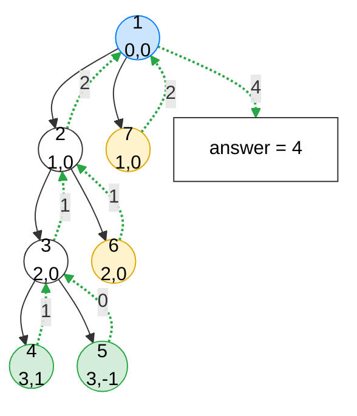

## LeetCode 416: Partition Equal Subset Sum
**Difficulty:** Medium | **Pattern:** 0/1 knapsack, boolean subset sum | **Language:** Java

### 1. Problem
- Given an integer array `nums`, return `true` if it can be split into two subsets with equal sums.
- Example: `[1,5,11,5]` -> `true` (`{11}` and `{1,5,5}`, both sum 11). `[1,2,3,5]` -> `false`.
- Constraints: `1 <= n <= 200`, `1 <= nums[i] <= 100`, so `sum <= 20000`. An `O(n * sum)` DP is about 2 million steps, fine. Subset enumeration `2^200` is impossible.
- **Key insight:** two equal halves exist iff some subset sums to exactly `sum / 2`. That turns "partition" into "subset sum with target `sum/2`", a 0/1 knapsack where weight = value = the number and the question is only "is this capacity reachable exactly?".

### 2. Solution
- **Step 1, brute force:** for every element choose "in" or "out", check whether the chosen sum equals `sum/2`. `O(2^n)`. Wasteful because the same (index, partial sum) pair is recomputed through many different choice histories.
- **Step 2, observation:** only the partial sum matters, not which elements made it. Define `dp[j]` = "some subset of the items seen so far sums to exactly `j`". Sums above `target = sum/2` are useless, so `j` ranges over `0..target`.
- **Step 3, transition:** adding item `num` makes `j` reachable if `j` was already reachable, or `j - num` was reachable before this item: `dp[j] = dp[j] || dp[j - num]`. Base: `dp[0] = true` (empty subset).
- **Step 4, 1D compression and why the loop runs backwards:**
  - In the 2D form, `dp[i][j]` reads `dp[i-1][j - num]` (the row of the previous item). Collapsing to one array only works if, when we read `dp[j - num]`, it still holds the previous item's value.
  - `j - num < j`. Going **downwards** we write `dp[j]` before we ever reach smaller indices, so everything smaller is still "old". Going **upwards**, `dp[j - num]` may already have been set by this same item, so the item is used again.
  - Counter-example, `nums = [2, 6]`, `target = 4` (sum 8, truth: `false`, since 2 vs 6). Only item `2` matters (6 > 4 is skipped):

| Direction | j visited | Action | dp[0..4] after |
|---|---|---|---|
| start | | | T F F F F |
| **Forward (wrong)** | 2 | dp[2] = dp[0] = T | T F T F F |
| | 3 | dp[3] = dp[1] = F | T F T F F |
| | 4 | dp[4] = dp[2] = **T** (dp[2] was written a moment ago, so item 2 is used twice) | T F T F T |
| **Backward (right)** | 4 | dp[4] = dp[2] = F (dp[2] still old) | T F F F F |
| | 3 | dp[3] = dp[1] = F | T F F F F |
| | 2 | dp[2] = dp[0] = T | T F T F F |

  Forward ends with `dp[4] = true` (wrong); backward keeps `dp[4] = false` (right). Forward iteration is exactly the *unbounded* knapsack (each item reusable), which is why Coin Change loops forward.
- **Pruning:** if `sum` is odd, return `false` immediately (halves cannot be equal integers).
- Other approach in one line: a bitset, `bits |= bits << num` (`BigInteger` or `long[]`), does the same DP 64 states per word.

```java
class Solution {
    public boolean canPartition(int[] nums) {
        int sum = 0;
        for (int num : nums) sum += num;
        if ((sum & 1) == 1) return false;           // odd total can never split evenly

        int target = sum / 2;
        boolean[] dp = new boolean[target + 1];     // dp[j]: some subset sums to exactly j
        dp[0] = true;                               // empty subset

        for (int num : nums) {
            // backwards: dp[j - num] must still describe the items BEFORE this one
            for (int j = target; j >= num; j--) {
                dp[j] |= dp[j - num];
            }
        }
        return dp[target];
    }
}
```

Implementation notes: `boolean[]` of size `target + 1`, no boxing. `sum <= 20000` cannot overflow `int`. The loop bound `j >= num` automatically skips items larger than `target`.

### 3. Dry Run
Input `nums = [1,5,11,5]`, `sum = 22`, `target = 11`. Columns are `dp[0..11]` (1 = true).

| Item | Writes (in loop order, only changes) | j: 0 1 2 3 4 5 6 7 8 9 10 11 |
|---|---|---|
| init | dp[0] = T | 1 0 0 0 0 0 0 0 0 0 0 0 |
| 1 | j=1: dp[0] -> dp[1] = T | 1 1 0 0 0 0 0 0 0 0 0 0 |
| 5 | j=6: dp[1] -> T; j=5: dp[0] -> T | 1 1 0 0 0 1 1 0 0 0 0 0 |
| 11 | j=11: dp[0] -> T | 1 1 0 0 0 1 1 0 0 0 0 1 |
| 5 | j=11: dp[6] already T; j=10: dp[5] -> T; j=6, j=5 already T | 1 1 0 0 0 1 1 0 0 0 1 1 |

Note in the last row `j=11` is processed before `j=10`; had we gone forward, `dp[10]` (just set from `dp[5]`) could feed `dp[15]`-style double use on other inputs.

`dp[11] = true`, so the answer is **true**.

**Complexity:** Time `O(n * sum/2)`, each of `n` items sweeps the capacity array once. Space `O(sum/2)`, a single boolean array.

### 4. Takeaway
- **Pattern:** "split / choose a subset hitting an exact total" with small positive integers is 0/1 subset-sum. Inner loop **downwards** for 0/1, **upwards** for unbounded.
- **Edge cases:**

| Input | Result | Note |
|---|---|---|
| `[1]` | false | odd sum |
| `[2,2]` | true | target 2, reached by one item |
| `[1,2,5]` | false | sum 8, target 4, unreachable |
| `[100]*200` | true | sum 20000, array size 10001 |
| `[1,1]` | true | smallest valid even split |

- **Mistakes to avoid:**
  - Looping `j` upwards (reuses an item).
  - Forgetting the odd-sum early exit (still correct, just wasteful) or using `sum/2` when sum is odd (wrong: floor target can be reachable).
  - Looping `j` down to 0 instead of `num` (index `j - num` goes negative).
- **Related problems:** 1049 Last Stone Weight II (closest to half instead of exactly half); 494 Target Sum (count ways); 698 Partition to K Equal Sum Subsets (k groups, needs bitmask DP); 322 Coin Change / 518 Coin Change II (unbounded, forward loop).

---

## LeetCode 1049: Last Stone Weight II
**Difficulty:** Medium | **Pattern:** 0/1 knapsack, minimise difference between two groups | **Language:** Java

### 1. Problem
- Stones have weights `stones[i]`. Repeatedly pick any two, smash them: equal stones both vanish, otherwise the lighter vanishes and the heavier becomes `y - x`. Return the smallest possible weight of the last remaining stone (0 if none).
- Example: `[2,7,4,1,8,1]` -> `1`.
- Constraints: `n <= 30`, `stones[i] <= 100`, so `sum <= 3000`. An `O(n * sum)` DP is trivial.
- **Key insight:** every smash outcome is some signed sum `+-s1 +-s2 ... +-sn`, i.e. you split the stones into two groups and the final weight is `|S1 - S2|` (and every split is achievable by smashing in a suitable order). So minimise `|S1 - S2| = sum - 2*S1` where `S1 <= sum/2`: find the **largest achievable subset sum not exceeding `sum/2`**.

### 2. Solution
- **Step 1, brute force:** simulate all smash orders, or try all `2^n` sign assignments. `2^30` is about 10^9 sign patterns, too slow, and the same partial sums repeat.
- **Step 2, reframe:** with `S2 = sum - S1`, the difference is `sum - 2*S1`. Make `S1` as close to `sum/2` as possible from below.
- **Step 3, reuse #416:** run the identical boolean subset-sum DP with `half = sum/2` as capacity (backwards loop, each stone used once). Then scan `j` from `half` downward and take the first reachable `j`.
- Answer `sum - 2*j`. `dp[0]` is always true, so the scan always stops.

```java
class Solution {
    public int lastStoneWeightII(int[] stones) {
        int sum = 0;
        for (int stone : stones) sum += stone;

        int half = sum / 2;                          // floor: S1 is the smaller group
        boolean[] dp = new boolean[half + 1];
        dp[0] = true;

        for (int stone : stones) {
            for (int j = half; j >= stone; j--) {    // backwards: each stone used once
                dp[j] |= dp[j - stone];
            }
        }
        for (int j = half; j >= 0; j--) {
            if (dp[j]) return sum - 2 * j;
        }
        return sum; // unreachable: dp[0] is always true
    }
}
```

Implementation notes: no sentinel needed because the empty subset guarantees a hit. All values fit in `int`.

### 3. Dry Run
Input `[2,7,4,1,8,1]`, `sum = 23`, `half = 11`. Columns are `dp[0..11]`.

| Stone | Reachable sums (new ones from this stone) | j: 0 1 2 3 4 5 6 7 8 9 10 11 |
|---|---|---|
| init | {0} | 1 0 0 0 0 0 0 0 0 0 0 0 |
| 2 | {2} | 1 0 1 0 0 0 0 0 0 0 0 0 |
| 7 | {7, 9} | 1 0 1 0 0 0 0 1 0 1 0 0 |
| 4 | {4, 6, 11}; 7+4 and 9+4 exceed 11 | 1 0 1 0 1 0 1 1 0 1 0 1 |
| 1 | {1, 3, 5, 8, 10}; 7 and 12 already known/out of range | 1 1 1 1 1 1 1 1 1 1 1 1 |
| 8 | nothing new (all already true) | 1 1 1 1 1 1 1 1 1 1 1 1 |
| 1 | nothing new | 1 1 1 1 1 1 1 1 1 1 1 1 |

Check of the stone-1 row: from {0,2,4,6,7,9,11} add 1 -> {1,3,5,7,8,10,12}; union covers 0..11.

Scan: `j = 11`, `dp[11]` is true, so answer = `23 - 2*11 = 1`. One concrete split: `{7,4}` = 11 and `{2,1,8,1}` = 12, difference 1.

**Complexity:** Time `O(n * sum/2)`. Space `O(sum/2)`.

### 4. Takeaway
- **Pattern:** "minimise the difference of two groups" = subset sum to the closest value at or below `sum/2`. Any signed-sum or smashing puzzle with small totals reduces to this.
- **Edge cases:**

| Input | Result | Note |
|---|---|---|
| `[1]` | 1 | half = 0, only dp[0], answer 1 |
| `[2,2]` | 0 | dp[2] true, 4 - 4 |
| `[1,2]` | 1 | half = 1, dp[1] true, 3 - 2 |
| `[31,26,33,21,40]` | 5 | classic second sample |
| `[100]*30` | 0 | even count of equal stones |

- **Mistakes to avoid:**
  - Simulating with a heap (greedy "smash two heaviest" is #1046, not optimal here).
  - Using `ceil(sum/2)` as capacity (harmless but pointless) or returning `half - j` instead of `sum - 2*j`.
  - Forward capacity loop (a stone used twice breaks the two-group model).
- **Related problems:** 416 Partition Equal Subset Sum (exact half); 1046 Last Stone Weight (heap simulation, different rules); 494 Target Sum; 2035 Partition Array Into Two Arrays to Minimize Sum Difference (same goal, `n = 30` per half so needs meet in the middle).

---

## LeetCode 494: Target Sum
**Difficulty:** Medium | **Pattern:** 0/1 knapsack counting ways (or DFS + memoisation) | **Language:** Java

### 1. Problem
- Put `+` or `-` in front of every number in `nums` so the expression equals `target`. Return how many sign assignments work.
- Example: `nums = [1,1,1,1,1]`, `target = 3` -> `5` (choose which one of the five 1s is negative).
- Constraints: `n <= 20`, `0 <= nums[i] <= 1000`, `sum <= 1000`, `-1000 <= target <= 1000`. `2^20` is about 10^6 (brute force would pass), but the intended solutions are `O(n * sum)`.
- **Key insight:** let `P` = sum of numbers given `+`, `N` = sum of numbers given `-`. Then `P - N = target` and `P + N = total`, so `P = (total + target) / 2`. Counting sign assignments equals counting **subsets with sum `P`**.

### 2. Solution
- **Step 1, brute force:** DFS trying `+nums[i]` and `-nums[i]` at each index, `O(2^n)`. The same state `(i, current sum)` is reached by many sign histories (e.g. `+1-1` and `-1+1`), so the work repeats.
- **Step 2, top-down DP:** memoise on `(index, current sum)`. States: `n * (2*total + 1)`. Each is computed once, so `O(n * total)`. The sum is negative-capable, so shift it by `total` to index an array.
- **Step 3, algebraic reduction (optimal and simpler):**
  - `P - N = target`, `P + N = total` -> add: `2P = total + target`.
  - If `total + target` is odd, or `|target| > total` (so `P` would be negative or larger than `total`), the answer is 0.
  - Otherwise count subsets summing to `s = (total + target)/2`.
- **Step 4, counting knapsack:** `dp[j]` = number of subsets of items so far with sum `j`. Adding `num`: `dp[j] += dp[j - num]` (ways without it, plus ways that include it). `dp[0] = 1`. Loop `j` **backwards** for the usual reason: `dp[j - num]` must be the count from before this item; forwards would let an item be added repeatedly.
- **Zeros:** `num = 0` makes `dp[j] += dp[j]`, doubling every count, which is correct since `+0` and `-0` are two distinct assignments. The loop bound `j >= num` (i.e. `j >= 0`) handles this naturally.

```java
class Solution {
    public int findTargetSumWays(int[] nums, int target) {
        int total = 0;
        for (int num : nums) total += num;

        // P - N = target and P + N = total  =>  P = (total + target) / 2
        if (Math.abs(target) > total || ((total + target) & 1) != 0) return 0;
        int subsetSum = (total + target) / 2;

        int[] dp = new int[subsetSum + 1];           // dp[j]: subsets summing to j
        dp[0] = 1;                                   // empty subset

        for (int num : nums) {
            for (int j = subsetSum; j >= num; j--) { // backwards: each number once
                dp[j] += dp[j - num];
            }
        }
        return dp[subsetSum];
    }
}
```

Implementation notes: counts never exceed `2^20`, so `int` is safe. `(total + target) & 1` is valid because `total + target >= 0` after the abs check.

Alternative, top-down memoised DFS (what the recursion tree below traces):

```java
class Solution {
    private static final int UNSET = Integer.MIN_VALUE;
    private int[] nums;
    private int target, total;
    private int[][] memo;

    public int findTargetSumWays(int[] nums, int target) {
        this.nums = nums;
        this.target = target;
        for (int num : nums) total += num;
        memo = new int[nums.length][2 * total + 1];  // sum + total is the column
        for (int[] row : memo) java.util.Arrays.fill(row, UNSET);
        return dfs(0, 0);
    }

    private int dfs(int i, int cur) {
        if (i == nums.length) return cur == target ? 1 : 0;
        int col = cur + total;
        if (memo[i][col] != UNSET) return memo[i][col];       // memo hit
        int ways = dfs(i + 1, cur + nums[i]) + dfs(i + 1, cur - nums[i]);
        return memo[i][col] = ways;
    }
}
```

### 3. Dry Run

**A. Bottom-up DP**, `nums = [1,1,1,1,1]`, `target = 3`.
`total = 5`, `|3| <= 5`, `5 + 3 = 8` is even, `s = 4`. Count subsets of five 1s summing to 4. Columns are `dp[0..4]`.

| Item | Writes (loop order j = 4 down to 1) | dp[0] dp[1] dp[2] dp[3] dp[4] |
|---|---|---|
| init | dp[0] = 1 | 1 0 0 0 0 |
| 1st | j=1: dp[1] = 0 + dp[0] = 1 | 1 1 0 0 0 |
| 2nd | j=2: 0 + dp[1] = 1; j=1: 1 + dp[0] = 2 | 1 2 1 0 0 |
| 3rd | j=3: 0 + 1 = 1; j=2: 1 + 2 = 3; j=1: 2 + 1 = 3 | 1 3 3 1 0 |
| 4th | j=4: 0 + 1 = 1; j=3: 1 + 3 = 4; j=2: 3 + 3 = 6; j=1: 3 + 1 = 4 | 1 4 6 4 1 |
| 5th | j=4: 1 + 4 = 5; j=3: 4 + 6 = 10; j=2: 6 + 4 = 10; j=1: 4 + 1 = 5 | 1 5 10 10 5 |

These are binomial rows truncated at 4. `dp[4] = 5 = C(5,4)`. Answer: **5**.

**B. Memoised DFS recursion tree.** To keep the tree within 10 nodes, use `nums = [0,0,1]`, `target = 1` (`total = 1`). The zeros make `+0` and `-0` land in the same state, which is exactly where memoisation pays off. Node label = call order, then `i,cur`.



Legend: node text is "call order" then "i,cur"; blue = root, green = base case (`i == 3`), yellow = memo hit (returns stored value, no children), dotted green arrows = returned values.

Call-trace table (`total = 1`, so `col = cur + 1`):

| Order | Call | Depth | Action | Returns |
|---|---|---|---|---|
| 1 | dfs(0,0) | 0 | memo empty; recurse `+0` then `-0` | 4 (2 + 2) |
| 2 | dfs(1,0) | 1 | memo empty; recurse `+0` then `-0` | 2 (1 + 1) |
| 3 | dfs(2,0) | 2 | memo empty; recurse `+1` then `-1` | 1 (1 + 0) |
| 4 | dfs(3,1) | 3 | base: 1 == target | 1 |
| 5 | dfs(3,-1) | 3 | base: -1 != target | 0 |
| 6 | dfs(2,0) | 2 | **memo hit**, stored 1 (from call 3) | 1 |
| 7 | dfs(1,0) | 1 | **memo hit**, stored 2 (from call 2) | 2 |

Without memo the tree would have 15 nodes; with it, 7 calls. Final answer **4** (the `1` must be `+`; each `0` is `+` or `-`: 2*2). Cross-check with the reduction: `s = (1+1)/2 = 1`, `dp` starts `[1,0]`, first 0 gives `[2,0]`, second 0 gives `[4,0]`, item 1 gives `dp[1] = 0 + 4 = 4`. Both methods agree.

**Complexity:** Bottom-up: time `O(n * s)` with `s <= total`, space `O(s)`. Memo DFS: time and space `O(n * total)` (states `n * (2*total + 1)`, plus `O(n)` recursion stack).

### 4. Takeaway
- **Pattern:** counting sign/choice assignments with a fixed total -> convert to "count subsets with sum S" and use `dp[j] += dp[j - num]`. Feasibility (#416) uses `|=`, counting uses `+=`, optimisation uses `max/min`.
- **Edge cases:**

| Input | Result | Note |
|---|---|---|
| `[1], 1` | 1 | s = 1 |
| `[1], 2` | 0 | `|target| > total` |
| `[1,2], 2` | 0 | total + target = 5, odd |
| `[0], 0` | 2 | zero doubles dp[0] |
| `[1,1,1,1,1], -3` | 5 | symmetric to `+3` (s = 1) |

- **Mistakes to avoid:**
  - Skipping the parity and range checks (negative array size, or wrong counts).
  - Forward loop (counts items multiple times).
  - Initialising `dp[0]` wrongly or treating zeros as a special case that gets dropped (they must double the count).
  - In the DFS version, indexing a memo by a negative sum without the `+ total` offset.
- **Related problems:** 416 Partition Equal Subset Sum (boolean version); 518 Coin Change II (count with unlimited reuse, forward loop); 377 Combination Sum IV (order matters, items outer vs target outer); 282 Expression Add Operators (generate all, not count).

---

## LeetCode 474: Ones and Zeroes
**Difficulty:** Medium | **Pattern:** 2D 0/1 knapsack (two capacity constraints) | **Language:** Java

### 1. Problem
- Given binary strings `strs` and integers `m`, `n`, return the size of the largest subset of `strs` that uses at most `m` zeros and at most `n` ones in total.
- Example: `strs = ["10","0001","111001","1","0"]`, `m = 5`, `n = 3` -> `4` (`"10","0001","1","0"`, using 5 zeros and 3 ones).
- Constraints: up to 600 strings of length up to 100, `m, n <= 100`. `O(L * m * n)` is about 6 million. `2^600` subsets is hopeless.
- **Key insight:** each string is an item with a two-part weight `(zeros, ones)` and value 1. The "knapsack" has two capacities, so `dp` gets two dimensions: `dp[i][j]` = max strings using at most `i` zeros and `j` ones.

### 2. Solution
- **Step 1, brute force:** take or skip each string, check both budgets, `O(2^L)`. Overlapping: what matters is only the remaining `(zeros, ones)` budget and which strings are left.
- **Step 2, state:** `dp[i][j]` over items processed so far. Transition for a string with `z` zeros and `o` ones: `dp[i][j] = max(dp[i][j], dp[i - z][j - o] + 1)` for `i >= z`, `j >= o` (skip it, or take it and consume `z`, `o` of budget).
- **Step 3, drop the item dimension** exactly as in 1D: update in place. Both loops go **downwards**, so `dp[i - z][j - o]` is still the value from before this string.
  - Why both: if `z > 0`, descending `i` already guarantees row `i - z` is old. If `z == 0` (a string like `"1"`), the read is in the same row, so descending `j` is what protects it. Descending in both is always safe.
  - Counter-example, `strs = ["0"]`, `m = 2`, `n = 0`. Truth: 1 (only one such string). Forward `i`: `dp[1][0] = dp[0][0] + 1 = 1`, then `dp[2][0] = dp[1][0] + 1 = 2`, using `"0"` twice. Backward: `dp[2][0] = dp[1][0] + 1 = 1` (old `dp[1][0] = 0`), then `dp[1][0] = 1`; final `dp[2][0] = 1`, correct.
- Strings needing more than `n` ones (or `m` zeros) never enter the loops, so they are skipped for free.

```java
class Solution {
    public int findMaxForm(String[] strs, int m, int n) {
        int[][] dp = new int[m + 1][n + 1];          // dp[i][j]: best count within i zeros, j ones

        for (String s : strs) {
            int zeros = 0;
            for (int k = 0; k < s.length(); k++) {
                if (s.charAt(k) == '0') zeros++;
            }
            int ones = s.length() - zeros;

            // both dimensions backwards: each string is used at most once
            for (int i = m; i >= zeros; i--) {
                for (int j = n; j >= ones; j--) {
                    dp[i][j] = Math.max(dp[i][j], dp[i - zeros][j - ones] + 1);
                }
            }
        }
        return dp[m][n];                             // "at most" semantics: the corner is the max
    }
}
```

Implementation notes: counting characters with `charAt` avoids `toCharArray` allocation. Because `dp[i][j]` means "at most", it is monotone and `dp[m][n]` is the answer; no search for a max cell is needed.

### 3. Dry Run
Input `strs = ["10","0001","111001","1","0"]`, `m = 5`, `n = 3`. Costs `(zeros, ones)`: `"10"` = (1,1), `"0001"` = (3,1), `"111001"` = (2,4), `"1"` = (0,1), `"0"` = (1,0). Rows are `i` = zeros 0..5, columns are `j` = ones 0..3.

Initial: all zeros.

| i \ j | 0 | 1 | 2 | 3 |
|---|---|---|---|---|
| 0 | 0 | 0 | 0 | 0 |
| 1 | 0 | 0 | 0 | 0 |
| 2 | 0 | 0 | 0 | 0 |
| 3 | 0 | 0 | 0 | 0 |
| 4 | 0 | 0 | 0 | 0 |
| 5 | 0 | 0 | 0 | 0 |

**After `"10"` (1,1):** every cell with `i >= 1`, `j >= 1` becomes `0 + 1 = 1`.

| i \ j | 0 | 1 | 2 | 3 |
|---|---|---|---|---|
| 0 | 0 | 0 | 0 | 0 |
| 1 | 0 | 1 | 1 | 1 |
| 2 | 0 | 1 | 1 | 1 |
| 3 | 0 | 1 | 1 | 1 |
| 4 | 0 | 1 | 1 | 1 |
| 5 | 0 | 1 | 1 | 1 |

**After `"0001"` (3,1):** cells with `i >= 3`, `j >= 1`: `max(old, dp[i-3][j-1] + 1)`. Row 3 reads row 0 (all 0), giving 1, no change. Row 4 reads row 1: `dp[1][0..2] = 0,1,1` gives 1,2,2. Row 5 reads row 2: same values 0,1,1, gives 1,2,2.

| i \ j | 0 | 1 | 2 | 3 |
|---|---|---|---|---|
| 0 | 0 | 0 | 0 | 0 |
| 1 | 0 | 1 | 1 | 1 |
| 2 | 0 | 1 | 1 | 1 |
| 3 | 0 | 1 | 1 | 1 |
| 4 | 0 | 1 | 2 | 2 |
| 5 | 0 | 1 | 2 | 2 |

**After `"111001"` (2,4):** `ones = 4 > n = 3`, the inner loop never runs. Table unchanged.

**After `"1"` (0,1):** for each row, `j` descends 3..1: `dp[i][j] = max(dp[i][j], dp[i][j-1] + 1)` using old same-row values.
Row 0: [0,0,0,0] -> [0,1,1,1]. Row 1: old [0,1,1,1] -> j=3: max(1,2)=2, j=2: max(1,2)=2, j=1: max(1,1)=1 -> [0,1,2,2]. Rows 2 and 3 identical to row 1 (same old values). Row 4: old [0,1,2,2] -> j=3: max(2,3)=3, j=2: max(2,2)=2, j=1: 1 -> [0,1,2,3]. Row 5 same as row 4.

| i \ j | 0 | 1 | 2 | 3 |
|---|---|---|---|---|
| 0 | 0 | 1 | 1 | 1 |
| 1 | 0 | 1 | 2 | 2 |
| 2 | 0 | 1 | 2 | 2 |
| 3 | 0 | 1 | 2 | 2 |
| 4 | 0 | 1 | 2 | 3 |
| 5 | 0 | 1 | 2 | 3 |

**After `"0"` (1,0):** `i` descends 5..1: `dp[i][j] = max(dp[i][j], dp[i-1][j] + 1)`, reading the not-yet-updated row `i-1`.
Row 5: row 4 + 1 = [1,2,3,4] vs old [0,1,2,3] -> [1,2,3,4]. Row 4: row 3 + 1 = [1,2,3,3] vs [0,1,2,3] -> [1,2,3,3]. Row 3: row 2 + 1 = [1,2,3,3] vs [0,1,2,2] -> [1,2,3,3]. Row 2: row 1 + 1 = [1,2,3,3] vs [0,1,2,2] -> [1,2,3,3]. Row 1: row 0 + 1 = [1,2,2,2] vs [0,1,2,2] -> [1,2,2,2]. Row 0 unchanged.

| i \ j | 0 | 1 | 2 | 3 |
|---|---|---|---|---|
| 0 | 0 | 1 | 1 | 1 |
| 1 | 1 | 2 | 2 | 2 |
| 2 | 1 | 2 | 3 | 3 |
| 3 | 1 | 2 | 3 | 3 |
| 4 | 1 | 2 | 3 | 3 |
| 5 | 1 | 2 | 3 | 4 |

`dp[5][3] = 4`. Answer: **4**.

Iteration summary:

| String | (z,o) | Effect |
|---|---|---|
| `"10"` | (1,1) | fills the `i>=1, j>=1` block with 1 |
| `"0001"` | (3,1) | raises rows 4-5 at `j>=2` to 2 |
| `"111001"` | (2,4) | skipped, 4 ones > n |
| `"1"` | (0,1) | same-row update, raises `dp[0][1..3]` to 1 and lifts others |
| `"0"` | (1,0) | row-to-row update, `dp[5][3]` becomes 4 |

**Complexity:** Time `O(L * m * n)` where `L = strs.length`, plus `O(total characters)` for counting. Space `O(m * n)`.

### 4. Takeaway
- **Pattern:** a 0/1 selection under **several** simultaneous budgets -> one dp dimension per budget, every dimension iterated downwards, value = count (or profit).
- **Edge cases:**

| Input | Result | Note |
|---|---|---|
| `["10","0","1"], m=1, n=1` | 2 | `"0"` and `"1"`, cheaper than `"10"` |
| `["0"], m=0, n=0` | 0 | cannot afford any string |
| `["10","0001","111001","1","0"], m=5, n=3` | 4 | sample above |
| `["0","0","0"], m=2, n=0` | 2 | only two zeros available |
| string longer than budget | skipped | loop bounds exclude it |

- **Mistakes to avoid:**
  - Ascending `i` or `j` (reuses a string; see the counter-example).
  - Treating `m`/`n` as exact usage instead of "at most" (initial zeros already encode "at most").
  - Allocating a 3D `dp[L][m][n]` (works, but wastes memory) or re-parsing each string inside the double loop.
- **Related problems:** 416 Partition Equal Subset Sum (one capacity); 879 Profitable Schemes (two constraints: members and profit); 1155 Number of Dice Rolls (different DP); 322 Coin Change / 518 Coin Change II (unbounded, forward loops).
