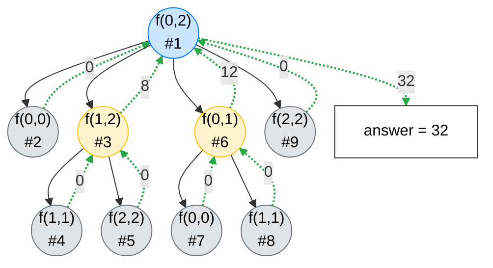
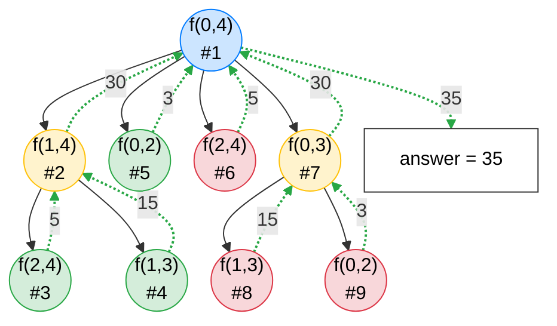
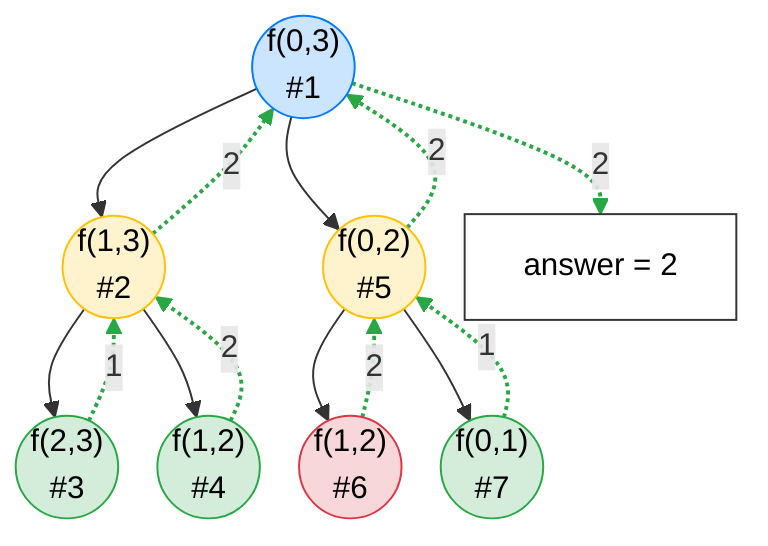

## LeetCode 1130: Minimum Cost Tree From Leaf Values
**Difficulty:** Medium | **Pattern:** Interval DP or monotonic stack | **Language:** Java

### 1. Problem
- Given `arr`, build a binary tree where every node has 0 or 2 children, the in-order traversal of the leaves is exactly `arr`, and each non-leaf value is the product of the largest leaf in its left subtree and the largest leaf in its right subtree. Return the minimum possible sum of the non-leaf values.
- Example: `arr = [6,2,4]` -> `32`. (Tree A: merge 6,2 first: cost 12, then 6*4 = 24, total 36. Tree B: merge 2,4 first: cost 8, then 6*4 = 24, total 32.)
- Constraints: `2 <= n <= 40`, `1 <= arr[i] <= 15`; the answer fits in a 32-bit int. `n = 40` allows O(n^3) easily; the stack solution is O(n).
- **Key insight:** a node's value only depends on the **maximum** of each side, so a subtree over leaves `[i, j]` can be summarised by two numbers: its cost and its max. The last merge splits `[i, j]` at some `k` into `[i, k]` and `[k+1, j]`, which is an interval DP. Greedy view: the smallest leaf must be multiplied with something once and then disappears (it is never the max of a merged group), and the cheapest partner is its smaller neighbour.

### 2. Solution
**Step 1, brute force.** Enumerate every binary tree shape over `n` ordered leaves: Catalan(n-1) trees (about 10^21 for n = 40). Far too many, and the same sub-ranges are rebuilt again and again.

**Step 2, observation.** Whatever the shape, the root splits the leaves into a left block `[i, k]` and right block `[k+1, j]`. The root costs `max(i..k) * max(k+1..j)`, and the two blocks are built independently, so only the range matters.

**Step 3, interval DP.**
- State: `dp[i][j]` = minimum sum of non-leaf values of a tree built from leaves `arr[i..j]`.
- Base: `dp[i][i] = 0` (a single leaf has no non-leaf node).
- Recurrence: `dp[i][j] = min over k in [i, j-1] of dp[i][k] + dp[k+1][j] + mx[i][k] * mx[k+1][j]`, where `mx[i][j]` is the max of `arr[i..j]` (precomputed in O(n^2)).
- Order: by interval length `len = 2..n`, so both halves (shorter) are already filled.
- Answer: `dp[0][n-1]`. Time O(n^3), space O(n^2).

**Step 4, greedy / monotonic stack (optimal).** Repeatedly take the smallest remaining leaf `x`, merge it with the smaller of its two neighbours, pay `x * min(left, right)`, and delete `x`. Why it is right: `x` must be multiplied by some neighbouring group's max at least once; its neighbours are at least `x`, so the cheapest partner is the smaller neighbour. After that merge, the new node's value is the neighbour's max (>= x), so `x` never matters again. A monotonic stack that keeps values decreasing performs exactly this "remove smallest local minimum" process in one pass: when the incoming value `a` is >= the stack top `mid`, `mid` is a local minimum whose neighbours are the new top and `a`.

**Java code (stack, O(n) time, O(n) space):**

```java
class Solution {
    public int mctFromLeafValues(int[] arr) {
        int[] stack = new int[arr.length + 1];
        int top = 0;
        stack[0] = Integer.MAX_VALUE;          // sentinel: never popped, always a valid left neighbour
        int cost = 0;
        for (int a : arr) {
            while (stack[top] <= a) {          // stack[top] is a local minimum
                int mid = stack[top--];
                cost += mid * Math.min(stack[top], a);
            }
            stack[++top] = a;
        }
        while (top > 1) {                      // remaining values are strictly decreasing
            cost += stack[top] * stack[top - 1];
            top--;
        }
        return cost;
    }
}
```

**Java code (interval DP):**

```java
class Solution {
    public int mctFromLeafValues(int[] arr) {
        int n = arr.length;
        int[][] mx = new int[n][n];
        for (int i = 0; i < n; i++) {
            mx[i][i] = arr[i];
            for (int j = i + 1; j < n; j++) {
                mx[i][j] = Math.max(mx[i][j - 1], arr[j]);
            }
        }
        int[][] dp = new int[n][n];            // dp[i][i] = 0 by default
        for (int len = 2; len <= n; len++) {
            for (int i = 0; i + len - 1 < n; i++) {
                int j = i + len - 1;
                int best = Integer.MAX_VALUE;
                for (int k = i; k < j; k++) {
                    int cost = dp[i][k] + dp[k + 1][j] + mx[i][k] * mx[k + 1][j];
                    best = Math.min(best, cost);
                }
                dp[i][j] = best;
            }
        }
        return dp[0][n - 1];
    }
}
```

Implementation notes: `Integer.MAX_VALUE` as the stack sentinel removes empty-stack checks (`arr[i] <= 15`, so it is never popped). `<=` in the while condition handles equal values (merging two equals costs `v*v`, which is correct). Plain `int[]` as the stack avoids boxing.

### 3. Dry Run
Example `arr = [6,2,4]`. Max table: `mx[0][0]=6, mx[0][1]=6, mx[0][2]=6, mx[1][1]=2, mx[1][2]=4, mx[2][2]=4`.

**Interval DP iteration table (by length):**

| len | cell (i,j) | split k | dp[i][k] + dp[k+1][j] + mx*mx | candidate | dp[i][j] |
|---|---|---|---|---|---|
| 2 | (0,1) | 0 | 0 + 0 + 6*2 | 12 | 12 |
| 2 | (1,2) | 1 | 0 + 0 + 2*4 | 8 | 8 |
| 3 | (0,2) | 0 | dp[0][0] + dp[1][2] + mx[0][0]*mx[1][2] = 0 + 8 + 6*4 | 32 | |
| 3 | (0,2) | 1 | dp[0][1] + dp[2][2] + mx[0][1]*mx[2][2] = 12 + 0 + 6*4 | 36 | 32 |

**Filled dp table** (`-` = unused lower triangle):

| i \ j | 0 | 1 | 2 |
|---|---|---|---|
| 0 | 0 | 12 | **32** |
| 1 | - | 0 | 8 |
| 2 | - | - | 0 |

**Recursion tree** (memoised view of the same recurrence; each non-leaf call tries every split `k`, its children are the left and right sub-calls of each split in order: split k=0 gives `f(0,0), f(1,2)`, split k=1 gives `f(0,1), f(2,2)`). With only 3 leaves, every repeated state is a base case `i == j` returning 0; a non-trivial memo hit first appears at n = 4 (e.g. `f(1,2)` is needed by both `f(0,2)` and `f(1,3)`).



Legend: blue = root, yellow = interval of length 2, grey = base case (single leaf, cost 0), green dotted arrows = returned values.

**Call-trace table:**

| Order | Call | Depth | Action | Returns |
|---|---|---|---|---|
| 1 | f(0,2) | 0 | try k=0 and k=1, take the min | 32 |
| 2 | f(0,0) | 1 | base, left of split k=0 | 0 |
| 3 | f(1,2) | 1 | right of split k=0; only k=1: 0 + 0 + 2*4 | 8 |
| 4 | f(1,1) | 2 | base | 0 |
| 5 | f(2,2) | 2 | base | 0 |
| 6 | f(0,1) | 1 | left of split k=1; only k=0: 0 + 0 + 6*2 | 12 |
| 7 | f(0,0) | 2 | base | 0 |
| 8 | f(1,1) | 2 | base | 0 |
| 9 | f(2,2) | 1 | base, right of split k=1 | 0 |

Back in call 1: split k=0 gives `0 + 8 + 6*4 = 32`; split k=1 gives `12 + 0 + 6*4 = 36`; min is 32.

**Stack solution on the same input** (`cost` = running result):

| Step | a | Stack (bottom to top) | Action | cost |
|---|---|---|---|---|
| 1 | 6 | [MAX] -> [MAX, 6] | top MAX > 6, push | 0 |
| 2 | 2 | [MAX, 6] -> [MAX, 6, 2] | top 6 > 2, push | 0 |
| 3 | 4 | [MAX, 6, 2] | top 2 <= 4: pop mid=2, neighbours 6 and 4, add 2*min(6,4) = 8 | 8 |
| 3 | 4 | [MAX, 6] -> [MAX, 6, 4] | top 6 > 4, push | 8 |
| 4 | end | [MAX, 6, 4] | cleanup: pop 4, add 4*6 = 24 | 32 |
| 4 | end | [MAX, 6] | `top == 1`, stop | 32 |

**Final answer: 32** (both methods agree).

**Complexity:** Stack: time O(n) (each value pushed and popped once), space O(n) (stack). Interval DP: time O(n^3) (O(n^2) cells times O(n) splits), space O(n^2).

### 4. Takeaway
- **Pattern:** "build a binary structure over an ordered sequence" -> split at the last merge point and use interval DP. When the cost of combining depends only on a monotone summary (here, the max), a monotonic stack of local minima often replaces the DP (same family as "next greater element", see §6.2).
- **Edge cases:**

| Input | Result | Note |
|---|---|---|
| `[a, b]` | `a*b` | one merge, loop never pops, cleanup pairs them |
| `[4,4]` | 16 | equal values: `<=` pops, cost `4*4` |
| `[7,6,5,4]` (decreasing) | 92 | 4*5 + 5*6 + 6*7; nothing pops in the loop, cleanup merges from the top |
| `[1,2,3,4]` (increasing) | 20 | 1*2 + 2*3 + 3*4; every new value pops the previous one (the first pop pairs with the sentinel side as min, so it uses the new value) |
| all equal `[3,3,3]` | 18 | any tree costs 9 + 9 |

- **Mistakes to avoid:**
  - Summing leaf values or forgetting leaves cost nothing; only non-leaf nodes count.
  - Using `<` instead of `<=` in the pop condition (equal values then never merge correctly and the sentinel logic breaks).
  - Forgetting the cleanup loop after the scan.
  - In the DP, recomputing the max inside the inner loop (O(n^4)) instead of precomputing `mx`.
  - Iterating `i` and `j` in an order where `dp[k+1][j]` is not yet filled; iterate by length.
- **Related problems:** #84 Largest Rectangle in Histogram (same monotonic-stack "pop a local extreme with both neighbours"), #312 Burst Balloons (interval DP choosing a split), #1039 Minimum Score Triangulation of Polygon (same DP shape on a polygon), #1000 Minimum Cost to Merge Stones (interval DP with a merge-size constraint), #496/#739 next greater element (stack basics).

---

## LeetCode 312: Burst Balloons
**Difficulty:** Hard | **Pattern:** Interval DP, think about which balloon to pop LAST | **Language:** Java

### 1. Problem
- You have `n` balloons with values `nums[i]`. Bursting balloon `i` earns `nums[left] * nums[i] * nums[right]`, where `left` and `right` are the nearest *remaining* neighbours; outside the array counts as 1. Burst all balloons to maximise total coins.
- Example: `nums = [3,1,5]` -> `35` (pop 1: 3*1*5 = 15; pop 3: 1*3*5 = 15; pop 5: 1*5*1 = 5). Another well-known one: `[3,1,5,8]` -> `167`.
- Constraints: `1 <= n <= 300`, `0 <= nums[i] <= 100`. O(n^3) = 2.7 * 10^7 is fine; anything exponential is not. Max total is about 3 * 10^8, which fits in `int`.
- **Key insight:** do not ask which balloon to pop *first*; ask which to pop *last* in a range. The last balloon's neighbours are exactly the range boundaries, and the two sides become independent subproblems.

### 2. Solution
**Step 1, brute force.** Try every order of popping: n! orders (each costing O(1) to score if we keep a linked list). Hopeless for n = 300.

**Step 2, the natural DP fails: "pop k first".** Define `f(l, r)` = best for balloons `l..r` and try each `k` as the first pop. Popping `k` earns `nums[l-1] * nums[k] * nums[r+1]` only if the range boundaries are the neighbours. But after `k` is gone, the left part `l..k-1` and right part `k+1..r` are glued together: the last-standing balloon of the left part now has a neighbour from the right part, so the coins in one part depend on what happens in the other. The subproblems are entangled, and the state would have to be the whole set of survivors.

**Step 3, reverse time: pop k LAST.** Take the open range `(i, j)`, meaning balloons strictly between positions `i` and `j`, and assume the walls `i` and `j` are still standing while this range is cleared. Choose `k` in `(i, j)` to be the last one popped.
- When `k` is finally popped, everything else in `(i, j)` is gone, so its neighbours are exactly `i` and `j`: it earns `v[i] * v[k] * v[j]`.
- While the balloons in `(i, k)` are being popped, `k` is still alive (it goes last), so their walls are exactly `i` and `k`. That is the subproblem `(i, k)` with its own fixed walls.
- Likewise `(k, j)` has walls `k` and `j`. The two sides never see each other, so they are independent.

Walk-through on `[3,1,5]` padded to `v = [1,3,1,5,1]`, range `(0,4)` (all three balloons): if `5` is last, its neighbours are the walls `1` and `1`: it earns `1*5*1 = 5`. Before that, `3` and `1` must be cleared with walls `v[0]=1` and `v[3]=5` (5 is alive), worth 30 (pop 1 for 3*1*5 = 15, then 3 for 1*3*5 = 15). Total 35. If instead we had said "5 is first", the leftover coins would depend on a different, now-adjacent neighbour structure.

**Step 4, the DP.**
- Pad: `v[0] = v[n+1] = 1`, `v[1..n] = nums`.
- State: `dp[i][j]` = max coins from bursting **all balloons strictly between** `i` and `j`, with `i` and `j` kept.
- Base: if `j - i < 2` there is nothing between them, `dp[i][j] = 0`.
- Recurrence: `dp[i][j] = max over k in (i, j) of dp[i][k] + dp[k][j] + v[i] * v[k] * v[j]`.
- Order: by gap `j - i` from 2 up to `n + 1`, so `dp[i][k]` and `dp[k][j]` (smaller gaps) are ready.
- Answer: `dp[0][n+1]`. Time O(n^3), space O(n^2).

**Java code:**

```java
class Solution {
    public int maxCoins(int[] nums) {
        int n = nums.length;
        int[] v = new int[n + 2];
        v[0] = 1;
        v[n + 1] = 1;
        System.arraycopy(nums, 0, v, 1, n);

        int[][] dp = new int[n + 2][n + 2];     // dp[i][j] = 0 when gap < 2
        for (int gap = 2; gap <= n + 1; gap++) {
            for (int i = 0; i + gap <= n + 1; i++) {
                int j = i + gap;
                int best = 0;
                for (int k = i + 1; k < j; k++) {   // k is the LAST balloon popped in (i, j)
                    int coins = dp[i][k] + dp[k][j] + v[i] * v[k] * v[j];
                    best = Math.max(best, coins);
                }
                dp[i][j] = best;
            }
        }
        return dp[0][n + 1];
    }
}
```

Implementation notes: padding with 1s removes boundary special cases. The range is *open* (exclusive of both walls), so `dp[i][k]` and `dp[k][j]` share `k` without overlap. Per-product max is 10^6 and the total fits in `int`.

### 3. Dry Run
Example `nums = [3,1,5]`, padded `v = [1,3,1,5,1]` (indices 0..4).

**Iteration table (by gap):**

| gap | cell (i,j) | walls v[i],v[j] | k (last) | dp[i][k] + dp[k][j] + v[i]*v[k]*v[j] | candidate | dp[i][j] |
|---|---|---|---|---|---|---|
| 2 | (0,2) | 1, 1 | 1 (v=3) | 0 + 0 + 1*3*1 | 3 | 3 |
| 2 | (1,3) | 3, 5 | 2 (v=1) | 0 + 0 + 3*1*5 | 15 | 15 |
| 2 | (2,4) | 1, 1 | 3 (v=5) | 0 + 0 + 1*5*1 | 5 | 5 |
| 3 | (0,3) | 1, 5 | 1 (v=3) | dp[0][1] + dp[1][3] + 1*3*5 = 0 + 15 + 15 | 30 | |
| 3 | (0,3) | 1, 5 | 2 (v=1) | dp[0][2] + dp[2][3] + 1*1*5 = 3 + 0 + 5 | 8 | 30 |
| 3 | (1,4) | 3, 1 | 2 (v=1) | dp[1][2] + dp[2][4] + 3*1*1 = 0 + 5 + 3 | 8 | |
| 3 | (1,4) | 3, 1 | 3 (v=5) | dp[1][3] + dp[3][4] + 3*5*1 = 15 + 0 + 15 | 30 | 30 |
| 4 | (0,4) | 1, 1 | 1 (v=3) | dp[0][1] + dp[1][4] + 1*3*1 = 0 + 30 + 3 | 33 | |
| 4 | (0,4) | 1, 1 | 2 (v=1) | dp[0][2] + dp[2][4] + 1*1*1 = 3 + 5 + 1 | 9 | |
| 4 | (0,4) | 1, 1 | 3 (v=5) | dp[0][3] + dp[3][4] + 1*5*1 = 30 + 0 + 5 | 35 | 35 |

**Filled dp table** (`-` = unused; cells with `j - i < 2` are 0):

| i \ j | 0 | 1 | 2 | 3 | 4 |
|---|---|---|---|---|---|
| 0 | - | 0 | 3 | 30 | **35** |
| 1 | - | - | 0 | 15 | 30 |
| 2 | - | - | - | 0 | 5 |
| 3 | - | - | - | - | 0 |

Reconstruction: last in (0,4) is `5`; last in (0,3) is `3`; last in (1,3) is `1`. So the pop order is the reverse: `1`, `3`, `5`, earning 15 + 15 + 5 = 35.

**Recursion tree** (top-down view of the same recurrence, calls `f(i,j)` on the padded array; calls with `j - i < 2` return 0 immediately and are not drawn). Each `k` in order calls `f(i,k)` then `f(k,j)`. The root's three splits are k=1 (calls `f(1,4)`), k=2 (calls `f(0,2)`, `f(2,4)`), k=3 (calls `f(0,3)`).



Legend: blue = root, yellow = inner call, green = call computed directly from base cases, red = memo hit (returns the stored value, no recursion), green dotted arrows = returned values.

**Call-trace table:**

| Order | Call | Depth | Action | Returns |
|---|---|---|---|---|
| 1 | f(0,4) | 0 | try k=1,2,3 | 35 |
| 2 | f(1,4) | 1 | k=1 of root; tries k=2 and k=3 | 30 |
| 3 | f(2,4) | 2 | only k=3: 1*5*1 | 5 |
| 4 | f(1,3) | 2 | only k=2: 3*1*5 | 15 |
| 5 | f(0,2) | 1 | k=2 of root; only k=1: 1*3*1 | 3 |
| 6 | f(2,4) | 1 | memo hit | 5 |
| 7 | f(0,3) | 1 | k=3 of root; tries k=1, k=2 | 30 |
| 8 | f(1,3) | 2 | memo hit | 15 |
| 9 | f(0,2) | 2 | memo hit | 3 |

Root combines: k=1: `0 + 30 + 3 = 33`; k=2: `3 + 5 + 1 = 9`; k=3: `30 + 0 + 5 = 35`. Max is 35. Three of the nine calls are memo hits, which is where the O(n^2) states (instead of exponential calls) come from.

**Final answer: 35.** Extra check with `[3,1,5,8]` (padded `[1,3,1,5,8,1]`): the same table gives `dp[0][5] = 167`, via last balloon `8` (`dp[0][4] + 1*8*1 = 159 + 8`).

**Complexity:** Time O(n^3): about n^2 / 2 cells, each scanning up to n values of `k`. Space O(n^2) for the table.

### 4. Takeaway
- **Pattern:** when removing an element changes its neighbours' relationships (so subproblems entangle), flip the question: choose the element that is removed (or added) **last** in a range with fixed boundaries. Use open-range interval DP with sentinel walls.
- **Edge cases:**

| Input | Result | Note |
|---|---|---|
| `[5]` | 5 | 1 * 5 * 1 |
| `[0]` | 0 | zero is fine |
| `[1,5]` | 10 | pop 1 (1*1*5 = 5) then 5 (1*5*1 = 5); or pop 5 first: 1*5*1 + 1*1*1 = 6; best is 10 |
| `[3,1,5,8]` | 167 | classic |
| contains zeros | works as-is | optional optimisation: zeros are best popped first, but the DP does not need it |

- **Mistakes to avoid:**
  - Using the "pop first" split (entangled subproblems, wrong answer).
  - Making the range closed and double-counting `k` in `dp[i][k] + dp[k][j]`, or forgetting the padding 1s.
  - Wrong loop order (iterating `i` ascending with `j` fixed so that `dp[k][j]` is not ready); iterate by gap.
  - Multiplying with `nums[]` indices instead of padded `v[]` indices.
- **Related problems:** #1130 Minimum Cost Tree From Leaf Values (interval DP with a split choice), #1039 Minimum Score Triangulation of Polygon (same "last triangle" thinking), #1547 Minimum Cost to Cut a Stick (same shape: choose which cut is made last), #546 Remove Boxes (harder interval DP with an extra state), #1000 Minimum Cost to Merge Stones.

---

## LeetCode 516: Longest Palindromic Subsequence
**Difficulty:** Medium | **Pattern:** Interval DP on a single string (or LCS with its reverse) | **Language:** Java

### 1. Problem
- Given a string `s`, return the length of the longest palindromic **subsequence** (characters need not be contiguous; this differs from #5, the *substring* problem).
- Example: `s = "cbbd"` -> `2` (`"bb"`). Another: `"bbbab"` -> `4` (`"bbbb"`).
- Constraints: `1 <= s.length <= 1000`, lowercase letters. O(n^2) = 10^6 states is fine; O(n^3) would be 10^9 and too slow.
- **Key insight:** compare the two end characters of a range. If they match, they wrap a palindrome of the inside (+2). If not, one of them is useless, so drop one end and take the better. Ranges only depend on strictly shorter ranges.

### 2. Solution
**Step 1, brute force.** Enumerate all 2^n subsequences and test each for being a palindrome: O(n * 2^n). The same sub-ranges get re-examined constantly.

**Step 2, recursion on ends.** Let `f(i, j)` be the LPS length inside `s[i..j]`.
- If `s[i] == s[j]`, the best palindrome can use both ends: `2 + f(i+1, j-1)`. (Using both is never worse than skipping one, by an exchange argument.)
- Otherwise they cannot both be used: `max(f(i+1, j), f(i, j-1))`.
Without memoisation this branches in two at each mismatch, so exponential; but there are only O(n^2) distinct `(i, j)` pairs.

**Step 3, interval DP.**
- State: `dp[i][j]` = length of the longest palindromic subsequence of `s[i..j]`.
- Base: `dp[i][i] = 1`; an empty range (`i > j`) is 0 (the lower triangle of the array stays 0, which is what `dp[i+1][j-1]` hits when `j = i + 1`).
- Recurrence: equal ends -> `dp[i+1][j-1] + 2`; else `max(dp[i+1][j], dp[i][j-1])`.
- Order: by interval length `len = 2..n` (expand the interval outward), because each cell depends on length `len - 1` and `len - 2` cells.
- Answer: `dp[0][n-1]`. Time O(n^2), space O(n^2).

**Step 4, space reduction.** Row `i` only needs row `i+1` and itself, so a single array works if `i` goes from `n-1` down to 0 and `j` from `i+1` up, with one saved variable for the diagonal `dp[i+1][j-1]`: O(n) space.

**Step 5, the equivalent view: LCS(s, reverse(s)).** A sequence is a palindrome exactly when it equals its own reverse. A subsequence of `s` that is a palindrome is therefore a common subsequence of `s` and `reverse(s)`; conversely, a longest common subsequence of `s` and `reverse(s)` has length equal to the LPS (it can be shown the LCS can always be chosen symmetric). So `LPS(s) = LCS(s, reverse(s))`. This reduces to a problem you may already know, at the same O(n^2) cost.

**Java code (interval DP, by length):**

```java
class Solution {
    public int longestPalindromeSubseq(String s) {
        int n = s.length();
        char[] c = s.toCharArray();
        int[][] dp = new int[n][n];
        for (int i = 0; i < n; i++) {
            dp[i][i] = 1;
        }
        for (int len = 2; len <= n; len++) {
            for (int i = 0; i + len <= n; i++) {
                int j = i + len - 1;
                if (c[i] == c[j]) {
                    dp[i][j] = dp[i + 1][j - 1] + 2;   // len == 2 reads the 0 below the diagonal
                } else {
                    dp[i][j] = Math.max(dp[i + 1][j], dp[i][j - 1]);
                }
            }
        }
        return dp[0][n - 1];
    }
}
```

**Java code (O(n) space):**

```java
class Solution {
    public int longestPalindromeSubseq(String s) {
        int n = s.length();
        char[] c = s.toCharArray();
        int[] dp = new int[n];                  // dp[j] holds dp[i][j] for the current i
        for (int i = n - 1; i >= 0; i--) {
            dp[i] = 1;
            int prev = 0;                       // old dp[i+1][j-1]; empty range for j = i + 1
            for (int j = i + 1; j < n; j++) {
                int saved = dp[j];              // old dp[i+1][j]
                if (c[i] == c[j]) {
                    dp[j] = prev + 2;
                } else {
                    dp[j] = Math.max(saved, dp[j - 1]);   // dp[j-1] is already the new dp[i][j-1]
                }
                prev = saved;
            }
        }
        return dp[n - 1];
    }
}
```

**Java code (LCS with the reverse):**

```java
class Solution {
    public int longestPalindromeSubseq(String s) {
        int n = s.length();
        char[] a = s.toCharArray();
        char[] b = new StringBuilder(s).reverse().toString().toCharArray();
        int[][] dp = new int[n + 1][n + 1];     // dp[i][j] = LCS of a[0..i) and b[0..j)
        for (int i = 1; i <= n; i++) {
            for (int j = 1; j <= n; j++) {
                if (a[i - 1] == b[j - 1]) {
                    dp[i][j] = dp[i - 1][j - 1] + 1;
                } else {
                    dp[i][j] = Math.max(dp[i - 1][j], dp[i][j - 1]);
                }
            }
        }
        return dp[n][n];
    }
}
```

Implementation notes: `char[]` avoids repeated `charAt` bounds checks. The by-length version is the clearest statement of the iteration order; the rolling version saves memory for large `n`.

### 3. Dry Run
Example `s = "cbbd"` (indices 0..3: c, b, b, d).

**Iteration table (by length):**

| len | cell (i,j) | substring | ends | rule | value |
|---|---|---|---|---|---|
| 1 | (0,0),(1,1),(2,2),(3,3) | c, b, b, d | - | base | 1 each |
| 2 | (0,1) | cb | c != b | max(dp[1][1], dp[0][0]) = max(1,1) | 1 |
| 2 | (1,2) | bb | b == b | dp[2][1] + 2 = 0 + 2 | 2 |
| 2 | (2,3) | bd | b != d | max(dp[3][3], dp[2][2]) = max(1,1) | 1 |
| 3 | (0,2) | cbb | c != b | max(dp[1][2], dp[0][1]) = max(2,1) | 2 |
| 3 | (1,3) | bbd | b != d | max(dp[2][3], dp[1][2]) = max(1,2) | 2 |
| 4 | (0,3) | cbbd | c != d | max(dp[1][3], dp[0][2]) = max(2,2) | 2 |

**Filled dp table:**

| i \ j | 0 (c) | 1 (b) | 2 (b) | 3 (d) |
|---|---|---|---|---|
| 0 | 1 | 1 | 2 | **2** |
| 1 | - | 1 | 2 | 2 |
| 2 | - | - | 1 | 1 |
| 3 | - | - | - | 1 |

(For `"bbbab"` the full table is: row 0 = 1 2 3 3 4, row 1 = - 1 2 2 3, row 2 = - - 1 1 3, row 3 = - - - 1 1, row 4 = - - - - 1, answer 4: the match of the two outer `b`s adds 2 to `dp[1][3] = 2`.)

**Recursion tree** (memoised top-down version of the recurrence; mismatch calls `f(i+1,j)` then `f(i,j-1)`; calls with `i >= j` are base cases returning 1 or 0 and are not drawn).



Legend: blue = root, yellow = inner call, green = call that only reaches base cases, red = memo hit (stored value reused), green dotted arrows = returned values.

**Call-trace table:**

| Order | Call | Depth | Action | Returns |
|---|---|---|---|---|
| 1 | f(0,3) | 0 | c != d: max(f(1,3), f(0,2)) | 2 |
| 2 | f(1,3) | 1 | b != d: max(f(2,3), f(1,2)) | 2 |
| 3 | f(2,3) | 2 | b != d: max(f(3,3)=1, f(2,2)=1) | 1 |
| 4 | f(1,2) | 2 | b == b: 2 + f(2,1) = 2 + 0 | 2 |
| 5 | f(0,2) | 1 | c != b: max(f(1,2), f(0,1)) | 2 |
| 6 | f(1,2) | 2 | memo hit | 2 |
| 7 | f(0,1) | 2 | c != b: max(f(1,1)=1, f(0,0)=1) | 1 |

**LCS view of the same input**: `s = "cbbd"`, `reverse(s) = "dbbc"`.

| LCS | "" | d | b | b | c |
|---|---|---|---|---|---|
| **""** | 0 | 0 | 0 | 0 | 0 |
| **c** | 0 | 0 | 0 | 0 | 1 |
| **b** | 0 | 0 | 1 | 1 | 1 |
| **b** | 0 | 0 | 1 | 2 | 2 |
| **d** | 0 | 1 | 1 | 2 | 2 |

Example cells: row `b`(2nd), col `b`(2nd): match -> `dp[2][2] + 1 = 1 + 1 = 2`; row `d`, col `c`: mismatch -> `max(dp[3][4] = 2, dp[4][3] = 2) = 2`. Bottom-right is 2, agreeing with the interval DP.

**Final answer: 2.**

**Complexity:** Time O(n^2): each of the ~n^2/2 cells is O(1). Space O(n^2) for the 2-D table (O(n) with the rolling array).

### 4. Takeaway
- **Pattern:** a property of a whole string that is decided by its two ends (palindromes, matching brackets, "can this range be reduced") -> `dp[i][j]` on substrings filled by increasing length. If you can also phrase the problem as "common subsequence of a sequence and its transform", you can reuse LCS.
- **Edge cases:**

| Input | Result | Note |
|---|---|---|
| `"a"` | 1 | base `dp[0][0]`; the length loop never runs |
| `"aa"` | 2 | `len = 2` reads the 0 below the diagonal, +2 |
| `"ab"` | 1 | mismatch, max of two 1s |
| `"abcde"` | 1 | no repeated letters |
| `"bbbab"` | 4 | `"bbbb"`; subsequence, not contiguous |
| already a palindrome | n | table's top-right is n |

- **Mistakes to avoid:**
  - Confusing subsequence with substring: on a mismatch a substring DP resets to false/0, a subsequence DP carries the max of the two shorter ranges.
  - Iterating `i` ascending: `dp[i+1][...]` must be filled first (use descending `i` or by length).
  - In the rolling array, overwriting `dp[j]` before saving the old value needed as the next diagonal.
  - Worrying that `dp[i+1][j-1]` is out of bounds when `j = i + 1`: it is an empty range, worth 0, and in an `n x n` array it lands safely on the untouched lower triangle.
- **Related problems:** #5 Longest Palindromic Substring (contiguous, boolean table `dp[i][j] = s[i]==s[j] && dp[i+1][j-1]`), #647 Palindromic Substrings (count the true cells of that table), #1143 Longest Common Subsequence (the engine of the reverse trick), #1312 Minimum Insertion Steps to Make a String Palindrome (`n - LPS`), #730 Count Different Palindromic Subsequences (counting variant, much harder).
