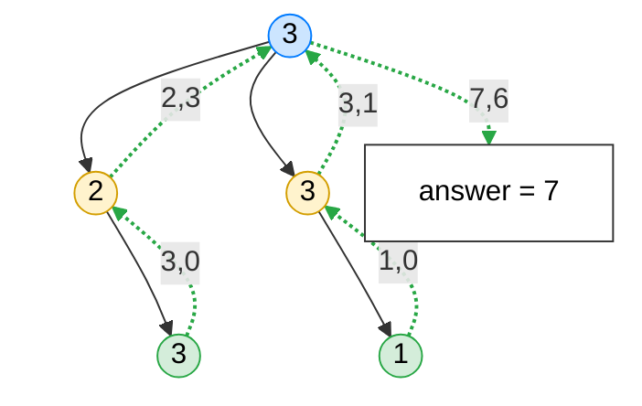

## LeetCode 337: House Robber III
**Difficulty:** Medium | **Pattern:** DP on trees, return a (rob, skip) pair per node | **Language:** Java

### 1. Problem
- Houses form a binary tree. If you rob two directly linked houses (parent and child) the police are alerted. Return the maximum money you can rob.
- Example: `root = [3,2,3,null,3,null,1]` -> `7` (rob the root 3, the left-right 3 and the right-right 1: 3 + 3 + 1).
- Constraints: 1 <= nodes <= 10^4, 0 <= val <= 10^4. A linear O(n) pass is the target. Depth can reach 10^4 on a chain, which a Java recursion handles with the default stack, but note it. The total is at most 10^8, so `int` is safe.
- **Key insight:** a node's best answer depends on only one fact about each child: "what is the best total in that subtree if the child is robbed" and "if the child is not robbed". Return both numbers (a pair) from a post-order DFS and the parent combines them with no repeated work.

### 2. Solution
**Step 1: brute force.** `rob(node) = max(node.val + rob(4 grandchildren), rob(left) + rob(right))`. The grandchildren are recomputed again when the children are visited, so the same subtrees are solved many times. The recursion tree grows like a Fibonacci recurrence in the depth: exponential in the worst case.

**Step 2: memoise.** Cache `rob(node)` in a `HashMap<TreeNode,Integer>`. Each node is solved once: O(n) time, but O(n) map memory plus hashing overhead.

**Step 3: remove the map by returning a pair.** The reason the grandchildren were needed was only to express "the child is not robbed". Say it directly:
- `rob`  (this node is robbed) = `node.val + left.skip + right.skip`. Children must be skipped.
- `skip` (this node is not robbed) = `max(left.rob, left.skip) + max(right.rob, right.skip)`. Each child is free to be either, so take its better option.

Skip means "this node is not robbed", not "its children are robbed". Each child picks its own best. The answer is `max(root.rob, root.skip)`. Each node is visited once and the pair carries all the information a parent ever needs.

```java
class Solution {
    // Shared and never mutated, so no allocation for null children.
    private static final int[] EMPTY = {0, 0};

    public int rob(TreeNode root) {
        int[] best = dfs(root);
        return Math.max(best[0], best[1]);
    }

    // returns {robThisNode, skipThisNode} for the subtree rooted at node
    private int[] dfs(TreeNode node) {
        if (node == null) return EMPTY;
        int[] left = dfs(node.left);
        int[] right = dfs(node.right);
        int rob = node.val + left[1] + right[1];
        int skip = Math.max(left[0], left[1]) + Math.max(right[0], right[1]);
        return new int[]{rob, skip};
    }
}
```
Implementation notes: the shared `EMPTY` array is safe because no caller writes to a returned array. One small `int[2]` per real node is the only allocation. A deep chain of 10^4 nodes is fine for the default stack; if depth were far larger you would convert to an iterative post-order.

### 3. Dry Run
Tree `[3,2,3,null,3,null,1]`: root 3; left child 2 has only a right child 3; right child 3 has only a right child 1. Pairs are `[rob,skip]`.


Legend: blue = root, yellow = inner, green = leaf; solid arrows are calls, green dotted arrows return "rob,skip" to the parent; blank slots are missing left children (they return 0,0).

Per-node computation (post-order):

| Node | left pair | right pair | rob = val + l.skip + r.skip | skip = max(l) + max(r) | returns [rob, skip] |
|---|---|---|---|---|---|
| left-right 3 (leaf) | [0,0] | [0,0] | 3 + 0 + 0 = 3 | 0 + 0 = 0 | [3,0] |
| right-right 1 (leaf) | [0,0] | [0,0] | 1 + 0 + 0 = 1 | 0 + 0 = 0 | [1,0] |
| left 2 | [0,0] | [3,0] | 2 + 0 + 0 = 2 | 0 + max(3,0) = 3 | [2,3] |
| right 3 | [0,0] | [1,0] | 3 + 0 + 0 = 3 | 0 + max(1,0) = 1 | [3,1] |
| root 3 | [2,3] | [3,1] | 3 + 3 + 1 = 7 | max(2,3) + max(3,1) = 3 + 3 = 6 | [7,6] |

Call trace (no memo hits: every node is reached exactly once; the 6 null calls are base cases):

| Order | Call | Depth | Action | Returns |
|---|---|---|---|---|
| 1 | dfs(root 3) | 0 | go left, then right, combine | [7,6] |
| 2 | dfs(left 2) | 1 | go left, then right, combine | [2,3] |
| 3 | dfs(null) | 2 | base case | [0,0] |
| 4 | dfs(left-right 3) | 2 | both children null, combine | [3,0] |
| 5 | dfs(null) | 3 | base case | [0,0] |
| 6 | dfs(null) | 3 | base case | [0,0] |
| 7 | dfs(right 3) | 1 | go left, then right, combine | [3,1] |
| 8 | dfs(null) | 2 | base case | [0,0] |
| 9 | dfs(right-right 1) | 2 | both children null, combine | [1,0] |
| 10 | dfs(null) | 3 | base case | [0,0] |
| 11 | dfs(null) | 3 | base case | [0,0] |

Final answer: `max(7, 6) = 7`.

**Complexity:** Time O(n), each node is processed once (2n+1 calls). Space O(h) for the recursion stack (O(n) for a chain), plus one small pair per live frame.

### 4. Takeaway
- **Pattern:** when a tree decision at a node depends only on a small summary of each child's subtree under different states (taken/not taken, covered/uncovered), return a tuple of those states from post-order DFS. No memo table is needed because each node is visited once.
- **Edge cases:**

| Input | Result | Note |
|---|---|---|
| single node `[5]` | 5 | root pair [5,0] |
| `[1,10,10]` (star) | 20 | skip the root, rob both leaves |
| chain `[2,1,3]` (left chain) | 5 | rob top and bottom, skip middle |
| all zeros | 0 | pairs stay 0 |
| null root (outside constraints) | 0 | EMPTY pair |

- **Mistakes to avoid:**
  - Writing `skip = left.rob + right.rob`. Skipping a node does not force its children to be robbed; take the max for each child.
  - Using only `max(rob, skip)` as a single return value, which loses the information the parent needs (this is why the plain single-value DP fails).
  - Allocating a new array for null children when a shared constant works, or mutating the shared `EMPTY`.
  - Memoising with a `HashMap` keyed on nodes: correct, but slower and heavier than the pair.
- **Related problems:** #198 House Robber (linear: same rob/skip states along an array), #213 House Robber II (circular: run linear twice), #968 Binary Tree Cameras (tree DP with three states), #124 Binary Tree Maximum Path Sum (post-order returns one-sided gain while a global tracks the best), #543 Diameter of Binary Tree (post-order with a side-channel answer).

---

## LeetCode 1463: Cherry Pickup II
**Difficulty:** Hard | **Pattern:** 3D DP, two agents moving in lockstep on a grid | **Language:** Java

### 1. Problem
- A `rows x cols` grid holds cherries. Robot 1 starts at the top-left `(0,0)`, robot 2 at the top-right `(0,cols-1)`. Each step both robots move down one row, each going to column `c-1`, `c` or `c+1` (inside the grid). They collect the cherries in the cells they visit; a cell visited by both counts once. Return the maximum total when both reach the last row.
- Example: `[[3,1,1],[2,5,1],[1,5,5],[2,1,1]]` -> `24` (row 0: 3+1, row 1: 2+5, row 2: 5+5, row 3: 2+1).
- Constraints: 2 <= rows, cols <= 70, 0 <= grid[i][j] <= 100. There are about 70 * 70 * 70 = 343,000 states, so O(rows * cols^2 * 9) (about 3 million operations) is the target.
- **Key insight:** both robots move down exactly one row per step, so they share a clock: after `r` steps both are in row `r`. The joint state is just `(r, c1, c2)`. Solving the robots separately fails because shared cells must be counted once, so they must be planned together.

### 2. Solution
**Step 1: brute force.** Try every pair of paths: each robot has 3 choices per row, so 9 joint moves per step and `9^(rows-1)` joint paths. For 70 rows this is astronomically large.

**Step 2: independent or greedy ideas fail.** Picking the best path for robot 1 and then the best remaining one for robot 2 is not optimal (taking a shared cell for robot 1 can hurt the combined total). The robots interact only through the overlap rule, so they need one joint state.

**Step 3: joint state with a shared clock.** Define `dp[r][a][b]` = maximum cherries collectable from row `r` to the last row when robot 1 is at column `a` and robot 2 at column `b` in row `r` (including the cherries in row `r`). Because both advance one row per step, no time dimension beyond `r` is needed.

- Cherries in row `r`: `cost(r,a,b) = grid[r][a] + (a == b ? 0 : grid[r][b])`.
- Base: `dp[last][a][b] = cost(last,a,b)`.
- Transition: `dp[r][a][b] = cost(r,a,b) + max dp[r+1][a+da][b+db]` over `da, db` in `{-1, 0, +1}`. That is 3 x 3 = 9 transitions: each robot independently picks one of 3 moves.
- Boundary clamping: skip any next column outside `[0, cols-1]` (loop from `max(0,a-1)` to `min(cols-1,a+1)`).
- Answer: `dp[0][0][cols-1]`.

Going bottom-up (backward) makes every state valid, so there are no "unreachable" sentinels. Row `r` needs only row `r+1`, so keep two `cols x cols` layers: O(cols^2) space. (By symmetry `dp[a][b] == dp[b][a]`, so half the states could be skipped; not needed at these limits.)

```java
class Solution {
    public int cherryPickup(int[][] grid) {
        int rows = grid.length, cols = grid[0].length;
        int[][] next = new int[cols][cols]; // layer for row r + 1
        int[][] cur = new int[cols][cols];  // layer for row r

        int[] last = grid[rows - 1];
        for (int a = 0; a < cols; a++) {
            for (int b = 0; b < cols; b++) {
                next[a][b] = last[a] + (a == b ? 0 : last[b]);
            }
        }

        for (int r = rows - 2; r >= 0; r--) {
            int[] row = grid[r];
            for (int a = 0; a < cols; a++) {
                int aLo = Math.max(0, a - 1), aHi = Math.min(cols - 1, a + 1);
                for (int b = 0; b < cols; b++) {
                    int bLo = Math.max(0, b - 1), bHi = Math.min(cols - 1, b + 1);
                    int best = 0;
                    for (int na = aLo; na <= aHi; na++) {
                        for (int nb = bLo; nb <= bHi; nb++) {
                            best = Math.max(best, next[na][nb]);
                        }
                    }
                    cur[a][b] = row[a] + (a == b ? 0 : row[b]) + best;
                }
            }
            int[][] tmp = next; next = cur; cur = tmp;
        }
        return next[0][cols - 1];
    }
}
```
Implementation notes: two rolling `int[][]` layers swapped by reference; `best` starts at 0 which is safe because all cherry counts are non-negative and the window always has at least 4 cells. After the final swap, `next` holds row 0. Maximum total is 2 * 70 * 100 = 14,000, far from overflow.

### 3. Dry Run
Grid (4 rows, 3 columns):

```
row 0: 3 1 1
row 1: 2 5 1
row 2: 1 5 5
row 3: 2 1 1
```
For each row we show `cost` (cherries at the two columns, counted once if equal), `M` (max of the next layer over the 3x3 window, clamped at borders) and `dp = cost + M`. Rows of each matrix are `a = 0,1,2`, columns are `b = 0,1,2`.

| Layer | Work |
|---|---|
| row 3 | base: dp = cost |
| row 2 | M from row-3 layer, dp = cost + M |
| row 1 | M from row-2 layer, dp = cost + M |
| row 0 | M from row-1 layer, dp = cost + M; read dp[0][2] |

**Row 3 (base), grid row `[2,1,1]`:**
```
dp3 = [ 2 3 3 ]     e.g. (0,1): 2+1 = 3 ; (1,1): same cell, 1 counted once
      [ 3 1 2 ]
      [ 3 2 1 ]
```

**Row 2, grid row `[1,5,5]`:**
```
cost2 = [ 1  6  6 ]    M3 = [ 3 3 3 ]    dp2 = [ 4  9  9 ]
        [ 6  5 10 ]         [ 3 3 3 ]          [ 9  8 13 ]
        [ 6 10  5 ]         [ 3 3 2 ]          [ 9 13  7 ]
```
Checks: dp2[1][2]: cost 5+5 = 10, window a' in {0,1,2}, b' in {1,2} of dp3 -> max(3,3,1,2,2,1) = 3, total 13. dp2[2][2]: same cell so cost 5; window a' in {1,2}, b' in {1,2} -> max(1,2,2,1) = 2, total 7 (clamped: no column 3).

**Row 1, grid row `[2,5,1]`:**
```
cost1 = [ 2 7 3 ]      M2 = [  9 13 13 ]    dp1 = [ 11 20 16 ]
        [ 7 5 6 ]           [ 13 13 13 ]          [ 20 18 19 ]
        [ 3 6 1 ]           [ 13 13 13 ]          [ 16 19 14 ]
```
Check dp1[0][0]: cost 2 (same cell), window a' in {0,1}, b' in {0,1} of dp2: max(4,9,9,8) = 9, total 11.

**Row 0, grid row `[3,1,1]`:**
```
cost0 = [ 3 4 4 ]      M1 = [ 20 20 20 ]    dp0 = [ 23 24 24 ]
        [ 4 1 2 ]           [ 20 20 20 ]          [ 24 21 22 ]
        [ 4 2 1 ]           [ 20 20 19 ]          [ 24 22 20 ]
```
The answer cell is `dp0[0][2]`: cost 3 + 1 = 4, window a' in {0,1}, b' in {1,2} of dp1 = max(20,16,18,19) = 20, so 4 + 20 = 24.

Path recovery (for understanding): row 0 (cols 0,2) = 3+1 = 4 -> row 1 (cols 0,1) = 2+5 = 7 -> row 2 (cols 1,2) = 5+5 = 10 -> row 3 (cols 0,1) = 2+1 = 3. Total 4 + 7 + 10 + 3 = 24.

Final answer: `24`.

**Complexity:** Time O(rows * cols^2 * 9), one 3x3 window per `(a,b)` per row. Space O(cols^2), two rolling layers.

### 4. Takeaway
- **Pattern:** several agents that move in synchronized steps: put the shared clock (here the row) in the state once and add one coordinate per agent. Interactions (double-counting shared cells) are handled inside the cost function.
- **Edge cases:**

| Input | Result | Note |
|---|---|---|
| `cols = 2`, any grid | uses columns 0 and 1 only | robots can still meet in the same cell |
| all zeros | 0 | trivial |
| robots forced to share a cell | cell counted once | `a == b` branch |
| `rows = 2` | cost(0,0,cols-1) + best 3x3 window of row 1 | loop runs once |
| max values (70x70 of 100) | 14,000 | well within `int` |

- **Mistakes to avoid:**
  - Counting a shared cell twice when `a == b`.
  - Forgetting to clamp `a-1` / `a+1` (and `b-1` / `b+1`) to the grid, or clamping only one robot.
  - Planning the robots one after another (greedy or two independent DPs), which breaks the overlap rule.
  - Returning `dp[0][0][0]` instead of the start state `dp[0][0][cols-1]`.
  - Reusing a single layer in place: row `r` reads many cells of row `r+1`, so you need two layers.
- **Related problems:** #741 Cherry Pickup (two simultaneous trips in a grid with obstacles, the 3D version with shared clock `step = r1 + c1`), #64 Minimum Path Sum (single agent), #931 Minimum Falling Path Sum (single agent, 3 moves), #174 Dungeon Game (grid DP processed backward).

---

## LeetCode 931: Minimum Falling Path Sum
**Difficulty:** Medium | **Pattern:** Grid DP with three-way transitions and boundary clamping | **Language:** Java

### 1. Problem
- Given an `n x n` integer matrix, a falling path starts at any cell in the first row and moves to the next row into the cell directly below, or diagonally left or right. Return the minimum sum of a falling path.
- Example: `[[2,1,3],[6,5,4],[7,8,9]]` -> `13` (for instance 1 -> 5 -> 7, or 1 -> 4 -> 8).
- Constraints: 1 <= n <= 100, -100 <= matrix[i][j] <= 100. n^2 = 10,000 cells, so O(n^2) is easy. The sum is within about +/-10^4, so `int` is safe. Values can be negative.
- **Key insight:** the best path ending at `(i,j)` depends only on the best paths ending at the up to three cells above it: `dp[i][j] = matrix[i][j] + min(dp[i-1][j-1], dp[i-1][j], dp[i-1][j+1])`, ignoring columns that do not exist.

### 2. Solution
**Step 1: brute force.** Try every path from every start: 3 choices per row gives about `n * 3^(n-1)` paths, hopeless for n = 100.

**Step 2: overlapping subproblems.** Many paths pass through the same cell and the cost of finishing from there (or arriving there) is the same each time. Computing "best path ending at this cell" once per cell removes the repetition.

**Step 3: bottom-down DP with clamping.** Row 0 is the base case (`dp[0][j] = matrix[0][j]`). For each later row, take the minimum of the reachable parents in the previous row: the cell above, and the left and right diagonals only when they exist (`c > 0`, `c < n - 1`). The answer is the minimum over the last row. Row `r` only reads row `r-1`, so two 1D arrays suffice and the input is left untouched.

Clamping with conditions (instead of a sentinel such as `0`) is important because values can be negative: a fake `0` parent could beat real negative parents. If you prefer sentinels, use `Integer.MAX_VALUE / 2` on both sides, never `0`.

```java
class Solution {
    public int minFallingPathSum(int[][] matrix) {
        int n = matrix.length;
        int[] prev = matrix[0].clone();
        int[] cur = new int[n];

        for (int r = 1; r < n; r++) {
            for (int c = 0; c < n; c++) {
                int best = prev[c];                          // straight above
                if (c > 0) best = Math.min(best, prev[c - 1]);     // upper-left exists
                if (c < n - 1) best = Math.min(best, prev[c + 1]); // upper-right exists
                cur[c] = matrix[r][c] + best;
            }
            int[] tmp = prev; prev = cur; cur = tmp;
        }

        int ans = prev[0];
        for (int c = 1; c < n; c++) ans = Math.min(ans, prev[c]);
        return ans;
    }
}
```
Implementation notes: `clone()` of the first row avoids mutating the caller's input; swapping array references avoids copying; with `n = 1` the loop is skipped and the answer is the single value.

### 3. Dry Run
Matrix `[[2,1,3],[6,5,4],[7,8,9]]`. `prev` is the previous dp row.

| Cell (r,c) | matrix value | Parent candidates in prev (clamped) | min parent | dp value |
|---|---|---|---|---|
| (0,0) | 2 | base | - | 2 |
| (0,1) | 1 | base | - | 1 |
| (0,2) | 3 | base | - | 3 |
| (1,0) | 6 | prev[0]=2, prev[1]=1 (no left parent) | 1 | 7 |
| (1,1) | 5 | prev[0]=2, prev[1]=1, prev[2]=3 | 1 | 6 |
| (1,2) | 4 | prev[1]=1, prev[2]=3 (no right parent) | 1 | 5 |
| (2,0) | 7 | prev[0]=7, prev[1]=6 (no left parent) | 6 | 13 |
| (2,1) | 8 | prev[0]=7, prev[1]=6, prev[2]=5 | 5 | 13 |
| (2,2) | 9 | prev[1]=6, prev[2]=5 (no right parent) | 5 | 14 |

Filled dp grid:

| | c=0 | c=1 | c=2 |
|---|---|---|---|
| r=0 | 2 | 1 | 3 |
| r=1 | 7 | 6 | 5 |
| r=2 | 13 | 13 | 14 |

Boundary clamping: column 0 has only two parents (`c` and `c+1`) and column `n-1` has only two (`c-1` and `c`); only interior columns use all three. Last row minimum: `min(13, 13, 14) = 13`.

Negative sanity check: `[[-19,57],[-40,-5]]`: row 1 dp = `-40 + min(-19,57) = -59` and `-5 + min(57,-19) = -24`, answer `-59`.

Final answer: `13`.

**Complexity:** Time O(n^2), each cell looks at at most 3 parents. Space O(n), two rows (the input is not modified).

### 4. Takeaway
- **Pattern:** grid DP where each cell depends on a small fixed neighbourhood in the previous row; process row by row, clamp at the edges, and keep only the last row.
- **Edge cases:**

| Input | Result | Note |
|---|---|---|
| `[[5]]` | 5 | no loop, min of row 0 |
| `[[-19,57],[-40,-5]]` | -59 | negatives; no sentinel 0 allowed |
| all equal values | n * value | every path ties |
| n = 2 | min over 4 sums | every cell has only two parents |
| max negative `-100` everywhere, n = 100 | -10,000 | fits in `int` |

- **Mistakes to avoid:**
  - Reading `prev[c-1]` or `prev[c+1]` out of bounds on the edges.
  - Using `0` as the out-of-range value when entries can be negative.
  - Forgetting the final minimum over the whole last row (the path can end in any column).
  - Overwriting `prev` while computing `cur` in the same array without care (a left neighbour of the new row would read an updated value).
  - Mutating the caller's matrix if that is not allowed (in-place on the matrix also works and gives O(1) extra space when permitted).
- **Related problems:** #1289 Minimum Falling Path Sum II (no two adjacent rows may use the same column: keep the two smallest values per row), #120 Triangle (same idea with two parents), #64 Minimum Path Sum (two parents: up and left), #1463 Cherry Pickup II (same three-way moves, but with two agents and 3D state).
