## LeetCode 200: Number of Islands
**Difficulty:** Medium | **Pattern:** Grid DFS, visit and mark (flood fill) | **Language:** Java

### 1. Problem
- Given a grid of `'1'` (land) and `'0'` (water), count islands. An island is a maximal group of land cells connected horizontally or vertically.
- Example: the grid below has output `2`.
- Constraints: `m, n <= 300`, so up to 90,000 cells. Visiting each cell a constant number of times (O(m*n)) is the target.
- **Key insight:** scan the grid; every time you meet unvisited land, you have found a new island. Immediately flood the whole island (mark all its cells visited) so it is never counted again. Number of floods started = number of islands.

### 2. Solution
- Step 1 (brute force): for each land cell, search for any already-counted cell it touches. That needs a union of sets or repeated scans, easily O(cells^2). Wasteful because connectivity is rediscovered repeatedly.
- Step 2: connectivity is a graph question, cells are nodes, 4-neighbours are edges. One DFS from a cell reaches exactly its component.
- Step 3 (optimal): outer scan plus DFS. To avoid a separate `visited` array, overwrite land with `'0'` ("sink" it). Each cell is entered once as land and rejected cheaply afterwards: O(m*n) time.

```java
class Solution {
    public int numIslands(char[][] grid) {
        int count = 0;
        for (int r = 0; r < grid.length; r++) {
            for (int c = 0; c < grid[0].length; c++) {
                if (grid[r][c] == '1') {
                    count++;
                    sink(grid, r, c);
                }
            }
        }
        return count;
    }

    private void sink(char[][] g, int r, int c) {
        if (r < 0 || c < 0 || r >= g.length || c >= g[0].length || g[r][c] != '1') return;
        g[r][c] = '0';          // mark before recursing, otherwise neighbours bounce back forever
        sink(g, r + 1, c);      // down
        sink(g, r - 1, c);      // up
        sink(g, r, c + 1);      // right
        sink(g, r, c - 1);      // left
    }
}
```
Implementation notes: the bounds check comes first so we never index outside. Mutating the input is fine in interviews, but say so (copy or use a boolean array if input must stay intact). Worst-case recursion depth is m*n (a snake-shaped island); for very large grids use an explicit `ArrayDeque<int[]>` stack or BFS.

### 3. Dry Run
Grid (3 x 4). Direction order: down, up, right, left.

| | c0 | c1 | c2 | c3 |
|---|---|---|---|---|
| r0 | 1 | 1 | 0 | 0 |
| r1 | 1 | 0 | 0 | 1 |
| r2 | 0 | 0 | 1 | 1 |

Visit order numbers (cells sunk, labelled by the order they are entered):

| | c0 | c1 | c2 | c3 |
|---|---|---|---|---|
| r0 | 1 | 3 | 0 | 0 |
| r1 | 2 | 0 | 0 | 4 |
| r2 | 0 | 0 | 6 | 5 |

Recursion tree for the first island (only calls that hit land are drawn; the other calls return immediately):

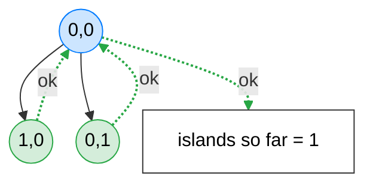
Legend: blue = flood start, green = land cells sunk, green dotted = return (void, "ok").

Call trace for island 1 (13 calls):

| Order | Call | Depth | Action | Returns |
|---|---|---|---|---|
| 1 | (0,0) | 0 | land, sink | after children |
| 2 | (1,0) | 1 | land, sink | after children |
| 3 | (2,0) | 2 | water | return |
| 4 | (0,0) | 2 | already sunk | return |
| 5 | (1,1) | 2 | water | return |
| 6 | (1,-1) | 2 | out of bounds | return |
| 7 | (-1,0) | 1 | out of bounds | return |
| 8 | (0,1) | 1 | land, sink | after children |
| 9 | (1,1) | 2 | water | return |
| 10 | (-1,1) | 2 | out of bounds | return |
| 11 | (0,2) | 2 | water | return |
| 12 | (0,0) | 2 | already sunk | return |
| 13 | (0,-1) | 1 | out of bounds | return |

Outer scan:

| Cell | Value | Action | count |
|---|---|---|---|
| (0,0) | 1 | new island, flood (cells 1-3) | 1 |
| (0,1), (1,0) | 0 | already sunk | 1 |
| (0,2),(0,3),(1,1),(1,2) | 0 | water | 1 |
| (1,3) | 1 | new island, flood (cells 4-6) | 2 |
| (2,2), (2,3) | 0 | already sunk | 2 |

Answer: 2.

**Complexity:** Time O(m*n), each cell is entered a constant number of times (once as land, up to 4 times as a rejected neighbour). Space O(m*n) worst-case recursion depth, O(1) extra otherwise.

### 4. Takeaway
- **Pattern:** "count / label connected regions in a grid" means scan plus flood fill. Sink in place or keep a `visited` array.
- **Edge cases:**

| Input | Result | Note |
|---|---|---|
| all `'0'` | 0 | no flood ever starts |
| all `'1'` | 1 | one flood, deep recursion |
| 1 x 1 `'1'` | 1 | bounds checks handle all four sides |
| diagonal land only | count of cells | diagonals are not connected |

- **Mistakes to avoid:**
  - Marking visited after the recursive calls (infinite recursion).
  - Treating diagonals as neighbours.
  - Comparing a `char` to `1` instead of `'1'`.
  - Stack overflow on huge snake islands; know the BFS/stack alternative. Union-Find also works and handles streaming land (see #305).
- **Related problems:** 695 Max Area of Island (return size), 733 Flood Fill (recolour), 130 Surrounded Regions (border-seeded), 463 Island Perimeter (count edges, no DFS needed), 305 Number of Islands II (Union-Find, premium).

---

## LeetCode 695: Max Area of Island
**Difficulty:** Medium | **Pattern:** Grid DFS, return component size | **Language:** Java

### 1. Problem
- Binary grid; return the largest area (cell count) of a 4-connected island, or 0 if none.
- Example: grid below gives `3`.
- Constraints: `m, n <= 50`. O(m*n) is the target.
- **Key insight:** the DFS does not have to be `void`. Let it return the number of cells it sank: `1 + sum of children`. The return value flows up the recursion tree and the root of each flood returns the island's area.

### 2. Solution
- Step 1 (brute force): flood each island to mark it, then rescan to count cells per island. Two passes and extra bookkeeping.
- Step 2: count while flooding. A cell contributes 1; water, out-of-bounds, or already-sunk cells contribute 0. The area of a component is the sum of contributions in its DFS tree.
- Step 3 (optimal): outer scan, `best = max(best, dfs(r, c))`. O(m*n).

```java
class Solution {
    private int[][] grid;
    private int rows, cols;

    public int maxAreaOfIsland(int[][] grid) {
        this.grid = grid;
        rows = grid.length;
        cols = grid[0].length;
        int best = 0;
        for (int r = 0; r < rows; r++) {
            for (int c = 0; c < cols; c++) {
                if (grid[r][c] == 1) {
                    best = Math.max(best, dfs(r, c));
                }
            }
        }
        return best;
    }

    private int dfs(int r, int c) {
        if (r < 0 || c < 0 || r >= rows || c >= cols || grid[r][c] == 0) return 0;
        grid[r][c] = 0; // sink = visited
        return 1 + dfs(r + 1, c) + dfs(r - 1, c) + dfs(r, c + 1) + dfs(r, c - 1);
    }
}
```
Notes: fields avoid passing the grid through every call. Java evaluates the sum left to right, so the order is down, up, right, left.

### 3. Dry Run
Grid (3 x 4):

| | c0 | c1 | c2 | c3 |
|---|---|---|---|---|
| r0 | 0 | 1 | 1 | 0 |
| r1 | 0 | 1 | 0 | 0 |
| r2 | 1 | 0 | 1 | 1 |

Island A = {(0,1),(0,2),(1,1)}, island B = {(2,0)}, island C = {(2,2),(2,3)}.

After flooding island A (visit order in cells): (0,1)=1, (1,1)=2, (0,2)=3.

| | c0 | c1 | c2 | c3 |
|---|---|---|---|---|
| r0 | 0 | 1 | 3 | 0 |
| r1 | 0 | 2 | 0 | 0 |
| r2 | 1 | 0 | 1 | 1 |

(Cells hold their visit number for A; in memory they are all set to 0.)

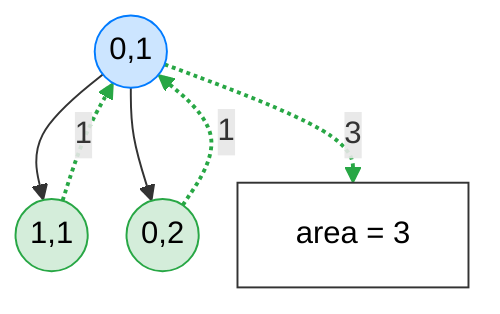
Legend: blue = flood root, green = land leaves, green dotted = returned area; the root returns 1 + 1 + 1 = 3.

Call trace for island A:

| Order | Call | Depth | Action | Returns |
|---|---|---|---|---|
| 1 | (0,1) | 0 | land, sink | 3 |
| 2 | (1,1) | 1 | land, sink | 1 |
| 3 | (2,1) | 2 | water | 0 |
| 4 | (0,1) | 2 | already sunk | 0 |
| 5 | (1,2) | 2 | water | 0 |
| 6 | (1,0) | 2 | water | 0 |
| 7 | (-1,1) | 1 | out of bounds | 0 |
| 8 | (0,2) | 1 | land, sink | 1 |
| 9 | (1,2) | 2 | water | 0 |
| 10 | (-1,2) | 2 | out of bounds | 0 |
| 11 | (0,3) | 2 | water | 0 |
| 12 | (0,1) | 2 | already sunk | 0 |
| 13 | (0,0) | 1 | water | 0 |

Outer scan:

| Cell | Action | Area | best |
|---|---|---|---|
| (0,1) | flood island A | 3 | 3 |
| (2,0) | flood island B | 1 | 3 |
| (2,2) | flood island C: 1 + dfs(2,3) = 1 + 1 | 2 | 3 |

Answer: 3.

**Complexity:** Time O(m*n), each cell sunk once. Space O(m*n) worst-case recursion depth (up to 2500 here, safe).

### 4. Takeaway
- **Pattern:** "property of each connected component" (size, max, sum) means DFS returning a value that aggregates children.
- **Edge cases:**

| Input | Result | Note |
|---|---|---|
| no land | 0 | `best` stays 0 |
| all land | m*n | single flood |
| 1 x 1 land | 1 | |
| two equal islands | that area | `max` ties are fine |

- **Mistakes to avoid:**
  - Forgetting to sink before recursing (double counting, infinite loop).
  - Resetting `best` per island instead of keeping a global max.
  - Returning area from the cell check but not adding the `1` for the current cell.
- **Related problems:** 200 Number of Islands (count only), 463 Island Perimeter (edges not cells), 827 Making A Large Island (label components, then merge), 1254 Closed Islands (border-aware flood).

---

## LeetCode 733: Flood Fill
**Difficulty:** Easy | **Pattern:** DFS with colour replacement (handle same-colour edge case) | **Language:** Java

### 1. Problem
- Starting at pixel `(sr, sc)`, recolour it and every 4-connected pixel that has the same original colour to `color`. Return the image.
- Example: `image = [[1,1,1],[1,1,0],[1,0,1]]`, `sr=1, sc=1, color=2` gives `[[2,2,2],[2,2,0],[2,0,1]]`.
- Constraints: `m, n <= 50`. O(m*n).
- **Key insight:** the recolouring itself is the visited mark: a repainted cell no longer has the old colour, so it is skipped. That only works if the new colour differs from the old. If `old == new`, nothing ever looks "visited" and recursion never ends, so return early.

### 2. Solution
- Step 1: a naive version with a separate `visited` array works but costs O(m*n) extra memory.
- Step 2: realise painting already marks cells. Drop the array.
- Step 3: guard `old == color`, then DFS over cells equal to `old`.

```java
class Solution {
    public int[][] floodFill(int[][] image, int sr, int sc, int color) {
        int old = image[sr][sc];
        if (old == color) return image; // nothing to change; avoids infinite recursion
        fill(image, sr, sc, old, color);
        return image;
    }

    private void fill(int[][] img, int r, int c, int old, int color) {
        if (r < 0 || c < 0 || r >= img.length || c >= img[0].length || img[r][c] != old) return;
        img[r][c] = color;
        fill(img, r + 1, c, old, color);
        fill(img, r - 1, c, old, color);
        fill(img, r, c + 1, old, color);
        fill(img, r, c - 1, old, color);
    }
}
```

### 3. Dry Run
Start (1,1), old = 1, new = 2. Direction order: down, up, right, left.

Before:

| | c0 | c1 | c2 |
|---|---|---|---|
| r0 | 1 | 1 | 1 |
| r1 | 1 | 1 | 0 |
| r2 | 1 | 0 | 1 |

After, with paint order in brackets:

| | c0 | c1 | c2 |
|---|---|---|---|
| r0 | 2 [4] | 2 [2] | 2 [3] |
| r1 | 2 [5] | 2 [1] | 0 |
| r2 | 2 [6] | 0 | 1 |

Pixel (2,2) is also 1 but is cut off by zeros, so it stays 1.

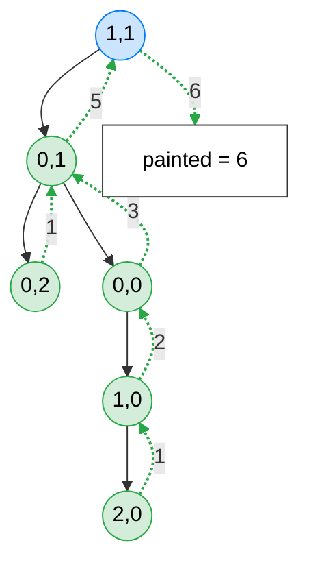
Legend: blue = start pixel, green = repainted pixels, dotted green = number of pixels painted in that subtree (the real function is void; the counts are only for illustration).

Call trace (only calls that repaint; the rest return at once on bounds, a `0`, or an already-painted `2`):

| Order | Cell | Depth | Action |
|---|---|---|---|
| 1 | (1,1) | 0 | 1 -> 2 |
| 2 | (0,1) | 1 | 1 -> 2 |
| 3 | (0,2) | 2 | 1 -> 2 |
| 4 | (0,0) | 2 | 1 -> 2 |
| 5 | (1,0) | 3 | 1 -> 2 |
| 6 | (2,0) | 4 | 1 -> 2 |

Answer: `[[2,2,2],[2,2,0],[2,0,1]]`.

**Complexity:** Time O(m*n), each pixel painted once. Space O(m*n) recursion worst-case.

### 4. Takeaway
- **Pattern:** "change a whole connected region" means flood fill; use the mutation as the visited mark.
- **Edge cases:**

| Input | Result | Note |
|---|---|---|
| `old == color` | unchanged | the early return prevents a stack overflow |
| single pixel | recoloured | |
| isolated start | only start changes | |
| whole image one colour | all repainted | recursion up to 2500 deep |

- **Mistakes to avoid:** omitting the same-colour guard; reading the old colour after the start pixel was already painted; using diagonal neighbours.
- **Related problems:** 200 Number of Islands (count regions), 695 Max Area (region size), 1034 Coloring A Border (border pixels only), 130 Surrounded Regions.

---

## LeetCode 130: Surrounded Regions
**Difficulty:** Medium | **Pattern:** Border DFS to mark "safe" cells, then flip the rest | **Language:** Java

### 1. Problem
- Grid of `'X'` and `'O'`. Capture every region of `'O'` that is completely surrounded by `'X'` (does not touch the border) by flipping it to `'X'`. Modify in place.
- Example: below, the 3 interior `O`s flip; the `O` on the bottom border and anything connected to it stay.
- Constraints: `m, n <= 200`. O(m*n).
- **Key insight:** deciding "is this region surrounded?" per region is awkward. Flip the question: an `O` survives iff it connects to a border `O`. So DFS from border `O`s, temporarily mark them safe, then flip every remaining `O` to `X` and restore safe ones.

### 2. Solution
- Step 1 (brute force): for each `O` region, flood it and check whether any cell touched the border; if not, flip. Needs two floods per region (collect, then flip) and bookkeeping.
- Step 2: border-connected is a property reachable from the border, so seed from the border only.
- Step 3 (optimal): DFS from every border `O`, marking it `'#'`. Final pass: `'O'` -> `'X'` (unreachable, so surrounded), `'#'` -> `'O'`.

```java
class Solution {
    public void solve(char[][] board) {
        int rows = board.length, cols = board[0].length;
        for (int r = 0; r < rows; r++) {
            mark(board, r, 0);
            mark(board, r, cols - 1);
        }
        for (int c = 0; c < cols; c++) {
            mark(board, 0, c);
            mark(board, rows - 1, c);
        }
        for (int r = 0; r < rows; r++) {
            for (int c = 0; c < cols; c++) {
                if (board[r][c] == 'O') board[r][c] = 'X';
                else if (board[r][c] == '#') board[r][c] = 'O';
            }
        }
    }

    private void mark(char[][] b, int r, int c) {
        if (r < 0 || c < 0 || r >= b.length || c >= b[0].length || b[r][c] != 'O') return;
        b[r][c] = '#';
        mark(b, r + 1, c);
        mark(b, r - 1, c);
        mark(b, r, c + 1);
        mark(b, r, c - 1);
    }
}
```
Notes: `'#'` is a third state so we can tell "safe O" from "capturable O" without an extra array. Calling `mark` on a corner twice is harmless.

### 3. Dry Run
Board (4 x 4):

| | c0 | c1 | c2 | c3 |
|---|---|---|---|---|
| r0 | X | X | X | X |
| r1 | X | O | O | X |
| r2 | X | X | O | X |
| r3 | X | O | X | X |

Border `O`s: only (3,1). Border scan order: rows (col 0 then last col), then columns (row 0 then last row). Row 3 col 1 is hit in the column loop at c=1, `mark(3,1)`.

DFS from (3,1): sink to `#` [1]; down OOB; up (2,1)=X; right (3,2)=X; left (3,0)=X. Done.

After marking:

| | c0 | c1 | c2 | c3 |
|---|---|---|---|---|
| r0 | X | X | X | X |
| r1 | X | O | O | X |
| r2 | X | X | O | X |
| r3 | X | # [1] | X | X |

Final pass (row-major):

| Cell | Before | After |
|---|---|---|
| (1,1) | O | X |
| (1,2) | O | X |
| (2,2) | O | X |
| (3,1) | # | O |

Result:

| | c0 | c1 | c2 | c3 |
|---|---|---|---|---|
| r0 | X | X | X | X |
| r1 | X | X | X | X |
| r2 | X | X | X | X |
| r3 | X | O | X | X |

Recursion for the single border seed:

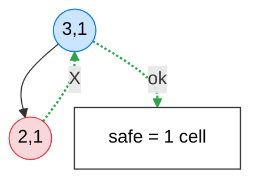
Legend: blue = border seed marked `#`, red = neighbour rejected (it is `X`, base case), green dotted = return.

Call trace for `mark(3,1)` (the other three neighbours are the same base case):

| Order | Call | Depth | Action | Returns |
|---|---|---|---|---|
| 1 | (3,1) | 0 | `O` -> `#` | after children |
| 2 | (4,1) | 1 | out of bounds | return |
| 3 | (2,1) | 1 | `X` | return |
| 4 | (3,2) | 1 | `X` | return |
| 5 | (3,0) | 1 | `X` | return |

Answer: the board above.

**Complexity:** Time O(m*n): border seeds plus each cell visited a constant number of times. Space O(m*n) recursion worst case (a border-connected snake of `O`s).

### 4. Takeaway
- **Pattern:** when "enclosed" is hard, solve the complement: "reachable from the border" is easy, then invert.
- **Edge cases:**

| Input | Result | Note |
|---|---|---|
| 1 x 1 `O` | `O` | on the border |
| width or height <= 2 | unchanged | every cell is on the border |
| all `X` | unchanged | |
| `O` ring with `O` inside | whole thing flips | ring not touching the border |

- **Mistakes to avoid:** flipping `O` to `X` before the border pass finishes; restoring `#` with a separate flag you forget; seeding only some border sides.
- **Related problems:** 1020 Number of Enclaves (count instead of flip), 1254 Closed Islands, 417 Pacific Atlantic (border-seeded reverse search), 200 Number of Islands.

---

## LeetCode 1020: Number of Enclaves
**Difficulty:** Medium | **Pattern:** Border DFS to subtract border-connected cells | **Language:** Java

### 1. Problem
- Grid of `0` (sea) and `1` (land). A move steps to an adjacent land cell. Count land cells from which you cannot walk off the grid boundary.
- Example: `[[0,0,0,0],[1,0,1,0],[0,1,1,0],[0,0,0,0]]` gives `3`.
- Constraints: `m, n <= 500`. O(m*n).
- **Key insight:** same complement idea as #130. Sink all land reachable from border land, then count the remaining `1`s.

### 2. Solution
- Step 1 (brute force): for each land cell run a search to see whether it escapes: O((m*n)^2).
- Step 2: escape is symmetric (undirected), so a cell escapes iff it is connected to a border land cell. One multi-source flood from the border replaces all per-cell searches.
- Step 3: flood from border, then count survivors.

```java
class Solution {
    public int numEnclaves(int[][] grid) {
        int rows = grid.length, cols = grid[0].length;
        for (int r = 0; r < rows; r++) {
            sink(grid, r, 0);
            sink(grid, r, cols - 1);
        }
        for (int c = 0; c < cols; c++) {
            sink(grid, 0, c);
            sink(grid, rows - 1, c);
        }
        int count = 0;
        for (int[] row : grid)
            for (int v : row) count += v;
        return count;
    }

    private void sink(int[][] g, int r, int c) {
        if (r < 0 || c < 0 || r >= g.length || c >= g[0].length || g[r][c] == 0) return;
        g[r][c] = 0;
        sink(g, r + 1, c);
        sink(g, r - 1, c);
        sink(g, r, c + 1);
        sink(g, r, c - 1);
    }
}
```
Notes: after sinking, remaining values are 0 or 1 so summing counts them.

### 3. Dry Run
Grid:

| | c0 | c1 | c2 | c3 |
|---|---|---|---|---|
| r0 | 0 | 0 | 0 | 0 |
| r1 | 1 | 0 | 1 | 0 |
| r2 | 0 | 1 | 1 | 0 |
| r3 | 0 | 0 | 0 | 0 |

Border land: (1,0) only. Seed (1,0): sink [1]; down (2,0)=0, up (0,0)=0, right (1,1)=0, left OOB. It has no neighbours of land.

After border flood:

| | c0 | c1 | c2 | c3 |
|---|---|---|---|---|
| r0 | 0 | 0 | 0 | 0 |
| r1 | 0 [1] | 0 | 1 | 0 |
| r2 | 0 | 1 | 1 | 0 |
| r3 | 0 | 0 | 0 | 0 |

Remaining ones: (1,2), (2,1), (2,2) = 3.

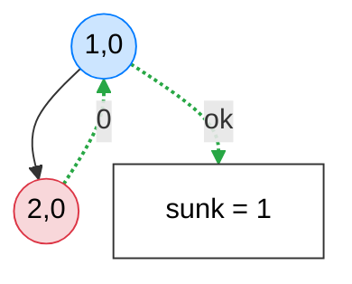
Legend: blue = border land seed, red = a neighbour that is already sea (base case).

Call trace for the only seed that finds land:

| Order | Call | Depth | Action | Returns |
|---|---|---|---|---|
| 1 | (1,0) | 0 | 1 -> 0 | after children |
| 2 | (2,0) | 1 | sea | return |
| 3 | (0,0) | 1 | sea | return |
| 4 | (1,1) | 1 | sea | return |
| 5 | (1,-1) | 1 | OOB | return |

Count scan: row 1 contributes 1, row 2 contributes 2, total 3.

Answer: 3.

**Complexity:** Time O(m*n). Space O(m*n) recursion worst-case.

### 4. Takeaway
- **Pattern:** "cells that cannot reach the boundary" means flood from the boundary and subtract/invert.
- **Edge cases:**

| Input | Result | Note |
|---|---|---|
| all land | 0 | everything touches the border via flood |
| no land | 0 | |
| grid with m or n <= 2 | 0 | all cells are border cells |
| land fully ringed by sea | its size | counted |

- **Mistakes to avoid:** only seeding the left/right borders; counting before the flood; treating diagonal as adjacent.
- **Related problems:** 130 Surrounded Regions (flip instead of count), 1254 Closed Islands (count islands not cells), 417 Pacific Atlantic, 200 Number of Islands.

---

## LeetCode 417: Pacific Atlantic Water Flow
**Difficulty:** Medium | **Pattern:** Reverse DFS/BFS from both borders, find intersection | **Language:** Java

### 1. Problem
- `heights[r][c]` is a cell's height. Water flows from a cell to a 4-neighbour with height less than or equal to it. The Pacific touches the top row and left column; the Atlantic touches the bottom row and right column. Return all cells from which water can reach both oceans.
- Example: `[[1,2,3],[8,9,4],[7,6,5]]` gives `[[0,2],[1,0],[1,1],[1,2],[2,0],[2,1],[2,2]]`.
- Constraints: `m, n <= 200`. O(m*n) is the target.
- **Key insight:** reverse the flow. Instead of asking "can this cell reach the ocean", start at ocean-adjacent cells and climb uphill (to neighbours with height >= current). The cells visited are exactly those that can drain into that ocean. Intersect the two sets.

### 2. Solution
- Step 1 (brute force): for each of the m*n cells run a DFS downhill to see if it hits both oceans: O((m*n)^2).
- Step 2: many cells share the same downhill paths, so repeating work is wasteful. "Reaches ocean" is a reachability relation, and reachability from a fixed target is cheaper computed backwards from the target.
- Step 3 (optimal): multi-source DFS from all Pacific border cells going uphill, same from the Atlantic border, each with its own `boolean[][]`. Answer = cells set in both. Each cell is visited at most once per ocean: O(m*n).

```java
class Solution {
    private static final int[][] DIRS = {{1, 0}, {-1, 0}, {0, 1}, {0, -1}};
    private int[][] h;
    private int rows, cols;

    public List<List<Integer>> pacificAtlantic(int[][] heights) {
        h = heights;
        rows = heights.length;
        cols = heights[0].length;
        boolean[][] pac = new boolean[rows][cols];
        boolean[][] atl = new boolean[rows][cols];
        for (int r = 0; r < rows; r++) {
            dfs(pac, r, 0);
            dfs(atl, r, cols - 1);
        }
        for (int c = 0; c < cols; c++) {
            dfs(pac, 0, c);
            dfs(atl, rows - 1, c);
        }
        List<List<Integer>> result = new ArrayList<>();
        for (int r = 0; r < rows; r++)
            for (int c = 0; c < cols; c++)
                if (pac[r][c] && atl[r][c]) result.add(List.of(r, c));
        return result;
    }

    private void dfs(boolean[][] seen, int r, int c) {
        seen[r][c] = true;
        for (int[] d : DIRS) {
            int nr = r + d[0], nc = c + d[1];
            if (nr < 0 || nc < 0 || nr >= rows || nc >= cols) continue;
            if (seen[nr][nc] || h[nr][nc] < h[r][c]) continue; // reverse flow: only climb or stay level
            dfs(seen, nr, nc);
        }
    }
}
```
Notes: two boolean grids are the visited sets and the answer test. A cell is marked on entry, so repeated seeding of an already-visited border cell does no extra work beyond four checks.

### 3. Dry Run
Heights:

| | c0 | c1 | c2 |
|---|---|---|---|
| r0 | 1 | 2 | 3 |
| r1 | 8 | 9 | 4 |
| r2 | 7 | 6 | 5 |

Pacific reach, starting from seed (0,0), order numbers (direction: down, up, right, left; move only to neighbour >= current):

| | c0 | c1 | c2 |
|---|---|---|---|
| r0 | 1 | 4 | 5 |
| r1 | 2 | 3 | 6 |
| r2 | 9 | 8 | 7 |

All 9 cells reach the Pacific. Atlantic reach, seeds in order (0,2), (1,2), (2,2), then bottom row (2,0), (2,1), (2,2); numbers are visit order: (0,2), (1,2), (2,2), (2,1), (1,1), (2,0), (1,0). Cell (1,1)=9 cannot step to (1,0)=8 because 8 < 9, but (2,0)=7 can step up to 8:

| | c0 | c1 | c2 |
|---|---|---|---|
| r0 | . | . | 1 |
| r1 | 7 | 5 | 2 |
| r2 | 6 | 4 | 3 |

(`.` = not reachable: (0,0)=1 and (0,1)=2 are lower than every neighbour they would have to be reached from, since a reverse step needs neighbour >= current, e.g. from (0,2)=3 going left to 2 is rejected.)

Pacific recursion tree from seed (0,0). Labels on dotted arrows are the number of cells newly marked in that subtree:

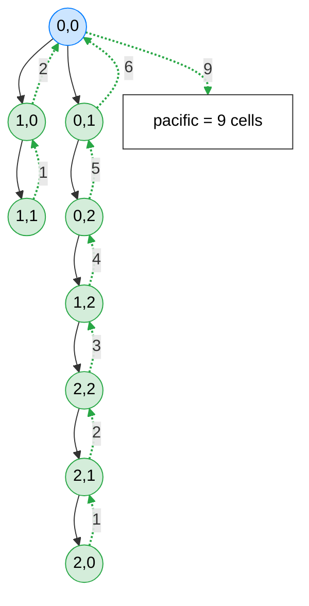
Legend: blue = ocean seed, green = cells that can drain into the Pacific, dotted green = cells newly marked in that subtree.

Call trace (Pacific from (0,0); rejected neighbours noted in the Action column):

| Order | Call | Depth | Action | Returns |
|---|---|---|---|---|
| 1 | (0,0)=1 | 0 | seed, mark; down 8 ok | 9 cells |
| 2 | (1,0)=8 | 1 | mark; down 7 < 8 skip; right 9 ok | 2 |
| 3 | (1,1)=9 | 2 | mark; 6, 2, 4, 8 all < 9 skip | 1 |
| 4 | (0,1)=2 | 1 | mark (from (0,0) right); down 9 already seen; right 3 ok | 6 |
| 5 | (0,2)=3 | 2 | mark; down 4 ok | 5 |
| 6 | (1,2)=4 | 3 | mark; down 5 ok | 4 |
| 7 | (2,2)=5 | 4 | mark; left 6 ok | 3 |
| 8 | (2,1)=6 | 5 | mark; up 9 seen, right 5 < 6; left 7 ok | 2 |
| 9 | (2,0)=7 | 6 | mark; up 8 seen | 1 |

Intersection of the two reach sets (Atlantic has 7 cells, all of them also Pacific): (0,2), (1,0), (1,1), (1,2), (2,0), (2,1), (2,2).

Answer: `[[0,2],[1,0],[1,1],[1,2],[2,0],[2,1],[2,2]]`.

**Complexity:** Time O(m*n): each cell is entered at most once per ocean, 4 neighbour checks each. Space O(m*n) for the two visited grids plus recursion depth.

### 4. Takeaway
- **Pattern:** "which sources can reach a target set" means reverse the edges and search from the targets (multi-source), then combine sets.
- **Edge cases:**

| Input | Result | Note |
|---|---|---|
| 1 x 1 | `[[0,0]]` | touches both oceans |
| single row or column | every cell | all border cells touch both |
| all equal heights | every cell | flow on equal height is allowed |
| strictly increasing diagonal | corner cells only | |

- **Mistakes to avoid:** forward DFS from every cell (TLE); using `<=` the wrong way when reversing (reverse step needs neighbour `>=` current); using one shared visited array for both oceans; forgetting equal heights flow.
- **Related problems:** 130 Surrounded Regions (border-seeded), 1020 Number of Enclaves, 542 01 Matrix (multi-source BFS), 329 Longest Increasing Path in a Matrix (DFS plus memo).

---

## LeetCode 785: Is Graph Bipartite?
**Difficulty:** Medium | **Pattern:** 2-colouring via DFS/BFS, conflict detection | **Language:** Java

### 1. Problem
- Undirected graph as adjacency lists `graph[u]`, nodes `0..n-1`, possibly disconnected. Return true if the nodes can be split into two sets so every edge connects nodes in different sets.
- Example: `graph = [[1,2,3],[0,2],[0,1,3],[0,2]]` gives `false` (triangle 0-1-2).
- Constraints: `n <= 100`, edges `<= n(n-1)/2`. O(V+E).
- **Key insight:** a graph is bipartite iff it has no odd cycle. Walk the graph painting each neighbour the opposite colour; if you meet an already-painted neighbour with the same colour as you, you have closed an odd cycle.

### 2. Solution
- Step 1 (brute force): try all 2^n splits and test every edge: exponential.
- Step 2: once one node's side is chosen, its neighbours' sides are forced (opposite), and their neighbours' too. So each connected component has at most 2 valid colourings, and a DFS finds it greedily.
- Step 3: `color[]` initialised to -1 (uncoloured). For every uncoloured node start a DFS (needed for disconnected graphs). On each edge `u->v`: if `v` uncoloured, colour it `1 - color[u]` and recurse; else if `color[v] == color[u]`, conflict.

```java
class Solution {
    private int[][] graph;
    private int[] color;

    public boolean isBipartite(int[][] graph) {
        this.graph = graph;
        color = new int[graph.length];
        Arrays.fill(color, -1);
        for (int i = 0; i < graph.length; i++) {
            if (color[i] == -1 && !dfs(i, 0)) return false;
        }
        return true;
    }

    private boolean dfs(int u, int c) {
        color[u] = c;
        for (int v : graph[u]) {
            if (color[v] == -1) {
                if (!dfs(v, c ^ 1)) return false;
            } else if (color[v] == c) {
                return false; // same colour across an edge: odd cycle
            }
        }
        return true;
    }
}
```
Notes: `c ^ 1` flips 0 and 1. The outer loop covers isolated nodes and extra components. No parent tracking is needed: the parent has the opposite colour, so it never looks like a conflict.

### 3. Dry Run
Edges: 0-1, 0-2, 0-3, 1-2, 2-3.

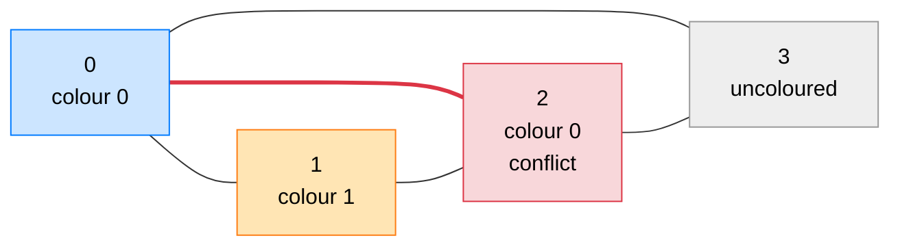
Legend: blue = colour 0, orange = colour 1, red = node where the conflict fires (edge 0-2 is the offending edge), grey = never reached.

Colour state over time:

| Step | Event | color[0] | color[1] | color[2] | color[3] |
|---|---|---|---|---|---|
| 0 | start | -1 | -1 | -1 | -1 |
| 1 | dfs(0,0) | 0 | -1 | -1 | -1 |
| 2 | dfs(1,1) from 0 | 0 | 1 | -1 | -1 |
| 3 | dfs(2,0) from 1 (1's neighbour 2 is uncoloured) | 0 | 1 | 0 | -1 |
| 4 | at 2, neighbour 0: color[0]=0 equals c=0 | 0 | 1 | 0 | -1 |

Recursion tree:

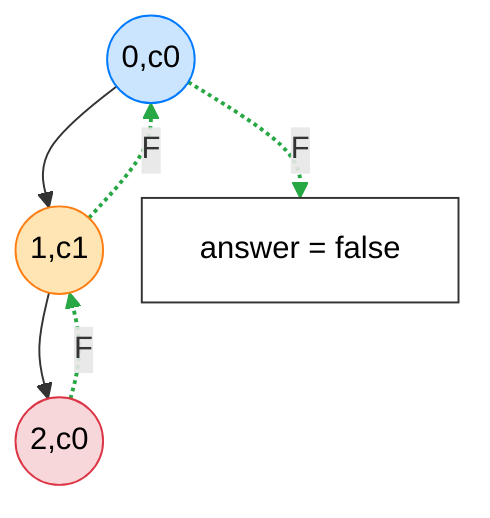
Legend: each node is `vertex,colour`; red = conflict found; dotted = boolean returned (F = false, short-circuits all the way up).

Call trace:

| Order | Call | Depth | Action | Returns |
|---|---|---|---|---|
| 1 | dfs(0,0) | 0 | colour 0 := 0; neighbour 1 uncoloured, recurse | false |
| 2 | dfs(1,1) | 1 | colour 1 := 1; neighbour 0 has colour 0 (ok); neighbour 2 uncoloured, recurse | false |
| 3 | dfs(2,0) | 2 | colour 2 := 0; neighbour 0 has colour 0 == 0: conflict | false |

Answer: `false`.

For contrast, a 4-cycle `[[1,3],[0,2],[1,3],[0,2]]` colours 0:0, 1:1, 2:0, 3:1 and returns true.

**Complexity:** Time O(V+E): each node is coloured once, each adjacency entry scanned once. Space O(V) for `color` plus recursion depth up to V.

### 4. Takeaway
- **Pattern:** "split into two groups / no odd cycle / conflicts" means 2-colour with DFS or BFS, looping over every component. Alternatively Union-Find with an "enemy" node.
- **Edge cases:**

| Input | Result | Note |
|---|---|---|
| no edges | true | each node coloured by its own start |
| disconnected graph | depends on each part | must loop over all nodes |
| self-loop | false (not in LC constraints) | would hit `color[v] == c` immediately |
| even cycle | true | |
| odd cycle | false | |

- **Mistakes to avoid:** starting from node 0 only; using 0 as "uncoloured" so you cannot tell colour 0 apart; returning true from a recursive call without checking its result; adding parent tracking incorrectly.
- **Related problems:** 886 Possible Bipartition (same problem, implicit graph), 1042 Flower Planting With No Adjacent (greedy colouring), 207 Course Schedule (3-colour cycle detection, directed), 261 Graph Valid Tree.

---

## LeetCode 886: Possible Bipartition
**Difficulty:** Medium | **Pattern:** Build graph from dislike pairs, then 2-colouring | **Language:** Java

### 1. Problem
- People labelled `1..n`. `dislikes[i] = [a, b]` means `a` and `b` must not be in the same group. Return true if everyone can be split into two groups with no disliked pair together.
- Example: `n = 4, dislikes = [[1,2],[1,3],[2,4]]` gives `true` (groups {1,4} and {2,3}).
- Constraints: `n <= 2000`, `dislikes.length <= 10^4`. O(n + E).
- **Key insight:** each dislike is an edge; "two groups, no edge inside a group" is exactly bipartiteness. The graph is simply implicit and 1-indexed.

### 2. Solution
- Step 1 (brute force): try all 2^n assignments: infeasible for n = 2000.
- Step 2: a dislike forces opposite groups, so assignments propagate along edges, same reasoning as #785.
- Step 3: build the adjacency list, then DFS 2-colour each component. Use size `n + 1` because of 1-based labels. Adjacency is stored in arrays of lists; boxing here is small.

```java
class Solution {
    private List<Integer>[] adj;
    private int[] color;

    @SuppressWarnings("unchecked")
    public boolean possibleBipartition(int n, int[][] dislikes) {
        adj = new List[n + 1];
        for (int i = 1; i <= n; i++) adj[i] = new ArrayList<>();
        for (int[] d : dislikes) {
            adj[d[0]].add(d[1]);
            adj[d[1]].add(d[0]);
        }
        color = new int[n + 1];
        Arrays.fill(color, -1);
        for (int i = 1; i <= n; i++) {
            if (color[i] == -1 && !dfs(i, 0)) return false;
        }
        return true;
    }

    private boolean dfs(int u, int c) {
        color[u] = c;
        for (int v : adj[u]) {
            if (color[v] == -1) {
                if (!dfs(v, c ^ 1)) return false;
            } else if (color[v] == c) {
                return false;
            }
        }
        return true;
    }
}
```
Notes: recursion depth is at most n = 2000, safe. Union-Find alternative: union each person with the first enemy's group; fail if a person and an enemy share a root.

### 3. Dry Run
`n = 4`, dislikes `[[1,2],[1,3],[2,4]]`. Adjacency: 1:[2,3], 2:[1,4], 3:[1], 4:[2].

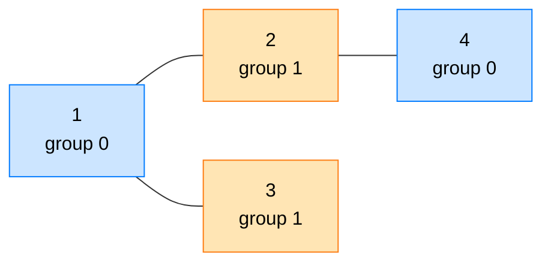
Legend: blue = group 0, orange = group 1. Every edge joins different colours.

Colour state:

| Step | Event | c[1] | c[2] | c[3] | c[4] |
|---|---|---|---|---|---|
| 0 | start | -1 | -1 | -1 | -1 |
| 1 | dfs(1,0) | 0 | -1 | -1 | -1 |
| 2 | dfs(2,1) | 0 | 1 | -1 | -1 |
| 3 | at 2: nbr 1 has 0 != 1 ok; dfs(4,0) | 0 | 1 | -1 | 0 |
| 4 | at 4: nbr 2 has 1 != 0 ok; return true | 0 | 1 | -1 | 0 |
| 5 | back at 1: dfs(3,1) | 0 | 1 | 1 | 0 |
| 6 | at 3: nbr 1 has 0 != 1 ok; return true | 0 | 1 | 1 | 0 |

Recursion tree:

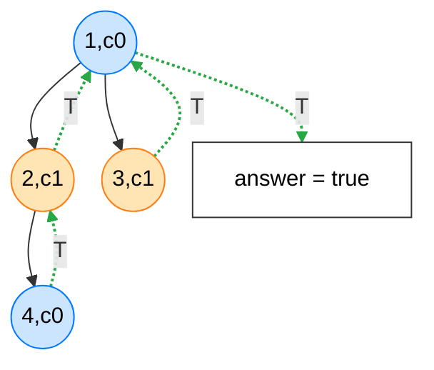
Legend: `vertex,colour`; dotted green = boolean returned (T = true).

Call trace:

| Order | Call | Depth | Action | Returns |
|---|---|---|---|---|
| 1 | dfs(1,0) | 0 | colour 1 := 0; recurse into 2 | true |
| 2 | dfs(2,1) | 1 | colour 2 := 1; nbr 1 ok; recurse into 4 | true |
| 3 | dfs(4,0) | 2 | colour 4 := 0; nbr 2 ok | true |
| 4 | dfs(3,1) | 1 | colour 3 := 1; nbr 1 ok | true |

The outer loop then finds nodes 2, 3, 4 coloured and finishes.

Answer: `true`.

**Complexity:** Time O(n + E) to build and colour. Space O(n + E) for the adjacency list.

### 4. Takeaway
- **Pattern:** "split into two groups subject to pairwise conflicts" means bipartite check on the conflict graph.
- **Edge cases:**

| Input | Result | Note |
|---|---|---|
| no dislikes | true | |
| triangle `[[1,2],[2,3],[1,3]]` | false | odd cycle |
| person with no dislikes | fine | isolated node coloured on its own |
| n = 1 | true | |

- **Mistakes to avoid:** 0-indexing the arrays (labels start at 1, allocate `n + 1`); adding only one direction of the edge; not looping over all nodes.
- **Related problems:** 785 Is Graph Bipartite? (graph given directly), 990 Satisfiability of Equality Equations (Union-Find), 1042 Flower Planting With No Adjacent.

---

## LeetCode 133: Clone Graph
**Difficulty:** Medium | **Pattern:** DFS + HashMap (original -> clone) for cycle-safe copying | **Language:** Java

### 1. Problem
- Given a node in a connected undirected graph (each node has `val` and `neighbors`), return a deep copy.
- Example: adjacency list `[[2,4],[1,3],[2,4],[1,3]]` (a 4-cycle) returns a structurally identical graph made of brand-new nodes.
- Constraints: up to 100 nodes, values 1..100 and unique; the graph may be empty (null input). O(V+E).
- **Key insight:** a naive recursive copy loops forever on cycles and would also create duplicate clones for a node reached by two paths. A map `original -> clone` solves both: it is the visited set and the lookup for "which clone do I link to".

### 2. Solution
- Step 1 (brute force): recursively clone neighbours without memory. Infinite recursion on any cycle, including every undirected edge (u lists v, v lists u).
- Step 2: remember what is already cloned. Create the clone and register it in the map before recursing, so a back-edge finds the clone-in-progress and stops.
- Step 3: for each neighbour, take `map.get(nb)` if present, else recurse; add the result to the clone's neighbour list.

```java
class Solution {
    private final Map<Node, Node> clones = new HashMap<>();

    public Node cloneGraph(Node node) {
        if (node == null) return null;
        Node existing = clones.get(node);
        if (existing != null) return existing;

        Node copy = new Node(node.val);
        clones.put(node, copy);                 // register BEFORE visiting neighbours
        for (Node nb : node.neighbors) {
            copy.neighbors.add(cloneGraph(nb));
        }
        return copy;
    }
}
```
Notes: `Node` uses identity `hashCode`/`equals`, so the map is keyed by object. Registration before recursion is the whole trick. Depth is at most 100.

### 3. Dry Run
Graph: 1-2, 2-3, 3-4, 4-1 (start at node 1). Neighbour order: 1:[2,4], 2:[1,3], 3:[2,4], 4:[1,3].

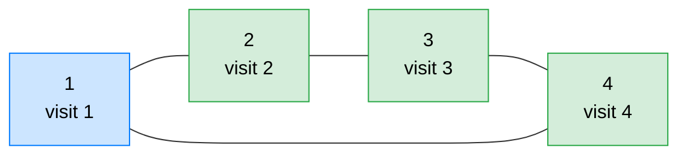
Legend: blue = start node, green = nodes cloned in discovery order 2, 3, 4 (the label shows when each clone was created).

Recursion tree (back-edges resolved by the map are marked "memo"):

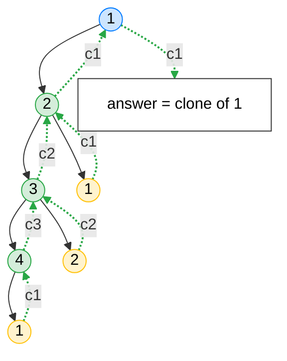
Legend: blue = first call, green = new clone created, yellow = memo hit (map lookup, no new clone); labels `cN` = clone of node N is returned.

Call trace (exact order):

| Order | Call | Depth | Action | Returns |
|---|---|---|---|---|
| 1 | clone(1) | 0 | not in map; new clone1; put(1); neighbours [2,4] | c1 |
| 2 | clone(2) | 1 | new clone2; put(2); neighbours [1,3] | c2 |
| 3 | clone(1) | 2 | memo hit | c1 |
| 4 | clone(3) | 2 | new clone3; put(3); neighbours [2,4] | c3 |
| 5 | clone(2) | 3 | memo hit | c2 |
| 6 | clone(4) | 3 | new clone4; put(4); neighbours [1,3] | c4 |
| 7 | clone(1) | 4 | memo hit | c1 |
| 8 | clone(3) | 4 | memo hit | c3 |
| 9 | clone(4) | 1 | memo hit (1's second neighbour) | c4 |

Map after each creation:

| After | map keys |
|---|---|
| order 1 | {1} |
| order 2 | {1,2} |
| order 4 | {1,2,3} |
| order 6 | {1,2,3,4} |

Resulting clone neighbour lists: c1:[c2,c4], c2:[c1,c3], c3:[c2,c4], c4:[c1,c3]. Calls 3 to 8 with a memo hit do no copying, so total new nodes = 4.

Answer: clone of node 1, whole cycle copied.

The diagram omits call 9 (node 1's second neighbour, a memo hit) for size; it is in the table.

**Complexity:** Time O(V+E): each node cloned once, each edge handled once from each endpoint. Space O(V) for the map plus recursion depth O(V).

### 4. Takeaway
- **Pattern:** copying or serialising a graph with cycles means traverse plus a `visited` map that stores the result for each node.
- **Edge cases:**

| Input | Result | Note |
|---|---|---|
| `null` | `null` | explicit guard |
| single node, no neighbours | one new node | |
| self-loop | clone points to itself | map lookup handles it |
| two nodes joined | each points to the other's clone | |

- **Mistakes to avoid:** putting the clone in the map after the neighbour loop (infinite recursion); returning the original node; creating a fresh clone per edge (breaks shared structure).
- **Related problems:** 138 Copy List with Random Pointer (same map idea on a linked list), 1485 Clone Binary Tree With Random Pointer, 207 Course Schedule, 797 All Paths From Source to Target.

---

## LeetCode 332: Reconstruct Itinerary
**Difficulty:** Hard | **Pattern:** Hierholzer's algorithm (Eulerian path), post-order edge consumption | **Language:** Java

### 1. Problem
- `tickets[i] = [from, to]`. Rebuild the itinerary starting at "JFK" that uses every ticket exactly once. If several are valid, return the lexicographically smallest sequence. A valid itinerary is guaranteed to exist.
- Example: `[["JFK","KUL"],["JFK","NRT"],["NRT","JFK"]]` gives `["JFK","NRT","JFK","KUL"]`.
- Constraints: up to 300 tickets. Target O(E log E), dominated by ordering the edges.
- **Key insight:** this is an Eulerian path (every edge once). Run a DFS that consumes edges, smallest destination first. A node is added to the route only after all its outgoing edges are used (post-order). A dead end (the true final airport) is therefore added first. Reverse the list at the end.

### 2. Solution
- Step 1 (brute force): backtracking over orderings of tickets, smallest destination first, undoing on failure. Correct but can be exponential, because a greedy early choice (taking a dead-end ticket too soon) is only discovered after a lot of work.
- Step 2: a wrong greedy choice always strands you at a dead end, and that dead end must be the last stop of the route. Instead of undoing, keep the stuck node as the tail and splice the remaining loops in front of it. Post-order appending does exactly this.
- Step 3 (Hierholzer): adjacency lists in min-heaps. `visit(u)`: while `u` has tickets, poll the smallest destination `v` and `visit(v)`; afterwards add `u` to the front of the route.

```java
class Solution {
    private final Map<String, PriorityQueue<String>> adj = new HashMap<>();
    private final LinkedList<String> route = new LinkedList<>();

    public List<String> findItinerary(List<List<String>> tickets) {
        for (List<String> t : tickets) {
            adj.computeIfAbsent(t.get(0), k -> new PriorityQueue<>()).add(t.get(1));
        }
        visit("JFK");
        return route;
    }

    private void visit(String u) {
        PriorityQueue<String> pq = adj.get(u);
        while (pq != null && !pq.isEmpty()) {
            visit(pq.poll());       // consume edge u -> smallest destination
        }
        route.addFirst(u);          // post-order; addFirst replaces the final reverse
    }
}
```
Notes: `poll` removes the ticket, which is the "visited" mark for an edge (this is an edge-visiting DFS, nodes can be entered many times). `addFirst` on a `LinkedList` is O(1). Recursion depth is at most 301.

### 3. Dry Run
Tickets: JFK->KUL, JFK->NRT, NRT->JFK. Heaps: JFK:[KUL,NRT], NRT:[JFK].

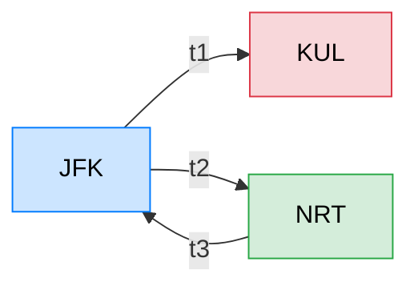
Legend: blue = start, red = dead end (final stop), green = intermediate; t1..t3 are the tickets.

Recursion order with call numbers (the number is the order the call is entered):

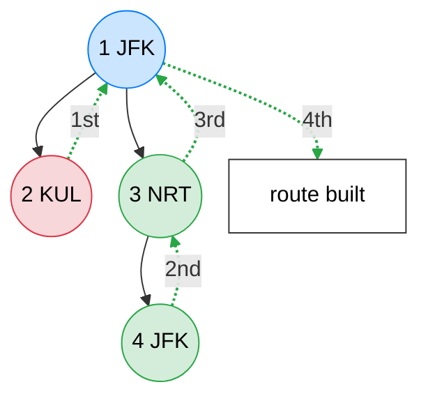
Legend: blue = first call, red = dead end, green = loop nodes; dotted green labels give the order in which each node is appended to the route (post-order).

Call trace:

| Order | Call | Depth | Action | Appended (post-order) |
|---|---|---|---|---|
| 1 | visit(JFK) | 0 | poll KUL from JFK heap, recurse | (later) |
| 2 | visit(KUL) | 1 | no tickets; append | 1st: KUL |
| 3 | visit(NRT) | 1 | back in JFK: poll NRT; NRT polls JFK, recurse | (later) |
| 4 | visit(JFK) | 2 | JFK heap now empty; append | 2nd: JFK |
| - | NRT returns | 1 | NRT heap empty; append | 3rd: NRT |
| - | JFK(1) returns | 0 | heap empty; append | 4th: JFK |

Route (built with `addFirst`) after each append:

| Append | Node | route |
|---|---|---|
| 1st | KUL | [KUL] |
| 2nd | JFK | [JFK, KUL] |
| 3rd | NRT | [NRT, JFK, KUL] |
| 4th | JFK | [JFK, NRT, JFK, KUL] |

The raw post-order is KUL, JFK, NRT, JFK; reversing it gives the answer. Greedily taking the smaller KUL first led to a dead end, and the algorithm correctly placed KUL last.

Answer: `["JFK","NRT","JFK","KUL"]`.

**Complexity:** Time O(E log E): each ticket is polled once from a heap (log degree) and inserted once. Space O(V + E) for adjacency plus recursion depth up to E + 1.

### 4. Takeaway
- **Pattern:** "use every edge exactly once" means Eulerian path: Hierholzer with post-order append and reverse. Lexicographic order comes from min-heaps (or sorted lists with an index pointer).
- **Edge cases:**

| Input | Result | Note |
|---|---|---|
| single ticket JFK->A | [JFK, A] | |
| ticket cycle back to JFK | closed circuit | start and end at JFK |
| parallel tickets JFK->A twice | A visited twice | heap holds duplicates |
| start with no outgoing tickets | not possible | guaranteed valid |

- **Mistakes to avoid:** appending in pre-order; treating airports as visited (edges are what is consumed); using a `TreeSet` (drops duplicate tickets); forgetting to reverse (or `addFirst`).
- **Related problems:** 2097 Valid Arrangement of Pairs (Eulerian path on integers), 753 Cracking the Safe (Eulerian circuit in a de Bruijn graph), 207 Course Schedule (vertex DFS with colours).

---

## LeetCode 1192: Critical Connections in a Network
**Difficulty:** Hard | **Pattern:** Tarjan's bridge-finding (DFS discovery time + low-link) | **Language:** Java

### 1. Problem
- `n` servers `0..n-1`, undirected `connections`, the network is connected. A connection is critical if removing it disconnects some servers. Return all critical connections (a bridge list), in any order.
- Example: `n = 4, connections = [[0,1],[1,2],[2,0],[1,3]]` gives `[[1,3]]`.
- Constraints: `n <= 10^5`, `connections <= 10^5`. Needs O(V+E).
- **Key insight:** an edge `u-v` (v a DFS child of u) is a bridge iff nothing in v's DFS subtree has a back-edge reaching u or above. Track `disc[x]` (when first visited) and `low[x]` (the earliest discovery time reachable from x's subtree using tree edges down and at most one back-edge up). The edge is a bridge iff `low[v] > disc[u]`.

### 2. Solution
- Step 1 (brute force): remove each edge, run a connectivity check: O(E*(V+E)), about 10^10 here.
- Step 2: an edge is NOT critical exactly when it lies on a cycle. In a DFS tree, a cycle shows up as a back-edge from a descendant to an ancestor, so we only need to know how far up each subtree can reach.
- Step 3: one DFS. For neighbour `v` of `u` (skipping the tree-parent): if `v` is unvisited, recurse and set `low[u] = min(low[u], low[v])`, then bridge if `low[v] > disc[u]`; if `v` is visited, it is a back-edge, so `low[u] = min(low[u], disc[v])`.

```java
class Solution {
    private List<Integer>[] adj;
    private int[] disc, low;
    private int timer;
    private final List<List<Integer>> bridges = new ArrayList<>();

    @SuppressWarnings("unchecked")
    public List<List<Integer>> criticalConnections(int n, List<List<Integer>> connections) {
        adj = new List[n];
        for (int i = 0; i < n; i++) adj[i] = new ArrayList<>();
        for (List<Integer> e : connections) {
            adj[e.get(0)].add(e.get(1));
            adj[e.get(1)].add(e.get(0));
        }
        disc = new int[n];
        low = new int[n];
        Arrays.fill(disc, -1);
        dfs(0, -1);
        return bridges;
    }

    private void dfs(int u, int parent) {
        disc[u] = low[u] = timer++;
        for (int v : adj[u]) {
            if (v == parent) continue;           // do not walk back over the tree edge
            if (disc[v] == -1) {
                dfs(v, u);
                low[u] = Math.min(low[u], low[v]);
                if (low[v] > disc[u]) bridges.add(List.of(u, v));
            } else {
                low[u] = Math.min(low[u], disc[v]); // back-edge
            }
        }
    }
}
```
Notes: `disc == -1` is the unvisited sentinel (timer starts at 0). Skipping `parent` by vertex is fine because the input has no parallel edges. With n = 10^5 a path graph recurses 10^5 deep, which can overflow the default Java stack; in an interview mention running in a `Thread` with a larger stack or converting to an iterative DFS.

### 3. Dry Run
`n = 4`, edges 0-1, 1-2, 2-0, 1-3. Adjacency: 0:[1,2], 1:[0,2,3], 2:[1,0], 3:[1].

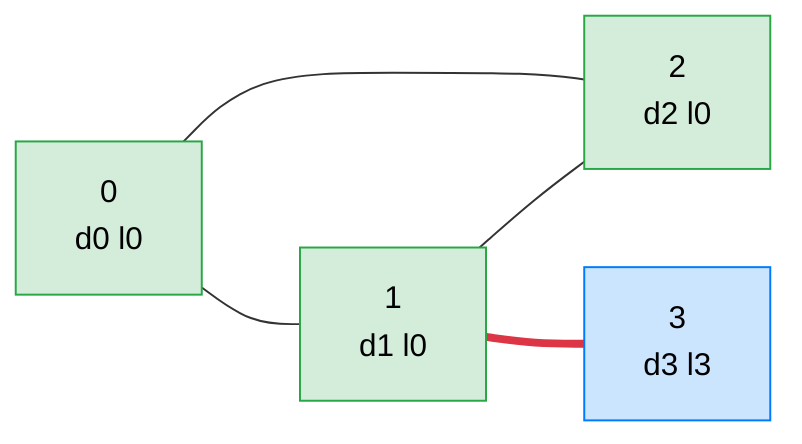
Legend: each node shows discovery (d) and low-link (l); green = on the triangle cycle, blue = leaf; the thick red edge 1-3 is the bridge.

Discovery and low-link values:

| Node | disc | low (final) | Computed from |
|---|---|---|---|
| 0 | 0 | 0 | start |
| 1 | 1 | 0 | child 2 has low 0 |
| 2 | 2 | 0 | back-edge to 0 gives disc[0] = 0 |
| 3 | 3 | 3 | only neighbour is its parent |

Recursion tree with call numbers (edge labels are `low` returned/used):

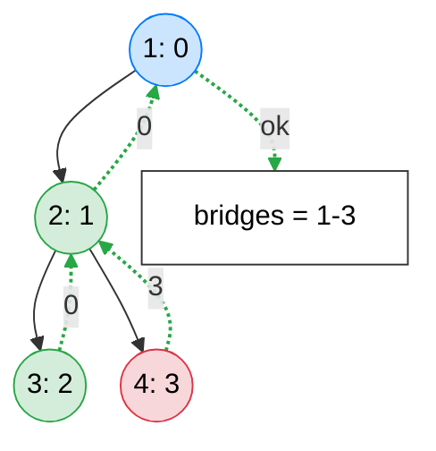
Legend: node text is `call number: vertex`; dotted green = low value returned to the parent. Red node 3 is the one whose parent edge is a bridge.

Call trace:

| Order | Call | Depth | Action | disc/low after | Returns |
|---|---|---|---|---|---|
| 1 | dfs(0,-1) | 0 | disc[0]=0; go to neighbour 1 | d0 l0 | - |
| 2 | dfs(1,0) | 1 | disc[1]=1; skip parent 0; neighbour 2 unvisited | d1 l1 | - |
| 3 | dfs(2,1) | 2 | disc[2]=2; skip parent 1; neighbour 0 visited: low[2]=min(2,0)=0 | d2 l0 | low 0 |
| 4 | back in 1 | 1 | low[1]=min(1,0)=0; check 0 > 1? no | l0 | - |
| 5 | dfs(3,1) | 2 | disc[3]=3; only neighbour is parent | d3 l3 | low 3 |
| 6 | back in 1 | 1 | low[1]=min(0,3)=0; check 3 > 1? yes, bridge [1,3] | l0 | - |
| 7 | back in 0 | 0 | low[0]=min(0,0)=0; neighbour 2 already visited: low[0]=min(0,2)=0; check for bridge 0-1: 0 > 0? no | l0 | - |

Post-order (finish) sequence: 2, 3, 1, 0.

Bridge test for every tree edge:

| Tree edge u-v | low[v] | disc[u] | low[v] > disc[u] | Bridge |
|---|---|---|---|---|
| 0-1 | 0 | 0 | no | no |
| 1-2 | 0 | 1 | no | no |
| 1-3 | 3 | 1 | yes | yes |

Answer: `[[1,3]]`.

**Complexity:** Time O(V+E): each vertex entered once, each adjacency entry examined once. Space O(V+E) for adjacency plus O(V) for `disc`, `low`, and recursion.

### 4. Takeaway
- **Pattern:** "single point of failure edge / bridge" means Tarjan with `disc` and `low`. Articulation points use `low[v] >= disc[u]`; strongly connected components use the same low-link with a stack.
- **Edge cases:**

| Input | Result | Note |
|---|---|---|
| tree (no cycles) | every edge is a bridge | `low[v] = disc[v]` |
| single cycle | no bridges | every `low` is 0 |
| n = 2, one edge | that edge | |
| duplicate edges | not in LC input | skipping parent by vertex would then be wrong |

- **Mistakes to avoid:** using `low[v] >= disc[u]` (that is articulation points, not bridges); updating `low[u]` with `low[v]` for a back-edge instead of `disc[v]`; not skipping the parent edge; stack overflow on a path of 10^5 nodes.
- **Related problems:** 1568 Minimum Number of Days to Disconnect Island (articulation point idea), 207 Course Schedule (directed cycle detection), 261 Graph Valid Tree, 323 Number of Connected Components (Union-Find), 802 Find Eventual Safe States.
