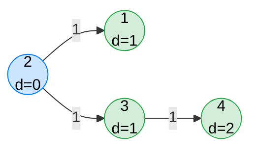
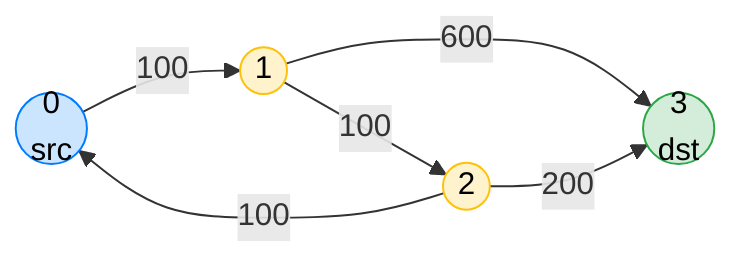
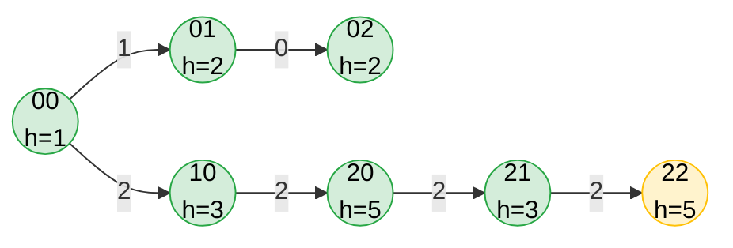
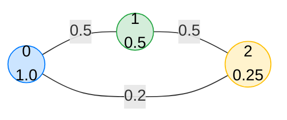
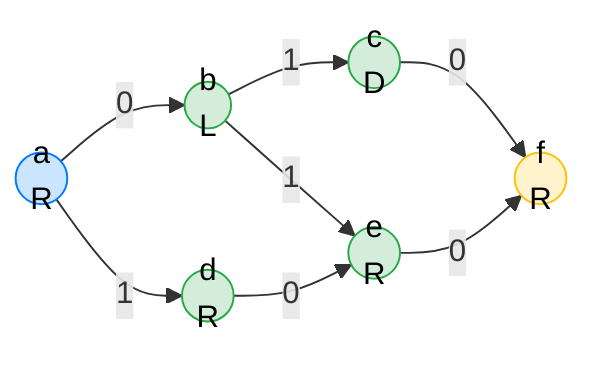
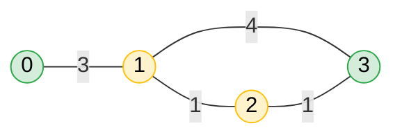
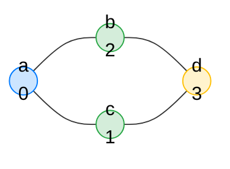
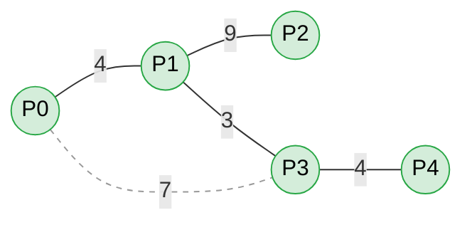

## LeetCode 743: Network Delay Time
**Difficulty:** Medium | **Pattern:** Dijkstra (min-heap + dist array) | **Language:** Java

### 1. Problem
- A signal starts at node `k` of a directed weighted graph (`times[i] = [u, v, w]`: a signal takes `w` to travel u to v). Return the time until all `n` nodes have it, or `-1` if some node is unreachable.
- Example: `times = [[2,1,1],[2,3,1],[3,4,1]], n = 4, k = 2` gives `2` (node 4 is reached via 2 -> 3 -> 4).
- Constraints: `n <= 100`, `times.length <= 6000`, `w <= 100`, non-negative weights. Anything near O(E log V) is fine.
- **Key insight:** the answer is `max(dist[i])` over single-source shortest paths. With non-negative weights, the unsettled node with the smallest tentative distance can never be improved later, so settle nodes greedily with a min-heap. Memorise this template; four later problems are variations.

### 2. Solution
- Step 1, brute force: enumerate all paths from `k` to every node. Exponential in the worst case.
- Step 2, Bellman-Ford: relax all edges `n-1` times. O(V*E), correct but it ignores that weights are non-negative.
- Step 3, observation: if the closest unsettled node is `u` with distance `d`, any other route to `u` goes through a node at distance >= `d` and adds a non-negative amount, so `d` is final.
- Step 4, Dijkstra: a min-heap keyed by distance gives the closest frontier node in O(log V). Java's heap has no decrease-key, so push a new entry on every improvement and skip stale entries on pop (`d > dist[u]`). O(E log V) time.

```java
import java.util.*;

class Solution {
    public int networkDelayTime(int[][] times, int n, int k) {
        @SuppressWarnings("unchecked")
        List<int[]>[] graph = new List[n + 1];
        for (int i = 1; i <= n; i++) graph[i] = new ArrayList<>();
        for (int[] t : times) graph[t[0]].add(new int[]{t[1], t[2]});

        int[] dist = new int[n + 1];
        Arrays.fill(dist, Integer.MAX_VALUE);
        dist[k] = 0;

        PriorityQueue<int[]> pq = new PriorityQueue<>((a, b) -> Integer.compare(a[0], b[0]));
        pq.offer(new int[]{0, k});

        while (!pq.isEmpty()) {
            int[] top = pq.poll();
            int d = top[0], u = top[1];
            if (d > dist[u]) continue;            // stale entry, a better one was processed
            for (int[] e : graph[u]) {
                int nd = d + e[1];                // d is finite here, so no overflow
                if (nd < dist[e[0]]) {
                    dist[e[0]] = nd;
                    pq.offer(new int[]{nd, e[0]});
                }
            }
        }

        int ans = 0;
        for (int i = 1; i <= n; i++) {
            if (dist[i] == Integer.MAX_VALUE) return -1;
            ans = Math.max(ans, dist[i]);
        }
        return ans;
    }
}
```
Implementation notes: `Integer.MAX_VALUE` is the sentinel but is never added to (we only add to a popped finite `d`). The comparator uses `Integer.compare`, never subtraction. Nodes are 1-indexed, so arrays have size `n + 1`.

### 3. Dry Run
Input: `times = [[2,1,1],[2,3,1],[3,4,1]], n = 4, k = 2`.


Legend: blue = source, green = settled (final dist shown); edge labels = weights.

| Step | Pop (d,u) | Action | PQ after (d,node) | dist[1..4] |
|---|---|---|---|---|
| init | - | dist[2]=0, push | (0,2) | inf, 0, inf, inf |
| 1 | (0,2) | relax 2->1: 1 < inf; relax 2->3: 1 < inf | (1,1) (1,3) | 1, 0, 1, inf |
| 2 | (1,1) | no outgoing edges | (1,3) | 1, 0, 1, inf |
| 3 | (1,3) | relax 3->4: 2 < inf | (2,4) | 1, 0, 1, 2 |
| 4 | (2,4) | no outgoing edges | empty | 1, 0, 1, 2 |

| Node | Final dist | Settled at step | Reached from |
|---|---|---|---|
| 1 | 1 | 2 | 2 |
| 2 | 0 | 1 | source |
| 3 | 1 | 3 | 2 |
| 4 | 2 | 4 | 3 |

All finite, answer = max(1, 0, 1, 2) = **2**.

**Complexity:** Time O(E log V): each edge causes at most one push, each push/pop costs log. Space O(V + E): adjacency lists, dist, heap.

### 4. Takeaway
- **Pattern:** single-source shortest path with non-negative weights -> Dijkstra. "Time for everything to be reached" -> max of the distances.
- **Edge cases:**

| Input | Result | Note |
|---|---|---|
| `n = 1`, no edges | 0 | max over only the source |
| Some node unreachable | -1 | dist stays `MAX_VALUE` |
| Parallel edges | min wins | relaxation keeps the smaller |
| Cycles | fine | `nd < dist` stops re-pushing |

- **Mistakes to avoid:**
  - Using BFS (ignores weights) or Dijkstra with negative weights.
  - Returning `dist[k]`-style sums instead of the max.
  - Omitting the stale-entry check (correct but slower).
  - Comparator `a[0] - b[0]` (overflow risk in general; use `Integer.compare`).
- **Related problems:** 787 Cheapest Flights (hop limit breaks Dijkstra); 1631 and 778 (min-max cost); 1514 (maximize product); 1368 (0/1 weights, deque instead of heap); 1334 (all pairs).

---

## LeetCode 787: Cheapest Flights Within K Stops
**Difficulty:** Medium | **Pattern:** Bellman-Ford with K+1 rounds | **Language:** Java

### 1. Problem
- Given directed weighted flights `[from, to, price]`, find the cheapest price from `src` to `dst` using at most `k` stops (so at most `k + 1` edges). Return `-1` if impossible.
- Example: `n = 4, flights = [[0,1,100],[1,2,100],[2,0,100],[1,3,600],[2,3,200]], src = 0, dst = 3, k = 1` gives `700` (0 -> 1 -> 3). The cheaper 0 -> 1 -> 2 -> 3 costs 400 but uses 2 stops.
- Constraints: `n <= 100`, `flights.length <= n*(n-1)/2`, prices up to 10^4. O(k * E) is easily fast enough.
- **Key insight:** the constraint is on the number of edges, so the state is really (node, edges used). Round `i` of Bellman-Ford computes the best cost using at most `i` edges, which matches the constraint exactly.

### 2. Solution
- Step 1, brute force: DFS over all paths of length <= k+1. Exponential.
- Step 2, plain Dijkstra: why it fails. Dijkstra finalises a node the first time it is popped with its minimum cost. Here the cheapest route to node 3 is 400 (2 stops), which is illegal for `k = 1`. Dijkstra would settle node 3 at 400 and the legal 700 route is never recorded; conversely a node reached cheaply with many hops blocks a costlier route with fewer hops that would still have been usable. "Cheapest" and "fewest hops" conflict, so a single dist per node is not enough information. (A fix is Dijkstra over states (node, stops), which works but is heavier.)
- Step 3, Bellman-Ford with a bounded number of rounds: run `k + 1` rounds. Each round may extend a path by exactly one edge.
- Step 4, the trap: if you update `dist` in place, an edge relaxed later in the same round can read a value written earlier in that round, silently extending a path by two or more edges. So each round reads from a frozen copy of `dist` and writes into `next`.

```java
import java.util.*;

class Solution {
    public int findCheapestPrice(int n, int[][] flights, int src, int dst, int k) {
        final int INF = Integer.MAX_VALUE;
        int[] dist = new int[n];
        Arrays.fill(dist, INF);
        dist[src] = 0;

        for (int round = 0; round <= k; round++) {      // k stops = k + 1 edges
            int[] prev = dist.clone();                  // frozen snapshot for this round
            for (int[] f : flights) {
                int u = f[0], v = f[1], w = f[2];
                if (prev[u] != INF && prev[u] + w < dist[v]) {
                    dist[v] = prev[u] + w;
                }
            }
        }
        return dist[dst] == INF ? -1 : dist[dst];
    }
}
```
Implementation notes: read only from `prev`, write only to `dist` (the "copy per round"). The `INF` check avoids overflow from `MAX_VALUE + w`. Max cost is about 100 * 10^4, so int is safe. Time O(k * E), space O(V).

### 3. Dry Run
Input as above, `k = 1`, so 2 rounds.


Legend: blue = source, yellow = reachable intermediate, green = destination; edge labels = prices.

| Round | prev (snapshot) | Edge | Check | dist after (0,1,2,3) |
|---|---|---|---|---|
| start | - | - | - | 0, inf, inf, inf |
| 1 | 0, inf, inf, inf | 0->1 (100) | 0+100 < inf, set 100 | 0, 100, inf, inf |
| 1 | same | 1->2, 2->0, 1->3, 2->3 | prev[1], prev[2] are inf, skip | 0, 100, inf, inf |
| 2 | 0, 100, inf, inf | 0->1 | 100 < 100 false | 0, 100, inf, inf |
| 2 | same | 1->2 (100) | 100+100 = 200 < inf, set | 0, 100, 200, inf |
| 2 | same | 2->0 | prev[2] inf, skip | 0, 100, 200, inf |
| 2 | same | 1->3 (600) | 100+600 = 700 < inf, set | 0, 100, 200, 700 |
| 2 | same | 2->3 (200) | prev[2] is inf in snapshot, skip | 0, 100, 200, 700 |

The last row is the point of the copy: in-place, `dist[2]` would already be 200 and 2->3 would yield 400, a path with 3 edges (2 stops), violating `k = 1`.

Answer = dist[3] = **700**.

**Complexity:** Time O((k+1) * E): each round scans all edges once. Space O(V): dist and one snapshot.

### 4. Takeaway
- **Pattern:** shortest path with a limit on the number of edges -> Bellman-Ford truncated to that many rounds (or BFS/Dijkstra over (node, hops) states).
- **Edge cases:**

| Input | Result | Note |
|---|---|---|
| `src == dst` | 0 | not possible per constraints, but dist[src]=0 handles it |
| `k = 0` | direct flight only | one round |
| No route within k | -1 | dist[dst] stays INF |
| Cheap route needs too many stops | pricier legal one | the copy prevents leakage |

- **Mistakes to avoid:**
  - Running `k` rounds instead of `k + 1`.
  - Updating `dist` in place within a round.
  - Adding to `Integer.MAX_VALUE` without the INF guard.
  - Using standard Dijkstra with a single dist per node.
- **Related problems:** 743 (no hop limit, Dijkstra works); 1334 (all pairs); 1928 Minimum Cost to Reach Destination in Time (DP over time); 2092-style state graphs.

---

## LeetCode 1631: Path With Minimum Effort
**Difficulty:** Medium | **Pattern:** Dijkstra with a min-max objective | **Language:** Java

### 1. Problem
- Grid `heights`; move in 4 directions from the top-left to the bottom-right. The effort of a path is the maximum absolute height difference between consecutive cells. Return the minimum possible effort.
- Example: `[[1,2,2],[3,8,2],[5,3,5]]` gives `2` (path 1,3,5,3,5: differences 2,2,2,2).
- Constraints: up to 100 x 100 cells, heights up to 10^6. Roughly 10^4 nodes, 4*10^4 edges, so O(E log V) is ideal.
- **Key insight:** Dijkstra works for any cost that never decreases as the path extends and combines monotonically. Here cost of reaching a neighbour = `max(cost so far, |diff|)`, which is non-decreasing, so the greedy "settle the cheapest cell" argument still holds.

### 2. Solution
- Step 1, brute force: DFS over all simple paths, track the max difference. Exponential.
- Step 2, binary search the answer `E` + BFS that only crosses edges with diff <= E. O(RC log H), valid but needs a feasibility pass per guess. (Union-Find over edges sorted by diff until start and end connect is the third option.)
- Step 3, Dijkstra directly: `effort[cell]` = minimal bottleneck to reach it. Relax with `max` instead of `+`. The first time the target is popped its effort is final.

```java
import java.util.*;

class Solution {
    private static final int[][] DIRS = {{1, 0}, {-1, 0}, {0, 1}, {0, -1}};

    public int minimumEffortPath(int[][] heights) {
        int rows = heights.length, cols = heights[0].length;
        int[][] effort = new int[rows][cols];
        for (int[] row : effort) Arrays.fill(row, Integer.MAX_VALUE);
        effort[0][0] = 0;

        // entry: {effort, row, col}
        PriorityQueue<int[]> pq = new PriorityQueue<>((a, b) -> Integer.compare(a[0], b[0]));
        pq.offer(new int[]{0, 0, 0});

        while (!pq.isEmpty()) {
            int[] cur = pq.poll();
            int e = cur[0], r = cur[1], c = cur[2];
            if (e > effort[r][c]) continue;                  // stale
            if (r == rows - 1 && c == cols - 1) return e;    // first pop is final
            for (int[] d : DIRS) {
                int nr = r + d[0], nc = c + d[1];
                if (nr < 0 || nc < 0 || nr >= rows || nc >= cols) continue;
                int ne = Math.max(e, Math.abs(heights[nr][nc] - heights[r][c]));
                if (ne < effort[nr][nc]) {
                    effort[nr][nc] = ne;
                    pq.offer(new int[]{ne, nr, nc});
                }
            }
        }
        return 0; // unreachable for a connected grid
    }
}
```
Implementation notes: heights are at most 10^6 so the difference never overflows; `Math.abs` on a difference is safe. Early return on popping the target saves work.

### 3. Dry Run
Input: `[[1,2,2],[3,8,2],[5,3,5]]`. Cells named by (row,col).


Legend: the chosen route and its edge differences (cell 11 with height 8 is avoided); green = settled, yellow = target.

Trace (entries are (effort, cell)):

| Step | Pop | Relaxations | PQ after | effort changes |
|---|---|---|---|---|
| init | - | - | (0,00) | 00=0 |
| 1 | (0,00) | 01: max(0,1)=1; 10: max(0,2)=2 | (1,01) (2,10) | 01=1, 10=2 |
| 2 | (1,01) | 02: max(1,0)=1; 11: max(1,6)=6; 00: max(1,1)=1 not < 0 | (1,02) (2,10) (6,11) | 02=1, 11=6 |
| 3 | (1,02) | 12: max(1,0)=1 (h 2 to 2) | (1,12) (2,10) (6,11) | 12=1 |
| 4 | (1,12) | 22: max(1,3)=3; 11: max(1,6)=6 not < 6 | (2,10) (3,22) (6,11) | 22=3 |
| 5 | (2,10) | 20: max(2,2)=2; 11: max(2,5)=5 < 6 | (2,20) (3,22) (5,11) (6,11) | 20=2, 11=5 |
| 6 | (2,20) | 21: max(2,2)=2 | (2,21) (3,22) (5,11) (6,11) | 21=2 |
| 7 | (2,21) | 22: max(2,2)=2 < 3; 11: max(2,5)=5 not < 5 | (2,22) (3,22) (5,11) (6,11) | 22=2 |
| 8 | (2,22) | target popped, return | - | - |

Answer = **2**.

**Complexity:** Time O(RC log(RC)). Space O(RC) for the effort table and heap.

### 4. Takeaway
- **Pattern:** "minimise the maximum along a path" -> Dijkstra with `max` as the combine step (or binary search + BFS, or sorted-edge DSU).
- **Edge cases:**

| Input | Result | Note |
|---|---|---|
| 1 x 1 grid | 0 | target popped immediately |
| Single row/column | max adjacent diff | only one path |
| All equal heights | 0 | |
| Huge heights | no overflow | diff <= 10^6 |

- **Mistakes to avoid:**
  - Adding differences instead of taking `max`.
  - Running plain BFS (shortest in steps, not effort).
  - Forgetting the stale check, causing rework.
- **Related problems:** 778 Swim in Rising Water (cost = cell value, same max trick); 1102 Path With Maximum Minimum Value (flipped comparator); 743 (sum version).

---

## LeetCode 1514: Path With Maximum Probability
**Difficulty:** Medium | **Pattern:** Modified Dijkstra (maximize a product) | **Language:** Java

### 1. Problem
- Undirected graph; edge `i` succeeds with probability `succProb[i]`. Return the maximum success probability of any path from `start` to `end` (0 if none).
- Example: `n = 3, edges = [[0,1],[1,2],[0,2]], succProb = [0.5,0.5,0.2], start = 0, end = 2` gives `0.25` (0 -> 1 -> 2 beats the direct 0.2).
- Constraints: `n <= 10^4`, `edges <= 2*10^4`. Need O(E log V).
- **Key insight:** probabilities are in [0,1], so extending a path can only keep or lower its value. That is the analogue of non-negative weights, so the greedy settle argument holds with a max-heap and `multiply` replacing `add`.

### 2. Solution
- Step 1, brute force: DFS all simple paths, multiply along the way. Exponential.
- Step 2, Bellman-Ford with products: relax all edges up to `n-1` times, O(V*E) = 2*10^8 worst case; works but too slow for the limits.
- Step 3, Dijkstra with a max-heap: `prob[v] = max(prob[v], prob[u] * p)`. The best unsettled node can never be improved because every extension multiplies by a value <= 1.
- Step 4, early exit when `end` is popped.
- Avoid logs: multiplying doubles directly is fine here.

```java
import java.util.*;

class Solution {
    public double maxProbability(int n, int[][] edges, double[] succProb, int start, int end) {
        @SuppressWarnings("unchecked")
        List<double[]>[] graph = new List[n];
        for (int i = 0; i < n; i++) graph[i] = new ArrayList<>();
        for (int i = 0; i < edges.length; i++) {
            graph[edges[i][0]].add(new double[]{edges[i][1], succProb[i]});
            graph[edges[i][1]].add(new double[]{edges[i][0], succProb[i]});
        }

        double[] best = new double[n];       // 0.0 means unreachable so far
        best[start] = 1.0;
        // entry: {probability, node}; larger probability first
        PriorityQueue<double[]> pq = new PriorityQueue<>((a, b) -> Double.compare(b[0], a[0]));
        pq.offer(new double[]{1.0, start});

        while (!pq.isEmpty()) {
            double[] top = pq.poll();
            double p = top[0];
            int u = (int) top[1];
            if (u == end) return p;
            if (p < best[u]) continue;       // stale
            for (double[] e : graph[u]) {
                int v = (int) e[0];
                double np = p * e[1];
                if (np > best[v]) {
                    best[v] = np;
                    pq.offer(new double[]{np, v});
                }
            }
        }
        return 0.0;
    }
}
```
Implementation notes: `Double.compare(b[0], a[0])` reverses order for a max-heap. Storing the node in a `double[]` is exact for ids up to 10^4; a small record would be the cleaner alternative. Unreachable stays at 0.0, which doubles as the answer.

### 3. Dry Run
Input: example above.


Legend: blue = start, green = settled, yellow = target; node text = best probability; edge labels = success probability.

| Step | Pop (p,u) | Relaxations | PQ after (p,node), max first | best[0..2] |
|---|---|---|---|---|
| init | - | best[0]=1 | (1.0,0) | 1, 0, 0 |
| 1 | (1.0,0) | to 1: 0.5 > 0, set; to 2: 0.2 > 0, set | (0.5,1) (0.2,2) | 1, 0.5, 0.2 |
| 2 | (0.5,1) | to 0: 0.25 > 1? no; to 2: 0.5*0.5 = 0.25 > 0.2, set | (0.25,2) (0.2,2) | 1, 0.5, 0.25 |
| 3 | (0.25,2) | u == end, return 0.25 | - | - |

The stale (0.2,2) entry is never popped. Answer = **0.25**.

**Complexity:** Time O(E log V). Space O(V + E).

### 4. Takeaway
- **Pattern:** maximize a product of values in [0,1] (or minimize a product of factors >= 1) -> Dijkstra with a flipped heap. Taking `-log` turns it into an ordinary sum if you prefer.
- **Edge cases:**

| Input | Result | Note |
|---|---|---|
| `start` and `end` disconnected | 0.0 | best stays 0 |
| Probability 0 edges | path value 0 | never beats `best > 0` |
| Direct edge worse than detour | detour | max-heap handles it |
| No edges | 0.0 | |

- **Mistakes to avoid:**
  - Using a min-heap, or `Double.compare(a[0], b[0])` unreversed.
  - Initialising `best[start]` to 0.
  - Subtraction comparators on doubles (casts to int break ordering).
  - Applying this when factors can exceed 1 (greedy argument fails).
- **Related problems:** 743 (sum); 1631 (max); 1102 Path With Maximum Minimum Value (max-min); 787 (hop limit).

---

## LeetCode 1368: Minimum Cost to Make at Least One Valid Path in a Grid
**Difficulty:** Hard | **Pattern:** 0-1 BFS with a deque | **Language:** Java

### 1. Problem
- Each cell holds an arrow: 1 right, 2 left, 3 down, 4 up. You start at (0,0) and follow arrows; you may change one cell's arrow at most once each, at cost 1 per change. Return the minimum total cost so that a valid path to the bottom-right exists.
- Example: `[[1,2,3],[1,1,1]]` gives `1` (change cell (0,1) to point down, or cell (0,0) to point down).
- Constraints: `m, n <= 100`, so 10^4 cells. Linear-ish is ideal.
- **Key insight:** model each cell as a node with 4 outgoing edges: the edge along its own arrow costs 0, the other three cost 1. Shortest path in a graph whose weights are only 0 or 1 needs no heap, just a deque.

### 2. Solution
- Step 1, brute force: try all subsets of cells to modify. Exponential.
- Step 2, Dijkstra on the grid graph: correct, O(RC log RC).
- Step 3, observation: weights are only 0 and 1. A plain BFS queue keeps nodes sorted by distance because every edge adds 1. With 0 edges we need a node to be processed *immediately* at the same distance.
- Step 4, 0-1 BFS: pop from the front; a weight-0 move pushes to the front (same distance level), a weight-1 move pushes to the back (next level). The deque always stays sorted with at most two distinct distances, d at the front and d+1 at the back. A node is only pushed when its distance strictly improves, so each node is pushed O(1) times in practice. O(V+E).

```java
import java.util.*;

class Solution {
    private static final int[] DR = {0, 0, 1, -1};   // right, left, down, up
    private static final int[] DC = {1, -1, 0, 0};   // matches arrows 1..4

    public int minCost(int[][] grid) {
        int rows = grid.length, cols = grid[0].length;
        int[] dist = new int[rows * cols];
        Arrays.fill(dist, Integer.MAX_VALUE);
        dist[0] = 0;

        Deque<Integer> dq = new ArrayDeque<>();
        dq.offerFirst(0);

        while (!dq.isEmpty()) {
            int cell = dq.pollFirst();
            int r = cell / cols, c = cell % cols;
            for (int dir = 0; dir < 4; dir++) {
                int nr = r + DR[dir], nc = c + DC[dir];
                if (nr < 0 || nc < 0 || nr >= rows || nc >= cols) continue;
                int cost = grid[r][c] == dir + 1 ? 0 : 1;
                int next = nr * cols + nc;
                int nd = dist[cell] + cost;
                if (nd < dist[next]) {
                    dist[next] = nd;
                    if (cost == 0) dq.offerFirst(next);
                    else dq.offerLast(next);
                }
            }
        }
        return dist[rows * cols - 1];
    }
}
```
Implementation notes: cells flattened to `r * cols + c`; arrow value `dir + 1` lines up with the direction arrays. `dist[cell]` is read at pop time, so a stale deque entry just uses the already-improved distance and is harmless. `ArrayDeque` is the fast deque (no nulls needed).

### 3. Dry Run
Input `[[1,2,3],[1,1,1]]`. Cells: a=(0,0) b=(0,1) c=(0,2) d=(1,0) e=(1,1) f=(1,2). Target f.


Legend: blue = start, green = intermediate, yellow = target; edge labels = cost (0 = follow own arrow). Only the useful edges are drawn.

Deque shown front -> back. dist order (a,b,c,d,e,f).

| Step | Pop | Moves examined (nd vs dist) | Deque after | dist after |
|---|---|---|---|---|
| init | - | - | [a] | 0, inf, inf, inf, inf, inf |
| 1 | a | right to b: cost 0, nd 0, pushFront; down to d: cost 1, nd 1, pushBack | [b, d] | 0, 0, inf, 1, inf, inf |
| 2 | b | right to c: cost 1, nd 1, pushBack; left to a: cost 0, nd 0 not < 0; down to e: cost 1, nd 1, pushBack | [d, c, e] | 0, 0, 1, 1, 1, inf |
| 3 | d | right to e: cost 0, nd 1 not < 1; up to a: nd 2 no | [c, e] | unchanged |
| 4 | c | down to f: cost 0, nd 1, pushFront; left to b: nd 2 no | [f, e] | 0, 0, 1, 1, 1, 1 |
| 5 | f | left to e: nd 2 no; up to c: nd 2 no | [e] | unchanged |
| 6 | e | right to f: cost 0, nd 1 not < 1; others worse | [] | unchanged |

Answer = dist[f] = **1**.

**Complexity:** Time O(R*C): each cell is pushed a constant number of times, 4 edges each. Space O(R*C) for dist and the deque.

### 4. Takeaway
- **Pattern:** shortest path where every edge costs 0 or 1 -> 0-1 BFS (deque). It is the bridge between BFS (all 1) and Dijkstra (arbitrary non-negative).
- **Edge cases:**

| Input | Result | Note |
|---|---|---|
| 1 x 1 grid | 0 | dist[0] |
| Arrows already form a path | 0 | zero-cost edges only |
| Arrows point off-grid | counts edit | out-of-bounds moves skipped, edit needed elsewhere |
| Single row, all left arrows | cols - 1 | each cell must change |

- **Mistakes to avoid:**
  - Pushing weight-0 moves to the back (breaks sorted order, gives wrong answers).
  - Using a visited flag instead of a distance check; a node may need to be improved after first discovery.
  - Mismatching arrow numbering and direction arrays.
- **Related problems:** 743 (general Dijkstra); 1631 (min-max); 2290 Minimum Obstacle Removal to Reach Corner (0-1 BFS); 1091 Shortest Path in Binary Matrix (plain BFS).

---

## LeetCode 1334: Find the City With the Smallest Number of Neighbors at a Threshold Distance
**Difficulty:** Medium | **Pattern:** Floyd-Warshall all-pairs shortest path | **Language:** Java

### 1. Problem
- Undirected weighted graph of `n` cities. For each city count the other cities reachable with shortest-path distance <= `distanceThreshold`. Return the city with the fewest such neighbours; on a tie, the one with the greatest number.
- Example: `n = 4, edges = [[0,1,3],[1,2,1],[1,3,4],[2,3,1]], distanceThreshold = 4` gives `3`.
- Constraints: `n <= 100`, so O(n^3) = 10^6 is trivial.
- **Key insight:** we need distances between every pair, and `n` is tiny, so Floyd-Warshall is the simplest correct tool. Running Dijkstra from every node also works (O(V*E log V)) and wins for large sparse graphs.

### 2. Solution
- Step 1, brute force: DFS all paths between each pair. Exponential.
- Step 2, Dijkstra per source: fine, but more code than needed for n = 100.
- Step 3, Floyd-Warshall: `dist[i][j] = min(dist[i][j], dist[i][k] + dist[k][j])`. Invariant: after processing intermediates `0..k`, `dist[i][j]` is the shortest path using only those intermediates. The `k` loop must be outermost, because each pass must complete using the previous pass's table; with `k` inner, the invariant is lost.
- Step 4, count per city, scanning cities in increasing order and using `<=` so later (greater) cities win ties.

```java
import java.util.*;

class Solution {
    public int findTheCity(int n, int[][] edges, int distanceThreshold) {
        final int INF = Integer.MAX_VALUE / 2;          // INF + INF still fits in int
        int[][] dist = new int[n][n];
        for (int[] row : dist) Arrays.fill(row, INF);
        for (int i = 0; i < n; i++) dist[i][i] = 0;
        for (int[] e : edges) {
            dist[e[0]][e[1]] = e[2];
            dist[e[1]][e[0]] = e[2];
        }

        for (int k = 0; k < n; k++) {                   // intermediate node: outermost
            for (int i = 0; i < n; i++) {
                if (dist[i][k] == INF) continue;
                for (int j = 0; j < n; j++) {
                    int through = dist[i][k] + dist[k][j];
                    if (through < dist[i][j]) dist[i][j] = through;
                }
            }
        }

        int bestCity = -1, fewest = Integer.MAX_VALUE;
        for (int i = 0; i < n; i++) {
            int count = 0;
            for (int j = 0; j < n; j++) {
                if (i != j && dist[i][j] <= distanceThreshold) count++;
            }
            if (count <= fewest) {                      // <= so the larger index wins ties
                fewest = count;
                bestCity = i;
            }
        }
        return bestCity;
    }
}
```
Implementation notes: `INF = MAX_VALUE / 2` makes the sum of two INFs safe; the `dist[i][k] == INF` skip is a cheap pruning. Edges are undirected so both directions are set.

### 3. Dry Run
Input as above.


Legend: green = cities with the fewest neighbours (2), yellow = 3 neighbours; edge labels = weights.

Initial matrix (rows/cols 0..3, `.` = inf):

| | 0 | 1 | 2 | 3 |
|---|---|---|---|---|
| 0 | 0 | 3 | . | . |
| 1 | 3 | 0 | 1 | 4 |
| 2 | . | 1 | 0 | 1 |
| 3 | . | 4 | 1 | 0 |

Updates per `k`:

| k | Improvements | Result |
|---|---|---|
| 0 | only city 1 touches 0; 1-0-1 is 6, no gain | none |
| 1 | d[0][2] = 3+1 = 4; d[0][3] = 3+4 = 7; d[2][3] = 1+4 = 5 not < 1 | d02 = 4, d03 = 7 |
| 2 | d[0][3] = 4+1 = 5 < 7; d[1][3] = 1+1 = 2 < 4 | d03 = 5, d13 = 2 |
| 3 | d[0][2] = 5+1 = 6 not < 4; d[1][2] = 2+1 = 3 not < 1 | none |

Final matrix:

| | 0 | 1 | 2 | 3 |
|---|---|---|---|---|
| 0 | 0 | 3 | 4 | 5 |
| 1 | 3 | 0 | 1 | 2 |
| 2 | 4 | 1 | 0 | 1 |
| 3 | 5 | 2 | 1 | 0 |

Counting with threshold 4:

| City | Within 4 | Count | fewest / best after |
|---|---|---|---|
| 0 | 1 (3), 2 (4) | 2 | 2 / 0 |
| 1 | 0, 2, 3 | 3 | no change |
| 2 | 0 (4), 1, 3 | 3 | no change |
| 3 | 1 (2), 2 (1); 0 is 5 | 2 | 2 / 3 (tie, `<=`) |

Answer = **3**.

**Complexity:** Time O(n^3). Space O(n^2) for the matrix.

### 4. Takeaway
- **Pattern:** "distance between all pairs", small `n` (<= ~400) -> Floyd-Warshall; handles negative edges (not negative cycles).
- **Edge cases:**

| Input | Result | Note |
|---|---|---|
| Threshold below all edges | all counts 0, return `n - 1` | tie -> greatest index |
| Disconnected city | counts only reachable ones | INF never <= threshold |
| Parallel edges | not in this problem | otherwise take the min |
| `n = 2` | 1 | tie, greatest wins |

- **Mistakes to avoid:**
  - Putting `k` in the innermost loop.
  - `INF = Integer.MAX_VALUE` and adding two of them (overflow to negative).
  - Using `<` instead of `<=` in the tie-break.
  - Forgetting `dist[i][i] = 0`.
- **Related problems:** 743 (single source); 787 (hop limit); 1462 Course Schedule IV (Floyd-Warshall as transitive closure); 2976 Minimum Cost to Convert String I (all-pairs on 26 letters).

---

## LeetCode 778: Swim in Rising Water
**Difficulty:** Hard | **Pattern:** Dijkstra min-max (alt: binary search + BFS, Union-Find) | **Language:** Java

### 1. Problem
- `n x n` grid where `grid[i][j]` is the elevation, a permutation of `0..n^2-1`. At time `t` the water depth is `t`; you can move between adjacent cells if both elevations are <= `t`. Starting at (0,0), return the minimum `t` to reach (n-1,n-1).
- Example: `[[0,2],[1,3]]` gives `3` (the end cell itself has elevation 3, so you cannot arrive earlier).
- Constraints: `n <= 50`, so 2500 cells. Anything near O(n^2 log n) is easy.
- **Key insight:** time to finish a path = the maximum elevation on it (waiting is free). So we want the path minimising its maximum cell, the same bottleneck structure as #1631 with cell values instead of edge differences. Min-max and max-min are the same technique with a flipped comparator (see LC 1102).

### 2. Solution
- Step 1, brute force: DFS all paths, track max. Exponential.
- Step 2, three valid strategies:
  - Binary search on `t` with BFS/DFS feasibility: O(n^2 log n^2).
  - Union-Find: add cells in increasing elevation; at time `t` union the cell with already-active neighbours; stop when (0,0) and (n-1,n-1) connect. O(n^2 alpha) after sorting by value (the values are a permutation, so index by value, no sort).
  - Dijkstra with `max`: the heap always expands the frontier cell with the lowest bottleneck so far.
- Step 3, implement Dijkstra: `best[cell] = max(best[parent], grid[cell])`; the first pop of the target is final.

```java
import java.util.*;

class Solution {
    private static final int[][] DIRS = {{1, 0}, {-1, 0}, {0, 1}, {0, -1}};

    public int swimInWater(int[][] grid) {
        int n = grid.length;
        boolean[][] seen = new boolean[n][n];
        // entry: {bottleneck so far, row, col}
        PriorityQueue<int[]> pq = new PriorityQueue<>((a, b) -> Integer.compare(a[0], b[0]));
        pq.offer(new int[]{grid[0][0], 0, 0});
        seen[0][0] = true;

        while (!pq.isEmpty()) {
            int[] cur = pq.poll();
            int t = cur[0], r = cur[1], c = cur[2];
            if (r == n - 1 && c == n - 1) return t;
            for (int[] d : DIRS) {
                int nr = r + d[0], nc = c + d[1];
                if (nr < 0 || nc < 0 || nr >= n || nc >= n || seen[nr][nc]) continue;
                seen[nr][nc] = true;                       // safe: first discovery is already optimal
                pq.offer(new int[]{Math.max(t, grid[nr][nc]), nr, nc});
            }
        }
        return -1;
    }
}
```
Implementation notes: marking visited on push is valid here because the popped value `t` is non-decreasing, so any later route to the same cell has a bottleneck at least `t`, and `max(t', g) >= max(t, g)` for `t' >= t`. That removes the stale-entry check. The target is always reachable on a grid.

### 3. Dry Run
Input `[[0,2],[1,3]]`. Cells: a=(0,0)=0, b=(0,1)=2, c=(1,0)=1, d=(1,1)=3.


Legend: blue = start, green = settled, yellow = target; node text = elevation; edges are adjacency.

| Step | Pop (t,cell) | Action | PQ after (t,cell) | seen |
|---|---|---|---|---|
| init | - | push (0,a) | (0,a) | a |
| 1 | (0,a) | neighbours: c -> max(0,1) = 1; b -> max(0,2) = 2 | (1,c) (2,b) | a, b, c |
| 2 | (1,c) | neighbour d -> max(1,3) = 3; a already seen | (2,b) (3,d) | + d |
| 3 | (2,b) | neighbours a, d already seen | (3,d) | - |
| 4 | (3,d) | target, return 3 | - | - |

Answer = **3**.

**Complexity:** Time O(n^2 log n): each cell pushed once, heap ops log(n^2). Space O(n^2).

### 4. Takeaway
- **Pattern:** minimise the maximum (bottleneck) on a path -> Dijkstra with `max`, or binary search + BFS, or DSU adding cells by value. Flip comparators for max-min.
- **Edge cases:**

| Input | Result | Note |
|---|---|---|
| 1 x 1 grid | grid[0][0] (0) | target popped at once |
| Start cell is the maximum | n^2 - 1 | start value counts |
| End cell is the maximum | n^2 - 1 | same reason |
| Monotone snake | max along snake | heap finds the best route |

- **Mistakes to avoid:**
  - Starting with cost 0 instead of `grid[0][0]`.
  - Summing elevations or counting steps.
  - Marking visited on push in a problem where the cost can decrease later (valid here only due to the monotone bottleneck).
- **Related problems:** 1631 (edge-difference bottleneck); 1102 Path With Maximum Minimum Value (flipped); 1514 (product); 743 (sum).

---

## LeetCode 1584: Min Cost to Connect All Points
**Difficulty:** Medium | **Pattern:** Minimum Spanning Tree (Prim's and Kruskal's) | **Language:** Java

### 1. Problem
- Given points on a plane, connecting two points costs their Manhattan distance `|xi-xj| + |yi-yj|`. Return the minimum total cost to connect all points so there is exactly one simple path between any two (a spanning tree).
- Example: `[[0,0],[2,2],[3,10],[5,2],[7,0]]` gives `20`.
- Constraints: `n <= 1000`, so the complete graph has about 5*10^5 edges. O(n^2) or O(n^2 log n) both pass.
- **Key insight:** this is exactly a Minimum Spanning Tree on a complete graph. Greedy works by the cut property: the cheapest edge crossing any cut belongs to some MST.

### 2. Solution
- Step 1, brute force: try all spanning trees (n^(n-2) by Cayley). Hopeless.
- Step 2, Kruskal: sort all edges, add the next-cheapest edge unless it closes a cycle, detected with Union-Find (the DSU from section 14). Stop after `n - 1` edges. O(E log E) with E = n^2/2.
- Step 3, Prim: grow one tree from point 0. Keep `minDist[v]` = cheapest edge from the tree to `v`; repeatedly take the closest outside point. On a dense graph the array version is O(n^2) with no heap and no edge list, which is the best fit here (a heap version is O(E log V)).
- Both are shown; Prim (array) is the preferred submission for dense input.

```java
import java.util.*;

class Solution {
    // Prim, dense O(n^2)
    public int minCostConnectPoints(int[][] points) {
        int n = points.length;
        int[] minDist = new int[n];
        boolean[] inTree = new boolean[n];
        Arrays.fill(minDist, Integer.MAX_VALUE);
        minDist[0] = 0;
        int total = 0;

        for (int iter = 0; iter < n; iter++) {
            int u = -1;
            for (int v = 0; v < n; v++) {
                if (!inTree[v] && (u == -1 || minDist[v] < minDist[u])) u = v;
            }
            inTree[u] = true;
            total += minDist[u];
            for (int v = 0; v < n; v++) {
                if (!inTree[v]) {
                    int d = Math.abs(points[u][0] - points[v][0])
                          + Math.abs(points[u][1] - points[v][1]);
                    if (d < minDist[v]) minDist[v] = d;
                }
            }
        }
        return total;
    }

    // Kruskal with DSU
    public int minCostConnectPointsKruskal(int[][] points) {
        int n = points.length;
        int[][] edges = new int[n * (n - 1) / 2][];
        int idx = 0;
        for (int i = 0; i < n; i++) {
            for (int j = i + 1; j < n; j++) {
                int d = Math.abs(points[i][0] - points[j][0])
                      + Math.abs(points[i][1] - points[j][1]);
                edges[idx++] = new int[]{d, i, j};
            }
        }
        Arrays.sort(edges, (a, b) -> Integer.compare(a[0], b[0]));

        DSU dsu = new DSU(n);
        int total = 0, used = 0;
        for (int[] e : edges) {
            if (dsu.union(e[1], e[2])) {
                total += e[0];
                if (++used == n - 1) break;
            }
        }
        return total;
    }

    private static final class DSU {
        private final int[] parent, size;

        DSU(int n) {
            parent = new int[n];
            size = new int[n];
            for (int i = 0; i < n; i++) { parent[i] = i; size[i] = 1; }
        }

        int find(int x) {
            while (parent[x] != x) {
                parent[x] = parent[parent[x]];          // path halving
                x = parent[x];
            }
            return x;
        }

        boolean union(int a, int b) {
            int ra = find(a), rb = find(b);
            if (ra == rb) return false;                 // would form a cycle
            if (size[ra] < size[rb]) { int t = ra; ra = rb; rb = t; }
            parent[rb] = ra;
            size[ra] += size[rb];
            return true;
        }
    }
}
```
Implementation notes: total is at most about 1000 * 4*10^6 in the extreme but coordinates are bounded by 10^6, so a single distance is <= 4*10^6 and the sum of n-1 of them is <= about 4*10^9 in a theoretical worst case; real MSTs are far smaller (LeetCode's answers fit int). Use `long` if you want to be paranoid. `union` returning a boolean doubles as the cycle test.

### 3. Dry Run
Points: P0(0,0), P1(2,2), P2(3,10), P3(5,2), P4(7,0). Manhattan distances: d01=4, d02=13, d03=7, d04=7, d12=9, d13=3, d14=7, d23=10, d24=14, d34=4.


Legend: solid = MST edges (total 4+3+4+9 = 20), dashed grey = a rejected edge (P0-P3 would close a cycle); other edges omitted.

Prim from P0 (minDist order P0..P4; `-` = in tree):

| Iter | Pick | Cost added | minDist after relaxing (P0..P4) | Running total |
|---|---|---|---|---|
| 1 | P0 (0) | 0 | -, 4, 13, 7, 7 | 0 |
| 2 | P1 (4) | 4 | -, -, min(13,9)=9, min(7,3)=3, min(7,7)=7 | 4 |
| 3 | P3 (3) | 3 | -, -, min(9,10)=9, -, min(7,4)=4 | 7 |
| 4 | P4 (4) | 4 | -, -, min(9,14)=9, -, - | 11 |
| 5 | P2 (9) | 9 | all in tree | 20 |

Kruskal, edges sorted by weight (ties in generation order):

| Edge | Weight | DSU components before | Action | Total |
|---|---|---|---|---|
| P1-P3 | 3 | {0}{1}{2}{3}{4} | union | 3 |
| P0-P1 | 4 | {1,3} separate from {0} | union | 7 |
| P3-P4 | 4 | {0,1,3}{4} | union | 11 |
| P0-P3 | 7 | same set | skip (cycle) | 11 |
| P0-P4 | 7 | same set | skip | 11 |
| P1-P4 | 7 | same set | skip | 11 |
| P1-P2 | 9 | {0,1,3,4}{2} | union, 4 edges used, stop | 20 |

Both give **20**.

**Complexity:** Prim (array): time O(n^2), space O(n). Kruskal: time O(n^2 log n) to sort about n^2/2 edges, space O(n^2) for the edge list.

### 4. Takeaway
- **Pattern:** connect everything at minimum total cost -> MST. Dense complete graph -> array-based Prim; sparse explicit edge list -> Kruskal with DSU.
- **Edge cases:**

| Input | Result | Note |
|---|---|---|
| One point | 0 | no edges needed |
| Two points | their distance | single edge |
| Duplicate coordinates | edge weight 0 | handled naturally |
| Collinear points | span of the line | chain of neighbours |

- **Mistakes to avoid:**
  - Using Euclidean distance instead of Manhattan.
  - Building a full adjacency list for Prim when an O(n) array suffices.
  - Forgetting to skip `inTree` nodes in the relaxation.
  - Stopping Kruskal late (should break at `n - 1` edges) or comparing with subtraction.
- **Related problems:** 1135 Connecting Cities With Minimum Cost (premium, MST on a given edge list); 1489 Find Critical and Pseudo-Critical Edges in MST (Kruskal variants); 1168 Optimize Water Distribution (MST with a virtual node); 261 Graph Valid Tree (DSU cycle check).
