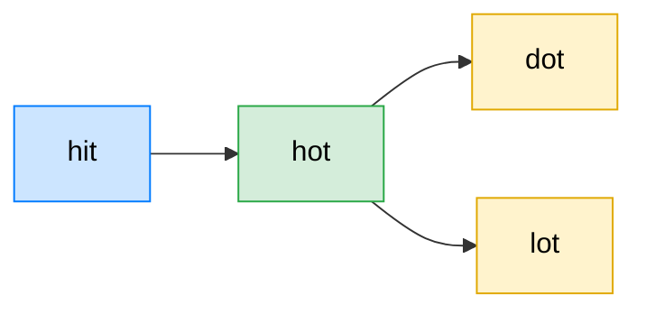
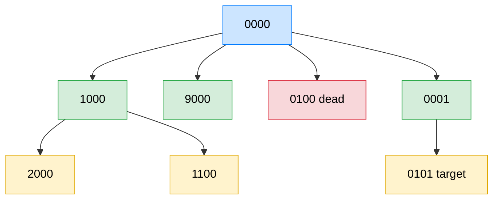
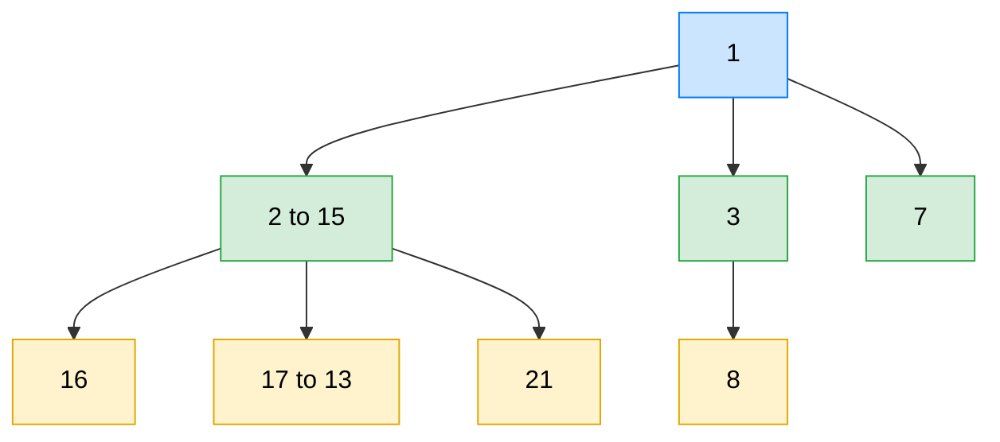

## LeetCode 542: 01 Matrix
**Difficulty:** Medium | **Pattern:** Multi-source BFS from all 0s | **Language:** Java

### 1. Problem
- For every cell of a binary matrix, return the distance to the nearest 0 (4-directional, each step costs 1). Example: `[[0,0,0],[0,1,0],[1,1,1]]` -> `[[0,0,0],[0,1,0],[1,2,1]]`.
- Constraints: `m*n <= 10^4`, at least one 0. An `O((mn)^2)` per-cell search is too slow in the worst case; target `O(m*n)`.
- **Key insight:** do not search from each 1 towards a 0. Reverse the question: start from ALL zeros at once. BFS visits cells in increasing distance, so the first time a cell is reached is its shortest distance.

### 2. Solution
1. Brute force: for each 1, run a BFS until a 0 is found. `O((mn)^2)`, because the same ground is re-explored from every cell.
2. Observation: the answer for a cell is `1 + min(neighbour answers)`. That is a distance field, and a distance field from a set of sources is exactly what BFS computes.
3. Put every 0 in the queue (distance 0) and mark every 1 as unvisited (`-1`). Pop a cell; any unvisited neighbour gets `dist + 1` and joins the queue. Because the queue is FIFO, cells are finalised in non-decreasing distance order, so no cell is ever improved later.

```java
public int[][] updateMatrix(int[][] mat) {
    int m = mat.length, n = mat[0].length;
    int[] queue = new int[m * n];          // each cell enqueued at most once
    int head = 0, tail = 0;
    for (int r = 0; r < m; r++) {
        for (int c = 0; c < n; c++) {
            if (mat[r][c] == 0) queue[tail++] = r * n + c;
            else mat[r][c] = -1;           // -1 doubles as "not visited"
        }
    }
    int[] dirs = {1, 0, -1, 0, 1};
    while (head < tail) {
        int cell = queue[head++];
        int r = cell / n, c = cell % n;
        for (int d = 0; d < 4; d++) {
            int nr = r + dirs[d], nc = c + dirs[d + 1];
            if (nr >= 0 && nr < m && nc >= 0 && nc < n && mat[nr][nc] == -1) {
                mat[nr][nc] = mat[r][c] + 1;
                queue[tail++] = nr * n + nc;
            }
        }
    }
    return mat;
}
```
Implementation notes: the input is overwritten in place (the sentinel `-1` replaces a separate visited array); the queue is a flat `int[]` with cell ids `r*n+c` to avoid boxing. No level loop is needed because the distance is stored in the cell.

### 3. Dry Run
Input `[[0,0,0],[0,1,0],[1,1,1]]`. Initial queue holds the five zeros in row-major order. `?` marks an unvisited cell.

Grid after each BFS level:

```
Level 0 (init)     Level 1            Level 2 (final)
0 0 0              0 0 0              0 0 0
0 ? 0              0 1 0              0 1 0
? ? ?              1 ? 1              1 2 1
```

| Level | Queue when level starts | Cells processed and what they discover | Queue for next level |
|---|---|---|---|
| 0 | (0,0) (0,1) (0,2) (1,0) (1,2) | (0,0): none. (0,1): (1,1)=1. (0,2): none. (1,0): (2,0)=1. (1,2): (2,2)=1 | (1,1) (2,0) (2,2) |
| 1 | (1,1) (2,0) (2,2) | (1,1): (2,1)=2. (2,0): (2,1) already set. (2,2): (2,1) already set | (2,1) |
| 2 | (2,1) | (2,1): all neighbours visited | empty |

Final answer: `[[0,0,0],[0,1,0],[1,2,1]]`. Check: (2,1) is 2 steps from the nearest zero ((0,1) via (1,1)), correct.

**Complexity:** Time `O(m*n)`, each cell enqueued once and does 4 constant checks. Space `O(m*n)` for the queue (output reuses the input).

### 4. Takeaway
- **Pattern:** "distance to the nearest X" for every cell -> multi-source BFS, seeding the queue with every X at distance 0.
- **Edge cases:**

| Input | Result | Note |
|---|---|---|
| all zeros | same matrix | nothing to discover |
| single column/row | distances along the line | bounds checks handle it |
| one zero in a big grid | Manhattan distances from it | queue holds one seed |
| `[[0]]` | `[[0]]` | trivial |

- **Mistakes to avoid:**
  - Running BFS from each 1 (quadratic).
  - Forgetting to mark visited when enqueuing (not when popping), which duplicates queue entries.
  - Seeding only one zero.
- **Related problems:** 994 Rotting Oranges (same idea, count levels instead of storing distances); 1162 (maximise the distance); DP two-pass alternative (top-left then bottom-right sweep) is also `O(mn)`.

---

## LeetCode 994: Rotting Oranges
**Difficulty:** Medium | **Pattern:** Multi-source BFS (simultaneous spread) plus fresh-count tracking | **Language:** Java

### 1. Problem
- Grid values: 0 empty, 1 fresh orange, 2 rotten orange. Each minute every fresh orange 4-adjacent to a rotten one becomes rotten. Return the minutes until no fresh orange remains, or -1 if impossible. Example: `[[2,1,1],[1,1,0],[0,1,1]]` -> `4`.
- Constraints: grid up to 10x10. Anything polynomial works; `O(m*n)` is natural.
- **Key insight:** all rotten oranges spread in parallel, so one BFS level equals one minute. A fresh counter tells us at the end whether some orange was unreachable.

### 2. Solution
1. Brute force: simulate minute by minute, rescanning the whole grid each minute. Up to `O((mn)^2)` since up to `mn` minutes may pass, each costing a full scan.
2. Wasteful because only oranges that just turned rotten can infect anyone new. Keep those in a queue (the frontier).
3. Seed the queue with all rotten oranges, count fresh ones. Process the queue level by level; each level infects neighbours, decrements `fresh`, and costs one minute. Stop as soon as `fresh == 0` (so the last level of already-rotten oranges that infect nobody is not counted). If `fresh > 0` at the end, return -1.

```java
public int orangesRotting(int[][] grid) {
    int m = grid.length, n = grid[0].length;
    int[] queue = new int[m * n];
    int head = 0, tail = 0, fresh = 0;
    for (int r = 0; r < m; r++) {
        for (int c = 0; c < n; c++) {
            if (grid[r][c] == 2) queue[tail++] = r * n + c;
            else if (grid[r][c] == 1) fresh++;
        }
    }
    int[] dirs = {1, 0, -1, 0, 1};
    int minutes = 0;
    while (head < tail && fresh > 0) {
        int size = tail - head;            // freeze the current level
        for (int i = 0; i < size; i++) {
            int cell = queue[head++];
            int r = cell / n, c = cell % n;
            for (int d = 0; d < 4; d++) {
                int nr = r + dirs[d], nc = c + dirs[d + 1];
                if (nr >= 0 && nr < m && nc >= 0 && nc < n && grid[nr][nc] == 1) {
                    grid[nr][nc] = 2;      // mark on enqueue
                    fresh--;
                    queue[tail++] = nr * n + nc;
                }
            }
        }
        minutes++;
    }
    return fresh == 0 ? minutes : -1;
}
```
Implementation notes: the `fresh > 0` loop condition avoids the classic off-by-one (counting a final empty level). Overwriting the cell with 2 is the visited mark.

### 3. Dry Run
Input `[[2,1,1],[1,1,0],[0,1,1]]`, fresh = 6 (cells (0,1) (0,2) (1,0) (1,1) (2,1) (2,2)).

Grid at the end of each minute:

```
t=0        t=1        t=2        t=3        t=4
2 1 1      2 2 1      2 2 2      2 2 2      2 2 2
1 1 0      2 1 0      2 2 0      2 2 0      2 2 0
0 1 1      0 1 1      0 1 1      0 2 1      0 2 2
```

| Minute | Queue at start | Infections | fresh after | Queue for next |
|---|---|---|---|---|
| 1 | (0,0) | (0,0) -> (0,1), (1,0) | 4 | (0,1) (1,0) |
| 2 | (0,1) (1,0) | (0,1) -> (0,2), (1,1); (1,0) -> (1,1) already rotten | 2 | (0,2) (1,1) |
| 3 | (0,2) (1,1) | (0,2) none; (1,1) -> (2,1) | 1 | (2,1) |
| 4 | (2,1) | (2,1) -> (2,2) | 0 | (2,2) |

After minute 4, `fresh == 0` so the loop exits. Answer `4`.

**Complexity:** Time `O(m*n)`, each cell is enqueued at most once. Space `O(m*n)` for the queue.

### 4. Takeaway
- **Pattern:** simultaneous spreading from several origins with a time measure (virus, fire, network propagation) -> multi-source BFS, level count = time.
- **Edge cases:**

| Input | Result | Note |
|---|---|---|
| no fresh oranges | 0 | loop never runs, even if grid is empty |
| fresh but no rotten | -1 | queue empty, fresh > 0 |
| fresh cut off by empty cells | -1 | fresh stays > 0 |
| `[[2,1]]` | 1 | single infection |

- **Mistakes to avoid:**
  - Returning `minutes` without checking `fresh`.
  - Counting a minute for a level that infects nothing (use the `fresh > 0` guard, or `minutes - 1`).
  - Not freezing `size` per level, which mixes levels.
- **Related problems:** 542 (store distance per cell); 286/1162 (distance from sources); 1091 (single-source level count).

---

## LeetCode 1162: As Far from Land as Possible (free substitute for #286)
**Difficulty:** Medium | **Pattern:** Multi-source BFS from all land (or gates), maximise the distance | **Language:** Java

Note: #286 Walls and Gates is premium. It is the same algorithm as 542: seed the queue with every gate (value 0), then BFS fills each empty room (`INF`) with its distance, and unreachable rooms keep `INF`. The full note below is for the free substitute.

### 1. Problem
- `n x n` grid, 0 = water, 1 = land. Find a water cell whose Manhattan distance to the nearest land cell is maximal, and return that distance. Return -1 if there is no land or no water. Example: `[[1,0,1],[0,0,0],[1,0,1]]` -> `2` (the centre).
- Constraints: `n <= 100`, so up to 10^4 cells; per-water-cell searches are too slow, target `O(n^2)`.
- **Key insight:** a multi-source BFS from all land cells reaches water in increasing distance order, so the LAST level that discovers any cell holds the farthest water cell. The answer is the number of levels, not a per-cell array.

### 2. Solution
1. Brute force: for each water cell scan all land cells, `O(n^4)` worst case.
2. Better: BFS from each water cell, still `O(n^4)` since each BFS is `O(n^2)`.
3. Reverse the direction, as in 542: enqueue all land cells, expand level by level. Each water cell is claimed by the first level that touches it, which is its nearest-land distance. Track the level index; the highest level that is processed (and had cells) is the answer. Edge: no land -> empty queue; no water -> only level 0 exists.

```java
public int maxDistance(int[][] grid) {
    int n = grid.length;
    int[] queue = new int[n * n];
    int head = 0, tail = 0;
    for (int r = 0; r < n; r++) {
        for (int c = 0; c < n; c++) {
            if (grid[r][c] == 1) queue[tail++] = r * n + c;
        }
    }
    int[] dirs = {1, 0, -1, 0, 1};
    int dist = -1;                          // index of the last processed level
    while (head < tail) {
        int size = tail - head;
        dist++;
        for (int i = 0; i < size; i++) {
            int cell = queue[head++];
            int r = cell / n, c = cell % n;
            for (int d = 0; d < 4; d++) {
                int nr = r + dirs[d], nc = c + dirs[d + 1];
                if (nr >= 0 && nr < n && nc >= 0 && nc < n && grid[nr][nc] == 0) {
                    grid[nr][nc] = 1;       // water becomes "visited land"
                    queue[tail++] = nr * n + nc;
                }
            }
        }
    }
    return dist <= 0 ? -1 : dist;           // -1: no land (dist=-1) or no water (dist=0)
}
```
Implementation notes: converting water to 1 is the visited mark. `dist` counts levels processed, so the final level (which discovers nothing) has index equal to the maximum distance.

### 3. Dry Run
Input `[[1,0,1],[0,0,0],[1,0,1]]`. Grid with distance written in each cell as it is claimed (L = land source):

```
Level 0 (init)   After level 1    After level 2
L . L            L 1 L            L 1 L
. . .            1 . 1            1 2 1
L . L            L 1 L            L 1 L
```

| Level (dist) | Queue at start | Discoveries | Queue for next level |
|---|---|---|---|
| 0 | (0,0) (0,2) (2,0) (2,2) | (0,0): (0,1), (1,0). (0,2): (1,2) ((0,1) taken). (2,0): (2,1) ((1,0) taken). (2,2): none new | (0,1) (1,0) (1,2) (2,1) |
| 1 | (0,1) (1,0) (1,2) (2,1) | (0,1): (1,1). others find (1,1) already taken | (1,1) |
| 2 | (1,1) | no water left | empty |

Three levels processed, `dist` goes 0, 1, 2, so the answer is `2`.

**Complexity:** Time `O(n^2)`, every cell enqueued at most once. Space `O(n^2)` for the queue.

### 4. Takeaway
- **Pattern:** "farthest point from a set of sources" -> multi-source BFS; the depth of the BFS is the answer. Same engine as 542 and 286.
- **Edge cases:**

| Input | Result | Note |
|---|---|---|
| all water | -1 | queue empty, `dist = -1` |
| all land | -1 | only level 0, `dist = 0` |
| `[[1,0]]` | 1 | one water cell adjacent to land |
| land in one corner | `2*(n-1)` | opposite corner, Manhattan distance |

- **Mistakes to avoid:**
  - Returning `levels` instead of `levels - 1` (the last level discovers nothing).
  - Forgetting the two -1 cases.
  - Marking visited on pop instead of on enqueue.
- **Related problems:** 542 (distance for every cell); 286 Walls and Gates (premium, `INF` rooms filled from gates, unreachable stay `INF`); 994 (levels as time).

---

## LeetCode 1091: Shortest Path in Binary Matrix
**Difficulty:** Medium | **Pattern:** BFS on grid (8-directional), shortest path | **Language:** Java

### 1. Problem
- `n x n` grid of 0 (open) and 1 (blocked). Return the length (number of cells) of the shortest clear path from `(0,0)` to `(n-1,n-1)` moving in 8 directions, or -1. Example: `[[0,0,0],[1,1,0],[1,1,0]]` -> `4`.
- Constraints: `n <= 100`. `O(n^2)` is needed; exponential path enumeration is out.
- **Key insight:** all moves cost 1, so BFS finds the shortest path, and the BFS level at which the goal is reached is the path length. The 8 directions are only a change of the neighbour list.

### 2. Solution
1. Brute force: DFS enumerating every path and keeping the minimum; exponential, since cells can be arranged in many orders.
2. DFS with a visited array finds a path but not the shortest one.
3. BFS explores all cells at path length 1, then 2, and so on. The first time the goal is dequeued its level is the minimum. Mark cells visited when enqueued so each is queued once. Count cells, so the start counts as length 1 (and `n = 1` with an open cell gives 1).

```java
public int shortestPathBinaryMatrix(int[][] grid) {
    int n = grid.length;
    if (grid[0][0] == 1 || grid[n - 1][n - 1] == 1) return -1;
    int[] queue = new int[n * n];
    int head = 0, tail = 0;
    queue[tail++] = 0;
    grid[0][0] = 1;                          // visited
    int length = 1;
    while (head < tail) {
        int size = tail - head;
        for (int i = 0; i < size; i++) {
            int cell = queue[head++];
            int r = cell / n, c = cell % n;
            if (r == n - 1 && c == n - 1) return length;
            for (int dr = -1; dr <= 1; dr++) {
                for (int dc = -1; dc <= 1; dc++) {
                    int nr = r + dr, nc = c + dc;   // (0,0) is harmless: already visited
                    if (nr >= 0 && nr < n && nc >= 0 && nc < n && grid[nr][nc] == 0) {
                        grid[nr][nc] = 1;
                        queue[tail++] = nr * n + nc;
                    }
                }
            }
        }
        length++;
    }
    return -1;
}
```
Implementation notes: the double loop over `dr, dc` avoids a direction table; the `(0,0)` offset points at the current, already visited cell. The goal check on dequeue also handles `n = 1`.

### 3. Dry Run
Input `[[0,0,0],[1,1,0],[1,1,0]]`. Path length at which each open cell is first reached (`#` blocked):

```
1 2 3
# # 3
# # 4
```

| Length (level) | Queue at start | Expansion | Next queue |
|---|---|---|---|
| 1 | (0,0) | not goal; neighbours: (0,1) open, (1,0) and (1,1) blocked | (0,1) |
| 2 | (0,1) | neighbours: (0,2) open, (1,2) open (diagonal), (1,0),(1,1) blocked | (0,2) (1,2) |
| 3 | (0,2) (1,2) | (0,2): nothing new. (1,2): (2,2) open; (2,1) blocked | (2,2) |
| 4 | (2,2) | equals goal | return 4 |

Answer `4`, path (0,0) -> (0,1) -> (1,2) -> (2,2).

**Complexity:** Time `O(n^2)`, each cell enqueued once with 8 constant checks. Space `O(n^2)` for the queue.

### 4. Takeaway
- **Pattern:** shortest path in an unweighted grid -> BFS, level = distance. Change the direction set for the variant (4, 8, knight moves).
- **Edge cases:**

| Input | Result | Note |
|---|---|---|
| `[[0]]` | 1 | start is the goal |
| `[[1]]` | -1 | start blocked |
| start or end blocked | -1 | early return |
| `[[0,1],[1,0]]` | 2 | diagonal move allowed |
| wall separating corners | -1 | queue empties |

- **Mistakes to avoid:**
  - Counting edges instead of cells (answer is off by one).
  - Marking visited on dequeue, which enqueues the same cell many times.
  - Forgetting to check the start cell is open.
- **Related problems:** 542 (many sources); 1293 (shortest path with obstacle elimination, adds state `k`); 127 (BFS on implicit graph). A* with a Chebyshev heuristic is an optional speed-up.

---

## LeetCode 127: Word Ladder
**Difficulty:** Hard | **Pattern:** BFS on an implicit graph (word -> words one letter apart) | **Language:** Java

### 1. Problem
- Transform `beginWord` into `endWord` changing one letter at a time, where every intermediate word must be in `wordList`. Return the number of words in the shortest sequence (including both ends), or 0. Example: `hit -> cog`, list `[hot,dot,dog,lot,log,cog]` -> `5` (`hit, hot, dot, dog, cog`).
- Constraints: word length `L <= 10`, list size `N <= 5000`, lowercase letters. The graph is never given; it is implied by the one-letter rule.
- **Key insight:** words are nodes, "differ by one letter" are edges, all with cost 1. The shortest transformation is a BFS shortest path on this implicit graph. The graph is generated lazily while searching.

### 2. Solution
1. Brute force: DFS over every ladder, exponential and not shortest-aware.
2. Build the graph explicitly by comparing all pairs of words: `O(N^2 * L)`, up to 25 million letter comparisons times 10. Wasteful when most pairs are not neighbours.
3. Generate neighbours instead: for each position (`L`) try 25 other letters and test membership in a hash set. That is `O(26 * L)` lookups per word, each hashing an `L`-length string, so `O(N * 26 * L^2)` overall, which beats pairing words when `N` is large.
4. Visited tracking: remove a word from the `unseen` set the moment it is enqueued. That both marks it visited and keeps the set shrinking.
5. Run BFS by levels; `steps` is the number of words on the path so far. When a generated neighbour equals `endWord`, the ladder length is `steps + 1`.

```java
public int ladderLength(String beginWord, String endWord, List<String> wordList) {
    Set<String> unseen = new HashSet<>(wordList);
    if (!unseen.contains(endWord)) return 0;
    unseen.remove(beginWord);                 // never revisit the start
    Deque<String> queue = new ArrayDeque<>();
    queue.add(beginWord);
    int steps = 1;                            // words on the path ending at the current level
    while (!queue.isEmpty()) {
        for (int size = queue.size(); size > 0; size--) {
            char[] word = queue.poll().toCharArray();
            for (int i = 0; i < word.length; i++) {
                char original = word[i];
                for (char ch = 'a'; ch <= 'z'; ch++) {
                    if (ch == original) continue;
                    word[i] = ch;
                    String next = new String(word);
                    if (unseen.remove(next)) {            // true only if present: visit once
                        if (next.equals(endWord)) return steps + 1;
                        queue.add(next);
                    }
                }
                word[i] = original;           // restore before the next position
            }
        }
        steps++;
    }
    return 0;
}
```
Implementation notes: one `char[]` is mutated and restored per position instead of building substrings; `remove` returning a boolean merges the "in dictionary" and "not visited" checks. Optimisation: **bidirectional BFS** grows a frontier from `beginWord` and one from `endWord`, always expanding the smaller one, and stops when they touch. With branching factor `b` and depth `d` it explores about `2 * b^(d/2)` words instead of `b^d`.

### 3. Dry Run
Implicit graph for `hit -> cog` with the list `[hot,dot,dog,lot,log,cog]`. First two BFS levels:


Legend: blue = level 0 (start), green = level 1, yellow = level 2. Levels 3 and 4 add `dog, log` and then `cog`.

| steps | Queue at start | Word expanded | Neighbours found in `unseen` | Queue for next level |
|---|---|---|---|---|
| 1 | hit | hit | hot (pos 1 'o') | hot |
| 2 | hot | hot | dot (pos 0 'd'), lot (pos 0 'l') | dot, lot |
| 3 | dot, lot | dot | dog (pos 2 'g'); hot already removed | dog |
| 3 | (same level) | lot | log (pos 2 'g') | dog, log |
| 4 | dog, log | dog | cog (pos 0 'c') equals `endWord` -> return `steps + 1 = 5` | |

Answer `5`.

**Complexity:** Time `O(N * L^2 * 26)`, each of up to `N` words generates `26*L` strings of length `L`. Space `O(N * L)` for the set and the queue.

### 4. Takeaway
- **Pattern:** minimum number of transformations between states where moves are implicit -> BFS where the neighbour function replaces an adjacency list. Reach for bidirectional BFS when the state space is wide.
- **Edge cases:**

| Input | Result | Note |
|---|---|---|
| `endWord` not in list | 0 | early exit |
| `beginWord` equals `endWord` | not allowed by the problem (they differ) | n/a |
| `beginWord` in the list | still works | removed from the set up front |
| no connecting path | 0 | queue drains |
| begin differs from end by one letter and end in list | 2 | found at first level |

- **Mistakes to avoid:**
  - Returning the number of edges (`steps`) instead of the number of words.
  - Not removing visited words, causing cycles or exponential blow-up.
  - Forgetting to restore `word[i]` after trying all letters.
  - Requiring `beginWord` to be in the list (it need not be).
- **Related problems:** 126 Word Ladder II (return all shortest paths, BFS plus backtracking); 433 Minimum Genetic Mutation (same graph, 4 letters); 752 (state space of numbers).

---

## LeetCode 752: Open the Lock
**Difficulty:** Medium | **Pattern:** BFS on state space (string states as nodes) | **Language:** Java

### 1. Problem
- A lock has 4 wheels `0-9` that wrap around. One move turns one wheel one step up or down. Start `"0000"`. Some states are dead ends (stuck forever once reached). Return the minimum number of moves to reach `target`, or -1. Example: deadends `["0201","0101","0102","1212","2002"]`, target `"0202"` -> `6`.
- Constraints: only `10^4` states, 8 moves each. So BFS over all states is at most `8 * 10^4` operations.
- **Key insight:** each of the `10^4` states is a node, each single-wheel turn an edge of cost 1. Minimum moves is the BFS distance from `0000` to `target`, with dead ends treated as pre-visited walls.

### 2. Solution
1. Brute force: try every sequence of turns, `8^k` for depth `k`; hopeless.
2. Observation: the number of distinct states is only 10,000, so we can afford to touch each once. A visited array removes all repeated work.
3. Treat dead ends as visited from the beginning. If `"0000"` is itself dead, the answer is -1.
4. Encode a state as an `int 0..9999`. Digit at weight `p` (1000, 100, 10, 1) is `(s / p) % 10`; turning it up or down replaces that digit using modular arithmetic. This avoids string building completely.

```java
public int openLock(String[] deadends, String target) {
    boolean[] seen = new boolean[10_000];
    for (String d : deadends) seen[Integer.parseInt(d)] = true;
    int goal = Integer.parseInt(target);
    if (seen[0]) return -1;                   // start is dead
    if (goal == 0) return 0;
    int[] queue = new int[10_000];
    int head = 0, tail = 0;
    queue[tail++] = 0;
    seen[0] = true;
    int[] weights = {1000, 100, 10, 1};
    int moves = 0;
    while (head < tail) {
        moves++;                              // moves needed to reach the states generated below
        for (int size = tail - head; size > 0; size--) {
            int state = queue[head++];
            for (int w : weights) {
                int digit = (state / w) % 10;
                int base = state - digit * w;
                int up = base + ((digit + 1) % 10) * w;
                int down = base + ((digit + 9) % 10) * w;
                if (!seen[up]) {
                    if (up == goal) return moves;
                    seen[up] = true;
                    queue[tail++] = up;
                }
                if (!seen[down]) {
                    if (down == goal) return moves;
                    seen[down] = true;
                    queue[tail++] = down;
                }
            }
        }
    }
    return -1;
}
```
Implementation notes: dead ends and visited share one array. The goal is checked when generated, so the answer is `moves` at that level. Leading zeros are preserved because the integer encoding is fixed width. **Bidirectional BFS** (frontier sets from `0000` and from `target`, expand the smaller side, stop when they intersect) cuts the explored states from about `b^d` to `2 * b^(d/2)`; with only `10^4` states plain BFS is already fast, but this is the standard follow-up discussion.

### 3. Dry Run
Use a small example: deadends `["0100"]`, target `"0101"`. Shortest path: `0000 -> 0001 -> 0101` (the other route through `0100` is dead), so the answer is `2`.

First two BFS levels of the implicit graph (not all level-2 nodes are shown):


Legend: blue = level 0, green = level 1, yellow = level 2, red = dead end (never enqueued).

Level 1 from `0000` generates, in weight order 1000, 100, 10, 1 (up then down): `1000, 9000, 0100 (dead, skipped), 0900, 0010, 0090, 0001, 0009`.

| moves | Queue at start | State expanded | Generated (new, not dead) | Goal? |
|---|---|---|---|---|
| 1 | 0000 | 0000 | 1000, 9000, 0900, 0010, 0090, 0001, 0009 (0100 is dead) | no |
| 2 | 1000, 9000, 0900, 0010, 0090, 0001, 0009 | 1000 | 2000, 1100, 1900, 1010, 1090, 1001, 1009 | no |
| 2 | (same level) | 9000, 0900, 0010, 0090 | more level-2 states, none equal 0101 | no |
| 2 | (same level) | 0001 | up on weight 100 gives 0101 | yes, return 2 |

Answer `2`. The `0101` state is reachable from `0001` by one turn of the hundreds wheel (0 -> 1).

**Complexity:** Time `O(10^d * d)` in general for `d` wheels, here `O(10^4 * 8)`. Space `O(10^4)` for `seen` and the queue.

### 4. Takeaway
- **Pattern:** puzzle or configuration with a small finite state space and uniform-cost moves -> BFS with a visited array; forbidden states are pre-marked as visited.
- **Edge cases:**

| Input | Result | Note |
|---|---|---|
| target `"0000"` | 0 | unless `"0000"` is dead |
| `"0000"` in deadends | -1 | cannot even start |
| target in deadends | -1 | never reachable, BFS drains |
| all 8 neighbours of start dead | -1 | queue empties after level 1 |
| target needs wrap (`"9000"`) | 1 | digit `(0+9)%10 = 9` |

- **Mistakes to avoid:**
  - Forgetting the wrap-around (use modular arithmetic, never `digit - 1` on 0).
  - Checking dead ends only for neighbours but not the start.
  - Marking visited on dequeue, which multiplies the queue size.
  - Returning `moves` off by one: the start is at 0 moves.
- **Related problems:** 127 Word Ladder (words instead of digit tuples); 773 Sliding Puzzle (board string states); 365 Water and Jug (state = pair of volumes).

---

## LeetCode 909: Snakes and Ladders
**Difficulty:** Medium | **Pattern:** BFS on a modified graph (teleportation edges) | **Language:** Java

### 1. Problem
- `n x n` board numbered `1..n^2` in boustrophedon order starting at the bottom-left (rows alternate left-to-right, right-to-left). From square `s` you roll a die and move to any of `s+1..s+6` (within the board). If the landing square holds a snake or ladder (value != -1), you must go to its destination (taken once, not chained). Return the minimum number of moves to reach `n^2`, or -1.
- Example: `n = 6`, ladder 2 -> 15, ladder 14 -> 35, snake 17 -> 13 -> answer `4`.
- Constraints: `n <= 20`, so at most 400 squares, each with 6 outgoing edges.
- **Key insight:** squares are nodes; each square has up to 6 edges whose endpoints are redirected by any snake or ladder. All edges cost one move, so BFS gives the minimum. The only real work is converting a square number into `(row, col)`.

### 2. Solution
1. Brute force: DFS over die sequences; exponential and loops forever on snake cycles.
2. Observation: the "state" is only the current square, 400 values, so a visited array makes the search linear. Every roll costs one move, which is unweighted BFS.
3. Number-to-cell mapping, with `k = square - 1`: the row from the bottom is `k / n`, so the array row is `n - 1 - k / n`; the offset within the row is `k % n`; the column is that offset if the bottom-based row index is even, else `n - 1 - offset`.
4. When a roll lands on a cell with a value other than -1, the destination is that value; otherwise it is the square itself. Mark the destination (not the landing square) as visited.

```java
public int snakesAndLadders(int[][] board) {
    int n = board.length, target = n * n;
    boolean[] seen = new boolean[target + 1];
    int[] queue = new int[target];            // each square is enqueued at most once
    int head = 0, tail = 0;
    queue[tail++] = 1;
    seen[1] = true;
    int moves = 0;
    while (head < tail) {
        for (int size = tail - head; size > 0; size--) {
            int square = queue[head++];
            if (square == target) return moves;
            int last = Math.min(square + 6, target);
            for (int next = square + 1; next <= last; next++) {
                int k = next - 1;
                int row = n - 1 - k / n;
                int col = (k / n) % 2 == 0 ? k % n : n - 1 - k % n;
                int jump = board[row][col];
                int dest = jump == -1 ? next : jump;   // teleport edge
                if (!seen[dest]) {
                    seen[dest] = true;
                    queue[tail++] = dest;
                }
            }
        }
        moves++;
    }
    return -1;
}
```
Implementation notes: the goal is tested on dequeue, so `moves` equals the level index. Teleports are not chained: we jump once and do not read the destination cell's own value. The start square 1 never holds a jump. The `Math.min` clamp handles the end of the board. Optimisation note: a bidirectional search is awkward here because teleports make reverse edges many-to-one; plain BFS on 400 nodes is enough.

### 3. Dry Run
Board (`n = 6`), jumps: square 2 -> 15, square 14 -> 35, square 17 -> 13. Target 36.

Level 0 is square 1. First two levels of the implicit graph (labels show the landing square after any jump):


Legend: blue = level 0, green = level 1, yellow = level 2. Squares 4, 5, 6 at level 1 and most other level-2 squares are omitted for size.

| moves | Queue at start | New squares generated (destination after jump) | Queue for next level |
|---|---|---|---|
| 0 | 1 | rolls 2..7: 2 -> 15, then 3, 4, 5, 6, 7 | 15, 3, 4, 5, 6, 7 |
| 1 | 15, 3, 4, 5, 6, 7 | from 15: 16, 17 -> 13, 18, 19, 20, 21. from 3: 8, 9. from 4: 10. from 5: 11. from 6: 12. from 7: 13 already seen | 16, 13, 18, 19, 20, 21, 8, 9, 10, 11, 12 |
| 2 | the 11 squares above | from 16: 22. from 13: 14 -> 35 (rolls 14..19). from 18: 23, 24. from 19: 25. from 20: 26. from 21: 27. from 8..12: nothing new | 22, 35, 23, 24, 25, 26, 27 |
| 3 | 22, 35, 23, 24, 25, 26, 27 | from 35: 36 (roll of 1). from 22..27 nothing reaches 36 | ..., 36 |
| 4 | contains 36 | dequeued, equals target -> return 4 | |

Check of the mapping: square 14 has `k = 13`, bottom-based row `13/6 = 2` (even), column `13 % 6 = 1`, array row `6-1-2 = 3`, so `board[3][1] = 35`. Square 17 has `k = 16`, row 2, column 4, `board[3][4] = 13`. Square 2 is `board[5][1] = 15`.

Answer `4`: 1 -> 15 (ladder) -> 13 (roll 2 lands on the snake at 17) -> 35 (ladder at 14) -> 36.

**Complexity:** Time `O(n^2)`, each square dequeued once with up to 6 transitions. Space `O(n^2)` for `seen` and the queue.

### 4. Takeaway
- **Pattern:** moves with fixed fan-out plus special redirect edges -> BFS where the neighbour function applies the redirect. Always separate "board index to coordinates" into its own small formula.
- **Edge cases:**

| Input | Result | Note |
|---|---|---|
| `n = 2`, no jumps | 1 | from 1, a roll of up to 3 reaches 4 |
| jump sits on the final square | still reachable | destination replaces it; ensure it does not break the goal check |
| a snake loop making target unreachable | -1 | BFS drains |
| ladder at square 2 | multiple rolls possible | each roll evaluated independently |
| `s + 6 > n*n` | clamp | do not index past the board |

- **Mistakes to avoid:**
  - Wrong zig-zag direction (the bottom-based row index parity decides it, not the array row).
  - Marking the landing square visited instead of the destination, or following chained jumps.
  - Forgetting that a move onto a snake/ladder is forced.
  - Off-by-one between 1-based squares and 0-based `k`.
- **Related problems:** 127 / 752 (state-space BFS without teleports); 1091 (grid BFS with 8 moves); 210 Course Schedule II (BFS topological order, a different BFS use); 785 Is Graph Bipartite (BFS colouring).
