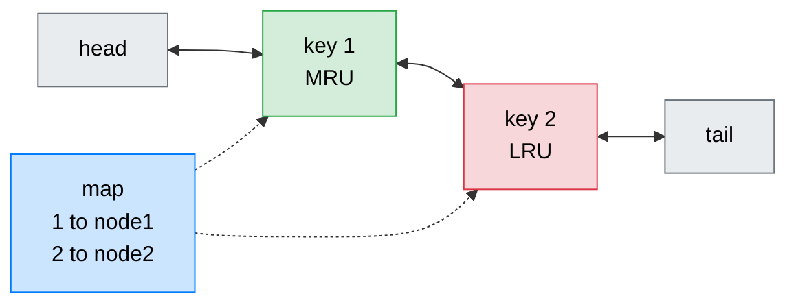
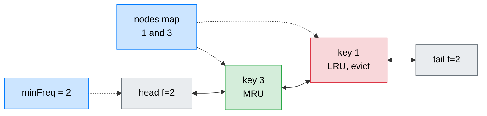

## LeetCode 1: Two Sum
**Difficulty:** Easy | **Pattern:** HashMap (value -> index), complement lookup | **Language:** Java

### 1. Problem
- Given an array `nums` and an integer `target`, return the indices of the two different elements that add up to `target`. Exactly one solution exists. Example: `nums = [3,2,4], target = 6` -> `[1,2]` (2 + 4).
- Constraints: `2 <= n <= 10^4`, values and target in `[-10^9, 10^9]`. `O(n^2)` is acceptable for 10^4 but the interview target is `O(n)`.
- **Key insight:** for each number `x`, the partner is fixed: `target - x`. Instead of searching the array for it, remember what you have already seen in a map and ask "have I seen `target - x`?" in O(1).

### 2. Solution
- **Step 1, brute force:** try every pair, `O(n^2)` time, `O(1)` space. Wasteful because for each `x` we rescan the array for a value we already know exactly.
- **Step 2, observation:** the question per element is a pure lookup ("does value v exist, and where?"). That is what a hash map is for.
- **Step 3, one pass:** walk left to right. Before inserting `nums[i]`, look up its complement among earlier elements. If found, we have the pair. Otherwise store `nums[i] -> i`. Looking up before inserting guarantees we never pair an element with itself (matters for `[3,2,4]`, target 6, where `3 + 3` must not count). Duplicates like `[3,3]` still work because the first 3 is already stored when the second arrives.

```java
import java.util.HashMap;
import java.util.Map;

class Solution {
    public int[] twoSum(int[] nums, int target) {
        Map<Integer, Integer> seen = new HashMap<>(nums.length * 2);
        for (int i = 0; i < nums.length; i++) {
            Integer j = seen.get(target - nums[i]);   // |target - x| <= 2*10^9 < 2^31, no overflow
            if (j != null) {
                return new int[] {j, i};
            }
            seen.put(nums[i], i);                      // insert AFTER the lookup
        }
        return new int[0];                             // unreachable: a solution is guaranteed
    }
}
```
Implementation notes: one `get` instead of `containsKey` + `get` halves hashing work. Pre-sizing the map avoids rehashing. The difference `target - nums[i]` is at most 2*10^9 in magnitude, which still fits in an `int`.

### 3. Dry Run
Input: `nums = [3,2,4]`, `target = 6`.

| i | nums[i] | need = 6 - nums[i] | map before | lookup | action | map after |
|---|---------|--------------------|-----------|--------|--------|-----------|
| 0 | 3 | 3 | {} | miss | store 3 -> 0 | {3:0} |
| 1 | 2 | 4 | {3:0} | miss | store 2 -> 1 | {3:0, 2:1} |
| 2 | 4 | 2 | {3:0, 2:1} | hit, index 1 | return [1, 2] | - |

Note at i = 0 the need is 3 and the map was empty, so the element did not pair with itself.

Answer: `[1, 2]`.

**Complexity:** Time `O(n)`: one pass with `O(1)` average lookups. Space `O(n)`: the map holds up to n entries.

### 4. Takeaway
- **Pattern:** "find a pair with a relationship (sum, difference, XOR)": store what you have seen, look up what you need. Sorting plus two pointers is the `O(1)`-space alternative when indices are not required.
- **Edge cases:**

| Input | Result | Note |
|-------|--------|------|
| `[3,3], 6` | `[0,1]` | duplicates work because lookup precedes insert |
| `[0,4,3,0], 0` | `[0,3]` | zeros are valid values |
| `[-1,-2,-3,-4,-5], -8` | `[2,4]` | negatives fine |
| `[3,2,4], 6` | `[1,2]` | must not reuse index 0 twice |

- **Mistakes to avoid:**
  - Inserting before the lookup (pairs an element with itself).
  - Returning values instead of indices.
  - Sorting first and losing the original indices.
- **Related problems:** 167 Two Sum II (sorted input, two pointers, O(1) space); 15 3Sum (sort + two pointers, need all unique triplets); 560 Subarray Sum Equals K (same idea with prefix sums as keys); 653 Two Sum IV BST.

---

## LeetCode 242: Valid Anagram
**Difficulty:** Easy | **Pattern:** int[26] character frequency comparison | **Language:** Java

### 1. Problem
- Return true if `t` is a rearrangement of `s`. Example: `s = "anagram", t = "nagaram"` -> `true`; `s = "rat", t = "car"` -> `false`.
- Constraints: lengths up to `5 * 10^4`, lowercase English letters only. Target: `O(n)` time, `O(1)` space.
- **Key insight:** two strings are anagrams exactly when every letter has the same count in both. The alphabet is fixed at 26, so a plain `int[26]` replaces a hash map.

### 2. Solution
- **Step 1, brute force:** sort both strings and compare: `O(n log n)` time, `O(n)` extra space for the char arrays. Sorting does far more work than needed because we only care about counts, not order.
- **Step 2, count both:** build two frequency tables and compare them: `O(n)` but two arrays.
- **Step 3, one array:** increment for `s[i]` and decrement for `t[i]` in the same loop. If all 26 counters end at zero, the multisets match. Different lengths are rejected up front.
- Follow-up (Unicode): swap the array for `HashMap<Integer, Integer>` over code points.

```java
class Solution {
    public boolean isAnagram(String s, String t) {
        if (s.length() != t.length()) {
            return false;
        }
        int[] count = new int[26];
        for (int i = 0; i < s.length(); i++) {
            count[s.charAt(i) - 'a']++;
            count[t.charAt(i) - 'a']--;
        }
        for (int c : count) {
            if (c != 0) {
                return false;
            }
        }
        return true;
    }
}
```
Implementation notes: equal length is what makes "all zeros" a sufficient check. Without the length test, a single array could hide a mismatch only if lengths differ, so keep the early exit.

### 3. Dry Run
Input: `s = "anagram"`, `t = "nagaram"`. Net effect on the counters at each index (`s` adds, `t` subtracts):

| i | s[i] (+1) | t[i] (-1) | non-zero counters after |
|---|-----------|-----------|-------------------------|
| 0 | a | n | a=1, n=-1 |
| 1 | n | a | none (a=0, n=0) |
| 2 | a | g | a=1, g=-1 |
| 3 | g | a | none |
| 4 | r | r | none |
| 5 | a | a | none |
| 6 | m | m | none |

All counters are zero -> `true`. For `"rat"` vs `"car"`: after processing, `t=1, c=-1` remain non-zero -> `false`.

**Complexity:** Time `O(n)`: one pass plus a fixed 26-length scan. Space `O(1)`: the array size does not depend on n.

### 4. Takeaway
- **Pattern:** "same letters, any order" or "does this window match that multiset" -> fixed-size frequency array. This is the core of every sliding-window anagram problem (438, 567).
- **Edge cases:**

| Input | Result | Note |
|-------|--------|------|
| `"a", "a"` | true | single char |
| `"ab", "a"` | false | length mismatch |
| `"aacc", "ccac"` | false | same letters, different counts |
| `"", ""` | true | not in constraints but consistent |

- **Mistakes to avoid:**
  - Comparing only the sets of letters, not counts.
  - Forgetting the length check.
  - Using `HashMap<Character,Integer>` when the alphabet is tiny (slower, boxing).
- **Related problems:** 49 Group Anagrams (frequency signature as map key); 438 Find All Anagrams in a String (sliding window of the same counters); 383 Ransom Note (one-directional subset check); 567 Permutation in String.

---

## LeetCode 347: Top K Frequent Elements
**Difficulty:** Medium | **Pattern:** HashMap + bucket sort (or min-heap) | **Language:** Java

### 1. Problem
- Return the `k` most frequent values in `nums` (any order). Example: `nums = [1,1,1,2,2,3], k = 2` -> `[1,2]`.
- Constraints: `n <= 10^5`, `k` is between 1 and the number of distinct values, and the answer is unique. Better than `O(n log n)` is requested.
- **Key insight:** a frequency can never exceed `n`. So instead of sorting elements by frequency, index buckets by frequency (bucket f holds the values that occur f times) and read from the highest bucket down.

### 2. Solution
- **Step 1, brute force:** count with a map, sort all distinct entries by count, take k: `O(n log n)`. The full sort is wasteful since we need only the top k.
- **Step 2, min-heap of size k:** keep the k best seen; each of up to `m` distinct values costs `O(log k)`: `O(n log k)`. Good, and the right answer when memory for buckets matters or the stream is unbounded.
- **Step 3, bucket sort:** frequencies live in `[1, n]`, a small bounded integer range, so counting-sort style bucketing gives `O(n)`. Build `buckets[f]` as a list of values with frequency `f`, then scan `f = n .. 1` collecting values until k are gathered.

```java
import java.util.ArrayList;
import java.util.HashMap;
import java.util.List;
import java.util.Map;

class Solution {
    @SuppressWarnings("unchecked")
    public int[] topKFrequent(int[] nums, int k) {
        Map<Integer, Integer> freq = new HashMap<>();
        for (int x : nums) {
            freq.merge(x, 1, Integer::sum);
        }

        List<Integer>[] buckets = new List[nums.length + 1];   // index = frequency
        for (Map.Entry<Integer, Integer> e : freq.entrySet()) {
            int f = e.getValue();
            if (buckets[f] == null) {
                buckets[f] = new ArrayList<>();
            }
            buckets[f].add(e.getKey());
        }

        int[] result = new int[k];
        int filled = 0;
        for (int f = nums.length; f >= 1 && filled < k; f--) {
            if (buckets[f] == null) {
                continue;
            }
            for (int value : buckets[f]) {
                result[filled++] = value;
                if (filled == k) {
                    break;
                }
            }
        }
        return result;
    }
}
```
Implementation notes: buckets are created lazily to avoid `n` empty lists. The generic array needs `@SuppressWarnings("unchecked")`. Because the answer is guaranteed unique, a bucket never needs to be split between "in" and "out".

### 3. Dry Run
Input: `nums = [1,1,1,2,2,3]`, `k = 2`.

Counting: `freq = {1:3, 2:2, 3:1}`.

| Step | Action | State |
|------|--------|-------|
| bucket 1 | value 3 has freq 1 | buckets[1] = [3] |
| bucket 2 | value 2 has freq 2 | buckets[2] = [2] |
| bucket 3 | value 1 has freq 3 | buckets[3] = [1] |

Scan from f = 6 down (n = 6):

| f | bucket | filled before | action | result |
|---|--------|---------------|--------|--------|
| 6 | null | 0 | skip | [] |
| 5 | null | 0 | skip | [] |
| 4 | null | 0 | skip | [] |
| 3 | [1] | 0 | take 1 | [1] |
| 2 | [2] | 1 | take 2, filled = k, stop | [1, 2] |

Answer: `[1, 2]`.

**Complexity:** Time `O(n)`: one counting pass, one bucket fill over distinct values, one scan of at most n+1 buckets. Space `O(n)`: map plus buckets.

### 4. Takeaway
- **Pattern:** "top k by count" with counts bounded by n -> bucket by frequency. When values are not bounded integers (top k by arbitrary score), use a size-k min-heap.
- **Edge cases:**

| Input | Result | Note |
|-------|--------|------|
| `[1], 1` | `[1]` | single element |
| `[4,4,4,4], 1` | `[4]` | one huge bucket |
| `[1,2], 2` | `[1,2]` | all frequencies equal, one bucket holds both |
| negatives like `[-1,-1,2]`, 1 | `[-1]` | map handles any int |

- **Mistakes to avoid:**
  - Allocating `n+1` bucket lists eagerly.
  - Sizing buckets by `max(value)` instead of `n`.
  - Using a max-heap over all distinct values (`O(m log m)`) and calling it optimal.
- **Related problems:** 692 Top K Frequent Words (tie-break lexicographically, heap with comparator); 451 Sort Characters By Frequency (same buckets, output expanded); 215 Kth Largest Element (heap or quickselect); 973 K Closest Points (heap by distance).

---

## LeetCode 128: Longest Consecutive Sequence
**Difficulty:** Medium | **Pattern:** HashSet + sequence-start detection | **Language:** Java

### 1. Problem
- Given unsorted integers, return the length of the longest run of consecutive values (order in the array is irrelevant). Example: `[100,4,200,1,3,2]` -> `4` (the run 1,2,3,4).
- Constraints: `n <= 10^5`, values in `[-10^9, 10^9]`. Must run in `O(n)`, which rules out sorting.
- **Key insight:** only start counting at a number that begins a run, i.e. `x - 1` is not in the set. Then each run is walked exactly once, from its first element, so total work is linear.

### 2. Solution
- **Step 1, brute force:** for each `x`, extend `x+1, x+2, ...` with a linear scan of the array: `O(n^3)` worst case. Even with a set for lookups, extending from every element is `O(n^2)` (a run of length n is re-walked from each of its members).
- **Step 2, sort:** sort and count runs, `O(n log n)`. Correct but violates the required bound.
- **Step 3, set plus start detection:** put everything in a `HashSet` (this simulates sortedness: "is the next value present?" is O(1)). Skip any `x` where `x-1` exists, since that run is counted from an earlier start. For true starts, walk upward while the next value exists. Each element is visited by the inner loop at most once, because it belongs to exactly one run. Iterate over the set, not the array, so duplicated starts are not re-walked.

```java
import java.util.HashSet;
import java.util.Set;

class Solution {
    public int longestConsecutive(int[] nums) {
        Set<Integer> set = new HashSet<>(nums.length * 2);
        for (int x : nums) {
            set.add(x);
        }

        int best = 0;
        for (int x : set) {
            if (set.contains(x - 1)) {
                continue;                      // not a start; its run is counted from the start
            }
            int len = 1;
            while (set.contains(x + len)) {    // |values| <= 10^9, so x + len cannot overflow
                len++;
            }
            best = Math.max(best, len);
        }
        return best;
    }
}
```

### 3. Dry Run
Input: `[100,4,200,1,3,2]`, set = {1,2,3,4,100,200}. (Set iteration order is arbitrary; shown in ascending order for readability.)

| x | x-1 in set? | action | run walked | len | best |
|---|-------------|--------|-----------|-----|------|
| 1 | no (0) | start | 2,3,4 present, 5 absent | 4 | 4 |
| 2 | yes | skip | - | - | 4 |
| 3 | yes | skip | - | - | 4 |
| 4 | yes | skip | - | - | 4 |
| 100 | no (99) | start | 101 absent | 1 | 4 |
| 200 | no (199) | start | 201 absent | 1 | 4 |

Answer: `4`.

**Complexity:** Time `O(n)`: each element is touched once by the outer loop and at most once by an inner walk. Space `O(n)`: the set.

### 4. Takeaway
- **Pattern:** "longest consecutive / contiguous values without sorting" -> hash set, count only from run starts. The "skip if predecessor exists" guard is what turns `O(n^2)` into `O(n)`. Union-Find is an alternative.
- **Edge cases:**

| Input | Result | Note |
|-------|--------|------|
| `[]` | 0 | loop never runs |
| `[5]` | 1 | single start |
| `[1,2,0,1]` | 3 | duplicates collapse in the set |
| `[9,1,4,7,3,-1,0,5,8,-1,6]` | 7 | run 3..9 (7) beats run -1..1 (3); value 2 is missing |
| `[-1,0,1]` | 3 | negatives fine |

- **Mistakes to avoid:**
  - Omitting the `x-1` check (quietly `O(n^2)`).
  - Iterating over `nums` with many duplicates of a start.
  - Sorting and forgetting to de-duplicate (`[1,2,2,3]` is 3, not 2).
- **Related problems:** 298 Binary Tree Longest Consecutive Sequence (tree path, not values); 674 Longest Continuous Increasing Subsequence (array contiguity, no hashing); 953 / 1296 style consecutive-group checks (same set/map presence ideas).

---

## LeetCode 36: Valid Sudoku
**Difficulty:** Medium | **Pattern:** Multi-dimensional HashSet constraint validation | **Language:** Java

### 1. Problem
- Given a 9x9 board with digits `'1'-'9'` and `'.'` for empty cells, decide whether the filled cells are valid: no repeated digit in any row, any column, or any of the nine 3x3 boxes. Only filled cells are checked; the board need not be solvable.
- Constraints: board is always 9x9, so the work is a fixed 81 cells. Any single pass is fine.
- **Key insight:** every cell belongs to exactly one row, one column and one box. Track "digit already used" per row, per column, per box; the box id is `(r / 3) * 3 + c / 3`.

### 2. Solution
- **Step 1, brute force:** for each filled cell, rescan its row, column and box for a duplicate: about 81 * 27 checks. Fine at this size but repeated work and clumsy.
- **Step 2, sets per unit:** keep 9 sets for rows, 9 for columns, 9 for boxes. For each cell, if the digit is in any of its three sets, invalid; else add to all three.
- **Step 3, bitmasks:** digits are only 1-9, so a set is a 9-bit integer. `int[9]` for rows, columns, boxes; test and set with `1 << digit`. No objects, no hashing, same logic.

```java
class Solution {
    public boolean isValidSudoku(char[][] board) {
        int[] rows = new int[9];
        int[] cols = new int[9];
        int[] boxes = new int[9];

        for (int r = 0; r < 9; r++) {
            for (int c = 0; c < 9; c++) {
                char ch = board[r][c];
                if (ch == '.') {
                    continue;
                }
                int bit = 1 << (ch - '1');           // digit 1..9 -> bit 0..8
                int b = (r / 3) * 3 + c / 3;
                if (((rows[r] | cols[c] | boxes[b]) & bit) != 0) {
                    return false;
                }
                rows[r] |= bit;
                cols[c] |= bit;
                boxes[b] |= bit;
            }
        }
        return true;
    }
}
```
Implementation notes: OR-ing the three masks lets one test cover all three constraints. Using `HashSet<String>` ("5 in row 0") also works and reads clearly, but allocates.

### 3. Dry Run
Box index map: rows 0-2 give boxes 0,1,2 by column band; rows 3-5 give 3,4,5; rows 6-8 give 6,7,8.

Small invalid board (all other cells `.`): `(0,0)='8'`, `(1,2)='7'`, `(2,2)='8'`.

| Step | cell (r,c) | digit | box b | in rows[r]? | in cols[c]? | in boxes[b]? | action |
|------|-----------|-------|-------|-------------|-------------|--------------|--------|
| 1 | (0,0) | 8 | 0 | no | no | no | mark row0, col0, box0 |
| 2 | (1,2) | 7 | (1/3)*3+2/3 = 0 | no | no | no | mark row1, col2, box0 |
| 3 | (2,2) | 8 | (2/3)*3+2/3 = 0 | no | no | yes (8 from step 1) | return false |

Step 3 conflict is in the box only: different row (2 vs 0) and different column (2 vs 0), which is why the box set is needed.

Answer: `false`. A board with no conflict returns `true` after all 81 cells.

**Complexity:** Time `O(81)` = `O(1)`: fixed board size (`O(n^2)` for an n x n generalisation). Space `O(1)`: 27 ints.

### 4. Takeaway
- **Pattern:** validating several overlapping uniqueness constraints in one pass -> one "seen" structure per constraint, keyed by a computed group id. Box index `(r/3)*3 + c/3` is the standard trick for grid blocks.
- **Edge cases:**

| Input | Result | Note |
|-------|--------|------|
| all `.` | true | empty board is valid |
| same digit twice in a row | false | row check |
| same digit twice in a column | false | column check |
| same digit twice in a box only | false | needs the box check |
| valid but unsolvable board | true | we validate, not solve |

- **Mistakes to avoid:**
  - Wrong box formula such as `r/3 + c/3` (collides: boxes (0,1) and (1,0)).
  - Treating `'.'` as a digit.
  - Checking duplicates across the whole board instead of per unit.
- **Related problems:** 37 Sudoku Solver (backtracking using these same masks); 51 N-Queens (row/column/diagonal sets); 73 Set Matrix Zeroes (row/column markers).

---

## LeetCode 387: First Unique Character in a String
**Difficulty:** Easy | **Pattern:** Frequency array + second pass | **Language:** Java

### 1. Problem
- Return the index of the first character that appears exactly once in `s`, or `-1`. Example: `"leetcode"` -> `0` ('l'); `"loveleetcode"` -> `2` ('v'); `"aabb"` -> `-1`.
- Constraints: `n <= 10^5`, lowercase letters only. `O(n)` expected.
- **Key insight:** "unique" needs global knowledge (counts over the whole string), "first" needs order. Separate the two: pass 1 counts, pass 2 walks in order and returns the first character with count 1.

### 2. Solution
- **Step 1, brute force:** for each index, scan the whole string for another copy: `O(n^2)`. We recompute the same counts over and over.
- **Step 2, count once:** one pass fills `int[26]`. The count of a letter does not change afterwards.
- **Step 3, ordered lookup:** a second pass in index order returns the first position whose count is 1. Two linear passes are still `O(n)`; the constant factor of 2 is irrelevant.

```java
class Solution {
    public int firstUniqChar(String s) {
        int[] count = new int[26];
        for (int i = 0; i < s.length(); i++) {
            count[s.charAt(i) - 'a']++;
        }
        for (int i = 0; i < s.length(); i++) {
            if (count[s.charAt(i) - 'a'] == 1) {
                return i;
            }
        }
        return -1;
    }
}
```

### 3. Dry Run
Input: `s = "loveleetcode"` (indices 0-11: l o v e l e e t c o d e).

Pass 1 counts: l=2, o=2, v=1, e=4, t=1, c=1, d=1.

Pass 2:

| i | s[i] | count | action |
|---|------|-------|--------|
| 0 | l | 2 | skip |
| 1 | o | 2 | skip |
| 2 | v | 1 | return 2 |

Answer: `2`. Check pass 1 total: 2+2+1+4+1+1+1 = 12 = length.

**Complexity:** Time `O(n)`: two linear passes. Space `O(1)`: a 26-slot array.

### 4. Takeaway
- **Pattern:** "first/last element satisfying a global property" -> compute the property in one pass, then scan in order. For streams, use `LinkedHashMap` or a queue instead.
- **Edge cases:**

| Input | Result | Note |
|-------|--------|------|
| `"a"` | 0 | single char is unique |
| `"aabb"` | -1 | no unique |
| `"aadadaad"` | -1 | every letter repeats |
| `"abcabcd"` | 6 | unique appears last |

- **Mistakes to avoid:**
  - Returning the letter instead of the index.
  - Looping over the 26 counters to find the answer: that finds a unique letter, not the first one by position.
  - Using a map and iterating its (unordered) keys.
- **Related problems:** 316 Remove Duplicate Letters (greedy + counts); 1429 First Unique Number (stream version, premium); 409 Longest Palindrome (parity of counts).

---

## LeetCode 383: Ransom Note
**Difficulty:** Easy | **Pattern:** Character frequency difference check | **Language:** Java

### 1. Problem
- Return true if `ransomNote` can be built from letters of `magazine`, each magazine letter used at most once. Example: `("aa", "aab")` -> `true`; `("aa", "ab")` -> `false`.
- Constraints: lengths up to `10^5`, lowercase letters. `O(n + m)` expected.
- **Key insight:** it is a multiset-subset test: for every letter, `count in magazine >= count in note`.

### 2. Solution
- **Step 1, brute force:** for each note letter, find and delete an unused copy in the magazine: `O(n*m)` with string rebuilding. Wasteful: we only need counts.
- **Step 2, count the supply:** `int[26]` from the magazine.
- **Step 3, spend it:** for each note letter, decrement; if a counter goes below zero, that letter ran out -> false. A quick length check (`note > magazine`) avoids work in the obvious failing case.

```java
class Solution {
    public boolean canConstruct(String ransomNote, String magazine) {
        if (ransomNote.length() > magazine.length()) {
            return false;
        }
        int[] supply = new int[26];
        for (int i = 0; i < magazine.length(); i++) {
            supply[magazine.charAt(i) - 'a']++;
        }
        for (int i = 0; i < ransomNote.length(); i++) {
            if (--supply[ransomNote.charAt(i) - 'a'] < 0) {
                return false;
            }
        }
        return true;
    }
}
```

### 3. Dry Run
Input: `ransomNote = "aa"`, `magazine = "ab"`.

Supply after counting magazine: a=1, b=1.

| i | note[i] | supply[letter] after decrement | action |
|---|---------|-------------------------------|--------|
| 0 | a | 0 | ok |
| 1 | a | -1 | below zero, return false |

Answer: `false`. For `("aa","aab")`: supply a=2,b=1; note takes a (1), a (0), never negative -> `true`.

**Complexity:** Time `O(n + m)`: one pass over each string. Space `O(1)`: 26 counters.

### 4. Takeaway
- **Pattern:** "can we form X from the pool Y" -> count Y, consume for X, fail on underflow. The one-directional cousin of the anagram check.
- **Edge cases:**

| Input | Result | Note |
|-------|--------|------|
| `("a","b")` | false | missing letter |
| `("aa","aab")` | true | surplus in magazine is fine |
| `("abc","a")` | false | length shortcut |
| `("aab","baa")` | true | order irrelevant |

- **Mistakes to avoid:**
  - Checking only that each note letter exists, ignoring multiplicity.
  - Counting the note and decrementing from the magazine, then forgetting to test the right direction.
  - Requiring equal lengths (that is Valid Anagram).
- **Related problems:** 242 Valid Anagram (counts must match exactly); 409 Longest Palindrome; 1347 Min Steps to Make Two Strings Anagram.

---

## LeetCode 290: Word Pattern
**Difficulty:** Easy | **Pattern:** Bijection mapping (two-way HashMap) | **Language:** Java

### 1. Problem
- Given a `pattern` of letters and a string `s` of space-separated words, decide if `s` follows the pattern: a bijection (one-to-one and onto) between pattern letters and words. Example: `pattern = "abba"`, `s = "dog cat cat dog"` -> `true`; `"abba"` with `"dog dog dog dog"` -> `false`.
- Constraints: pattern up to 300 chars, `s` has single spaces, no leading/trailing spaces. `O(n)` expected.
- **Key insight:** a one-way map is not enough. `a -> dog` and `b -> dog` would both be consistent forward, yet two letters cannot share a word. Check letter -> word and word -> letter.

### 2. Solution
- **Step 1, idea:** split into words; if the counts differ, return false.
- **Step 2, one map:** `letter -> word` catches `"abba"` vs `"dog cat cat fish"` (a maps to dog, then to fish), but misses `"abba"` vs `"dog dog dog dog"`.
- **Step 3, two directions:** keep `letter -> word` and `word -> letter`. For each position, both existing mappings must agree with the current pair; if neither exists, create both.
- Trick: a single `Map<Object,Integer>` of "first index seen" for letters and words (`put` returns the previous value) compares last-seen positions; the explicit two-map version is clearer.

```java
import java.util.HashMap;
import java.util.Map;

class Solution {
    public boolean wordPattern(String pattern, String s) {
        String[] words = s.split(" ");
        if (words.length != pattern.length()) {
            return false;
        }
        Map<Character, String> toWord = new HashMap<>();
        Map<String, Character> toLetter = new HashMap<>();
        for (int i = 0; i < words.length; i++) {
            char letter = pattern.charAt(i);
            String word = words[i];
            String mappedWord = toWord.get(letter);
            Character mappedLetter = toLetter.get(word);
            if (mappedWord == null && mappedLetter == null) {
                toWord.put(letter, word);
                toLetter.put(word, letter);
            } else if (mappedWord == null || mappedLetter == null
                    || !mappedWord.equals(word) || mappedLetter != letter) {
                return false;
            }
        }
        return true;
    }
}
```
Implementation notes: compare words with `equals`, never `==`. `mappedLetter != letter` unboxes the `Character`, safe because it is non-null at that point (the short-circuit `||` order guarantees it).

### 3. Dry Run
Input: `pattern = "abba"`, `s = "dog dog dog dog"`.

| i | letter | word | toWord[letter] | toLetter[word] | action |
|---|--------|------|----------------|----------------|--------|
| 0 | a | dog | none | none | store a->dog, dog->a |
| 1 | b | dog | none | a | one exists, one does not -> return false |

Answer: `false`. With `"dog cat cat dog"`: i=0 stores a<->dog, i=1 stores b<->cat, i=2 b/cat both agree, i=3 a/dog both agree -> `true`.

**Complexity:** Time `O(n)`: n = length of `s`; split plus one pass with O(1) average map operations. Space `O(w)`: w = number of distinct words/letters stored.

### 4. Takeaway
- **Pattern:** "one-to-one correspondence" -> maintain both directions. Same shape as Isomorphic Strings (205).
- **Edge cases:**

| Input | Result | Note |
|-------|--------|------|
| `"abba", "dog cat cat fish"` | false | a maps to two words |
| `"aaaa", "dog cat cat dog"` | false | one letter, many words |
| `"abc", "b c a"` | true | any consistent assignment |
| `"aaa", "aa aa aa aa"` | false | length mismatch |
| `"a", "dog"` | true | trivial |

- **Mistakes to avoid:**
  - Only the forward map (misses two letters to one word).
  - `==` on strings.
  - Skipping the length check, causing out-of-bounds or false positives.
- **Related problems:** 205 Isomorphic Strings (same with characters); 291 Word Pattern II (premium, requires backtracking to find the split); 49 Group Anagrams.

---

## LeetCode 146: LRU Cache
**Difficulty:** Medium | **Pattern:** HashMap + Doubly Linked List, O(1) get and put | **Language:** Java

### 1. Problem
- Design a cache with a fixed `capacity`. `get(key)` returns the value or `-1`. `put(key, value)` inserts or updates; when full, evict the **least recently used** key first. Both operations must be `O(1)` average. Both `get` and `put` count as a "use".
- Example (capacity 2): `put(1,1)`, `put(2,2)`, `get(1)` -> 1, `put(3,3)` evicts key 2, `get(2)` -> -1.
- Constraints: capacity up to 3000, up to 2*10^5 calls. Anything above O(1) per call is too slow in the worst case.
- **Key insight:** two needs, two structures. A hash map finds a node by key in O(1). A doubly linked list keeps keys ordered by recency and can unlink a node and move it to the front in O(1) because we already hold a pointer to it (the map gives that pointer).

### 2. Solution
- **Step 1, brute force:** an array or list ordered by recency. Lookup is `O(n)` and move-to-front is `O(n)`. Too slow.
- **Step 2, map plus timestamps:** `O(1)` lookup, but finding the oldest key on eviction is `O(n)`.
- **Step 3, `LinkedHashMap` with access order:** works and is a fine production answer, but interviewers want the mechanics.
- **Step 4, map + doubly linked list:** the list is ordered most recent (front) to least recent (back). Use dummy `head` and `tail` sentinels so insert and unlink never need null checks. `get`: look up the node, move it to the front. `put`: if present, update and move to front; else create, add to front, and if size exceeds capacity remove `tail.prev` and delete its key from the map. Each node stores its key so eviction can remove the map entry.

State at the key moment (capacity 2, after `put(1)`, `put(2)`, `get(1)`; the next `put(3)` will evict the node before `tail`):


Legend: grey = sentinels, green = most recently used, red = eviction candidate, blue = hash map pointing into the list.

```java
import java.util.HashMap;
import java.util.Map;

class LRUCache {
    private static final class Node {
        final int key;
        int value;
        Node prev, next;
        Node(int key, int value) { this.key = key; this.value = value; }
    }

    private final int capacity;
    private final Map<Integer, Node> map;
    private final Node head = new Node(0, 0);   // sentinel: most recent side
    private final Node tail = new Node(0, 0);   // sentinel: least recent side

    public LRUCache(int capacity) {
        this.capacity = capacity;
        this.map = new HashMap<>(capacity * 2);
        head.next = tail;
        tail.prev = head;
    }

    public int get(int key) {
        Node node = map.get(key);
        if (node == null) {
            return -1;
        }
        unlink(node);
        addFront(node);
        return node.value;
    }

    public void put(int key, int value) {
        Node node = map.get(key);
        if (node != null) {
            node.value = value;
            unlink(node);
            addFront(node);
            return;
        }
        if (map.size() == capacity) {
            Node lru = tail.prev;
            unlink(lru);
            map.remove(lru.key);
        }
        node = new Node(key, value);
        map.put(key, node);
        addFront(node);
    }

    private void unlink(Node n) {
        n.prev.next = n.next;
        n.next.prev = n.prev;
    }

    private void addFront(Node n) {
        n.next = head.next;
        n.prev = head;
        head.next.prev = n;
        head.next = n;
    }
}
```
Implementation notes: evict before inserting so the map never exceeds capacity. Order of pointer assignments in `addFront` matters: read `head.next` before overwriting it.

### 3. Dry Run
Capacity 2. List shown front (MRU) to back (LRU).

| # | Operation | List after | Map keys | Result / action |
|---|-----------|-----------|----------|-----------------|
| 1 | put(1,1) | [1] | {1} | insert |
| 2 | put(2,2) | [2,1] | {1,2} | insert at front |
| 3 | get(1) | [1,2] | {1,2} | move 1 to front, return 1 |
| 4 | put(3,3) | [3,1] | {1,3} | full: evict tail.prev = 2, insert 3 |
| 5 | get(2) | [3,1] | {1,3} | miss, return -1 |
| 6 | put(4,4) | [4,3] | {3,4} | full: evict 1, insert 4 |
| 7 | get(1) | [4,3] | {3,4} | miss, return -1 |
| 8 | get(3) | [3,4] | {3,4} | move 3 to front, return 3 |
| 9 | get(4) | [4,3] | {3,4} | move 4 to front, return 4 |

Outputs in call order for the gets: 1, -1, -1, 3, 4.

**Complexity:** Time `O(1)` per operation: a hash lookup plus constant pointer rewiring. Space `O(capacity)`: one node and one map entry per key.

### 4. Takeaway
- **Pattern:** "O(1) access plus O(1) reorder or evict-oldest" -> hash map to nodes, doubly linked list for order. Doubly linked because unlinking a node needs its predecessor. Same combination appears in LFU and in many design questions.
- **Edge cases:**

| Input | Result | Note |
|-------|--------|------|
| capacity 1, put(1), put(2) | key 1 evicted | list holds a single node |
| put existing key | value updated, key becomes MRU | no eviction |
| get missing key | -1 | does not change order |
| repeated get on same key | stays at front | unlink and re-add is safe |

- **Mistakes to avoid:**
  - Not storing the key in the node (cannot remove the map entry on eviction).
  - Forgetting to refresh recency on `put` of an existing key.
  - Evicting after inserting when capacity is 1 (can evict the new node) or skipping sentinels and chasing null pointers.
- **Related problems:** 460 LFU Cache (frequency instead of recency); 432 All O`one Data Structure (bucketed linked list); 355 Design Twitter; 706 Design HashMap. One-line alternative: extend `LinkedHashMap` with `accessOrder = true` and override `removeEldestEntry`.

---

## LeetCode 460: LFU Cache
**Difficulty:** Hard | **Pattern:** HashMap + frequency map + doubly linked list per frequency | **Language:** Java

### 1. Problem
- Design a cache of fixed `capacity`. `get(key)` returns the value or `-1`; `put(key, value)` inserts or updates. When full, evict the **least frequently used** key; among ties on frequency, evict the **least recently used** of them. Each `get` or `put` on a key increments its use count. Both operations must be `O(1)` average.
- Example (capacity 2): `put(1,1)`, `put(2,2)`, `get(1)` -> 1, `put(3,3)` evicts key 2 (freq 1 vs key 1's freq 2), `get(2)` -> -1.
- Constraints: capacity up to 10^4, up to 2*10^5 calls. Capacity may be 0 (nothing can be stored).
- **Key insight:** keep one recency list per frequency, plus a `minFreq` pointer. Eviction is "remove the last node of `lists[minFreq]`". Bumping a key moves it from `lists[f]` to the front of `lists[f+1]`, and `minFreq` only needs to change when the old list becomes empty.

### 2. Solution
- **Step 1, brute force:** store (freq, last-used time) per key and scan for the minimum on eviction: `O(n)`.
- **Step 2, heap on (freq, time):** eviction `O(log n)`, updates also `O(log n)`. Not O(1).
- **Step 3, frequency buckets:** group keys by frequency; within a bucket keep recency order with a doubly linked list (front = most recent). Maintain `nodes: key -> Node` (each node knows its freq) and `lists: freq -> DList`.
- **Step 4, tracking `minFreq`:** after a bump, if the old bucket is now empty and it was the minimum, the new minimum is `freq + 1` (this key moved there). On inserting a new key, the minimum is always 1, because a fresh key has frequency 1. Eviction happens before the insert, so the new key is not at risk.

Key moment (the state just before `put(4,4)` in the dry run below; capacity 2, minFreq = 2). Bucket 1 has been emptied, bucket 2 holds keys 3 (newer) and 1 (older); key 1 is the eviction victim:


Legend: grey = sentinels of the frequency-2 list, green = newest in that bucket, red = victim, blue = map and minFreq pointer.

```java
import java.util.HashMap;
import java.util.Map;

class LFUCache {
    private static final class Node {
        final int key;
        int value;
        int freq = 1;
        Node prev, next;
        Node(int key, int value) { this.key = key; this.value = value; }
    }

    // Doubly linked list with sentinels; front = most recently used.
    private static final class DList {
        final Node head = new Node(0, 0);
        final Node tail = new Node(0, 0);
        int size;

        DList() {
            head.next = tail;
            tail.prev = head;
        }

        void addFront(Node n) {
            n.next = head.next;
            n.prev = head;
            head.next.prev = n;
            head.next = n;
            size++;
        }

        void remove(Node n) {
            n.prev.next = n.next;
            n.next.prev = n.prev;
            size--;
        }

        Node removeLast() {
            Node last = tail.prev;
            remove(last);
            return last;
        }
    }

    private final int capacity;
    private int minFreq;
    private final Map<Integer, Node> nodes = new HashMap<>();
    private final Map<Integer, DList> lists = new HashMap<>();

    public LFUCache(int capacity) {
        this.capacity = capacity;
    }

    public int get(int key) {
        Node node = nodes.get(key);
        if (node == null) {
            return -1;
        }
        touch(node);
        return node.value;
    }

    public void put(int key, int value) {
        if (capacity == 0) {
            return;
        }
        Node node = nodes.get(key);
        if (node != null) {
            node.value = value;
            touch(node);
            return;
        }
        if (nodes.size() == capacity) {
            DList bucket = lists.get(minFreq);
            Node victim = bucket.removeLast();
            if (bucket.size == 0) {
                lists.remove(minFreq);
            }
            nodes.remove(victim.key);
        }
        node = new Node(key, value);
        nodes.put(key, node);
        lists.computeIfAbsent(1, f -> new DList()).addFront(node);
        minFreq = 1;
    }

    // Move node from bucket f to the front of bucket f + 1.
    private void touch(Node node) {
        DList old = lists.get(node.freq);
        old.remove(node);
        if (old.size == 0) {
            lists.remove(node.freq);
            if (minFreq == node.freq) {
                minFreq++;
            }
        }
        node.freq++;
        lists.computeIfAbsent(node.freq, f -> new DList()).addFront(node);
    }
}
```
Implementation notes: empty buckets are removed so the map stays small; the `capacity == 0` guard must come first. Updating the value of an existing key also counts as a use.

### 3. Dry Run
Capacity 2. Buckets are written front (MRU) to back (LRU), e.g. `f1=[2,1]` means key 2 is newer than key 1.

| # | Operation | Buckets after | minFreq | Result / action |
|---|-----------|---------------|---------|-----------------|
| 1 | put(1,1) | f1=[1] | 1 | insert |
| 2 | put(2,2) | f1=[2,1] | 1 | insert |
| 3 | get(1) | f1=[2], f2=[1] | 1 | 1 bumped to freq 2; f1 not empty; returns 1 |
| 4 | put(3,3) | f1=[3], f2=[1] | 1 | full: evict last of f1 = key 2 (f1 emptied, removed), then insert 3 |
| 5 | get(2) | unchanged | 1 | miss, returns -1 |
| 6 | get(3) | f2=[3,1] | 2 | 3 bumped 1 -> 2; f1 emptied and min was 1, so minFreq = 2; returns 3 |
| 7 | put(4,4) | f1=[4], f2=[3] | 1 | full: evict last of f2 = key 1; insert 4 at f1, minFreq = 1 |
| 8 | get(1) | unchanged | 1 | miss, returns -1 |
| 9 | get(3) | f1=[4], f3=[3] | 1 | 3 bumped 2 -> 3; f2 emptied but min is 1, unchanged; returns 3 |
| 10 | get(4) | f2=[4] | 2 | 4 bumped 1 -> 2; f1 emptied and min was 1, so minFreq = 2; returns 4 |

Get outputs in order: 1, -1, 3, -1, 3, 4. Step 4 shows the tie rule is not needed (freq 1 vs 2); step 7 compares 3 (freq 2, newer) with 1 (freq 2, older) and evicts the older, which is the LRU tie-break.

**Complexity:** Time `O(1)` per operation: map lookups plus constant list rewiring. Space `O(capacity)`: nodes, at most one bucket list per distinct frequency.

### 4. Takeaway
- **Pattern:** "evict by a two-level priority (count, then recency)" with O(1) -> bucket by the first level, a recency linked list inside each bucket, and a pointer to the lowest non-empty bucket. LRU is the special case with one bucket.
- **Edge cases:**

| Input | Result | Note |
|-------|--------|------|
| capacity 0 | put is a no-op, get -> -1 | guard at the top of `put` |
| put existing key | value updated, freq +1 | counts as a use, no eviction |
| two keys, same freq | older one evicted | tie broken by recency |
| new key after eviction | minFreq = 1 | fresh key has freq 1 |
| only key bumped from min bucket | minFreq increments | covered in `touch` |

- **Mistakes to avoid:**
  - Not resetting `minFreq = 1` on insert of a new key.
  - Evicting after inserting (can evict the key you just added).
  - Forgetting to update `minFreq` when the bumped key was alone in the minimum bucket.
  - Treating `put` on an existing key as not a use.
- **Related problems:** 146 LRU Cache (recency only); 432 All O`one Data Structure; 895 Maximum Frequency Stack (per-frequency stacks). Alternative: `Map<Integer, LinkedHashSet<Integer>>` per frequency gives the same O(1) with less code, hiding the list mechanics.

---

## LeetCode 380: Insert Delete GetRandom O(1)
**Difficulty:** Medium | **Pattern:** HashMap + array for O(1) random access | **Language:** Java

### 1. Problem
- Implement `RandomizedSet` with `insert(val)` (true if newly added), `remove(val)` (true if it existed), and `getRandom()` (each current element equally likely). All in average `O(1)`.
- Example: `insert(1)` -> true, `remove(2)` -> false, `insert(2)` -> true, `getRandom()` -> 1 or 2, `remove(1)` -> true, `insert(2)` -> false, `getRandom()` -> 2.
- Constraints: up to 2*10^5 calls, values are 32-bit ints; `getRandom` is only called when the set is non-empty.
- **Key insight:** a hash set cannot pick a random element in O(1), and an array cannot find or delete a value in O(1). Combine them: the array gives random access, the map `value -> index` gives location. To delete from the middle in O(1), overwrite the slot with the last element and shrink the array by one. Order does not matter, so this is free.

### 2. Solution
- **Step 1, brute force:** a `HashSet` alone: `getRandom` must copy or iterate to a random position, `O(n)`.
- **Step 2, array alone:** random pick is O(1), but `insert` must check duplicates (`O(n)`) and `remove` must search and shift (`O(n)`).
- **Step 3, array + map:** `insert`: if the value is in the map, return false; else append and record its index. `remove`: find its index from the map; move the last element into that slot, update that element's index in the map, shrink the array, and delete the removed value from the map. Edge case: when the removed value is itself last, just shrink.
- Implement the array as a primitive `int[]` with doubling growth to avoid boxing in the hot path.

```java
import java.util.HashMap;
import java.util.Map;
import java.util.concurrent.ThreadLocalRandom;

class RandomizedSet {
    private int[] items = new int[16];
    private int size;
    private final Map<Integer, Integer> indexOf = new HashMap<>();

    public boolean insert(int val) {
        if (indexOf.containsKey(val)) {
            return false;
        }
        if (size == items.length) {
            items = java.util.Arrays.copyOf(items, size * 2);
        }
        items[size] = val;
        indexOf.put(val, size);
        size++;
        return true;
    }

    public boolean remove(int val) {
        Integer idx = indexOf.remove(val);
        if (idx == null) {
            return false;
        }
        size--;
        int last = items[size];
        if (idx != size) {              // value was not the last slot
            items[idx] = last;
            indexOf.put(last, idx);
        }
        return true;
    }

    public int getRandom() {
        return items[ThreadLocalRandom.current().nextInt(size)];
    }
}
```
Implementation notes: remove from the map first, then decrement size; `last` is read from the old last index (`size` after the decrement). When `idx == size` the removed value was last, and re-putting it would wrongly resurrect it, so that branch is skipped. `idx != size` unboxes `Integer` safely (non-null here).

### 3. Dry Run
Operations: `insert(1)`, `remove(2)`, `insert(2)`, `remove(1)`, `insert(2)`, `getRandom()`.

| # | Operation | items (first `size` slots) | map value -> index | Action | Returns |
|---|-----------|---------------------------|--------------------|--------|---------|
| 1 | insert(1) | [1] | {1:0} | append | true |
| 2 | remove(2) | [1] | {1:0} | not in map | false |
| 3 | insert(2) | [1,2] | {1:0, 2:1} | append | true |
| 4 | remove(1) | [2] | {2:0} | idx = 0; size 2 -> 1; last = items[1] = 2; 0 != 1, so items[0] = 2, map 2 -> 0; map removed 1 | true |
| 5 | insert(2) | [2] | {2:0} | already present | false |
| 6 | getRandom() | [2] | {2:0} | nextInt(1) = 0 | 2 |

After step 4 the stale copy of 2 remains in `items[1]` but is beyond `size`, so it is never read.

**Complexity:** Time `O(1)` average per operation (amortised for array doubling). Space `O(n)`: the array and the map.

### 4. Takeaway
- **Pattern:** "O(1) delete plus uniform random sample" -> array for sampling, map for locating, and swap-with-last to delete. The same trick suits sampling from a live pool such as servers or experiment buckets.
- **Edge cases:**

| Input | Result | Note |
|-------|--------|------|
| remove the only element | true, set empty | idx == size branch, no map re-put |
| remove the last-inserted element | true | no swap needed |
| insert duplicate | false | map check first |
| remove absent | false | no state change |
| negative or zero values | work | map keys, not array indices |

- **Mistakes to avoid:**
  - Forgetting to update the moved element's index in the map.
  - Re-putting the removed value when it was last (resurrects it).
  - Removing from the middle of an `ArrayList` by index (`O(n)` shift) or using `remove(Object)`.
- **Related problems:** 381 Insert Delete GetRandom with duplicates (map value -> set of indices); 398 Random Pick Index (reservoir sampling); 528 Random Pick with Weight (prefix sums + binary search); 146 LRU Cache (another map + structure combination).
