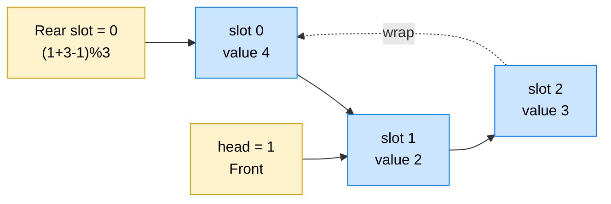
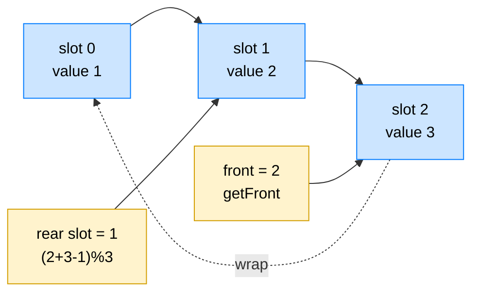

# 07 - Queues and Deques


## LeetCode 232: Implement Queue using Stacks
**Difficulty:** Easy | **Pattern:** Amortized O(1) queue via lazy transfer | **Language:** Java

### 1. Problem
- Build a FIFO queue (`push`, `pop`, `peek`, `empty`) using only stack operations (push to top, pop from top, peek top, size/empty).
- Example: `push(1), push(2), peek() -> 1, pop() -> 1, empty() -> false`.
- Constraints: at most 100 calls, `pop`/`peek` are always valid. Tiny limits, so the real goal is the follow-up: amortized O(1) per operation.
- **Key insight:** reversing a stack once turns LIFO order into FIFO order. Keep two stacks: `in` receives pushes, `out` serves pops. Only refill `out` from `in` when `out` is empty. Every element is moved exactly once, so total moves equal total pushes.

### 2. Solution
- **Step 1 (brute force):** on every `push`, move everything from `main` to a temp stack, push the new item, move everything back. `push` is O(n); every push re-shuffles elements that were already in order. Wasteful.
- **Step 2:** the shuffle is only needed when we read from the front. So push into `in` in O(1) and defer the reversal until a read happens.
- **Step 3 (lazy transfer):** on `pop`/`peek`, if `out` is empty, pour all of `in` into `out`. Popping order flips, so `out`'s top is now the oldest element. If `out` is non-empty, its top is already the oldest of everything, because everything in `in` is newer. Never pour while `out` is non-empty (that would put newer items under older ones and break order).
- **Amortized argument:** each element is pushed to `in` once, poured once, popped from `out` once. That is at most 3 stack ops per element, so n operations cost O(n) total, O(1) amortized. A single `pop` can cost O(n) in the worst case.

```java
import java.util.ArrayDeque;
import java.util.Deque;

class MyQueue {
    private final Deque<Integer> in = new ArrayDeque<>();   // newest on top
    private final Deque<Integer> out = new ArrayDeque<>();  // oldest on top

    public void push(int x) {
        in.push(x);
    }

    public int pop() {
        shift();
        return out.pop();
    }

    public int peek() {
        shift();
        return out.peek();
    }

    public boolean empty() {
        return in.isEmpty() && out.isEmpty();
    }

    // Refill only when out is empty, otherwise FIFO order breaks.
    private void shift() {
        if (out.isEmpty()) {
            while (!in.isEmpty()) {
                out.push(in.pop());
            }
        }
    }
}
```
Implementation notes: `ArrayDeque` used strictly through `push/pop/peek` acts as a stack and is faster than the legacy synchronized `Stack`. The shared `shift()` keeps `pop` and `peek` consistent.

### 3. Dry Run
Operations: `push(1), push(2), peek(), pop(), push(3), pop(), pop(), empty()`. Stacks are written bottom -> top.

| # | Operation | `in` | `out` | Action | Result |
|---|-----------|------|-------|--------|--------|
| 1 | push(1) | [1] | [] | push onto in | - |
| 2 | push(2) | [1,2] | [] | push onto in | - |
| 3 | peek() | [] | [2,1] | out empty: pour 2 then 1; top of out is 1 | 1 |
| 4 | pop() | [] | [2] | out non-empty, pop top | 1 |
| 5 | push(3) | [3] | [2] | push onto in; out untouched | - |
| 6 | pop() | [3] | [] | out non-empty, pop top | 2 |
| 7 | pop() | [] | [] | out empty: pour 3, then pop it | 3 |
| 8 | empty() | [] | [] | both empty | true |

Pops return 1, 2, 3: FIFO order. Step 5 shows why we must not pour while `out` holds 2: 3 would land under 2 and come out first.

**Complexity:** Time: amortized O(1) per operation (worst single pop O(n)), since each element moves at most twice. Space: O(n) for the stored elements.

### 4. Takeaway
- **Pattern:** two-stack lazy transfer whenever you need one order reversed to simulate another (queue from stacks, undo/redo, two-stack deque trick). Amortized analysis: count work per element, not per call.
- **Edge cases:**

| Input | Result | Note |
|-------|--------|------|
| push then immediate pop | returns that value | pours a single element |
| pop after interleaved pushes | oldest element | `out` top is older than anything in `in` |
| empty() with items only in `out` | false | must check both stacks |
| pop when `out` has items and `in` too | no pour | pouring early would break order |

- **Mistakes to avoid:**
  - Pouring on every `pop` or `push` (loses amortized O(1)).
  - Pouring while `out` is non-empty.
  - `empty()` checking only one stack.
  - Using `Stack`/`Vector` instead of `ArrayDeque`.
- **Related problems:** 225 Implement Stack using Queues (the reverse; needs rotation on push, O(n) push or pop with one queue); 155 Min Stack (extra state on a stack); 1381 Design a Stack With Increment Operation; 622 Design Circular Queue (queue with a fixed array instead).

---

## LeetCode 622: Design Circular Queue
**Difficulty:** Medium | **Pattern:** Circular buffer with head/tail and modular arithmetic | **Language:** Java

### 1. Problem
- Implement a fixed-capacity queue `MyCircularQueue(k)` with `enQueue`, `deQueue`, `Front`, `Rear`, `isEmpty`, `isFull`. `enQueue` returns false when full, `deQueue` returns false when empty, `Front`/`Rear` return -1 when empty.
- Example: capacity 3. `enQueue(1), enQueue(2), enQueue(3)` all true; `enQueue(4)` false; `Rear()` -> 3.
- Constraints: `1 <= k <= 1000`, up to 3000 calls. Every operation must be O(1) and space O(k).
- **Key insight:** never shift elements. Keep a `head` index and a `size`; the next write slot is `(head + size) % capacity` and the last element is at `(head + size - 1) % capacity`. Indices wrap around the array like a ring, so freed slots at the front are reused.

### 2. Solution
- **Step 1 (brute force):** use an array, dequeue by shifting everything left. `deQueue` is O(k). Wasteful: elements move only to fill a gap we could have just skipped.
- **Step 2:** move a `head` pointer instead of shifting. Now the front of the array is wasted space and a plain array "fills up" even when logically not full.
- **Step 3:** wrap the pointers with modulo so the array is a ring. The classic problem: with only `head` and `tail`, `head == tail` is ambiguous (empty or full). Fix by tracking `size` explicitly (alternative: leave one slot unused, giving capacity k+1).
- Derived formulas with `head` and `size`:
  - tail slot (next write) = `(head + size) % cap`
  - rear element = `(head + size - 1) % cap`
  - enQueue: write at tail slot, `size++`
  - deQueue: `head = (head + 1) % cap`, `size--`
  - empty: `size == 0`, full: `size == cap`

```java
class MyCircularQueue {
    private final int[] buf;
    private int head;  // index of the front element
    private int size;  // number of stored elements

    public MyCircularQueue(int k) {
        buf = new int[k];
    }

    public boolean enQueue(int value) {
        if (isFull()) return false;
        buf[(head + size) % buf.length] = value;
        size++;
        return true;
    }

    public boolean deQueue() {
        if (isEmpty()) return false;
        head = (head + 1) % buf.length;
        size--;
        return true;
    }

    public int Front() {
        return isEmpty() ? -1 : buf[head];
    }

    public int Rear() {
        return isEmpty() ? -1 : buf[(head + size - 1) % buf.length];
    }

    public boolean isEmpty() {
        return size == 0;
    }

    public boolean isFull() {
        return size == buf.length;
    }
}
```
Implementation notes: a primitive `int[]` avoids boxing. `head + size` is at most 2k, so no overflow. Dequeued slots are not cleared; they are simply overwritten later.

### 3. Dry Run
Capacity 3. Sequence: `enQueue(1), enQueue(2), enQueue(3), enQueue(4), Rear(), isFull(), deQueue(), enQueue(4), Rear(), Front()`. `_` marks an unused slot; a stale value left behind by `deQueue` is shown as `(1)`.

| # | Operation | head | size | Slot used | buf after | Result |
|---|-----------|------|------|-----------|-----------|--------|
| 0 | init | 0 | 0 | - | [_, _, _] | - |
| 1 | enQueue(1) | 0 | 1 | (0+0)%3 = 0 | [1, _, _] | true |
| 2 | enQueue(2) | 0 | 2 | (0+1)%3 = 1 | [1, 2, _] | true |
| 3 | enQueue(3) | 0 | 3 | (0+2)%3 = 2 | [1, 2, 3] | true |
| 4 | enQueue(4) | 0 | 3 | full, rejected | [1, 2, 3] | false |
| 5 | Rear() | 0 | 3 | (0+3-1)%3 = 2 | [1, 2, 3] | 3 |
| 6 | isFull() | 0 | 3 | size == 3 | [1, 2, 3] | true |
| 7 | deQueue() | 1 | 2 | head = (0+1)%3 | [(1), 2, 3] | true |
| 8 | enQueue(4) | 1 | 3 | (1+2)%3 = 0, wraps | [4, 2, 3] | true |
| 9 | Rear() | 1 | 3 | (1+3-1)%3 = 0 | [4, 2, 3] | 4 |
| 10 | Front() | 1 | 3 | buf[1] | [4, 2, 3] | 2 |

Key moment after step 8: the queue is full, logically 2 -> 3 -> 4, and the write wrapped into slot 0.


Legend: blue = ring slots (solid arrows follow index order, dotted arrow is the wrap from the last slot to slot 0); yellow = pointers into the ring.

Final answers in order: true, true, true, false, 3, true, true, true, 4, 2.

**Complexity:** Time: O(1) per operation (index arithmetic only). Space: O(k) for the buffer.

### 4. Takeaway
- **Pattern:** fixed-size FIFO with reuse of freed space: ring buffer. Reach for `(index + offset) % capacity` and an explicit count to disambiguate empty vs full. Used in producer-consumer queues, I/O buffers, rate limiters.
- **Edge cases:**

| Input | Result | Note |
|-------|--------|------|
| `k = 1`, enQueue twice | true, false | head, tail and rear all point to slot 0 |
| deQueue on empty | false | check before moving head |
| Front/Rear on empty | -1 | Rear formula would index wrongly without the check |
| Fill, drain, fill again | works | head has wrapped; size keeps the state correct |
| Full then deQueue then enQueue | true | write lands at wrapped slot |

- **Mistakes to avoid:**
  - Using only `head`/`tail` and confusing empty with full (`head == tail` both ways).
  - Forgetting `-1` in the Rear formula, or `%` with a negative index (matters in #641).
  - Updating `size` before computing the write slot.
  - Shifting elements on dequeue.
- **Related problems:** 641 Design Circular Deque (both ends, needs negative wrap); 232 Implement Queue using Stacks (queue via two stacks, unbounded); 1670 Design Front Middle Back Queue; 346 Moving Average from Data Stream (premium; ring buffer window).

---

## LeetCode 641: Design Circular Deque
**Difficulty:** Medium | **Pattern:** Circular buffer with front/rear pointers, both-end ops | **Language:** Java

### 1. Problem
- Implement `MyCircularDeque(k)` with `insertFront`, `insertLast`, `deleteFront`, `deleteLast`, `getFront`, `getRear`, `isEmpty`, `isFull`. Inserts/deletes return a boolean; getters return -1 when empty.
- Example: capacity 3. `insertLast(1), insertLast(2), insertFront(3)` all true; `insertFront(4)` false (full); `getRear()` -> 2.
- Constraints: `1 <= k <= 1000`, up to 2000 calls. All operations O(1), space O(k).
- **Key insight:** same ring as #622 but the front can also move backward. Store `front` and `size`; the rear is derived as `(front + size - 1) % cap`. Moving the front back needs `(front - 1 + cap) % cap` to avoid a negative index (Java's `%` keeps the sign of the dividend).

### 2. Solution
- **Step 1 (brute force):** `ArrayList` with `add(0, x)` and `remove(0)`: front operations are O(n) because of shifting. Wasteful for a fixed buffer.
- **Step 2:** use the #622 ring. Back-side operations are free: `insertLast` writes at `(front + size) % cap`, `deleteLast` is just `size--`.
- **Step 3:** front-side operations move `front`:
  - `insertFront`: `front = (front - 1 + cap) % cap`, write there, `size++`.
  - `deleteFront`: `front = (front + 1) % cap`, `size--`.
- Storing `size` rather than a rear pointer removes the empty/full ambiguity and means only one pointer has to be kept consistent.

```java
class MyCircularDeque {
    private final int[] buf;
    private int front;  // index of the first element
    private int size;

    public MyCircularDeque(int k) {
        buf = new int[k];
    }

    public boolean insertFront(int value) {
        if (isFull()) return false;
        front = (front - 1 + buf.length) % buf.length; // +cap avoids negative index
        buf[front] = value;
        size++;
        return true;
    }

    public boolean insertLast(int value) {
        if (isFull()) return false;
        buf[(front + size) % buf.length] = value;
        size++;
        return true;
    }

    public boolean deleteFront() {
        if (isEmpty()) return false;
        front = (front + 1) % buf.length;
        size--;
        return true;
    }

    public boolean deleteLast() {
        if (isEmpty()) return false;
        size--;
        return true;
    }

    public int getFront() {
        return isEmpty() ? -1 : buf[front];
    }

    public int getRear() {
        return isEmpty() ? -1 : buf[(front + size - 1) % buf.length];
    }

    public boolean isEmpty() {
        return size == 0;
    }

    public boolean isFull() {
        return size == buf.length;
    }
}
```
Implementation notes: primitive array, no boxing; all index sums stay below 2k. Deleted slots are left as stale data and overwritten later.

### 3. Dry Run
Capacity 3. Sequence: `insertLast(1), insertLast(2), insertFront(3), insertFront(4), getRear(), isFull(), deleteLast(), insertFront(4), getFront()`. `(x)` marks a stale value outside the logical deque.

| # | Operation | front | size | Index computation | buf after | Logical deque (front -> rear) | Result |
|---|-----------|-------|------|-------------------|-----------|-------------------------------|--------|
| 0 | init | 0 | 0 | - | [_, _, _] | [] | - |
| 1 | insertLast(1) | 0 | 1 | (0+0)%3 = 0 | [1, _, _] | [1] | true |
| 2 | insertLast(2) | 0 | 2 | (0+1)%3 = 1 | [1, 2, _] | [1, 2] | true |
| 3 | insertFront(3) | 2 | 3 | (0-1+3)%3 = 2 | [1, 2, 3] | [3, 1, 2] | true |
| 4 | insertFront(4) | 2 | 3 | full, rejected | [1, 2, 3] | [3, 1, 2] | false |
| 5 | getRear() | 2 | 3 | (2+3-1)%3 = 1 | [1, 2, 3] | [3, 1, 2] | 2 |
| 6 | isFull() | 2 | 3 | size == 3 | [1, 2, 3] | [3, 1, 2] | true |
| 7 | deleteLast() | 2 | 2 | size-- | [1, (2), 3] | [3, 1] | true |
| 8 | insertFront(4) | 1 | 3 | (2-1+3)%3 = 1 | [1, 4, 3] | [4, 3, 1] | true |
| 9 | getFront() | 1 | 3 | buf[1] | [1, 4, 3] | [4, 3, 1] | 4 |

Check step 8: from `front = 1`, the logical order reads `buf[1]=4, buf[2]=3, buf[0]=1`, which is 4, 3, 1. Correct: 3 and 1 kept their relative order and 4 is in front.

Key moment after step 3: `front` wrapped backward from 0 to slot 2.


Legend: blue = ring slots (dotted arrow is the wrap from slot 2 to slot 0); yellow = front and rear pointers. Logical order is 3 (slot 2), 1 (slot 0), 2 (slot 1).

Final answers in order: true, true, true, false, 2, true, true, true, 4.

**Complexity:** Time: O(1) per operation. Space: O(k).

### 4. Takeaway
- **Pattern:** double-ended bounded buffer: ring with a start index and a count. Moving backward uses `(i - 1 + cap) % cap`. Same structure underlies array-backed `ArrayDeque`, work-stealing deques and undo/redo buffers.
- **Edge cases:**

| Input | Result | Note |
|-------|--------|------|
| `k = 1`, insertFront then insertLast | true, false | one slot only |
| insertFront on empty deque | true | front wraps to cap-1, rear derived correctly (same slot) |
| deleteLast on empty | false | guard before decrementing size |
| getFront/getRear on empty | -1 | explicit check |
| Repeated insertFront/deleteFront | works | front cycles around the ring |

- **Mistakes to avoid:**
  - `(front - 1) % cap` without `+ cap`: yields -1 in Java.
  - Maintaining separate front and rear pointers and mis-handling empty vs full.
  - Forgetting that `deleteLast` needs no pointer move when rear is derived.
  - Checking `isFull`/`isEmpty` after mutating state.
- **Related problems:** 622 Design Circular Queue (one-sided version); 1670 Design Front Middle Back Queue (deque with middle ops, two deques); 232 Implement Queue using Stacks; 239 Sliding Window Maximum (uses a deque as a tool, not a design).

---

## LeetCode 1696: Jump Game VI
**Difficulty:** Medium | **Pattern:** DP + Monotonic Deque for window max | **Language:** Java

### 1. Problem
- Start at index 0 of `nums`. From index `i` you may jump to any index in `[i+1, min(n-1, i+k)]`. Your score is the sum of `nums[j]` over every index visited (including the first and last). Reach `n-1` with maximum score.
- Example: `nums = [1,-1,-2,4,-7,3]`, `k = 2` -> `7` (path 0 -> 1 -> 3 -> 5: 1 + (-1) + 4 + 3).
- Constraints: `n, k <= 10^5`, `|nums[i]| <= 10^4`. O(nk) is 10^10, too slow; target O(n). Scores stay within about 10^9 in magnitude, so `int` is safe.
- **Key insight:** `dp[i] = nums[i] + max(dp[i-k..i-1])`. That is a sliding-window maximum over dp values already computed. A monotonic deque of indices (dp values decreasing front to back) gives the window max in amortized O(1).

### 2. Solution
- **Step 1 (brute force):** try all jump sequences recursively: exponential.
- **Step 2 (DP):** let `dp[i]` be the best score ending at `i`. Then `dp[0] = nums[0]` and `dp[i] = nums[i] + max over j in [max(0,i-k), i-1] of dp[j]`. Answer `dp[n-1]`. Time O(nk) because each state scans up to k predecessors. Wasteful: consecutive windows overlap in k-1 elements.
- **Step 3 (window max):** we need the max of a window that slides right by one each step: the Sliding Window Maximum problem (#239). A heap gives O(n log n) with lazy deletion; a monotonic deque gives O(n).
- **Step 4 (deque):** store indices, keeping dp values strictly decreasing from front to back.
  - Before computing `dp[i]`, drop the front index if it is `< i - k` (out of window).
  - The front is then the argmax, so `dp[i] = nums[i] + dp[front]`.
  - Before pushing `i`, pop from the back while `dp[back] <= dp[i]`: an older, smaller-or-equal value can never beat `i` for any later window since `i` lives longer.
- The window is never empty when used: index `i-1` was just pushed and satisfies `i-1 >= i-k` for `k >= 1`.

```java
class Solution {
    public int maxResult(int[] nums, int k) {
        int n = nums.length;
        int[] dp = new int[n];
        int[] dq = new int[n];      // indices; each index is pushed once, so n slots suffice
        int head = 0, tail = 0;     // live range is dq[head..tail-1]

        dp[0] = nums[0];
        dq[tail++] = 0;

        for (int i = 1; i < n; i++) {
            if (dq[head] < i - k) head++;               // front left the window
            dp[i] = nums[i] + dp[dq[head]];             // front holds window max
            while (tail > head && dp[dq[tail - 1]] <= dp[i]) tail--;
            dq[tail++] = i;
        }
        return dp[n - 1];
    }
}
```
Implementation notes: an `int[]` with head/tail indices is a deque that never wraps (indices only grow), avoiding `Integer` boxing. At most one index leaves the front per step, so `if` suffices instead of `while`. Max magnitude is `10^5 * 10^4 = 10^9 < 2^31`, so no overflow.

### 3. Dry Run
`nums = [1,-1,-2,4,-7,3]`, `k = 2`. Deque shown as indices with their dp values in parentheses, front first. Window of candidates for `dp[i]` is `[i-2, i-1]`; evict when front index `< i-2`.

| i | nums[i] | Evict (front < i-2) | Deque before compute | Window max (front dp) | dp[i] | Pop from back (dp <= dp[i]) | Deque after push |
|---|---------|---------------------|----------------------|-----------------------|-------|------------------------------|------------------|
| 0 | 1 | - | - | - | 1 | - | [0(1)] |
| 1 | -1 | none (0 >= -1) | [0(1)] | 1 | 0 | none (1 > 0) | [0(1), 1(0)] |
| 2 | -2 | none (0 >= 0) | [0(1), 1(0)] | 1 | -1 | none (0 > -1) | [0(1), 1(0), 2(-1)] |
| 3 | 4 | evict 0 (0 < 1) | [1(0), 2(-1)] | 0 | 4 | pop 2(-1), pop 1(0) | [3(4)] |
| 4 | -7 | none (3 >= 2) | [3(4)] | 4 | -3 | none (4 > -3) | [3(4), 4(-3)] |
| 5 | 3 | none (3 >= 3) | [3(4), 4(-3)] | 4 | 7 | pop 4(-3), pop 3(4) | [5(7)] |

Final dp = `[1, 0, -1, 4, -3, 7]`. Check by hand: dp[3] = 4 + max(dp[1], dp[2]) = 4 + max(0, -1) = 4; dp[4] = -7 + max(dp[2], dp[3]) = -7 + 4 = -3; dp[5] = 3 + max(dp[3], dp[4]) = 3 + 4 = 7.

Answer: **7**.

**Complexity:** Time: O(n); each index enters and leaves the deque at most once. Space: O(n) for `dp` and the deque array.

### 4. Takeaway
- **Pattern:** a DP transition of the form `dp[i] = cost[i] + max/min(dp[i-k..i-1])` is a sliding-window extremum; replace the inner scan with a monotonic deque (or a heap with lazy deletion at O(n log n)).
- **Edge cases:**

| Input | Result | Note |
|-------|--------|------|
| `n = 1` | `nums[0]` | loop never runs |
| `k = 1` | sum of all elements | forced walk; deque holds only `i-1` |
| `k >= n-1` | window is the whole prefix | front is the global prefix max |
| All negative | sum along fewest, least-bad picks | deque still correct; scores can be negative |
| Equal dp values | newer index kept | pop with `<=` so the longest-living index wins |

- **Mistakes to avoid:**
  - Storing values instead of indices (cannot evict by position).
  - Evicting after computing `dp[i]` rather than before.
  - Using `<` instead of `<=` in the back pop (harmless for correctness but grows the deque with ties).
  - Window bound off by one: valid predecessors are `i-k` through `i-1`.
  - Initialising dp with a sentinel like `Integer.MIN_VALUE` and then adding to it (overflow).
- **Related problems:** 239 Sliding Window Maximum (the pure deque problem, do first); 1425 Constrained Subsequence Sum (same dp + deque, with the option to start anywhere and skip negatives); 1499 Max Value of Equation (deque over a derived key); 45 Jump Game II (min jumps, greedy BFS); 55 Jump Game (reachability only).
