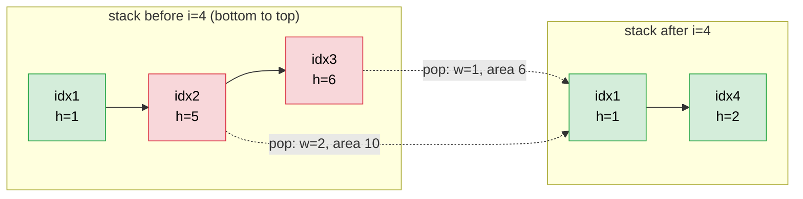
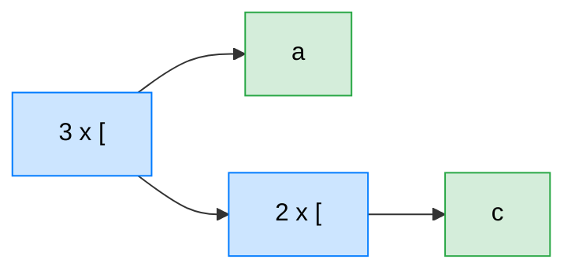

## LeetCode 20: Valid Parentheses
**Difficulty:** Easy | **Pattern:** Stack for bracket matching | **Language:** Java

### 1. Problem
- Given a string of only `()[]{}`, decide whether every bracket is closed by the same type, in the correct order. `"{[()]}"` -> `true`; `"([)]"` -> `false`.
- Constraints: length up to 10^4. A single O(n) pass is expected.
- **Key insight:** the most recently opened bracket must be the first one closed (LIFO), so a stack is the natural structure.

### 2. Solution
- Step 1, brute force: repeatedly delete the substrings `()`, `[]`, `{}` until nothing changes. Each scan is O(n) and up to n/2 rounds are needed, so O(n^2). It rescans text it already knows is fine.
- Observation: when a closer arrives, only the latest unmatched opener matters. That is exactly the top of a stack.
- Final: on an opener push the closer we expect to see later; on a closer, the stack must be non-empty and its top must equal this character. At the end the stack must be empty (no unclosed openers).

```java
public boolean isValid(String s) {
    int n = s.length();
    if ((n & 1) == 1) return false;          // odd length can never pair up
    char[] stack = new char[n];              // primitive stack, no boxing
    int sp = 0;
    for (int i = 0; i < n; i++) {
        char c = s.charAt(i);
        switch (c) {
            case '(' -> stack[sp++] = ')';   // push the closer we now expect
            case '[' -> stack[sp++] = ']';
            case '{' -> stack[sp++] = '}';
            default -> {
                if (sp == 0 || stack[--sp] != c) return false;
            }
        }
    }
    return sp == 0;
}
```
Implementation notes: pushing the expected closer removes the need for a lookup map. A `char[]` of size n is enough because the stack can never exceed n.

### 3. Dry Run
Input `"{[()]}"` (stack shown bottom to top, holding expected closers).

| i | char | stack before | action | stack after |
|---|------|--------------|--------|-------------|
| 0 | `{` | [] | push `}` | [`}`] |
| 1 | `[` | [`}`] | push `]` | [`}`,`]`] |
| 2 | `(` | [`}`,`]`] | push `)` | [`}`,`]`,`)`] |
| 3 | `)` | [`}`,`]`,`)`] | pop `)`, equals `)` | [`}`,`]`] |
| 4 | `]` | [`}`,`]`] | pop `]`, equals `]` | [`}`] |
| 5 | `}` | [`}`] | pop `}`, equals `}` | [] |

Stack is empty at the end, so the answer is `true`. For `"([)]"`: after `(`,`[` the stack is [`)`,`]`]; at `)` we pop `]` which is not `)`, so return `false`.

**Complexity:** Time O(n), one pass with O(1) work per character. Space O(n), worst case all openers.

### 4. Takeaway
- **Pattern:** any nested/balanced structure where the latest open item closes first: brackets, tags, nested calls.
- **Edge cases:**

| Input | Result | Note |
|-------|--------|------|
| `""` | true | vacuously valid (constraints say length >= 1) |
| `"("` | false | stack non-empty at end |
| `")"` | false | closer with empty stack |
| `"(]"` | false | type mismatch |
| `"(("` | false | odd/leftover openers |

- **Mistakes to avoid:**
  - Popping from an empty stack (check `sp == 0` first).
  - Forgetting the final emptiness check.
  - Only counting brackets; counts cannot detect `([)]`.
- **Related problems:** 1249 Minimum Remove to Make Valid Parentheses (fix the string instead of judging it); 32 Longest Valid Parentheses (longest valid substring); 22 Generate Parentheses (generate all valid strings).

---

## LeetCode 155: Min Stack
**Difficulty:** Medium | **Pattern:** Auxiliary stack tracking running minimum | **Language:** Java

### 1. Problem
- Design a stack with `push`, `pop`, `top`, and `getMin`, all in O(1). Example: push -2, push 0, push -3, `getMin()` -> -3, `pop()`, `top()` -> 0, `getMin()` -> -2.
- Constraints: up to 3 * 10^4 calls; pop/top/getMin are only called on a non-empty stack. All operations must be O(1).
- **Key insight:** the minimum of the stack at any depth depends only on the elements at or below that depth, so store "min so far" next to each element. Popping then automatically restores the previous minimum.

### 2. Solution
- Step 1, brute force: `getMin` scans the whole stack, O(n). Too slow for many calls.
- Step 2: keep a single variable `min`. It breaks on pop: if we pop the minimum, we do not know the next smallest.
- Final: a parallel array `mins[i]` = minimum of `vals[0..i]`. On push, `mins[i] = min(val, mins[i-1])`. Pop just decrements size; both arrays stay aligned.

```java
import java.util.Arrays;

class MinStack {
    private int[] vals = new int[16];
    private int[] mins = new int[16];   // mins[i] = min of vals[0..i]
    private int size;

    public void push(int val) {
        if (size == vals.length) {
            vals = Arrays.copyOf(vals, size * 2);
            mins = Arrays.copyOf(mins, size * 2);
        }
        vals[size] = val;
        mins[size] = size == 0 ? val : Math.min(val, mins[size - 1]);
        size++;
    }

    public void pop()    { size--; }
    public int top()     { return vals[size - 1]; }
    public int getMin()  { return mins[size - 1]; }
}
```
Implementation notes: primitive int arrays avoid `Integer` boxing; doubling gives amortized O(1) push. A single-stack variant that stores `val - min` is possible but needs `long` to avoid overflow, so two arrays are safer.

### 3. Dry Run
| op | vals | mins | result |
|----|------|------|--------|
| push(-2) | [-2] | [-2] | |
| push(0) | [-2,0] | [-2,-2] | |
| push(-3) | [-2,0,-3] | [-2,-2,-3] | |
| getMin() | [-2,0,-3] | [-2,-2,-3] | -3 |
| pop() | [-2,0] | [-2,-2] | |
| top() | [-2,0] | [-2,-2] | 0 |
| getMin() | [-2,0] | [-2,-2] | -2 |

**Complexity:** Time O(1) per operation (amortized for push because of resizing). Space O(n) for the two arrays.

### 4. Takeaway
- **Pattern:** "augmented stack": store extra metadata (running min/max/count) alongside each element so an aggregate query is O(1) and survives pops.
- **Edge cases:**

| Input | Result | Note |
|-------|--------|------|
| push same min twice, pop once | min unchanged | per-index mins handle duplicates automatically |
| push `Integer.MIN_VALUE` | works | no subtraction, no overflow |
| single element | top == getMin | |

- **Mistakes to avoid:**
  - Keeping one `min` variable that cannot be restored after pop.
  - In the two-stack-with-skip variant, pushing to the min stack only on strictly smaller values and then mishandling duplicates.
  - Overflow when encoding differences in one stack.
- **Related problems:** 716 Max Stack (adds popMax, needs more than a parallel array); 232 Implement Queue using Stacks; 239 Sliding Window Maximum (running max with a deque).

---

## LeetCode 225: Implement Stack using Queues
**Difficulty:** Easy | **Pattern:** Simulate stack with queue rotation | **Language:** Java

### 1. Problem
- Implement `push`, `pop`, `top`, `empty` of a LIFO stack using only standard queue operations (enqueue at back, dequeue from front, peek front, size, isEmpty). Example: push 1, push 2, `top()` -> 2, `pop()` -> 2, `empty()` -> false.
- Constraints: at most 100 calls, so any O(n) per-operation is fine, but a clean amortized story is the goal.
- **Key insight:** a queue serves the oldest element first, a stack the newest. If after every push we rotate the queue so the new element sits at the front, the queue front is always the stack top.

### 2. Solution
- Step 1: two queues. Push into `q2`, move everything from `q1` behind it, swap names. Works, but needs two queues and copies.
- Observation: moving the old elements behind the new one is just "dequeue and re-enqueue" `size-1` times. One queue suffices.
- Final: `push` enqueues `x` then rotates `size - 1` elements from front to back. `pop`, `top`, `empty` are plain queue operations.

```java
import java.util.ArrayDeque;
import java.util.Queue;

class MyStack {
    private final Queue<Integer> q = new ArrayDeque<>();

    public void push(int x) {
        q.offer(x);
        for (int i = q.size() - 1; i > 0; i--) {
            q.offer(q.poll());           // rotate older elements behind x
        }
    }

    public int pop()      { return q.poll(); }
    public int top()      { return q.peek(); }
    public boolean empty(){ return q.isEmpty(); }
}
```
Implementation notes: `ArrayDeque` used purely through the `Queue` interface. The alternative (push O(1), pop O(n) by rotating `size-1` elements) shifts the cost; pick based on which operation is more frequent.

### 3. Dry Run
| op | queue (front -> back) | action | result |
|----|----------------------|--------|--------|
| push(1) | [1] | offer 1; rotate 0 times | |
| push(2) | [1,2] -> [2,1] | offer 2; rotate 1: poll 1, offer 1 | |
| top() | [2,1] | peek front | 2 |
| pop() | [1] | poll front | 2 |
| empty() | [1] | not empty | false |

**Complexity:** Time: push O(n), pop/top/empty O(1) (each push rotates size-1 elements). Space O(n) for the single queue.

### 4. Takeaway
- **Pattern:** convert FIFO to LIFO by making the newest element reach the front; pairs with 232 (queue from stacks), where the two-stack lazy transfer gives amortized O(1).
- **Edge cases:**

| Input | Result | Note |
|-------|--------|------|
| push on empty | no rotation | loop runs 0 times |
| pop then empty | true when last element removed | |
| alternating push/pop | always correct | invariant: front = top |

- **Mistakes to avoid:**
  - Rotating `size` times (full cycle returns the original order) instead of `size - 1`.
  - Using `Stack`/`Deque.push` methods, which defeats the exercise.
  - Rotating before enqueuing the new element.
- **Related problems:** 232 Implement Queue using Stacks (reverse direction, amortized O(1)); 622 Design Circular Queue; 155 Min Stack.

---

## LeetCode 1249: Minimum Remove to Make Valid Parentheses
**Difficulty:** Medium | **Pattern:** Stack for index tracking + string rebuild | **Language:** Java

### 1. Problem
- Remove the fewest `(` or `)` characters so the string becomes valid; letters are untouched. Return any valid result. `"lee(t(c)o)de)"` -> `"lee(t(c)o)de"`.
- Constraints: length up to 10^5, so O(n).
- **Key insight:** a bracket must be removed exactly when it has no partner: a `)` seen while no `(` is open, or a `(` still open at the end. A stack of `(` indices identifies both groups in one pass.

### 2. Solution
- Step 1, brute force: try deleting every subset of brackets and validate: exponential.
- Observation: greedy matching is optimal. Match each `)` with the nearest earlier unmatched `(`; anything left unmatched can never be fixed by keeping it.
- Final: scan left to right. On `(` push its index. On `)` pop if the stack is non-empty, else mark this index for removal. After the scan, every index still in the stack is an unmatched `(`; mark it too. Rebuild the string skipping marked indices.

```java
public String minRemoveToMakeValid(String s) {
    int n = s.length();
    boolean[] drop = new boolean[n];
    int[] stack = new int[n];       // indices of currently unmatched '('
    int sp = 0;
    for (int i = 0; i < n; i++) {
        char c = s.charAt(i);
        if (c == '(') {
            stack[sp++] = i;
        } else if (c == ')') {
            if (sp == 0) drop[i] = true;   // nothing to match
            else sp--;                      // matched
        }
    }
    while (sp > 0) drop[stack[--sp]] = true; // leftover '('

    StringBuilder sb = new StringBuilder(n);
    for (int i = 0; i < n; i++) {
        if (!drop[i]) sb.append(s.charAt(i));
    }
    return sb.toString();
}
```
Implementation notes: marking in a `boolean[]` and rebuilding once avoids O(n) `deleteCharAt` calls that would make the solution O(n^2).

### 3. Dry Run
Input `"lee(t(c)o)de)"` (indices 0-12).

| i | char | stack (indices) | action | drop so far |
|---|------|-----------------|--------|-------------|
| 0 | l | [] | letter, ignore | |
| 1 | e | [] | ignore | |
| 2 | e | [] | ignore | |
| 3 | ( | [3] | push 3 | |
| 4 | t | [3] | ignore | |
| 5 | ( | [3,5] | push 5 | |
| 6 | c | [3,5] | ignore | |
| 7 | ) | [3] | pop 5 (matched) | |
| 8 | o | [3] | ignore | |
| 9 | ) | [] | pop 3 (matched) | |
| 10 | d | [] | ignore | |
| 11 | e | [] | ignore | |
| 12 | ) | [] | stack empty, mark 12 | {12} |

Stack is empty after the scan, so nothing else to drop. Result: `"lee(t(c)o)de"`.

**Complexity:** Time O(n), two linear passes. Space O(n) for the stack, flags, and output.

### 4. Takeaway
- **Pattern:** when you must fix (not just judge) a bracket string, store indices on the stack rather than characters, then act on the leftovers.
- **Edge cases:**

| Input | Result | Note |
|-------|--------|------|
| `"))(("` | `""` | everything unmatched |
| `"a)b(c)d"` | `"ab(c)d"` | stray `)` removed |
| `"(a(b(c)d)"` | `"a(b(c)d)"` | leftover `(` at index 0 dropped |
| `"abc"` | `"abc"` | no brackets |

- **Mistakes to avoid:**
  - Deleting inside the loop, which shifts indices.
  - Forgetting leftover openers after the scan.
  - Removing letters.
- **Related problems:** 20 Valid Parentheses (decision only); 921 Minimum Add to Make Parentheses Valid (insert instead of delete, counter works); 32 Longest Valid Parentheses. A two-pass counter solution (left-to-right drop extra `)`, right-to-left drop extra `(`) avoids the stack.

---

## LeetCode 32: Longest Valid Parentheses
**Difficulty:** Hard | **Pattern:** Stack of indices with a -1 sentinel (or DP) | **Language:** Java

### 1. Problem
- Given a string of `(` and `)`, return the length of the longest contiguous valid (well-formed) substring. `")()())"` -> `4`.
- Constraints: length up to 3 * 10^4; O(n) expected, O(n^2) borderline.
- **Key insight:** keep on the stack the index just before the current valid stretch begins (the last unmatched position). After a match, the length of the valid run ending at `i` is `i - stack.top`.

### 2. Solution
- Step 1, brute force: check every substring for validity: O(n^3), or O(n^2) with a running balance. Still repeats work.
- Observation: a valid run is broken only by an unmatched `)` or is bounded on the left by an unmatched `(`/start. So we need the index of the last "barrier".
- Final: stack starts with `-1` as the barrier below index 0. On `(` push `i`. On `)` pop; if the stack becomes empty this `)` is unmatched, so push `i` as the new barrier; otherwise the current valid length is `i - stack.top`.

```java
public int longestValidParentheses(String s) {
    int n = s.length();
    int[] stack = new int[n + 1];
    int sp = 0;
    stack[sp++] = -1;                       // barrier before the string
    int best = 0;
    for (int i = 0; i < n; i++) {
        if (s.charAt(i) == '(') {
            stack[sp++] = i;
        } else {
            sp--;                           // match with top (barrier or '(')
            if (sp == 0) {
                stack[sp++] = i;            // unmatched ')': new barrier
            } else {
                best = Math.max(best, i - stack[sp - 1]);
            }
        }
    }
    return best;
}
```
Implementation notes: capacity `n + 1` covers the sentinel plus up to n pushes. DP alternative: `dp[i]` = longest valid ending at `i`, O(n) time and space; a two-pass counter version does it in O(1) space.

### 3. Dry Run
Input `")()())"` (indices 0-5).

| i | char | stack before | action | stack after | best |
|---|------|--------------|--------|-------------|------|
| - | init | | push -1 | [-1] | 0 |
| 0 | ) | [-1] | pop -1, empty -> push 0 | [0] | 0 |
| 1 | ( | [0] | push 1 | [0,1] | 0 |
| 2 | ) | [0,1] | pop 1; len = 2 - 0 = 2 | [0] | 2 |
| 3 | ( | [0] | push 3 | [0,3] | 2 |
| 4 | ) | [0,3] | pop 3; len = 4 - 0 = 4 | [0] | 4 |
| 5 | ) | [0] | pop 0, empty -> push 5 | [5] | 4 |

Answer: `4`.

**Complexity:** Time O(n), each index pushed and popped at most once. Space O(n) for the stack.

### 4. Takeaway
- **Pattern:** "longest valid stretch" problems: a stack of barrier indices converts a match into a length via subtraction.
- **Edge cases:**

| Input | Result | Note |
|-------|--------|------|
| `""` | 0 | |
| `"(()"` | 2 | leftover `(` becomes the barrier |
| `"()(())"` | 6 | whole string; barrier stays -1 |
| `"))))"` | 0 | each `)` becomes the new barrier |

- **Mistakes to avoid:**
  - Omitting the `-1` sentinel, which breaks runs starting at index 0.
  - Computing length as `i - top + 1` (the top is the barrier, exclusive).
  - Not pushing the unmatched `)` index when the stack empties.
- **Related problems:** 20 Valid Parentheses; 1249 Minimum Remove to Make Valid Parentheses; 22 Generate Parentheses.

---

## LeetCode 739: Daily Temperatures
**Difficulty:** Medium | **Pattern:** Monotonic decreasing stack (next greater element) | **Language:** Java

### 1. Problem
- For each day, report how many days you must wait for a strictly warmer temperature; 0 if none. `[73,74,75,71,69,72,76,73]` -> `[1,1,4,2,1,1,0,0]`.
- Constraints: n up to 10^5, so O(n^2) (10^10 steps) is too slow; target O(n).
- **Key insight:** keep a stack of indices whose answer is still unknown. Their temperatures are non-increasing from bottom to top. A new warmer day answers every waiting day on top that is colder than it.

### 2. Solution
- Step 1, brute force: for each day scan forward to the first warmer day: O(n^2) on decreasing input.
- Observation: when day `i` is warmer than day `j < i`, day `j` is resolved forever. Days still unresolved form a non-increasing sequence (otherwise a later one would have resolved an earlier one).
- Final: iterate; while the stack is non-empty and `temps[top] < temps[i]`, pop `j` and set `ans[j] = i - j`. Then push `i`. Each index is pushed and popped once.

```java
public int[] dailyTemperatures(int[] temperatures) {
    int n = temperatures.length;
    int[] ans = new int[n];            // 0 by default = no warmer day
    int[] stack = new int[n];          // indices, temperatures non-increasing
    int sp = 0;
    for (int i = 0; i < n; i++) {
        while (sp > 0 && temperatures[stack[sp - 1]] < temperatures[i]) {
            int j = stack[--sp];
            ans[j] = i - j;
        }
        stack[sp++] = i;
    }
    return ans;                        // leftovers keep 0
}
```
Implementation notes: strict `<` because "warmer" means strictly greater; equal temperatures stay waiting. Stack stores indices so the distance is a subtraction.

### 3. Dry Run
Input `[73,74,75,71,69,72,76,73]`; stack holds indices (temps in parentheses).

| i | temp | stack before | pops (ans) | stack after |
|---|------|--------------|------------|-------------|
| 0 | 73 | [] | none | [0] |
| 1 | 74 | [0(73)] | pop 0: ans[0]=1 | [1] |
| 2 | 75 | [1(74)] | pop 1: ans[1]=1 | [2] |
| 3 | 71 | [2(75)] | none (75 not < 71) | [2,3] |
| 4 | 69 | [2,3] | none | [2,3,4] |
| 5 | 72 | [2,3,4] | pop 4: ans[4]=1; pop 3: ans[3]=2 | [2,5] |
| 6 | 76 | [2(75),5(72)] | pop 5: ans[5]=1; pop 2: ans[2]=4 | [6] |
| 7 | 73 | [6(76)] | none | [6,7] |

Indices 6 and 7 remain, so ans stays 0 for them. Answer: `[1,1,4,2,1,1,0,0]`.

**Complexity:** Time O(n), each index pushed/popped once. Space O(n) for the stack and output.

### 4. Takeaway
- **Pattern:** "next greater/smaller element" with a distance or value: monotonic stack of unresolved indices. Decreasing stack for next greater; increasing for next smaller.
- **Edge cases:**

| Input | Result | Note |
|-------|--------|------|
| `[30]` | `[0]` | single day |
| `[30,30,30]` | `[0,0,0]` | equal is not warmer |
| `[90,80,70]` | `[0,0,0]` | strictly decreasing, nothing pops |
| `[70,80,90]` | `[1,1,0]` | each pops its predecessor |

- **Mistakes to avoid:**
  - Using `<=` (treats equal as warmer).
  - Storing temperatures instead of indices (loses the distance).
  - Writing a nested loop and calling it a stack solution.
- **Related problems:** 496 / 503 Next Greater Element I / II (values instead of distances; circular); 901 Online Stock Span (previous greater); 84 Largest Rectangle in Histogram (smaller on both sides).

---

## LeetCode 496: Next Greater Element I
**Difficulty:** Easy | **Pattern:** Monotonic stack + lookup table for cross-array queries | **Language:** Java

### 1. Problem
- `nums1` is a subset of `nums2` (all values distinct). For each `x` in `nums1`, find the first element to the right of `x` in `nums2` that is larger; -1 if none. `nums1=[4,1,2]`, `nums2=[1,3,4,2]` -> `[-1,3,-1]`.
- Constraints: lengths up to 1000, values 0..10^4 and unique. O(n + m) is easy to reach.
- **Key insight:** compute the next greater element for every value of `nums2` in one monotonic-stack pass, store it by value, then answer each query by lookup.

### 2. Solution
- Step 1, brute force: for each query locate `x` in `nums2` and scan right: O(n * m).
- Observation: the answer depends only on `nums2`, so precompute for all its elements (as in #739 but storing values).
- Final: pass over `nums2` with a decreasing stack of values. When `v` arrives, every smaller value on top has `v` as its next greater. Values are bounded by 10^4 and distinct, so a plain `int[]` indexed by value replaces a HashMap (no boxing).

```java
public int[] nextGreaterElement(int[] nums1, int[] nums2) {
    int[] nge = new int[10_001];
    java.util.Arrays.fill(nge, -1);
    int[] stack = new int[nums2.length];     // values, non-increasing
    int sp = 0;
    for (int v : nums2) {
        while (sp > 0 && stack[sp - 1] < v) {
            nge[stack[--sp]] = v;
        }
        stack[sp++] = v;
    }
    int[] ans = new int[nums1.length];
    for (int i = 0; i < nums1.length; i++) ans[i] = nge[nums1[i]];
    return ans;
}
```
Implementation notes: if the value range were unbounded, use a `HashMap<Integer,Integer>` instead; the algorithm is identical.

### 3. Dry Run
`nums2 = [1,3,4,2]`, stack holds values.

| step | v | stack before | action | stack after | nge so far |
|------|---|--------------|--------|-------------|------------|
| 1 | 1 | [] | push | [1] | {} |
| 2 | 3 | [1] | pop 1 (1<3): nge[1]=3; push 3 | [3] | {1:3} |
| 3 | 4 | [3] | pop 3: nge[3]=4; push 4 | [4] | {1:3, 3:4} |
| 4 | 2 | [4] | 4 not < 2; push | [4,2] | {1:3, 3:4} |

Leftover 4 and 2 keep -1. Queries: 4 -> -1, 1 -> 3, 2 -> -1. Answer: `[-1,3,-1]`.

**Complexity:** Time O(n + m): one stack pass over `nums2`, one lookup per query. Space O(V) for the table (V = 10^4) plus O(m) stack.

### 4. Takeaway
- **Pattern:** monotonic stack to precompute per-element answers, then a hash/array lookup to answer queries about a subset.
- **Edge cases:**

| Input | Result | Note |
|-------|--------|------|
| `nums1=[2,4]`, `nums2=[1,2,3,4]` | `[3,-1]` | last element has none |
| `nums2` decreasing | all -1 | nothing pops |
| `nums1=[]` | `[]` | trivial |

- **Mistakes to avoid:**
  - Scanning `nums2` per query.
  - Looking only to the right of the query's position in `nums1` (the order that matters is in `nums2`).
  - Pushing values but then needing indices; here values are unique so values suffice.
- **Related problems:** 739 Daily Temperatures (distance); 503 Next Greater Element II (circular, duplicates allowed so uses indices).

---

## LeetCode 503: Next Greater Element II
**Difficulty:** Medium | **Pattern:** Monotonic stack on a circular array (modular index) | **Language:** Java

### 1. Problem
- For each element of a circular array, find the next strictly greater element, wrapping around; -1 if none. `[1,2,1]` -> `[2,-1,2]`.
- Constraints: n up to 10^4, values may repeat, so O(n^2) is borderline; target O(n).
- **Key insight:** a circular array is the same array laid end to end twice. Walk `2n` positions using `i % n`; only push during the first lap, since every index only needs to be resolved, never re-registered.

### 2. Solution
- Step 1, brute force: for each index scan up to `n - 1` following positions with wrap-around: O(n^2).
- Observation: an element's search never needs more than one full wrap, which is exactly the second lap.
- Final: same stack as #739, over indices `0 .. 2n-1`. In the second lap, we pop and resolve but do not push (pushing would only create duplicate unresolved entries). Indices left at the end have no greater element, so they stay -1.

```java
public int[] nextGreaterElements(int[] nums) {
    int n = nums.length;
    int[] ans = new int[n];
    java.util.Arrays.fill(ans, -1);
    int[] stack = new int[n];          // indices, values non-increasing
    int sp = 0;
    for (int i = 0; i < 2 * n; i++) {
        int idx = i % n;
        int v = nums[idx];
        while (sp > 0 && nums[stack[sp - 1]] < v) {
            ans[stack[--sp]] = v;
        }
        if (i < n) stack[sp++] = idx;   // register only in the first lap
    }
    return ans;
}
```
Implementation notes: the stack never exceeds n because pushes happen only in lap one. Strict `<` handles duplicates (an equal value is not greater).

### 3. Dry Run
Input `[1,2,1]`, n = 3.

| i | idx | v | stack before | action | stack after | ans |
|---|-----|---|--------------|--------|-------------|-----|
| 0 | 0 | 1 | [] | push 0 | [0] | [-1,-1,-1] |
| 1 | 1 | 2 | [0] | pop 0: ans[0]=2; push 1 | [1] | [2,-1,-1] |
| 2 | 2 | 1 | [1(2)] | 2 not < 1; push 2 | [1,2] | [2,-1,-1] |
| 3 | 0 | 1 | [1,2] | top val 1 not < 1; no push | [1,2] | [2,-1,-1] |
| 4 | 1 | 2 | [1,2] | pop 2 (1<2): ans[2]=2; top val 2 not < 2 | [1] | [2,-1,2] |
| 5 | 2 | 1 | [1] | nothing | [1] | [2,-1,2] |

Index 1 (the maximum) is never resolved. Answer: `[2,-1,2]`.

**Complexity:** Time O(n): 2n steps, each index pushed/popped at most once. Space O(n) for the stack and output.

### 4. Takeaway
- **Pattern:** circular array + "next" query: iterate `2n` with `i % n`. The same trick shows up in circular DP and ring-buffer problems.
- **Edge cases:**

| Input | Result | Note |
|-------|--------|------|
| `[5]` | `[-1]` | single element |
| `[2,2,2]` | `[-1,-1,-1]` | equal is not greater |
| `[5,4,3,2,1]` | `[-1,5,5,5,5]` | wraps to find 5 |
| `[1,2,3,4,3]` | `[2,3,4,-1,4]` | 3 at the end wraps to 4 |

- **Mistakes to avoid:**
  - Pushing during the second lap (wasteful, and may overflow an n-sized stack).
  - Looping `2n` without the modulo.
  - Using `<=` which makes equal values count as greater.
- **Related problems:** 496 Next Greater Element I (non-circular, distinct); 739 Daily Temperatures; 918 Maximum Sum Circular Subarray (circular handled differently).

---

## LeetCode 853: Car Fleet
**Difficulty:** Medium | **Pattern:** Sort + stack to simulate merging events | **Language:** Java

### 1. Problem
- Cars drive toward `target` on a one-lane road, each at its own constant speed. A faster car cannot pass; it slows down and joins the car ahead, forming a fleet moving at the slower speed. Count the final fleets. `target=12`, `position=[10,8,0,5,3]`, `speed=[2,4,1,1,3]` -> `3`.
- Constraints: n up to 10^5, positions distinct and below `target`. Need O(n log n).
- **Key insight:** sort by position from the car closest to the target. Each car's solo arrival time is `(target - pos) / speed`. A car whose time is `<=` the fleet ahead of it catches up and merges; a larger time means it arrives later and starts a new fleet.

### 2. Solution
- Step 1, brute force: simulate time events, find collisions, merge: complex and slow.
- Observation: a car can only ever merge with the fleet directly ahead, and merging does not change how fast that fleet arrives (the slower car dictates). So only arrival times in position order matter.
- Final: process from the front car backwards, pushing arrival times. If the new time is `<=` the top, the car merges (do not push). Otherwise push a new fleet. Stack size is the answer.

```java
public int carFleet(int target, int[] position, int[] speed) {
    int n = position.length;
    long[] keys = new long[n];                  // position in high bits, index in low bits
    for (int i = 0; i < n; i++) keys[i] = ((long) position[i] << 32) | i;
    java.util.Arrays.sort(keys);                // ascending by position

    double[] stack = new double[n];             // arrival times of fleets, strictly increasing upward
    int sp = 0;
    for (int k = n - 1; k >= 0; k--) {          // closest to target first
        int idx = (int) keys[k];
        double time = (double) (target - position[idx]) / speed[idx];
        if (sp == 0 || time > stack[sp - 1]) {
            stack[sp++] = time;                 // arrives later: new fleet
        }                                       // otherwise merges into fleet ahead
    }
    return sp;
}
```
Implementation notes: packing `(position, index)` into a `long` sorts primitives without boxing a comparator. Comparing `double` times is safe here because both come from the same exact division formula for values below 10^6 and 10^6; ties merge, as the problem states cars meeting exactly at the target form a fleet. Cross-multiplication with `long` would avoid floating point entirely if desired.

### 3. Dry Run
Sorted by position descending: (10,2), (8,4), (5,1), (3,3), (0,1).

| car (pos,speed) | time = (12-pos)/speed | stack before | action | stack after (fleets) |
|-----------------|-----------------------|--------------|--------|----------------------|
| (10,2) | 2/2 = 1 | [] | push | [1] |
| (8,4) | 4/4 = 1 | [1] | 1 <= 1: merges | [1] |
| (5,1) | 7/1 = 7 | [1] | 7 > 1: new fleet | [1,7] |
| (3,3) | 9/3 = 3 | [1,7] | 3 <= 7: merges | [1,7] |
| (0,1) | 12/1 = 12 | [1,7] | 12 > 7: new fleet | [1,7,12] |

Answer: `3`.

**Complexity:** Time O(n log n) for the sort; the scan is O(n). Space O(n) for keys and the stack.

### 4. Takeaway
- **Pattern:** sort by one dimension, then fold a monotonic quantity (arrival time) with a stack to count merged groups. Only the last group matters, so the stack can be reduced to a single variable.
- **Edge cases:**

| Input | Result | Note |
|-------|--------|------|
| one car | 1 | |
| `target=10`, pos `[3]`, speed `[3]` | 1 | single fleet |
| cars arrive at the same time | merged | use `<=` |
| speeds increase toward the back, pos spaced | each new fleet | no catch-ups |

- **Mistakes to avoid:**
  - Using `<` instead of `<=` (cars reaching the target together are one fleet).
  - Sorting ascending and iterating forward.
  - Integer division for times.
  - Comparing speeds instead of arrival times.
- **Related problems:** 435 Non-overlapping Intervals and 56 Merge Intervals (sort then merge); 739 Daily Temperatures (stack of unresolved items); 1776 Car Fleet II (collision times, harder).

---

## LeetCode 84: Largest Rectangle in Histogram
**Difficulty:** Hard | **Pattern:** Monotonic increasing stack (previous/next smaller element) | **Language:** Java

### 1. Problem
- Given bar heights (each bar has width 1), find the area of the largest rectangle that fits inside the histogram. `[2,1,5,6,2,3]` -> `10` (the bars of height 5 and 6, width 2).
- Constraints: n up to 10^5, heights up to 10^4. O(n^2) is too slow; the area can reach 10^9, which still fits in `int`, but a `long` is not needed.
- **Key insight:** the best rectangle that uses bar `i` as its limiting (shortest) bar extends left and right until it meets a strictly shorter bar. So for each bar we need its nearest smaller bar on each side, and a monotonic stack finds both in one pass.

### 2. Solution
- Step 1, brute force: for every pair `(l, r)` take the minimum height times width: O(n^3), or O(n^2) with a running minimum. For 10^5 bars this is 10^10 operations.
- Step 2: fix the bar as the height. Expand left and right while neighbours are at least as tall: O(n) per bar, O(n^2) worst case (for example all equal heights).
- Step 3: the expansion boundaries are just "previous smaller" and "next smaller". Compute them with two monotonic passes, or in a single pass: keep a stack of indices with increasing heights. When a bar `i` shorter than the top arrives, `i` is the top's next smaller. The element below the top in the stack is its previous smaller. Pop, and measure the rectangle right there.
- Final: append a sentinel bar of height 0 at `i == n` so every remaining bar is popped. For a popped bar with height `h`, `left` is the new stack top (or -1 if empty), and the width is `i - left - 1`.

```java
public int largestRectangleArea(int[] heights) {
    int n = heights.length;
    int[] stack = new int[n];          // indices, heights strictly increasing from bottom to top
    int sp = 0;
    int best = 0;
    for (int i = 0; i <= n; i++) {
        int cur = (i == n) ? 0 : heights[i];       // sentinel bar flushes the stack
        while (sp > 0 && heights[stack[sp - 1]] > cur) {
            int height = heights[stack[--sp]];
            int left = (sp == 0) ? -1 : stack[sp - 1];   // previous smaller
            int width = i - left - 1;                     // i is the next smaller
            best = Math.max(best, height * width);
        }
        if (i < n) stack[sp++] = i;     // the sentinel itself is never stored
    }
    return best;
}
```
Implementation notes: an `int[]` stack avoids boxing. The sentinel is never pushed, so capacity n suffices. Strict `>` keeps equal heights on the stack; the last of an equal run later computes the full width, so no area is missed. `height * width <= 10^4 * 10^5 = 10^9` fits in `int`.

### 3. Dry Run
Input `[2,1,5,6,2,3]`, n = 6. Stack holds indices (height in parentheses).

| i | cur | stack before | pops (height, left, width, area) | stack after | best |
|---|-----|--------------|----------------------------------|-------------|------|
| 0 | 2 | [] | none | [0(2)] | 0 |
| 1 | 1 | [0(2)] | pop 0: h=2, left=-1, w=1-(-1)-1=1, area 2 | [1(1)] | 2 |
| 2 | 5 | [1(1)] | none | [1,2(5)] | 2 |
| 3 | 6 | [1,2] | none | [1,2,3(6)] | 2 |
| 4 | 2 | [1,2,3] | pop 3: h=6, left=2, w=4-2-1=1, area 6; pop 2: h=5, left=1, w=4-1-1=2, area 10 | [1,4(2)] | 10 |
| 5 | 3 | [1,4] | none | [1,4,5(3)] | 10 |
| 6 | 0 (sentinel) | [1,4,5] | pop 5: h=3, left=4, w=1, area 3; pop 4: h=2, left=1, w=6-1-1=4, area 8; pop 1: h=1, left=-1, w=6, area 6 | [] | 10 |

Key moment at i = 4 (bar height 2): it is shorter than 6 and 5, so both are popped and measured; the bar of height 1 stays below as the previous smaller.


Legend: red nodes are popped at i=4 and measured; green nodes stay on the stack.

Answer: `10`.

**Complexity:** Time O(n): each index is pushed once and popped once. Space O(n) for the stack.

### 4. Takeaway
- **Pattern:** "largest/sum over ranges bounded by the nearest smaller (or greater) element": monotonic stack, measure when an element is popped.
- **Edge cases:**

| Input | Result | Note |
|-------|--------|------|
| `[5]` | 5 | sentinel pops the lone bar: width 1 |
| `[2,4]` | 4 | increasing: all popped by the sentinel; 2*2 = 4 and 4*1 = 4 |
| `[3,3,3]` | 9 | equal heights stay stacked; last pops with left = -1, width 3 |
| `[0,0]` | 0 | zero heights |
| `[6,5,4,3]` | 12 | decreasing: each bar pops its predecessor (4*3 = 12 at the end) |

- **Mistakes to avoid:**
  - Forgetting the sentinel, which leaves bars unmeasured.
  - Wrong width: it is `i - left - 1` with `left` the new top after popping, not `i - popped_index`.
  - Using `-1` incorrectly when the stack is empty (width must span from index 0, so left = -1).
  - Using `>=` and `>` inconsistently; either works if widths are computed from the stack below.
- **Related problems:** 85 Maximal Rectangle (this function per row); 42 Trapping Rain Water (also bounded by nearest taller bars); 907 Sum of Subarray Minimums (contribution form of the same boundaries); 739 Daily Temperatures (single-direction version).

---

## LeetCode 907: Sum of Subarray Minimums
**Difficulty:** Medium | **Pattern:** Monotonic stack, contribution technique | **Language:** Java

### 1. Problem
- Sum the minimum of every contiguous subarray of `arr`, modulo 10^9 + 7. `[3,1,2,4]` -> `17`.
- Constraints: n up to 3 * 10^4, values up to 3 * 10^4. There are about n^2/2 subarrays (4.5 * 10^8); aim for O(n).
- **Key insight:** instead of asking "what is the minimum of each subarray", ask "in how many subarrays is element `i` the minimum?". That count is `(choices of left end) * (choices of right end)` and the ends are bounded by the nearest smaller elements.

### 2. Solution
- Step 1, brute force: enumerate subarrays with a running minimum: O(n^2). About 4.5 * 10^8 steps is too slow.
- Observation: equal minimums would make a subarray get counted more than once, so break ties consistently: the leftmost minimum owns the subarray. Then element `i` extends left to the previous strictly smaller element, and right to the next smaller-or-equal element (an equal element to the right would own any subarray reaching it).
- Contribution of `i` = `arr[i] * (i - prevLess) * (nextLessOrEqual - i)`.
- Final: single pass with an increasing stack. Pop while `arr[top] >= arr[i]`; for a popped `j`, `i` is its next less-or-equal and the element below on the stack is its previous strictly-less (because equals were popped earlier, the stack is strictly increasing). A sentinel value 0 at `i == n` flushes the stack (all values are at least 1).

```java
public int sumSubarrayMins(int[] arr) {
    final long MOD = 1_000_000_007L;
    int n = arr.length;
    int[] stack = new int[n];          // indices, values strictly increasing
    int sp = 0;
    long total = 0;
    for (int i = 0; i <= n; i++) {
        int cur = (i == n) ? 0 : arr[i];            // sentinel smaller than any value
        while (sp > 0 && arr[stack[sp - 1]] >= cur) {
            int j = stack[--sp];
            int left = (sp == 0) ? -1 : stack[sp - 1];   // previous strictly less
            long count = (long) (j - left) * (i - j);    // subarrays where j is the minimum
            total = (total + arr[j] * count) % MOD;
        }
        if (i < n) stack[sp++] = i;
    }
    return (int) total;
}
```
Implementation notes: `arr[j] * count` is promoted to `long` (up to 3 * 10^4 * 2.25 * 10^8 = 6.75 * 10^12), safe. Taking the modulo each step keeps `total` small. The tie-breaking asymmetry (`>=` on pop) is what prevents double counting subarrays with equal minimums.

### 3. Dry Run
Input `[3,1,2,4]`, n = 4.

| i | cur | stack before | pop j (left, left count j-left, right count i-j, contribution) | stack after | total |
|---|-----|--------------|-----------------------------------------------------------------|-------------|-------|
| 0 | 3 | [] | none | [0(3)] | 0 |
| 1 | 1 | [0(3)] | j=0: left=-1, 1, 1, 3*1*1=3 | [1(1)] | 3 |
| 2 | 2 | [1(1)] | none (1 not >= 2) | [1,2(2)] | 3 |
| 3 | 4 | [1,2] | none | [1,2,3(4)] | 3 |
| 4 | 0 (sentinel) | [1,2,3] | j=3: left=2, 1, 1, 4*1*1=4; j=2: left=1, 1, 2, 2*1*2=4; j=1: left=-1, 2, 3, 1*2*3=6 | [] | 3+4+4+6 = 17 |

Check by listing subarray minimums: 3,1,2,4,1,1,2,1,1,1 sums to 17. Answer: `17`.

**Complexity:** Time O(n), each index pushed and popped once. Space O(n) for the stack.

### 4. Takeaway
- **Pattern:** "sum over all subarrays of min/max/range": count each element's contribution using nearest-smaller boundaries and a tie-break rule. The same idea sums subarray maximums or ranges (907 plus 2104).
- **Edge cases:**

| Input | Result | Note |
|-------|--------|------|
| `[1]` | 1 | single element |
| `[2,2]` | 6 | subarrays 2, 2, 2: tie rule keeps counts exact (pop on `>=`) |
| `[1,2,3]` | 10 | increasing: 1*3 + 2*2 + 3*1 = 10 |
| `[3,2,1]` | 10 | decreasing: 3*1 + 2*2 + 1*3 = 10 |
| large equal values | needs mod | counts are `long` |

- **Mistakes to avoid:**
  - Using strict comparison on both sides (double counting) or non-strict on both (missing subarrays).
  - Multiplying in `int`: `arr[j] * count` overflows.
  - Forgetting the final modulo cast or using the sentinel only for max values.
- **Related problems:** 84 Largest Rectangle in Histogram (same boundaries, different formula); 2104 Sum of Subarray Ranges (max contribution minus min contribution); 739 Daily Temperatures.

---

## LeetCode 85: Maximal Rectangle
**Difficulty:** Hard | **Pattern:** Histogram per row + Largest Rectangle in Histogram | **Language:** Java

### 1. Problem
- Given a binary matrix of `'0'`/`'1'` characters, find the area of the largest rectangle containing only `'1'`. For
```
1 0 1 0 0
1 0 1 1 1
1 1 1 1 1
1 0 0 1 0
```
the answer is `6` (rows 1-2, columns 2-4).
- Constraints: rows and columns up to 200. An O(rows * cols) solution is expected (a brute force over all rectangles is O(r^2 c^2) at best).
- **Key insight:** treat each row as the floor of a histogram. If `h[c]` counts consecutive `'1'` cells ending at the current row in column `c`, the largest all-ones rectangle with its bottom edge on this row is exactly Largest Rectangle in Histogram (#84) on `h`.

### 2. Solution
- Step 1, brute force: for each top-left and bottom-right check that the rectangle is all ones: O(r^2 c^2) with prefix sums, far worse without.
- Observation: a rectangle has a bottom row. Fixing the bottom row, each column contributes a height (the run of ones above and including that row), and a rectangle on that row is a contiguous set of columns limited by their minimum height, which is the histogram problem.
- Final: maintain `h[]` row by row (`h[c] = '1' ? h[c] + 1 : 0`), and after each update run the #84 routine. Total O(r * c), because each histogram pass is linear and updating `h` is linear.

```java
public int maximalRectangle(char[][] matrix) {
    if (matrix.length == 0 || matrix[0].length == 0) return 0;
    int cols = matrix[0].length;
    int[] heights = new int[cols];
    int[] stack = new int[cols];                    // reused buffer for every row
    int best = 0;
    for (char[] row : matrix) {
        for (int c = 0; c < cols; c++) {
            heights[c] = row[c] == '1' ? heights[c] + 1 : 0;   // reset on a zero
        }
        best = Math.max(best, largestRectangle(heights, stack));
    }
    return best;
}

// Same routine as LeetCode 84.
private static int largestRectangle(int[] heights, int[] stack) {
    int n = heights.length;
    int sp = 0;
    int best = 0;
    for (int i = 0; i <= n; i++) {
        int cur = (i == n) ? 0 : heights[i];
        while (sp > 0 && heights[stack[sp - 1]] > cur) {
            int height = heights[stack[--sp]];
            int left = (sp == 0) ? -1 : stack[sp - 1];
            best = Math.max(best, height * (i - left - 1));
        }
        if (i < n) stack[sp++] = i;
    }
    return best;
}
```
Implementation notes: one `heights` array and one stack buffer are reused, so extra space is O(cols). The sentinel is never pushed, so capacity `cols` is enough.

### 3. Dry Run
Update `heights`, then run the histogram on it.

| row | heights after update | best rectangle on this histogram | best so far |
|-----|----------------------|----------------------------------|-------------|
| 0: `1 0 1 0 0` | [1,0,1,0,0] | 1 | 1 |
| 1: `1 0 1 1 1` | [2,0,2,1,1] | 3 (columns 2-4, min height 1) | 3 |
| 2: `1 1 1 1 1` | [3,1,3,2,2] | 6 (columns 2-4, min height 2) | 6 |
| 3: `1 0 0 1 0` | [4,0,0,2,0] | 4 (column 0, height 4) | 6 |

Inside the histogram for row 2, `[3,1,3,2,2]` (n = 5, stack holds indices):

| i | cur | stack before | pops | stack after | best |
|---|-----|--------------|------|-------------|------|
| 0 | 3 | [] | none | [0] | 0 |
| 1 | 1 | [0] | pop 0: h=3, left=-1, w=1, area 3 | [1] | 3 |
| 2 | 3 | [1] | none | [1,2] | 3 |
| 3 | 2 | [1,2] | pop 2: h=3, left=1, w=1, area 3 | [1,3] | 3 |
| 4 | 2 | [1,3] | none (2 not > 2) | [1,3,4] | 3 |
| 5 | 0 | [1,3,4] | pop 4: h=2, left=3, w=1, area 2; pop 3: h=2, left=1, w=5-1-1=3, area 6; pop 1: h=1, left=-1, w=5, area 5 | [] | 6 |

Answer: `6`.

**Complexity:** Time O(rows * cols): each row costs O(cols) for the update and O(cols) for the stack pass. Space O(cols) for `heights` and the stack.

### 4. Takeaway
- **Pattern:** reduce a 2D problem to repeated 1D problems by accumulating a per-column state row by row. The same idea drives 221 Maximal Square and counting submatrices of ones (1504).
- **Edge cases:**

| Input | Result | Note |
|-------|--------|------|
| `[]` or `[[]]` | 0 | guard against empty |
| `[["0"]]` | 0 | all zeros |
| `[["1"]]` | 1 | single cell |
| one row `1 1 0 1` | 2 | histogram of 1s and 0s |
| all ones r x c | r * c | heights grow to r |

- **Mistakes to avoid:**
  - Not resetting `heights[c]` to 0 on a `'0'` (carrying the run through a gap).
  - Comparing a `char` to the int `1` instead of `'1'`.
  - Re-allocating the stack every row (harmless but wasteful).
  - Forgetting the sentinel in the histogram pass.
- **Related problems:** 84 Largest Rectangle in Histogram (the 1D routine); 221 Maximal Square (DP alternative for squares); 1504 Count Submatrices With All Ones.

---

## LeetCode 150: Evaluate Reverse Polish Notation
**Difficulty:** Medium | **Pattern:** Stack-based RPN evaluation | **Language:** Java

### 1. Problem
- Evaluate an expression in postfix form given as string tokens (`+ - * /` and integers). Division truncates toward zero. `["2","1","+","3","*"]` -> `9` (that is (2 + 1) * 3).
- Constraints: up to 10^4 tokens; the expression is always valid and every intermediate result fits in 32-bit `int`. O(n) expected.
- **Key insight:** in postfix, an operator always applies to the two most recent values, so a stack of values suffices. No precedence rules or parentheses are needed.

### 2. Solution
- Step 1, brute force: repeatedly search for the first operator, apply it to the two preceding numbers and splice the list: O(n^2) from the repeated shifting.
- Observation: the operands of an operator are always the two latest unconsumed results: LIFO.
- Final: for a number, push it. For an operator, pop `b` (right operand) then `a` (left operand), push `a op b`. The answer is the single remaining value.

```java
public int evalRPN(String[] tokens) {
    int[] stack = new int[tokens.length];
    int sp = 0;
    for (String t : tokens) {
        switch (t) {
            case "+" -> { int b = stack[--sp]; stack[sp - 1] += b; }
            case "-" -> { int b = stack[--sp]; stack[sp - 1] -= b; }
            case "*" -> { int b = stack[--sp]; stack[sp - 1] *= b; }
            case "/" -> { int b = stack[--sp]; stack[sp - 1] /= b; }  // Java truncates toward zero
            default -> stack[sp++] = Integer.parseInt(t);
        }
    }
    return stack[0];
}
```
Implementation notes: the left operand is updated in place, saving a pop and a push. Java integer division truncates toward zero, matching the problem. Because `"-3"` is a valid number, test operators by exact string equality rather than looking at the first character.

### 3. Dry Run
Input `["4","13","5","/","+"]` (that is 4 + 13 / 5).

| token | stack before | action | stack after |
|-------|--------------|--------|-------------|
| 4 | [] | push 4 | [4] |
| 13 | [4] | push 13 | [4,13] |
| 5 | [4,13] | push 5 | [4,13,5] |
| / | [4,13,5] | b=5, a=13, 13/5 = 2 | [4,2] |
| + | [4,2] | b=2, a=4, 4+2 = 6 | [6] |

Answer: `6`. A second check, `["10","6","9","3","+","-11","*","/","*","17","+","5","+"]`: 9+3 = 12, 12*-11 = -132, 6/-132 = 0 (truncation), 10*0 = 0, 0+17 = 17, 17+5 = `22`.

**Complexity:** Time O(n), one push or pop group per token. Space O(n) for the stack.

### 4. Takeaway
- **Pattern:** postfix/prefix evaluation: operand stack, operator pops its arguments. Converting infix to postfix (shunting-yard) uses a second stack for operators.
- **Edge cases:**

| Input | Result | Note |
|-------|--------|------|
| `["7"]` | 7 | no operators |
| `["3","-4","+"]` | -1 | negative number token is not an operator |
| `["7","-2","/"]` | -3 | truncates toward zero (not floor) |
| `["1","2","-"]` | -1 | order: a - b, not b - a |

- **Mistakes to avoid:**
  - Swapping operands for `-` and `/`.
  - Detecting operators by the first character: `"-3"` starts with `-` but is a number. Compare whole strings.
  - Using floor division semantics (Python habit).
- **Related problems:** 227 Basic Calculator II (infix, with precedence); 224 Basic Calculator (parentheses); 20 Valid Parentheses (stack basics).

---

## LeetCode 227: Basic Calculator II
**Difficulty:** Medium | **Pattern:** Stack with operator precedence (no parentheses) | **Language:** Java

### 1. Problem
- Evaluate an infix expression of non-negative integers, `+ - * /` and spaces; division truncates toward zero. `"3+2*2"` -> `7`; `" 3/2 "` -> `1`.
- Constraints: length up to 3 * 10^5; valid expression, all intermediate results fit in `int`. Need O(n).
- **Key insight:** `*` and `/` bind tighter, so resolve them immediately against the previous term, and defer `+`/`-` by pushing signed terms. The answer is the sum of the stack.

### 2. Solution
- Step 1, brute force: convert to postfix with the shunting-yard algorithm and evaluate it (two passes, an operator stack plus a value stack). Correct, but more machinery than needed with no parentheses.
- Observation: a term is a run of numbers joined by `*` and `/`; terms are joined by `+`/`-`. Keep the pending operator (the one before the current number).
- Final: read a number; when the next operator (or end of string) arrives, apply the pending operator to it: `+` pushes `num`, `-` pushes `-num`, `*` and `/` modify the stack top in place. Then remember the new operator. At the end, sum the stack.

```java
public int calculate(String s) {
    int n = s.length();
    int[] stack = new int[n];
    int sp = 0;
    int num = 0;
    char op = '+';                       // operator preceding the current number
    for (int i = 0; i < n; i++) {
        char c = s.charAt(i);
        if (c >= '0' && c <= '9') {
            num = num * 10 + (c - '0');
        }
        if ((c < '0' || c > '9') && c != ' ' || i == n - 1) {
            switch (op) {
                case '+' -> stack[sp++] = num;
                case '-' -> stack[sp++] = -num;
                case '*' -> stack[sp - 1] *= num;
                case '/' -> stack[sp - 1] /= num;   // truncates toward zero
            }
            op = c;
            num = 0;
        }
    }
    int result = 0;
    for (int k = 0; k < sp; k++) result += stack[k];
    return result;
}
```
Implementation notes: the in-place update on the stack top avoids pop/push pairs. The flush condition fires on any non-space, non-digit character (an operator) and on the last character, so the final number is applied even without a trailing operator. A trailing space on the last index still flushes because `i == n - 1`. Because `/` on a negative stack top (a term like `-3` pushed earlier) still truncates toward zero in Java, `-7/2` gives `-3`, which matches the specification (e.g. `1-7/2` is `1-3`). Using a running `last` term with O(1) space is also possible.

### 3. Dry Run
Input `"3+2*2"` (indices 0-4). `op` is the pending operator.

| i | c | num | op before | action | stack after | op after |
|---|---|-----|-----------|--------|-------------|----------|
| 0 | 3 | 3 | + | digit | [] | + |
| 1 | + | 3 -> 0 | + | flush: push 3 | [3] | + |
| 2 | 2 | 2 | + | digit | [3] | + |
| 3 | * | 2 -> 0 | + | flush: push 2 | [3,2] | * |
| 4 | 2 | 2 | * | digit and last index: flush, top = 2 * 2 | [3,4] | end |

Sum of the stack: 3 + 4 = `7`. Another check, `" 3/2 "` gives numbers 3 then 2: flush at `/` pushes 3, at the last index (space) flush applies `/` with num 2: 3/2 = 1, result `1`.

**Complexity:** Time O(n), one scan plus one sum. Space O(n) for the stack of terms.

### 4. Takeaway
- **Pattern:** precedence without parentheses: push signed low-precedence terms, fold high-precedence operators into the top. With parentheses (224/772) add a recursive call or an extra stack.
- **Edge cases:**

| Input | Result | Note |
|-------|--------|------|
| `"42"` | 42 | single number, flushed by the last-index check |
| `"14-3/2"` | 13 | 3/2 = 1, 14 - 1 |
| `"1-1+1"` | 1 | left-to-right on same precedence |
| `"0-2147483647"` | -2147483647 | fits in int |
| `" 3 + 5 / 2 "` | 5 | spaces ignored; trailing space still flushes |

- **Mistakes to avoid:**
  - Forgetting to flush the final number.
  - Treating a space as an operator (and resetting `op`).
  - Using `-` as `+ (-num)` incorrectly for a later `*` (that is fine: the signed value on the stack is multiplied, and `a - b*c` equals `a + (-b)*c`).
  - Floor division for negative values (Java's `/` is already truncating).
- **Related problems:** 150 Evaluate Reverse Polish Notation (already postfix); 224 Basic Calculator (parentheses and unary minus); 772 Basic Calculator III (all combined, premium).

---

## LeetCode 394: Decode String
**Difficulty:** Medium | **Pattern:** Two stacks (count stack + string stack) for nested decoding | **Language:** Java

### 1. Problem
- Decode `k[encoded]` where `encoded` is repeated `k` times; patterns can nest. `"3[a2[c]]"` -> `"accaccacc"`.
- Constraints: input length up to 30; `k` up to 300; the output length is below 10^5. The cost is dominated by output size.
- **Key insight:** when `[` opens a nested group, suspend what you were building and remember how many times it will repeat; on `]` restore the suspended text and append the repeated inner text. Suspension is stack behaviour.

### 2. Solution
- Step 1, brute force: repeatedly find the innermost `k[...]` with a regex or scan, replace it by its expansion, and restart. Each pass rescans the string: quadratic in nesting depth times length.
- Observation: the innermost group always closes first (LIFO), so one left-to-right pass with a stack handles everything.
- Final: keep `cur` (the text built at the current level) and `k` (the number being read). On a digit extend `k`. On `[` push `k` on the count stack and `cur` on the string stack, then reset both. On `]` pop the count `times` and the previous text `prev`; the new `cur` is `prev + cur` repeated `times`. A letter just appends to `cur`.

```java
import java.util.ArrayDeque;
import java.util.Deque;

public String decodeString(String s) {
    Deque<Integer> counts = new ArrayDeque<>();
    Deque<StringBuilder> prefixes = new ArrayDeque<>();
    StringBuilder cur = new StringBuilder();
    int k = 0;
    for (int i = 0; i < s.length(); i++) {
        char c = s.charAt(i);
        if (Character.isDigit(c)) {
            k = k * 10 + (c - '0');              // multi-digit counts like 100[a]
        } else if (c == '[') {
            counts.push(k);
            prefixes.push(cur);
            cur = new StringBuilder();
            k = 0;
        } else if (c == ']') {
            int times = counts.pop();
            StringBuilder prev = prefixes.pop();
            String chunk = cur.toString();
            for (int t = 0; t < times; t++) prev.append(chunk);
            cur = prev;
        } else {
            cur.append(c);
        }
    }
    return cur.toString();
}
```
Implementation notes: reusing the popped prefix builder avoids copying the earlier text again. `ArrayDeque` is used as the stack (faster than `Stack`). Boxing of counts is minor (at most 30 pushes).

### 3. Dry Run
Input `"3[a2[c]]"` (indices 0-7).

| i | c | k | cur | counts stack | prefixes stack | action |
|---|---|---|-----|--------------|----------------|--------|
| 0 | 3 | 3 | "" | [] | [] | read digit |
| 1 | [ | 0 | "" | [3] | [""] | push 3 and ""; reset cur |
| 2 | a | 0 | "a" | [3] | [""] | append |
| 3 | 2 | 2 | "a" | [3] | [""] | read digit |
| 4 | [ | 0 | "" | [3,2] | ["","a"] | push 2 and "a"; reset cur |
| 5 | c | 0 | "c" | [3,2] | ["","a"] | append |
| 6 | ] | 0 | "acc" | [3] | [""] | pop 2 and "a"; "a" + "c"*2 |
| 7 | ] | 0 | "accaccacc" | [] | [] | pop 3 and ""; "" + "acc"*3 |

Answer: `"accaccacc"`.


Legend: blue nodes are repeat groups, green nodes are literal text; inner groups are decoded first.

**Complexity:** Time O(L) where L is the output length (every output character is written once per enclosing level it passes through; bounded by output size times nesting depth in the worst case, but practically linear in output for the given limits). Space O(L) for the output plus O(depth) for the stacks.

### 4. Takeaway
- **Pattern:** nested structure with a prefix state to restore at the close bracket: two stacks (or one recursion). Same shape as parsing JSON/XML and the recursive version of 224.
- **Edge cases:**

| Input | Result | Note |
|-------|--------|------|
| `"abc"` | `"abc"` | no brackets |
| `"2[abc]3[cd]ef"` | `"abcabccdcdcdef"` | sequential groups, then trailing letters |
| `"10[a]"` | `"aaaaaaaaaa"` | multi-digit count |
| `"2[2[2[a]]]"` | 8 times `a` | deep nesting |
| `"3[z]2[2[y]pq4[2[jk]e1[f]]]ef"` | long result | nested with trailing text |

- **Mistakes to avoid:**
  - Reading only one digit for `k`.
  - Not resetting `k` after `[`.
  - Forgetting to restore the prefix (prepending the old text) after `]`.
  - Using String `+=` in loops (quadratic).
- **Related problems:** 224 Basic Calculator (parentheses with a stack); 726 Number of Atoms (nested groups with multipliers); 20 Valid Parentheses. A recursive-descent parser with an index pointer is the alternative.
